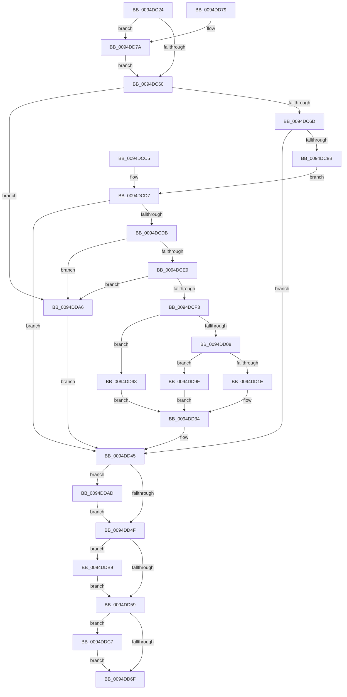

# PiSwIrpInterfaceSetState

- RVA: `0x0094DC24`–`0x0094DDE6` (길이 `450` bytes)
- VA: `0x000000014094DC24`
- 실행 섹션: `PAGE`
- PDB 이름 있음: `예`; PDB Function 태그: `아니요`
- unwind 정보 RVA: `0x00091980`
- 디코드: `108`개 명령, `450/450` bytes 표시
- 미해석 바이트: `0` (있으면 어셈블리에 `.byte`로 보존)

> 이 문서는 커널 이미지의 기계어와 PDB 기호를 분석해 생성했습니다. 4번과 5번은 함수 원형과 자료형을 바이너리 사용 방식에서 추정한 C 해석이며 원본 소스 복구 결과는 아닙니다.

## 1. Dependencies

- 직접 호출 지점: **13**; 고유 호출 대상: **13**
- 직접 호출자로 확인된 함수: **1**
- RIP 상대 이미지 참조: **10**

### Outgoing calls
- `0x0094DC75` → `msrpc.sys!MesDecodeBufferHandleCreate` (import, 간접 대상; import `msrpc.sys!MesDecodeBufferHandleCreate`)
- `0x0094DCB7` → `msrpc.sys!NdrMesTypeDecode3` (import, 간접 대상; import `msrpc.sys!NdrMesTypeDecode3`)
- `0x0094DCF3` → [PiSwLock](../8F/PiSwLock_function_008F7D50.md) (function, `0x008F7D50`)
- `0x0094DCFB` → [PiSwDeviceOperationsAllowed](../8F/PiSwDeviceOperationsAllowed_function_008F8EF4.md) (function, `0x008F8EF4`)
- `0x0094DD10` → [PiSwDeviceFindInterfaceEntry](PiSwDeviceFindInterfaceEntry_function_0094F498.md) (function, `0x0094F498`)
- `0x0094DD2D` → [PiSwDeviceInterfaceSetState](PiSwDeviceInterfaceSetState_function_0094ED48.md) (function, `0x0094ED48`)
- `0x0094DD3B` → [ExReleaseResourceLite](../../text/25/ExReleaseResourceLite_function_0025FA10.md) (function, `0x0025FA10`)
- `0x0094DD40` → [KeLeaveCriticalRegion](../../text/25/KeLeaveCriticalRegion_function_0025D8B0.md) (function, `0x0025D8B0`)
- `0x0094DD61` → [IofCompleteRequest](../../text/29/IofCompleteRequest_function_0029B5C0.md) (function, `0x0029B5C0`)
- `0x0094DD8E` → [McTemplateK0zz_EtwWriteTransfer](../../text/5A/McTemplateK0zz_EtwWriteTransfer_function_005A9408.md) (function, `0x005A9408`)
- `0x0094DDB2` → [ExFreePoolWithTag](../../poolcode/B8/ExFreePoolWithTag_function_00B82870.md) (function, `0x00B82870`)
- `0x0094DDB9` → `msrpc.sys!MesHandleFree` (import, 간접 대상; import `msrpc.sys!MesHandleFree`)
- `0x0094DDDF` → [McTemplateK0zzd_EtwWriteTransfer](../../text/42/McTemplateK0zzd_EtwWriteTransfer_function_00424414.md) (function, `0x00424414`)

### Direct callers
- [PiSwDispatch](../73/PiSwDispatch_function_0073AA90.md) at `0x0073AB5C`

### Static image references
- `0x0094DC53` → RVA `0x00EF012C` (`.data`; read)
- `0x0094DC75` → RVA `0x00151700` (`msrpc.sys!MesDecodeBufferHandleCreate (IAT)`; read)
- `0x0094DC9D` → RVA `0x00E07010` (`.data`; read)
- `0x0094DCA4` → RVA `0x00B4B210` (`PAGE`; read)
- `0x0094DCAB` → RVA `0x00B4B1A0` (`PAGE`; read)
- `0x0094DCB7` → RVA `0x001516F8` (`msrpc.sys!NdrMesTypeDecode3 (IAT)`; read)
- `0x0094DD34` → RVA `0x00F8AB20` (`.data`; read)
- `0x0094DD87` → RVA `0x00027728` (`.rdata`; read)
- `0x0094DDB9` → RVA `0x001516E0` (`msrpc.sys!MesHandleFree (IAT)`; read)
- `0x0094DDD8` → RVA `0x00026F10` (`.rdata`; read)

## 2. Other-region calls and transfers

- 다른 실행 섹션으로 향하는 call: **6**
  - `0x0094DD3B` → [ExReleaseResourceLite](../../text/25/ExReleaseResourceLite_function_0025FA10.md) (`PAGE` → `.text`)
  - `0x0094DD40` → [KeLeaveCriticalRegion](../../text/25/KeLeaveCriticalRegion_function_0025D8B0.md) (`PAGE` → `.text`)
  - `0x0094DD61` → [IofCompleteRequest](../../text/29/IofCompleteRequest_function_0029B5C0.md) (`PAGE` → `.text`)
  - `0x0094DD8E` → [McTemplateK0zz_EtwWriteTransfer](../../text/5A/McTemplateK0zz_EtwWriteTransfer_function_005A9408.md) (`PAGE` → `.text`)
  - `0x0094DDB2` → [ExFreePoolWithTag](../../poolcode/B8/ExFreePoolWithTag_function_00B82870.md) (`PAGE` → `POOLCODE`)
  - `0x0094DDDF` → [McTemplateK0zzd_EtwWriteTransfer](../../text/42/McTemplateK0zzd_EtwWriteTransfer_function_00424414.md) (`PAGE` → `.text`)
- 별도 외부 분기/꼬리 이동을 확인하지 못했습니다.

## 3. Assembly (complete function range)

```asm
0094DC24  48 89 4C 24 08                  mov qword ptr [rsp + 8], rcx
0094DC29  53                              push rbx
0094DC2A  56                              push rsi
0094DC2B  57                              push rdi
0094DC2C  48 83 EC 30                     sub rsp, 0x30
0094DC30  48 8B F1                        mov rsi, rcx
0094DC33  48 8B 99 B8 00 00 00            mov rbx, qword ptr [rcx + 0xb8]
0094DC3A  48 8B 43 30                     mov rax, qword ptr [rbx + 0x30]
0094DC3E  48 8B 78 20                     mov rdi, qword ptr [rax + 0x20]
0094DC42  48 89 7C 24 68                  mov qword ptr [rsp + 0x68], rdi
0094DC47  48 83 64 24 60 00               and qword ptr [rsp + 0x60], 0
0094DC4D  48 83 64 24 58 00               and qword ptr [rsp + 0x58], 0
0094DC53  F6 05 D2 24 5A 00 40            test byte ptr [rip + 0x5a24d2], 0x40
0094DC5A  0F 85 1A 01 00 00               jne 0x14094dd7a
0094DC60  48 8B 4E 18                     mov rcx, qword ptr [rsi + 0x18]
0094DC64  48 85 C9                        test rcx, rcx
0094DC67  0F 84 39 01 00 00               je 0x14094dda6
0094DC6D  4C 8D 44 24 60                  lea r8, [rsp + 0x60]
0094DC72  8B 53 10                        mov edx, dword ptr [rbx + 0x10]
0094DC75  48 FF 15 84 3A 80 FF            call qword ptr [rip - 0x7fc57c]
0094DC7C  0F 1F 44 00 00                  nop dword ptr [rax + rax]
0094DC81  8B D8                           mov ebx, eax
0094DC83  85 C0                           test eax, eax
0094DC85  0F 88 BA 00 00 00               js 0x14094dd45
0094DC8B  48 8D 44 24 58                  lea rax, [rsp + 0x58]
0094DC90  48 89 44 24 28                  mov qword ptr [rsp + 0x28], rax
0094DC95  C7 44 24 20 03 00 00 00         mov dword ptr [rsp + 0x20], 3
0094DC9D  4C 8D 0D 6C 93 4B 00            lea r9, [rip + 0x4b936c]
0094DCA4  4C 8D 05 65 D5 1F 00            lea r8, [rip + 0x1fd565]
0094DCAB  48 8D 15 EE D4 1F 00            lea rdx, [rip + 0x1fd4ee]
0094DCB2  48 8B 4C 24 60                  mov rcx, qword ptr [rsp + 0x60]
0094DCB7  48 FF 15 3A 3A 80 FF            call qword ptr [rip - 0x7fc5c6]
0094DCBE  0F 1F 44 00 00                  nop dword ptr [rax + rax]
0094DCC3  EB 12                           jmp 0x14094dcd7
0094DCC5  8B D8                           mov ebx, eax
0094DCC7  48 83 64 24 58 00               and qword ptr [rsp + 0x58], 0
0094DCCD  48 8B 74 24 50                  mov rsi, qword ptr [rsp + 0x50]
0094DCD2  48 8B 7C 24 68                  mov rdi, qword ptr [rsp + 0x68]
0094DCD7  85 DB                           test ebx, ebx
0094DCD9  78 6A                           js 0x14094dd45
0094DCDB  48 8B 4C 24 58                  mov rcx, qword ptr [rsp + 0x58]
0094DCE0  48 85 C9                        test rcx, rcx
0094DCE3  0F 84 BD 00 00 00               je 0x14094dda6
0094DCE9  48 83 39 00                     cmp qword ptr [rcx], 0
0094DCED  0F 84 B3 00 00 00               je 0x14094dda6
0094DCF3  E8 58 A0 FA FF                  call 0x1408f7d50
0094DCF8  48 8B CF                        mov rcx, rdi
0094DCFB  E8 F4 B1 FA FF                  call 0x1408f8ef4
0094DD00  84 C0                           test al, al
0094DD02  0F 84 90 00 00 00               je 0x14094dd98
0094DD08  48 8B 54 24 58                  mov rdx, qword ptr [rsp + 0x58]
0094DD0D  48 8B 12                        mov rdx, qword ptr [rdx]
0094DD10  E8 83 17 00 00                  call 0x14094f498
0094DD15  48 85 C0                        test rax, rax
0094DD18  0F 84 81 00 00 00               je 0x14094dd9f
0094DD1E  4C 8B 44 24 58                  mov r8, qword ptr [rsp + 0x58]
0094DD23  45 8A 40 08                     mov r8b, byte ptr [r8 + 8]
0094DD27  48 8B D0                        mov rdx, rax
0094DD2A  48 8B CF                        mov rcx, rdi
0094DD2D  E8 16 10 00 00                  call 0x14094ed48
0094DD32  8B D8                           mov ebx, eax
0094DD34  48 8D 0D E5 CD 63 00            lea rcx, [rip + 0x63cde5]
0094DD3B  E8 D0 1C 91 FF                  call 0x14025fa10
0094DD40  E8 6B FB 90 FF                  call 0x14025d8b0
0094DD45  48 8B 4C 24 58                  mov rcx, qword ptr [rsp + 0x58]
0094DD4A  48 85 C9                        test rcx, rcx
0094DD4D  75 5E                           jne 0x14094ddad
0094DD4F  48 8B 4C 24 60                  mov rcx, qword ptr [rsp + 0x60]
0094DD54  48 85 C9                        test rcx, rcx
0094DD57  75 60                           jne 0x14094ddb9
0094DD59  89 5E 30                        mov dword ptr [rsi + 0x30], ebx
0094DD5C  33 D2                           xor edx, edx
0094DD5E  48 8B CE                        mov rcx, rsi
0094DD61  E8 5A D8 94 FF                  call 0x14029b5c0
0094DD66  F6 05 BF 23 5A 00 40            test byte ptr [rip + 0x5a23bf], 0x40
0094DD6D  75 58                           jne 0x14094ddc7
0094DD6F  8B C3                           mov eax, ebx
0094DD71  48 83 C4 30                     add rsp, 0x30
0094DD75  5F                              pop rdi
0094DD76  5E                              pop rsi
0094DD77  5B                              pop rbx
0094DD78  C3                              ret
0094DD79  CC                              int3
0094DD7A  48 8B 47 10                     mov rax, qword ptr [rdi + 0x10]
0094DD7E  48 89 44 24 20                  mov qword ptr [rsp + 0x20], rax
0094DD83  4C 8B 4F 08                     mov r9, qword ptr [rdi + 8]
0094DD87  48 8D 15 9A 99 6D FF            lea rdx, [rip - 0x926666]
0094DD8E  E8 75 B6 C5 FF                  call 0x1405a9408
0094DD93  E9 C8 FE FF FF                  jmp 0x14094dc60
0094DD98  BB BB 00 00 C0                  mov ebx, 0xc00000bb
0094DD9D  EB 95                           jmp 0x14094dd34
0094DD9F  BB 25 02 00 C0                  mov ebx, 0xc0000225
0094DDA4  EB 8E                           jmp 0x14094dd34
0094DDA6  BB 0D 00 00 C0                  mov ebx, 0xc000000d
0094DDAB  EB 98                           jmp 0x14094dd45
0094DDAD  BA 6B 72 70 63                  mov edx, 0x6370726b
0094DDB2  E8 B9 4A 23 00                  call 0x140b82870
0094DDB7  EB 96                           jmp 0x14094dd4f
0094DDB9  48 FF 15 20 39 80 FF            call qword ptr [rip - 0x7fc6e0]
0094DDC0  0F 1F 44 00 00                  nop dword ptr [rax + rax]
0094DDC5  EB 92                           jmp 0x14094dd59
0094DDC7  89 5C 24 28                     mov dword ptr [rsp + 0x28], ebx
0094DDCB  48 8B 47 10                     mov rax, qword ptr [rdi + 0x10]
0094DDCF  48 89 44 24 20                  mov qword ptr [rsp + 0x20], rax
0094DDD4  4C 8B 4F 08                     mov r9, qword ptr [rdi + 8]
0094DDD8  48 8D 15 31 91 6D FF            lea rdx, [rip - 0x926ecf]
0094DDDF  E8 30 66 AD FF                  call 0x140424414
0094DDE4  EB 89                           jmp 0x14094dd6f
```

## 4. C-style interpretation (structured pseudocode)

```c
__int64 __fastcall PiSwIrpInterfaceSetState(__int64 a1)
{
    __int64 result;
    __int64 v_rsp;
    unsigned __int64 v_stack_m20;
    unsigned int v_stack_m28;
    unsigned __int64 v_stack_p10;
    unsigned __int64 v_stack_p18;
    unsigned __int64 v_stack_p20;
    unsigned int v_stack_p28;
    unsigned __int64 v_stack_p8;

    v_stack_p8 = a1;
    v_rsp = (v_rsp) - (48);
    v_stack_p20 = *(unsigned __int64 *)(*(unsigned __int64 *)(*(unsigned __int64 *)(a1 + 184) + 48) + 32);
    if (((*(unsigned __int8 *)(v_rip + 5907666)) & (64)) != 0) goto loc_0094DD7A;
loc_0094DC60:
    if (*(unsigned __int64 *)(a1 + 24) == 0) goto loc_0094DDA6;
    result = msrpc_sys_MesDecodeBufferHandleCreate(*(unsigned __int64 *)(a1 + 24), (unsigned int)(*(unsigned int *)(*(unsigned __int64 *)(a1 + 184) + 16)), v_stack_p18, a4);
    if (sign_flag) goto loc_0094DD45;
    v_stack_m20 = v_stack_p10;
    v_stack_m28 = 3;
    result = msrpc_sys_NdrMesTypeDecode3(v_stack_p18, v_rip + 2086126, v_rip + 2086245, v_rip + 4952940);
    goto loc_0094DCD7;
loc_0094DCD7:
    if (sign_flag) goto loc_0094DD45;
    if (v_stack_p10 == 0) goto loc_0094DDA6;
    if ((*(unsigned __int64 *)(v_stack_p10)) == 0) goto loc_0094DDA6;
    result = PiSwLock(v_stack_p10, v_rip + 2086126, v_rip + 2086245, v_rip + 4952940);
    result = PiSwDeviceOperationsAllowed(*(unsigned __int64 *)(*(unsigned __int64 *)(*(unsigned __int64 *)(a1 + 184) + 48) + 32), v_rip + 2086126, v_rip + 2086245, v_rip + 4952940);
    if ((unsigned __int8)(result) == 0) goto loc_0094DD98;
    result = PiSwDeviceFindInterfaceEntry(*(unsigned __int64 *)(*(unsigned __int64 *)(*(unsigned __int64 *)(a1 + 184) + 48) + 32), *(unsigned __int64 *)(v_stack_p10), v_rip + 2086245, v_rip + 4952940);
    if (result == 0) goto loc_0094DD9F;
    result = PiSwDeviceInterfaceSetState(*(unsigned __int64 *)(*(unsigned __int64 *)(*(unsigned __int64 *)(a1 + 184) + 48) + 32), result, *(unsigned __int8 *)(v_stack_p10 + 8), v_rip + 4952940);
loc_0094DD34:
    result = ExReleaseResourceLite(v_rip + 6540773, result, *(unsigned __int8 *)(v_stack_p10 + 8), v_rip + 4952940);
    result = KeLeaveCriticalRegion(v_rip + 6540773, result, *(unsigned __int8 *)(v_stack_p10 + 8), v_rip + 4952940);
loc_0094DD45:
    if (v_stack_p10 != 0) goto loc_0094DDAD;
loc_0094DD4F:
    if (v_stack_p18 != 0) goto loc_0094DDB9;
loc_0094DD59:
    *(unsigned int *)(a1 + 48) = (unsigned int)((unsigned int)((unsigned int)(result)));
    a2 = 0;
    result = IofCompleteRequest(a1, a2, *(unsigned __int8 *)(v_stack_p10 + 8), v_rip + 4952940);
    if (((*(unsigned __int8 *)(v_rip + 5907391)) & (64)) != 0) goto loc_0094DDC7;
loc_0094DD6F:
    v_rsp = (v_rsp) + (48);
    return (unsigned int)((unsigned int)((unsigned int)((unsigned int)(result))));
loc_0094DD7A:
    v_stack_p20 = *(unsigned __int64 *)(*(unsigned __int64 *)(*(unsigned __int64 *)(*(unsigned __int64 *)(a1 + 184) + 48) + 32) + 16);
    result = McTemplateK0zz_EtwWriteTransfer(a1, v_rip - 9594470, *(unsigned __int8 *)(v_stack_p10 + 8), *(unsigned __int64 *)(*(unsigned __int64 *)(*(unsigned __int64 *)(*(unsigned __int64 *)(a1 + 184) + 48) + 32) + 8));
    goto loc_0094DC60;
loc_0094DD98:
    goto loc_0094DD34;
loc_0094DD9F:
    goto loc_0094DD34;
loc_0094DDA6:
    goto loc_0094DD45;
loc_0094DDAD:
    result = ExFreePoolWithTag(a1, (unsigned int)(0x6370726BULL), *(unsigned __int8 *)(v_stack_p10 + 8), *(unsigned __int64 *)(*(unsigned __int64 *)(*(unsigned __int64 *)(*(unsigned __int64 *)(a1 + 184) + 48) + 32) + 8));
    goto loc_0094DD4F;
loc_0094DDB9:
    result = msrpc_sys_MesHandleFree(a1, (unsigned int)(0x6370726BULL), *(unsigned __int8 *)(v_stack_p10 + 8), *(unsigned __int64 *)(*(unsigned __int64 *)(*(unsigned __int64 *)(*(unsigned __int64 *)(a1 + 184) + 48) + 32) + 8));
    goto loc_0094DD59;
loc_0094DDC7:
    v_stack_p28 = (unsigned int)((unsigned int)(0xC000000DULL));
    v_stack_p20 = *(unsigned __int64 *)(*(unsigned __int64 *)(*(unsigned __int64 *)(*(unsigned __int64 *)(a1 + 184) + 48) + 32) + 16);
    result = McTemplateK0zzd_EtwWriteTransfer(a1, v_rip - 9596623, *(unsigned __int8 *)(v_stack_p10 + 8), *(unsigned __int64 *)(*(unsigned __int64 *)(*(unsigned __int64 *)(*(unsigned __int64 *)(a1 + 184) + 48) + 32) + 8));
    goto loc_0094DD6F;
}
```

## 5. (Beta) C Style

```c
int64_t PiSwIrpInterfaceSetState(void *Arg1)
{
    uint8_t *arg1 = (uint8_t *)Arg1;

    int64_t result;
    int64_t local_rsp;
    uint64_t v_stack_m20;
    uint32_t v_stack_m28;
    uint64_t v_stack_p10;
    uint64_t v_stack_p18;
    uint64_t v_stack_p20;
    uint32_t v_stack_p28;
    uint64_t v_stack_p8;

    v_stack_p8 = Arg1;
    local_rsp = (local_rsp) - (48);
    v_stack_p20 = *(uint64_t *)(*(uint64_t *)(*(uint64_t *)(arg1 + 0xB8) + 0x30) + 0x20);
    if (((*(uint8_t *)(v_rip + 0x5A24D2)) & (64)) != 0) goto loc_0094DD7A;
loc_0094DC60:
    if (*(uint64_t *)(arg1 + 0x18) == 0) goto loc_0094DDA6;
    result = kernel_indirect_call(*(uint64_t *)(arg1 + 0x18), (uint32_t)(*(uint32_t *)(*(uint64_t *)(arg1 + 0xB8) + 0x10)), v_stack_p18, a4);
    if (sign_flag) goto loc_0094DD45;
    v_stack_m20 = v_stack_p10;
    v_stack_m28 = 3;
    result = kernel_indirect_call(v_stack_p18, v_rip + 2086126, v_rip + 2086245, v_rip + 4952940);
    goto loc_0094DCD7;
loc_0094DCD7:
    if (sign_flag) goto loc_0094DD45;
    if (v_stack_p10 == 0) goto loc_0094DDA6;
    if ((*(uint64_t *)(v_stack_p10)) == 0) goto loc_0094DDA6;
    result = PiSwLock(v_stack_p10, v_rip + 2086126, v_rip + 2086245, v_rip + 4952940);
    result = PiSwDeviceOperationsAllowed(*(uint64_t *)(*(uint64_t *)(*(uint64_t *)(arg1 + 0xB8) + 0x30) + 0x20), v_rip + 2086126, v_rip + 2086245, v_rip + 4952940);
    if ((uint8_t)(result) == 0) goto loc_0094DD98;
    result = PiSwDeviceFindInterfaceEntry(*(uint64_t *)(*(uint64_t *)(*(uint64_t *)(arg1 + 0xB8) + 0x30) + 0x20), *(uint64_t *)(v_stack_p10), v_rip + 2086245, v_rip + 4952940);
    if (result == 0) goto loc_0094DD9F;
    result = PiSwDeviceInterfaceSetState(*(uint64_t *)(*(uint64_t *)(*(uint64_t *)(arg1 + 0xB8) + 0x30) + 0x20), result, *(uint8_t *)(v_stack_p10 + 0x8), v_rip + 4952940);
loc_0094DD34:
    result = ExReleaseResourceLite(v_rip + 6540773, result, *(uint8_t *)(v_stack_p10 + 0x8), v_rip + 4952940);
    result = KeLeaveCriticalRegion(v_rip + 6540773, result, *(uint8_t *)(v_stack_p10 + 0x8), v_rip + 4952940);
loc_0094DD45:
    if (v_stack_p10 != 0) goto loc_0094DDAD;
loc_0094DD4F:
    if (v_stack_p18 != 0) goto loc_0094DDB9;
loc_0094DD59:
    *(uint32_t *)(arg1 + 0x30) = (uint32_t)((uint32_t)((uint32_t)(result)));
    a2 = 0;
    result = IofCompleteRequest(Arg1, a2, *(uint8_t *)(v_stack_p10 + 0x8), v_rip + 4952940);
    if (((*(uint8_t *)(v_rip + 0x5A23BF)) & (64)) != 0) goto loc_0094DDC7;
loc_0094DD6F:
    local_rsp = (local_rsp) + (48);
    return (uint32_t)((uint32_t)((uint32_t)((uint32_t)(result))));
loc_0094DD7A:
    v_stack_p20 = *(uint64_t *)(*(uint64_t *)(*(uint64_t *)(*(uint64_t *)(arg1 + 0xB8) + 0x30) + 0x20) + 0x10);
    result = McTemplateK0zz_EtwWriteTransfer(Arg1, v_rip - 9594470, *(uint8_t *)(v_stack_p10 + 0x8), *(uint64_t *)(*(uint64_t *)(*(uint64_t *)(*(uint64_t *)(arg1 + 0xB8) + 0x30) + 0x20) + 0x8));
    goto loc_0094DC60;
loc_0094DD98:
    goto loc_0094DD34;
loc_0094DD9F:
    goto loc_0094DD34;
loc_0094DDA6:
    goto loc_0094DD45;
loc_0094DDAD:
    result = ExFreePoolWithTag(Arg1, (uint32_t)(0x6370726BULL), *(uint8_t *)(v_stack_p10 + 0x8), *(uint64_t *)(*(uint64_t *)(*(uint64_t *)(*(uint64_t *)(arg1 + 0xB8) + 0x30) + 0x20) + 0x8));
    goto loc_0094DD4F;
loc_0094DDB9:
    result = kernel_indirect_call(Arg1, (uint32_t)(0x6370726BULL), *(uint8_t *)(v_stack_p10 + 0x8), *(uint64_t *)(*(uint64_t *)(*(uint64_t *)(*(uint64_t *)(arg1 + 0xB8) + 0x30) + 0x20) + 0x8));
    goto loc_0094DD59;
loc_0094DDC7:
    v_stack_p28 = (uint32_t)((uint32_t)(0xC000000DULL));
    v_stack_p20 = *(uint64_t *)(*(uint64_t *)(*(uint64_t *)(*(uint64_t *)(arg1 + 0xB8) + 0x30) + 0x20) + 0x10);
    result = McTemplateK0zzd_EtwWriteTransfer(Arg1, v_rip - 9596623, *(uint8_t *)(v_stack_p10 + 0x8), *(uint64_t *)(*(uint64_t *)(*(uint64_t *)(*(uint64_t *)(arg1 + 0xB8) + 0x30) + 0x20) + 0x8));
    goto loc_0094DD6F;
}
```

### 관측된 메모리 오프셋

구조체 형식이 확인되지 않은 접근은 인자 기준의 오프셋으로만 기록했습니다.

| 기준 인자 | 오프셋 표현 | 폭 (bit) | 접근 |
|---|---:|---:|---|
| `Arg1` | `+ 0x18` | `64` | `R` |
| `Arg1` | `+ 0x30` | `32` | `W` |
| `Arg1` | `+ 0xB8` | `64` | `R` |

## 6. Execution-region graph

[열기: 2D/3D 그래프와 함수 탐색 컨트롤 패널](../../../control-panel.html?section=page&rva=0x0094DC24&view=graph)

- 2D 그래프는 위에서 아래로 흐르고, 3D 그래프는 빈 공간을 드래그해 회전합니다. Shift+드래그는 이동, 휠은 확대·축소, 함수 노드 선택은 대상 보고서 이동입니다.

### Static fallback


