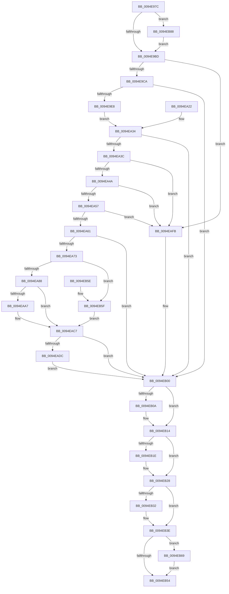

# PiSwIrpPropertySet

- RVA: `0x0094E97C`–`0x0094EBA6` (길이 `554` bytes)
- VA: `0x000000014094E97C`
- 실행 섹션: `PAGE`
- PDB 이름 있음: `예`; PDB Function 태그: `아니요`
- unwind 정보 RVA: `0x00091A6C`
- 디코드: `133`개 명령, `554/554` bytes 표시
- 미해석 바이트: `0` (있으면 어셈블리에 `.byte`로 보존)

> 이 문서는 커널 이미지의 기계어와 PDB 기호를 분석해 생성했습니다. 4번과 5번은 함수 원형과 자료형을 바이너리 사용 방식에서 추정한 C 해석이며 원본 소스 복구 결과는 아닙니다.

## 1. Dependencies

- 직접 호출 지점: **16**; 고유 호출 대상: **15**
- 직접 호출자로 확인된 함수: **1**
- RIP 상대 이미지 참조: **10**

### Outgoing calls
- `0x0094E9D2` → `msrpc.sys!MesDecodeBufferHandleCreate` (import, 간접 대상; import `msrpc.sys!MesDecodeBufferHandleCreate`)
- `0x0094EA14` → `msrpc.sys!NdrMesTypeDecode3` (import, 간접 대상; import `msrpc.sys!NdrMesTypeDecode3`)
- `0x0094EA64` → [PiSwValidatePropertyArray](../8F/PiSwValidatePropertyArray_function_008F75F4.md) (function, `0x008F75F4`)
- `0x0094EA73` → [PiSwLock](../8F/PiSwLock_function_008F7D50.md) (function, `0x008F7D50`)
- `0x0094EA7B` → [PiSwDeviceOperationsAllowed](../8F/PiSwDeviceOperationsAllowed_function_008F8EF4.md) (function, `0x008F8EF4`)
- `0x0094EA9C` → [PnpAllocatePWSTR](../8D/PnpAllocatePWSTR_function_008DE620.md) (function, `0x008DE620`)
- `0x0094EAC0` → [PiSwUpdateArrayProperties](PiSwUpdateArrayProperties_function_0094EBAC.md) (function, `0x0094EBAC`)
- `0x0094EACE` → [ExReleaseResourceLite](../../text/25/ExReleaseResourceLite_function_0025FA10.md) (function, `0x0025FA10`)
- `0x0094EAD3` → [KeLeaveCriticalRegion](../../text/25/KeLeaveCriticalRegion_function_0025D8B0.md) (function, `0x0025D8B0`)
- `0x0094EAF2` → [PiSwPropertySet](../8F/PiSwPropertySet_function_008F5EEC.md) (function, `0x008F5EEC`)
- `0x0094EB0F` → [ExFreePoolWithTag](../../poolcode/B8/ExFreePoolWithTag_function_00B82870.md) (function, `0x00B82870`)
- `0x0094EB23` → [ExFreePoolWithTag](../../poolcode/B8/ExFreePoolWithTag_function_00B82870.md) (function, `0x00B82870`)
- `0x0094EB32` → `msrpc.sys!MesHandleFree` (import, 간접 대상; import `msrpc.sys!MesHandleFree`)
- `0x0094EB46` → [IofCompleteRequest](../../text/29/IofCompleteRequest_function_0029B5C0.md) (function, `0x0029B5C0`)
- `0x0094EB81` → [McTemplateK0zzd_EtwWriteTransfer](../../text/42/McTemplateK0zzd_EtwWriteTransfer_function_00424414.md) (function, `0x00424414`)
- `0x0094EB9C` → [McTemplateK0zz_EtwWriteTransfer](../../text/5A/McTemplateK0zz_EtwWriteTransfer_function_005A9408.md) (function, `0x005A9408`)

### Direct callers
- [PiSwDispatch](../73/PiSwDispatch_function_0073AA90.md) at `0x0073AB70`

### Static image references
- `0x0094E9B0` → RVA `0x00EF012C` (`.data`; read)
- `0x0094E9D2` → RVA `0x00151700` (`msrpc.sys!MesDecodeBufferHandleCreate (IAT)`; read)
- `0x0094E9FA` → RVA `0x00E07010` (`.data`; read)
- `0x0094EA01` → RVA `0x00B4B210` (`PAGE`; read)
- `0x0094EA08` → RVA `0x00B4B1A0` (`PAGE`; read)
- `0x0094EA14` → RVA `0x001516F8` (`msrpc.sys!NdrMesTypeDecode3 (IAT)`; read)
- `0x0094EAC7` → RVA `0x00F8AB20` (`.data`; read)
- `0x0094EB32` → RVA `0x001516E0` (`msrpc.sys!MesHandleFree (IAT)`; read)
- `0x0094EB7A` → RVA `0x00012340` (`.rdata`; read)
- `0x0094EB95` → RVA `0x00027010` (`.rdata`; read)

## 2. Other-region calls and transfers

- 다른 실행 섹션으로 향하는 call: **7**
  - `0x0094EACE` → [ExReleaseResourceLite](../../text/25/ExReleaseResourceLite_function_0025FA10.md) (`PAGE` → `.text`)
  - `0x0094EAD3` → [KeLeaveCriticalRegion](../../text/25/KeLeaveCriticalRegion_function_0025D8B0.md) (`PAGE` → `.text`)
  - `0x0094EB0F` → [ExFreePoolWithTag](../../poolcode/B8/ExFreePoolWithTag_function_00B82870.md) (`PAGE` → `POOLCODE`)
  - `0x0094EB23` → [ExFreePoolWithTag](../../poolcode/B8/ExFreePoolWithTag_function_00B82870.md) (`PAGE` → `POOLCODE`)
  - `0x0094EB46` → [IofCompleteRequest](../../text/29/IofCompleteRequest_function_0029B5C0.md) (`PAGE` → `.text`)
  - `0x0094EB81` → [McTemplateK0zzd_EtwWriteTransfer](../../text/42/McTemplateK0zzd_EtwWriteTransfer_function_00424414.md) (`PAGE` → `.text`)
  - `0x0094EB9C` → [McTemplateK0zz_EtwWriteTransfer](../../text/5A/McTemplateK0zz_EtwWriteTransfer_function_005A9408.md) (`PAGE` → `.text`)
- 별도 외부 분기/꼬리 이동을 확인하지 못했습니다.

## 3. Assembly (complete function range)

```asm
0094E97C  4C 8B DC                        mov r11, rsp
0094E97F  49 89 4B 08                     mov qword ptr [r11 + 8], rcx
0094E983  53                              push rbx
0094E984  56                              push rsi
0094E985  57                              push rdi
0094E986  48 83 EC 40                     sub rsp, 0x40
0094E98A  48 8B F1                        mov rsi, rcx
0094E98D  48 8B 99 B8 00 00 00            mov rbx, qword ptr [rcx + 0xb8]
0094E994  48 8B 43 30                     mov rax, qword ptr [rbx + 0x30]
0094E998  48 8B 78 20                     mov rdi, qword ptr [rax + 0x20]
0094E99C  48 89 7C 24 30                  mov qword ptr [rsp + 0x30], rdi
0094E9A1  49 83 63 20 00                  and qword ptr [r11 + 0x20], 0
0094E9A6  49 83 63 10 00                  and qword ptr [r11 + 0x10], 0
0094E9AB  49 83 63 18 00                  and qword ptr [r11 + 0x18], 0
0094E9B0  F6 05 75 17 5A 00 40            test byte ptr [rip + 0x5a1775], 0x40
0094E9B7  0F 85 CB 01 00 00               jne 0x14094eb88
0094E9BD  48 8B 4E 18                     mov rcx, qword ptr [rsi + 0x18]
0094E9C1  48 85 C9                        test rcx, rcx
0094E9C4  0F 84 31 01 00 00               je 0x14094eafb
0094E9CA  4C 8D 44 24 78                  lea r8, [rsp + 0x78]
0094E9CF  8B 53 10                        mov edx, dword ptr [rbx + 0x10]
0094E9D2  48 FF 15 27 2D 80 FF            call qword ptr [rip - 0x7fd2d9]
0094E9D9  0F 1F 44 00 00                  nop dword ptr [rax + rax]
0094E9DE  8B D8                           mov ebx, eax
0094E9E0  85 C0                           test eax, eax
0094E9E2  0F 88 18 01 00 00               js 0x14094eb00
0094E9E8  48 8D 44 24 68                  lea rax, [rsp + 0x68]
0094E9ED  48 89 44 24 28                  mov qword ptr [rsp + 0x28], rax
0094E9F2  C7 44 24 20 01 00 00 00         mov dword ptr [rsp + 0x20], 1
0094E9FA  4C 8D 0D 0F 86 4B 00            lea r9, [rip + 0x4b860f]
0094EA01  4C 8D 05 08 C8 1F 00            lea r8, [rip + 0x1fc808]
0094EA08  48 8D 15 91 C7 1F 00            lea rdx, [rip + 0x1fc791]
0094EA0F  48 8B 4C 24 78                  mov rcx, qword ptr [rsp + 0x78]
0094EA14  48 FF 15 DD 2C 80 FF            call qword ptr [rip - 0x7fd323]
0094EA1B  0F 1F 44 00 00                  nop dword ptr [rax + rax]
0094EA20  EB 12                           jmp 0x14094ea34
0094EA22  8B D8                           mov ebx, eax
0094EA24  48 83 64 24 68 00               and qword ptr [rsp + 0x68], 0
0094EA2A  48 8B 74 24 60                  mov rsi, qword ptr [rsp + 0x60]
0094EA2F  48 8B 7C 24 30                  mov rdi, qword ptr [rsp + 0x30]
0094EA34  85 DB                           test ebx, ebx
0094EA36  0F 88 C4 00 00 00               js 0x14094eb00
0094EA3C  48 8B 4C 24 68                  mov rcx, qword ptr [rsp + 0x68]
0094EA41  48 85 C9                        test rcx, rcx
0094EA44  0F 84 B1 00 00 00               je 0x14094eafb
0094EA4A  48 8B 41 08                     mov rax, qword ptr [rcx + 8]
0094EA4E  48 85 C0                        test rax, rax
0094EA51  0F 84 A4 00 00 00               je 0x14094eafb
0094EA57  8B 11                           mov edx, dword ptr [rcx]
0094EA59  85 D2                           test edx, edx
0094EA5B  0F 84 9A 00 00 00               je 0x14094eafb
0094EA61  48 8B C8                        mov rcx, rax
0094EA64  E8 8B 8B FA FF                  call 0x1408f75f4
0094EA69  8B D8                           mov ebx, eax
0094EA6B  85 C0                           test eax, eax
0094EA6D  0F 88 8D 00 00 00               js 0x14094eb00
0094EA73  E8 D8 92 FA FF                  call 0x1408f7d50
0094EA78  48 8B CF                        mov rcx, rdi
0094EA7B  E8 74 A4 FA FF                  call 0x1408f8ef4
0094EA80  84 C0                           test al, al
0094EA82  0F 84 D7 00 00 00               je 0x14094eb5f
0094EA88  4C 8D 4C 24 70                  lea r9, [rsp + 0x70]
0094EA8D  BA C8 00 00 00                  mov edx, 0xc8
0094EA92  41 B8 50 6E 70 57               mov r8d, 0x57706e50
0094EA98  48 8B 4F 50                     mov rcx, qword ptr [rdi + 0x50]
0094EA9C  E8 7F FB F8 FF                  call 0x1408de620
0094EAA1  8B D8                           mov ebx, eax
0094EAA3  85 C0                           test eax, eax
0094EAA5  78 20                           js 0x14094eac7
0094EAA7  4C 8B 44 24 68                  mov r8, qword ptr [rsp + 0x68]
0094EAAC  45 8B 08                        mov r9d, dword ptr [r8]
0094EAAF  4D 8B 40 08                     mov r8, qword ptr [r8 + 8]
0094EAB3  8B 97 B0 00 00 00               mov edx, dword ptr [rdi + 0xb0]
0094EAB9  48 8B 8F A8 00 00 00            mov rcx, qword ptr [rdi + 0xa8]
0094EAC0  E8 E7 00 00 00                  call 0x14094ebac
0094EAC5  8B D8                           mov ebx, eax
0094EAC7  48 8D 0D 52 C0 63 00            lea rcx, [rip + 0x63c052]
0094EACE  E8 3D 0F 91 FF                  call 0x14025fa10
0094EAD3  E8 D8 ED 90 FF                  call 0x14025d8b0
0094EAD8  85 DB                           test ebx, ebx
0094EADA  78 24                           js 0x14094eb00
0094EADC  4C 8B 44 24 68                  mov r8, qword ptr [rsp + 0x68]
0094EAE1  45 8B 08                        mov r9d, dword ptr [r8]
0094EAE4  4D 8B 40 08                     mov r8, qword ptr [r8 + 8]
0094EAE8  BA 01 00 00 00                  mov edx, 1
0094EAED  48 8B 4C 24 70                  mov rcx, qword ptr [rsp + 0x70]
0094EAF2  E8 F5 73 FA FF                  call 0x1408f5eec
0094EAF7  8B D8                           mov ebx, eax
0094EAF9  EB 05                           jmp 0x14094eb00
0094EAFB  BB 0D 00 00 C0                  mov ebx, 0xc000000d
0094EB00  48 8B 4C 24 70                  mov rcx, qword ptr [rsp + 0x70]
0094EB05  48 85 C9                        test rcx, rcx
0094EB08  74 0A                           je 0x14094eb14
0094EB0A  BA 50 6E 70 57                  mov edx, 0x57706e50
0094EB0F  E8 5C 3D 23 00                  call 0x140b82870
0094EB14  48 8B 4C 24 68                  mov rcx, qword ptr [rsp + 0x68]
0094EB19  48 85 C9                        test rcx, rcx
0094EB1C  74 0A                           je 0x14094eb28
0094EB1E  BA 6B 72 70 63                  mov edx, 0x6370726b
0094EB23  E8 48 3D 23 00                  call 0x140b82870
0094EB28  48 8B 4C 24 78                  mov rcx, qword ptr [rsp + 0x78]
0094EB2D  48 85 C9                        test rcx, rcx
0094EB30  74 0C                           je 0x14094eb3e
0094EB32  48 FF 15 A7 2B 80 FF            call qword ptr [rip - 0x7fd459]
0094EB39  0F 1F 44 00 00                  nop dword ptr [rax + rax]
0094EB3E  89 5E 30                        mov dword ptr [rsi + 0x30], ebx
0094EB41  33 D2                           xor edx, edx
0094EB43  48 8B CE                        mov rcx, rsi
0094EB46  E8 75 CA 94 FF                  call 0x14029b5c0
0094EB4B  F6 05 DA 15 5A 00 40            test byte ptr [rip + 0x5a15da], 0x40
0094EB52  75 15                           jne 0x14094eb69
0094EB54  8B C3                           mov eax, ebx
0094EB56  48 83 C4 40                     add rsp, 0x40
0094EB5A  5F                              pop rdi
0094EB5B  5E                              pop rsi
0094EB5C  5B                              pop rbx
0094EB5D  C3                              ret
0094EB5E  CC                              int3
0094EB5F  BB BB 00 00 C0                  mov ebx, 0xc00000bb
0094EB64  E9 5E FF FF FF                  jmp 0x14094eac7
0094EB69  89 5C 24 28                     mov dword ptr [rsp + 0x28], ebx
0094EB6D  48 8B 47 10                     mov rax, qword ptr [rdi + 0x10]
0094EB71  48 89 44 24 20                  mov qword ptr [rsp + 0x20], rax
0094EB76  4C 8B 4F 08                     mov r9, qword ptr [rdi + 8]
0094EB7A  48 8D 15 BF 37 6C FF            lea rdx, [rip - 0x93c841]
0094EB81  E8 8E 58 AD FF                  call 0x140424414
0094EB86  EB CC                           jmp 0x14094eb54
0094EB88  48 8B 47 10                     mov rax, qword ptr [rdi + 0x10]
0094EB8C  48 89 44 24 20                  mov qword ptr [rsp + 0x20], rax
0094EB91  4C 8B 4F 08                     mov r9, qword ptr [rdi + 8]
0094EB95  48 8D 15 74 84 6D FF            lea rdx, [rip - 0x927b8c]
0094EB9C  E8 67 A8 C5 FF                  call 0x1405a9408
0094EBA1  E9 17 FE FF FF                  jmp 0x14094e9bd
```

## 4. C-style interpretation (structured pseudocode)

```c
__int64 __fastcall PiSwIrpPropertySet(__int64 a1)
{
    __int64 result;
    __int64 v_rbx;
    __int64 v_rsp;
    unsigned __int64 v_stack_m28;
    unsigned __int64 v_stack_m30;
    unsigned int v_stack_m38;
    unsigned __int64 v_stack_p10;
    unsigned __int64 v_stack_p18;
    unsigned __int64 v_stack_p20;
    unsigned int v_stack_p28;
    unsigned __int64 v_stack_p8;

    *(unsigned __int64 *)(v_rsp + 8) = a1;
    v_rsp = (v_rsp) - (64);
    v_stack_m28 = *(unsigned __int64 *)(*(unsigned __int64 *)(*(unsigned __int64 *)(a1 + 184) + 48) + 32);
    if (((*(unsigned __int8 *)(v_rip + 5904245)) & (64)) != 0) goto loc_0094EB88;
loc_0094E9BD:
    if (*(unsigned __int64 *)(a1 + 24) == 0) goto loc_0094EAFB;
    result = msrpc_sys_MesDecodeBufferHandleCreate(*(unsigned __int64 *)(a1 + 24), (unsigned int)(*(unsigned int *)(*(unsigned __int64 *)(a1 + 184) + 16)), v_stack_p20, a4);
    if (sign_flag) goto loc_0094EB00;
    v_stack_m30 = v_stack_p10;
    v_stack_m38 = 1;
    result = msrpc_sys_NdrMesTypeDecode3(v_stack_p20, v_rip + 2082705, v_rip + 2082824, v_rip + 4949519);
    goto loc_0094EA34;
loc_0094EA34:
    if (sign_flag) goto loc_0094EB00;
    if (v_stack_p10 == 0) goto loc_0094EAFB;
    if (*(unsigned __int64 *)(v_stack_p10 + 8) == 0) goto loc_0094EAFB;
    if ((unsigned int)((unsigned int)(*(unsigned int *)(v_stack_p10))) == 0) goto loc_0094EAFB;
    result = PiSwValidatePropertyArray(*(unsigned __int64 *)(v_stack_p10 + 8), (unsigned int)(*(unsigned int *)(v_stack_p10)), v_rip + 2082824, v_rip + 4949519);
    if (sign_flag) goto loc_0094EB00;
    result = PiSwLock(*(unsigned __int64 *)(v_stack_p10 + 8), (unsigned int)(*(unsigned int *)(v_stack_p10)), v_rip + 2082824, v_rip + 4949519);
    result = PiSwDeviceOperationsAllowed(*(unsigned __int64 *)(*(unsigned __int64 *)(*(unsigned __int64 *)(a1 + 184) + 48) + 32), (unsigned int)(*(unsigned int *)(v_stack_p10)), v_rip + 2082824, v_rip + 4949519);
    if ((unsigned __int8)(result) == 0) goto loc_0094EB5F;
    result = PnpAllocatePWSTR(*(unsigned __int64 *)(*(unsigned __int64 *)(*(unsigned __int64 *)(*(unsigned __int64 *)(a1 + 184) + 48) + 32) + 80), 200, (unsigned int)(0x57706E50ULL), v_stack_p18);
    v_rbx = (unsigned int)((unsigned int)(result));
    if (!(sign_flag)) {
        a3 = v_stack_p10;
        a4 = *(unsigned int *)(a3);
        a3 = *(unsigned __int64 *)(a3 + 8);
        a2 = *(unsigned int *)(*(unsigned __int64 *)(*(unsigned __int64 *)(*(unsigned __int64 *)(a1 + 184) + 48) + 32) + 176);
        a1 = *(unsigned __int64 *)(*(unsigned __int64 *)(*(unsigned __int64 *)(*(unsigned __int64 *)(a1 + 184) + 48) + 32) + 168);
        result = PiSwUpdateArrayProperties(a1, a2, a3, a4);
        v_rbx = (unsigned int)(result);
    }
    result = ExReleaseResourceLite(v_rip + 6537298, a2, a3, a4);
    result = KeLeaveCriticalRegion(v_rip + 6537298, a2, a3, a4);
    if (sign_flag) goto loc_0094EB00;
    result = PiSwPropertySet(v_stack_p18, 1, *(unsigned __int64 *)(v_stack_p10 + 8), (unsigned int)(*(unsigned int *)(v_stack_p10)));
    goto loc_0094EB00;
loc_0094EAFB:
loc_0094EB00:
    if (v_stack_p18 != 0) {
        a2 = 0x57706E50ULL;
        result = ExFreePoolWithTag(v_stack_p18, a2, *(unsigned __int64 *)(v_stack_p10 + 8), (unsigned int)(*(unsigned int *)(v_stack_p10)));
    }
    if (v_stack_p10 != 0) {
        a2 = 0x6370726BULL;
        result = ExFreePoolWithTag(v_stack_p10, a2, *(unsigned __int64 *)(v_stack_p10 + 8), (unsigned int)(*(unsigned int *)(v_stack_p10)));
    }
    if (v_stack_p20 != 0) {
        result = msrpc_sys_MesHandleFree(v_stack_p20, a2, *(unsigned __int64 *)(v_stack_p10 + 8), (unsigned int)(*(unsigned int *)(v_stack_p10)));
    }
    *(unsigned int *)(a1 + 48) = (unsigned int)((unsigned int)(0xC000000DULL));
    a2 = 0;
    result = IofCompleteRequest(a1, a2, *(unsigned __int64 *)(v_stack_p10 + 8), (unsigned int)(*(unsigned int *)(v_stack_p10)));
    if (((*(unsigned __int8 *)(v_rip + 5903834)) & (64)) != 0) goto loc_0094EB69;
loc_0094EB54:
    v_rsp = (v_rsp) + (64);
    return (unsigned int)((unsigned int)((unsigned int)(0xC000000DULL)));
loc_0094EB5F:
    goto loc_0094EAC7;
loc_0094EB69:
    v_stack_p28 = (unsigned int)((unsigned int)(0xC00000BBULL));
    v_stack_p20 = *(unsigned __int64 *)(*(unsigned __int64 *)(*(unsigned __int64 *)(*(unsigned __int64 *)(a1 + 184) + 48) + 32) + 16);
    result = McTemplateK0zzd_EtwWriteTransfer(a1, v_rip - 9685057, *(unsigned __int64 *)(v_stack_p10 + 8), *(unsigned __int64 *)(*(unsigned __int64 *)(*(unsigned __int64 *)(*(unsigned __int64 *)(a1 + 184) + 48) + 32) + 8));
    goto loc_0094EB54;
loc_0094EB88:
    v_stack_p20 = *(unsigned __int64 *)(*(unsigned __int64 *)(*(unsigned __int64 *)(*(unsigned __int64 *)(a1 + 184) + 48) + 32) + 16);
    result = McTemplateK0zz_EtwWriteTransfer(a1, v_rip - 9599884, *(unsigned __int64 *)(v_stack_p10 + 8), *(unsigned __int64 *)(*(unsigned __int64 *)(*(unsigned __int64 *)(*(unsigned __int64 *)(a1 + 184) + 48) + 32) + 8));
    goto loc_0094E9BD;
}
```

## 5. (Beta) C Style

```c
int64_t PiSwIrpPropertySet(void *Arg1)
{
    uint8_t *arg1 = (uint8_t *)Arg1;

    int64_t result;
    int64_t local_rbx;
    int64_t local_rsp;
    uint64_t v_stack_m28;
    uint64_t v_stack_m30;
    uint32_t v_stack_m38;
    uint64_t v_stack_p10;
    uint64_t v_stack_p18;
    uint64_t v_stack_p20;
    uint32_t v_stack_p28;
    uint64_t v_stack_p8;

    *(void **)(local_rsp + 0x8) = Arg1;
    local_rsp = (local_rsp) - (64);
    v_stack_m28 = *(uint64_t *)(*(uint64_t *)(*(uint64_t *)(arg1 + 0xB8) + 0x30) + 0x20);
    if (((*(uint8_t *)(v_rip + 0x5A1775)) & (64)) != 0) goto loc_0094EB88;
loc_0094E9BD:
    if (*(uint64_t *)(arg1 + 0x18) == 0) goto loc_0094EAFB;
    result = kernel_indirect_call(*(uint64_t *)(arg1 + 0x18), (uint32_t)(*(uint32_t *)(*(uint64_t *)(arg1 + 0xB8) + 0x10)), v_stack_p20, a4);
    if (sign_flag) goto loc_0094EB00;
    v_stack_m30 = v_stack_p10;
    v_stack_m38 = 1;
    result = kernel_indirect_call(v_stack_p20, v_rip + 2082705, v_rip + 2082824, v_rip + 4949519);
    goto loc_0094EA34;
loc_0094EA34:
    if (sign_flag) goto loc_0094EB00;
    if (v_stack_p10 == 0) goto loc_0094EAFB;
    if (*(uint64_t *)(v_stack_p10 + 0x8) == 0) goto loc_0094EAFB;
    if ((uint32_t)((uint32_t)(*(uint32_t *)(v_stack_p10))) == 0) goto loc_0094EAFB;
    result = PiSwValidatePropertyArray(*(uint64_t *)(v_stack_p10 + 0x8), (uint32_t)(*(uint32_t *)(v_stack_p10)), v_rip + 2082824, v_rip + 4949519);
    if (sign_flag) goto loc_0094EB00;
    result = PiSwLock(*(uint64_t *)(v_stack_p10 + 0x8), (uint32_t)(*(uint32_t *)(v_stack_p10)), v_rip + 2082824, v_rip + 4949519);
    result = PiSwDeviceOperationsAllowed(*(uint64_t *)(*(uint64_t *)(*(uint64_t *)(arg1 + 0xB8) + 0x30) + 0x20), (uint32_t)(*(uint32_t *)(v_stack_p10)), v_rip + 2082824, v_rip + 4949519);
    if ((uint8_t)(result) == 0) goto loc_0094EB5F;
    result = PnpAllocatePWSTR(*(uint64_t *)(*(uint64_t *)(*(uint64_t *)(*(uint64_t *)(arg1 + 0xB8) + 0x30) + 0x20) + 0x50), 200, (uint32_t)(0x57706E50ULL), v_stack_p18);
    local_rbx = (uint32_t)((uint32_t)(result));
    if (!(sign_flag)) {
        a3 = v_stack_p10;
        a4 = *(uint32_t *)(a3);
        a3 = *(uint64_t *)(a3 + 0x8);
        a2 = *(uint32_t *)(*(uint64_t *)(*(uint64_t *)(*(uint64_t *)(arg1 + 0xB8) + 0x30) + 0x20) + 0xB0);
        Arg1 = *(uint64_t *)(*(uint64_t *)(*(uint64_t *)(*(uint64_t *)(arg1 + 0xB8) + 0x30) + 0x20) + 0xA8);
        result = PiSwUpdateArrayProperties(Arg1, a2, a3, a4);
        local_rbx = (uint32_t)(result);
    }
    result = ExReleaseResourceLite(v_rip + 6537298, a2, a3, a4);
    result = KeLeaveCriticalRegion(v_rip + 6537298, a2, a3, a4);
    if (sign_flag) goto loc_0094EB00;
    result = PiSwPropertySet(v_stack_p18, 1, *(uint64_t *)(v_stack_p10 + 0x8), (uint32_t)(*(uint32_t *)(v_stack_p10)));
    goto loc_0094EB00;
loc_0094EAFB:
loc_0094EB00:
    if (v_stack_p18 != 0) {
        a2 = 0x57706E50ULL;
        result = ExFreePoolWithTag(v_stack_p18, a2, *(uint64_t *)(v_stack_p10 + 0x8), (uint32_t)(*(uint32_t *)(v_stack_p10)));
    }
    if (v_stack_p10 != 0) {
        a2 = 0x6370726BULL;
        result = ExFreePoolWithTag(v_stack_p10, a2, *(uint64_t *)(v_stack_p10 + 0x8), (uint32_t)(*(uint32_t *)(v_stack_p10)));
    }
    if (v_stack_p20 != 0) {
        result = kernel_indirect_call(v_stack_p20, a2, *(uint64_t *)(v_stack_p10 + 0x8), (uint32_t)(*(uint32_t *)(v_stack_p10)));
    }
    *(uint32_t *)(arg1 + 0x30) = (uint32_t)((uint32_t)(0xC000000DULL));
    a2 = 0;
    result = IofCompleteRequest(Arg1, a2, *(uint64_t *)(v_stack_p10 + 0x8), (uint32_t)(*(uint32_t *)(v_stack_p10)));
    if (((*(uint8_t *)(v_rip + 0x5A15DA)) & (64)) != 0) goto loc_0094EB69;
loc_0094EB54:
    local_rsp = (local_rsp) + (64);
    return (uint32_t)((uint32_t)((uint32_t)(0xC000000DULL)));
loc_0094EB5F:
    goto loc_0094EAC7;
loc_0094EB69:
    v_stack_p28 = (uint32_t)((uint32_t)(0xC00000BBULL));
    v_stack_p20 = *(uint64_t *)(*(uint64_t *)(*(uint64_t *)(*(uint64_t *)(arg1 + 0xB8) + 0x30) + 0x20) + 0x10);
    result = McTemplateK0zzd_EtwWriteTransfer(Arg1, v_rip - 9685057, *(uint64_t *)(v_stack_p10 + 0x8), *(uint64_t *)(*(uint64_t *)(*(uint64_t *)(*(uint64_t *)(arg1 + 0xB8) + 0x30) + 0x20) + 0x8));
    goto loc_0094EB54;
loc_0094EB88:
    v_stack_p20 = *(uint64_t *)(*(uint64_t *)(*(uint64_t *)(*(uint64_t *)(arg1 + 0xB8) + 0x30) + 0x20) + 0x10);
    result = McTemplateK0zz_EtwWriteTransfer(Arg1, v_rip - 9599884, *(uint64_t *)(v_stack_p10 + 0x8), *(uint64_t *)(*(uint64_t *)(*(uint64_t *)(*(uint64_t *)(arg1 + 0xB8) + 0x30) + 0x20) + 0x8));
    goto loc_0094E9BD;
}
```

### 관측된 메모리 오프셋

구조체 형식이 확인되지 않은 접근은 인자 기준의 오프셋으로만 기록했습니다.

| 기준 인자 | 오프셋 표현 | 폭 (bit) | 접근 |
|---|---:|---:|---|
| `Arg1` | `+ 0x18` | `64` | `R` |
| `Arg1` | `+ 0x30` | `32` | `W` |
| `Arg1` | `+ 0xB8` | `64` | `R` |

## 6. Execution-region graph

[열기: 2D/3D 그래프와 함수 탐색 컨트롤 패널](../../../control-panel.html?section=page&rva=0x0094E97C&view=graph)

- 2D 그래프는 위에서 아래로 흐르고, 3D 그래프는 빈 공간을 드래그해 회전합니다. Shift+드래그는 이동, 휠은 확대·축소, 함수 노드 선택은 대상 보고서 이동입니다.

### Static fallback


