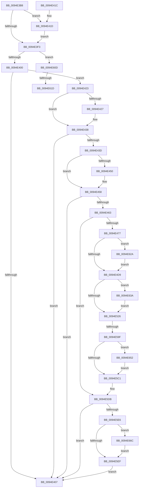

# PiSwProcessRemove

- RVA: `0x0094E3B8`–`0x0094E68A` (길이 `722` bytes)
- VA: `0x000000014094E3B8`
- 실행 섹션: `PAGE`
- PDB 이름 있음: `예`; PDB Function 태그: `예`
- unwind 정보 RVA: `0x000919FC`
- 디코드: `174`개 명령, `722/722` bytes 표시
- 미해석 바이트: `0` (있으면 어셈블리에 `.byte`로 보존)

> 이 문서는 커널 이미지의 기계어와 PDB 기호를 분석해 생성했습니다. 4번과 5번은 함수 원형과 자료형을 바이너리 사용 방식에서 추정한 C 해석이며 원본 소스 복구 결과는 아닙니다.

## 1. Dependencies

- 직접 호출 지점: **16**; 고유 호출 대상: **16**
- 직접 호출자로 확인된 함수: **3**
- RIP 상대 이미지 참조: **4**

### Outgoing calls
- `0x0094E433` → [PiSwDeviceInterfacesUpdateState](PiSwDeviceInterfacesUpdateState_function_0094E744.md) (function, `0x0094E744`)
- `0x0094E440` → [PiSwMakePdoInactive](PiSwMakePdoInactive_function_0094D9A0.md) (function, `0x0094D9A0`)
- `0x0094E453` → [PiSwUnassociateDeviceObject](PiSwUnassociateDeviceObject_function_0094E868.md) (function, `0x0094E868`)
- `0x0094E463` → [PiSwBusRelationRemove](PiSwBusRelationRemove_function_0094D9C0.md) (function, `0x0094D9C0`)
- `0x0094E484` → [PiSwPnPInfoFree](../8D/PiSwPnPInfoFree_function_008DA6F8.md) (function, `0x008DA6F8`)
- `0x0094E57C` → [PiSwFreeInterfaceList](../8D/PiSwFreeInterfaceList_function_008DAB4C.md) (function, `0x008DAB4C`)
- `0x0094E58C` → [PiSwBusRelationAdd](../8D/PiSwBusRelationAdd_function_008DA994.md) (function, `0x008DA994`)
- `0x0094E5B0` → [PnpDeviceObjectFromDeviceInstanceWithTag](../8E/PnpDeviceObjectFromDeviceInstanceWithTag_function_008E7490.md) (function, `0x008E7490`)
- `0x0094E5C9` → [PiSwQueuedCreateInfoFree](PiSwQueuedCreateInfoFree_function_0094D92C.md) (function, `0x0094D92C`)
- `0x0094E5FA` → [RtlDeleteElementGenericTableAvl](../../text/3E/RtlDeleteElementGenericTableAvl_function_003EE750.md) (function, `0x003EE750`)
- `0x0094E603` → [PiSwDeviceDereference](PiSwDeviceDereference_function_0094E8A8.md) (function, `0x0094E8A8`)
- `0x0094E62C` → [ExFreePoolWithTag](../../poolcode/B8/ExFreePoolWithTag_function_00B82870.md) (function, `0x00B82870`)
- `0x0094E644` → [PnpFreeDevPropertyArray](../8D/PnpFreeDevPropertyArray_function_008DE78C.md) (function, `0x008DE78C`)
- `0x0094E65A` → [IoInvalidateDeviceRelations](../../text/49/IoInvalidateDeviceRelations_function_0049E160.md) (function, `0x0049E160`)
- `0x0094E662` → [ObfDereferenceObject](../../text/2F/ObfDereferenceObject_function_002F9350.md) (function, `0x002F9350`)
- `0x0094E680` → [McTemplateK0zz_EtwWriteTransfer](../../text/5A/McTemplateK0zz_EtwWriteTransfer_function_005A9408.md) (function, `0x005A9408`)

### Direct callers
- [PiSwProcessParentRemoveIrp](../8F/PiSwProcessParentRemoveIrp_function_008FCD6C.md) at `0x008FCE8E`
- [PiSwPdoPnPDispatch](PiSwPdoPnPDispatch_function_0094DDF0.md) at `0x0094DFE4`
- [PiSwPdoPnPDispatch](PiSwPdoPnPDispatch_function_0094DDF0.md) at `0x0094E00A`
- [PiSwGetChildPdo](../AC/PiSwGetChildPdo_function_00AC3544.md) at `0x00AC37DB`

### Static image references
- `0x0094E3F3` → RVA `0x00EF012C` (`.data`; read)
- `0x0094E5F3` → RVA `0x00F8AAA0` (`.data`; read)
- `0x0094E60D` → RVA `0x00AFCAD0` (` ?? ::NNGAKEGL::`string'`; read)
- `0x0094E670` → RVA `0x000271D0` (`.rdata`; read)

## 2. Other-region calls and transfers

- 다른 실행 섹션으로 향하는 call: **5**
  - `0x0094E5FA` → [RtlDeleteElementGenericTableAvl](../../text/3E/RtlDeleteElementGenericTableAvl_function_003EE750.md) (`PAGE` → `.text`)
  - `0x0094E62C` → [ExFreePoolWithTag](../../poolcode/B8/ExFreePoolWithTag_function_00B82870.md) (`PAGE` → `POOLCODE`)
  - `0x0094E65A` → [IoInvalidateDeviceRelations](../../text/49/IoInvalidateDeviceRelations_function_0049E160.md) (`PAGE` → `.text`)
  - `0x0094E662` → [ObfDereferenceObject](../../text/2F/ObfDereferenceObject_function_002F9350.md) (`PAGE` → `.text`)
  - `0x0094E680` → [McTemplateK0zz_EtwWriteTransfer](../../text/5A/McTemplateK0zz_EtwWriteTransfer_function_005A9408.md) (`PAGE` → `.text`)
- call이 아닌 외부 분기/꼬리 이동: **3**
  - `0x0094E599` → [sub_00B25F7E + 0x34](../B2/Unknown_function_00B25F7E.md) (`tail-transfer`)
  - `0x0094E617` → [sub_00B25F7E](../B2/Unknown_function_00B25F7E.md) (`tail-transfer`)
  - `0x0094E625` → [sub_00B25F7E + 0x6](../B2/Unknown_function_00B25F7E.md) (`tail-transfer`)

## 3. Assembly (complete function range)

```asm
0094E3B8  48 89 5C 24 10                  mov qword ptr [rsp + 0x10], rbx
0094E3BD  48 89 74 24 18                  mov qword ptr [rsp + 0x18], rsi
0094E3C2  48 89 7C 24 20                  mov qword ptr [rsp + 0x20], rdi
0094E3C7  55                              push rbp
0094E3C8  48 8B EC                        mov rbp, rsp
0094E3CB  48 83 EC 50                     sub rsp, 0x50
0094E3CF  48 8B 59 40                     mov rbx, qword ptr [rcx + 0x40]
0094E3D3  48 8B F9                        mov rdi, rcx
0094E3D6  48 8B 81 38 01 00 00            mov rax, qword ptr [rcx + 0x138]
0094E3DD  45 33 DB                        xor r11d, r11d
0094E3E0  0F B6 F2                        movzx esi, dl
0094E3E3  4C 8B 03                        mov r8, qword ptr [rbx]
0094E3E6  4C 89 45 10                     mov qword ptr [rbp + 0x10], r8
0094E3EA  48 8B 48 28                     mov rcx, qword ptr [rax + 0x28]
0094E3EE  48 85 C9                        test rcx, rcx
0094E3F1  75 2A                           jne 0x14094e41d
0094E3F3  F6 05 32 1D 5A 00 40            test byte ptr [rip + 0x5a1d32], 0x40
0094E3FA  0F 85 0D 02 00 00               jne 0x14094e60d
0094E400  8B 43 08                        mov eax, dword ptr [rbx + 8]
0094E403  A8 20                           test al, 0x20
0094E405  74 1C                           je 0x14094e423
0094E407  48 8B 5C 24 68                  mov rbx, qword ptr [rsp + 0x68]
0094E40C  48 8B 74 24 70                  mov rsi, qword ptr [rsp + 0x70]
0094E411  48 8B 7C 24 78                  mov rdi, qword ptr [rsp + 0x78]
0094E416  48 83 C4 50                     add rsp, 0x50
0094E41A  5D                              pop rbp
0094E41B  C3                              ret
0094E41C  CC                              int3
0094E41D  4C 8B 59 30                     mov r11, qword ptr [rcx + 0x30]
0094E421  EB D0                           jmp 0x14094e3f3
0094E423  A8 01                           test al, 1
0094E425  74 11                           je 0x14094e438
0094E427  83 E0 FE                        and eax, 0xfffffffe
0094E42A  33 D2                           xor edx, edx
0094E42C  89 43 08                        mov dword ptr [rbx + 8], eax
0094E42F  48 8B 4D 10                     mov rcx, qword ptr [rbp + 0x10]
0094E433  E8 0C 03 00 00                  call 0x14094e744
0094E438  40 84 F6                        test sil, sil
0094E43B  75 CA                           jne 0x14094e407
0094E43D  48 8B CF                        mov rcx, rdi
0094E440  E8 5B F5 FF FF                  call 0x14094d9a0
0094E445  8B 4B 08                        mov ecx, dword ptr [rbx + 8]
0094E448  80 E1 48                        and cl, 0x48
0094E44B  80 F9 08                        cmp cl, 8
0094E44E  74 08                           je 0x14094e458
0094E450  48 8B CF                        mov rcx, rdi
0094E453  E8 10 04 00 00                  call 0x14094e868
0094E458  48 8B 4D 10                     mov rcx, qword ptr [rbp + 0x10]
0094E45C  8B 41 04                        mov eax, dword ptr [rcx + 4]
0094E45F  A8 02                           test al, 2
0094E461  74 A4                           je 0x14094e407
0094E463  E8 58 F5 FF FF                  call 0x14094d9c0
0094E468  4C 8B 4D 10                     mov r9, qword ptr [rbp + 0x10]
0094E46C  49 83 79 58 00                  cmp qword ptr [r9 + 0x58], 0
0094E471  0F 84 64 01 00 00               je 0x14094e5db
0094E477  41 83 61 04 FB                  and dword ptr [r9 + 4], 0xfffffffb
0094E47C  48 8B 4D 10                     mov rcx, qword ptr [rbp + 0x10]
0094E480  48 83 C1 18                     add rcx, 0x18
0094E484  E8 6F C2 F8 FF                  call 0x1408da6f8
0094E489  48 8B 4D 10                     mov rcx, qword ptr [rbp + 0x10]
0094E48D  BB 50 6E 70 57                  mov ebx, 0x57706e50
0094E492  48 8B 41 58                     mov rax, qword ptr [rcx + 0x58]
0094E496  0F 10 40 08                     movups xmm0, xmmword ptr [rax + 8]
0094E49A  0F 11 41 18                     movups xmmword ptr [rcx + 0x18], xmm0
0094E49E  0F 10 48 18                     movups xmm1, xmmword ptr [rax + 0x18]
0094E4A2  0F 11 49 28                     movups xmmword ptr [rcx + 0x28], xmm1
0094E4A6  0F 10 40 28                     movups xmm0, xmmword ptr [rax + 0x28]
0094E4AA  0F 11 41 38                     movups xmmword ptr [rcx + 0x38], xmm0
0094E4AE  48 8B 45 10                     mov rax, qword ptr [rbp + 0x10]
0094E4B2  0F 57 C0                        xorps xmm0, xmm0
0094E4B5  48 8B 48 58                     mov rcx, qword ptr [rax + 0x58]
0094E4B9  0F 11 41 08                     movups xmmword ptr [rcx + 8], xmm0
0094E4BD  0F 11 41 18                     movups xmmword ptr [rcx + 0x18], xmm0
0094E4C1  0F 11 41 28                     movups xmmword ptr [rcx + 0x28], xmm0
0094E4C5  48 8B 55 10                     mov rdx, qword ptr [rbp + 0x10]
0094E4C9  48 8B 8A 98 00 00 00            mov rcx, qword ptr [rdx + 0x98]
0094E4D0  48 85 C9                        test rcx, rcx
0094E4D3  0F 85 51 01 00 00               jne 0x14094e62a
0094E4D9  48 8B 42 58                     mov rax, qword ptr [rdx + 0x58]
0094E4DD  8B 48 40                        mov ecx, dword ptr [rax + 0x40]
0094E4E0  89 8A A0 00 00 00               mov dword ptr [rdx + 0xa0], ecx
0094E4E6  48 8B 55 10                     mov rdx, qword ptr [rbp + 0x10]
0094E4EA  48 8B 42 58                     mov rax, qword ptr [rdx + 0x58]
0094E4EE  48 8B 48 38                     mov rcx, qword ptr [rax + 0x38]
0094E4F2  48 89 8A 98 00 00 00            mov qword ptr [rdx + 0x98], rcx
0094E4F9  48 8B 45 10                     mov rax, qword ptr [rbp + 0x10]
0094E4FD  48 8B 48 58                     mov rcx, qword ptr [rax + 0x58]
0094E501  83 61 40 00                     and dword ptr [rcx + 0x40], 0
0094E505  48 8B 45 10                     mov rax, qword ptr [rbp + 0x10]
0094E509  48 8B 48 58                     mov rcx, qword ptr [rax + 0x58]
0094E50D  48 83 61 38 00                  and qword ptr [rcx + 0x38], 0
0094E512  4C 8B 4D 10                     mov r9, qword ptr [rbp + 0x10]
0094E516  49 8B 91 A8 00 00 00            mov rdx, qword ptr [r9 + 0xa8]
0094E51D  48 85 D2                        test rdx, rdx
0094E520  0F 85 14 01 00 00               jne 0x14094e63a
0094E526  49 8B 41 58                     mov rax, qword ptr [r9 + 0x58]
0094E52A  8B 48 50                        mov ecx, dword ptr [rax + 0x50]
0094E52D  41 89 89 B0 00 00 00            mov dword ptr [r9 + 0xb0], ecx
0094E534  48 8B 55 10                     mov rdx, qword ptr [rbp + 0x10]
0094E538  48 8B 42 58                     mov rax, qword ptr [rdx + 0x58]
0094E53C  48 8B 48 48                     mov rcx, qword ptr [rax + 0x48]
0094E540  48 89 8A A8 00 00 00            mov qword ptr [rdx + 0xa8], rcx
0094E547  48 8B 45 10                     mov rax, qword ptr [rbp + 0x10]
0094E54B  48 8B 48 58                     mov rcx, qword ptr [rax + 0x58]
0094E54F  83 61 50 00                     and dword ptr [rcx + 0x50], 0
0094E553  48 8B 45 10                     mov rax, qword ptr [rbp + 0x10]
0094E557  48 8B 48 58                     mov rcx, qword ptr [rax + 0x58]
0094E55B  48 83 61 48 00                  and qword ptr [rcx + 0x48], 0
0094E560  48 8B 55 10                     mov rdx, qword ptr [rbp + 0x10]
0094E564  48 8B 42 58                     mov rax, qword ptr [rdx + 0x58]
0094E568  8B 48 44                        mov ecx, dword ptr [rax + 0x44]
0094E56B  89 8A A4 00 00 00               mov dword ptr [rdx + 0xa4], ecx
0094E571  48 8B 4D 10                     mov rcx, qword ptr [rbp + 0x10]
0094E575  48 81 C1 B8 00 00 00            add rcx, 0xb8
0094E57C  E8 CB C5 F8 FF                  call 0x1408dab4c
0094E581  48 8B 55 10                     mov rdx, qword ptr [rbp + 0x10]
0094E585  48 8B 4A 58                     mov rcx, qword ptr [rdx + 0x58]
0094E589  48 8B 09                        mov rcx, qword ptr [rcx]
0094E58C  E8 03 C4 F8 FF                  call 0x1408da994
0094E591  8B D0                           mov edx, eax
0094E593  85 C0                           test eax, eax
0094E595  48 8B 45 10                     mov rax, qword ptr [rbp + 0x10]
0094E599  0F 88 13 7A 1D 00               js 0x140b25fb2
0094E59F  83 60 04 FD                     and dword ptr [rax + 4], 0xfffffffd
0094E5A3  BA 44 66 6C 74                  mov edx, 0x746c6644
0094E5A8  48 8B 4D 10                     mov rcx, qword ptr [rbp + 0x10]
0094E5AC  48 8B 49 70                     mov rcx, qword ptr [rcx + 0x70]
0094E5B0  E8 DB 8E F9 FF                  call 0x1408e7490
0094E5B5  48 8B D8                        mov rbx, rax
0094E5B8  48 85 C0                        test rax, rax
0094E5BB  0F 85 91 00 00 00               jne 0x14094e652
0094E5C1  48 8B 4D 10                     mov rcx, qword ptr [rbp + 0x10]
0094E5C5  48 8B 49 58                     mov rcx, qword ptr [rcx + 0x58]
0094E5C9  E8 5E F3 FF FF                  call 0x14094d92c
0094E5CE  48 8B 45 10                     mov rax, qword ptr [rbp + 0x10]
0094E5D2  48 83 60 58 00                  and qword ptr [rax + 0x58], 0
0094E5D7  4C 8B 4D 10                     mov r9, qword ptr [rbp + 0x10]
0094E5DB  49 83 79 70 00                  cmp qword ptr [r9 + 0x70], 0
0094E5E0  0F 85 21 FE FF FF               jne 0x14094e407
0094E5E6  F6 05 3F 1B 5A 00 40            test byte ptr [rip + 0x5a1b3f], 0x40
0094E5ED  75 7D                           jne 0x14094e66c
0094E5EF  48 8D 55 10                     lea rdx, [rbp + 0x10]
0094E5F3  48 8D 0D A6 C4 63 00            lea rcx, [rip + 0x63c4a6]
0094E5FA  E8 51 01 AA FF                  call 0x1403ee750
0094E5FF  48 8B 4D 10                     mov rcx, qword ptr [rbp + 0x10]
0094E603  E8 A0 02 00 00                  call 0x14094e8a8
0094E608  E9 FA FD FF FF                  jmp 0x14094e407
0094E60D  4C 8D 0D BC E4 1A 00            lea r9, [rip + 0x1ae4bc]
0094E614  4D 85 C0                        test r8, r8
0094E617  0F 84 61 79 1D 00               je 0x140b25f7e
0094E61D  45 8B 50 04                     mov r10d, dword ptr [r8 + 4]
0094E621  49 8B 50 10                     mov rdx, qword ptr [r8 + 0x10]
0094E625  E9 5A 79 1D 00                  jmp 0x140b25f84
0094E62A  8B D3                           mov edx, ebx
0094E62C  E8 3F 42 23 00                  call 0x140b82870
0094E631  48 8B 55 10                     mov rdx, qword ptr [rbp + 0x10]
0094E635  E9 9F FE FF FF                  jmp 0x14094e4d9
0094E63A  41 8B 89 B0 00 00 00            mov ecx, dword ptr [r9 + 0xb0]
0094E641  44 8B C3                        mov r8d, ebx
0094E644  E8 43 01 F9 FF                  call 0x1408de78c
0094E649  4C 8B 4D 10                     mov r9, qword ptr [rbp + 0x10]
0094E64D  E9 D4 FE FF FF                  jmp 0x14094e526
0094E652  BA 05 00 00 00                  mov edx, 5
0094E657  48 8B CB                        mov rcx, rbx
0094E65A  E8 01 FB B4 FF                  call 0x14049e160
0094E65F  48 8B CB                        mov rcx, rbx
0094E662  E8 E9 AC 9A FF                  call 0x1402f9350
0094E667  E9 55 FF FF FF                  jmp 0x14094e5c1
0094E66C  49 8B 41 10                     mov rax, qword ptr [r9 + 0x10]
0094E670  48 8D 15 59 8B 6D FF            lea rdx, [rip - 0x9274a7]
0094E677  4D 8B 49 08                     mov r9, qword ptr [r9 + 8]
0094E67B  48 89 44 24 20                  mov qword ptr [rsp + 0x20], rax
0094E680  E8 83 AD C5 FF                  call 0x1405a9408
0094E685  E9 65 FF FF FF                  jmp 0x14094e5ef
```

## 4. C-style interpretation (structured pseudocode)

```c
__int64 __fastcall PiSwProcessRemove(__int64 a1, int a2)
{
    __int64 result;
    __int64 v_r11;
    __int64 v_rsp;
    unsigned __int64 v_stack_p10;
    unsigned __int64 v_stack_p18;
    unsigned __int64 v_stack_p20;
    unsigned __int64 v_stack_p8;

    v_stack_p10 = v_rbx;
    v_stack_p18 = v_rsi;
    v_stack_p20 = v_rdi;
    v_rsp = (v_rsp) - (80);
    v_r11 = 0;
    v_stack_p8 = *(unsigned __int64 *)(*(unsigned __int64 *)(a1 + 64));
    if (*(unsigned __int64 *)(*(unsigned __int64 *)(a1 + 312) + 40) != 0) goto loc_0094E41D;
loc_0094E3F3:
    if (((*(unsigned __int8 *)(v_rip + 5905714)) & (64)) != 0) goto loc_0094E60D;
    if ((((unsigned __int8)((unsigned int)(*(unsigned int *)(*(unsigned __int64 *)(a1 + 64) + 8)))) & (32)) == 0) goto loc_0094E423;
loc_0094E407:
    v_rsp = (v_rsp) + (80);
    return (unsigned int)(*(unsigned int *)(*(unsigned __int64 *)(a1 + 64) + 8));
loc_0094E41D:
    goto loc_0094E3F3;
loc_0094E423:
    result = (unsigned int)(*(unsigned int *)(*(unsigned __int64 *)(a1 + 64) + 8));
    if ((((unsigned __int8)((unsigned int)(*(unsigned int *)(*(unsigned __int64 *)(a1 + 64) + 8)))) & (1)) != 0) {
        result = (unsigned int)(((unsigned int)(*(unsigned int *)(*(unsigned __int64 *)(a1 + 64) + 8))) & (0xFFFFFFFEULL));
        a2 = 0;
        *(unsigned int *)(v_stack_p10 + 8) = (unsigned int)(result);
        a1 = v_stack_p8;
        result = PiSwDeviceInterfacesUpdateState(a1, a2, *(unsigned __int64 *)(*(unsigned __int64 *)(a1 + 64)), a4);
    }
    if ((unsigned __int8)(v_stack_p18) != 0) goto loc_0094E407;
    result = PiSwMakePdoInactive(v_stack_p20, a2, *(unsigned __int64 *)(*(unsigned __int64 *)(a1 + 64)), a4);
    a1 = (unsigned __int8)(((unsigned int)(*(unsigned int *)(v_stack_p10 + 8))) & (72));
    if (((unsigned __int8)(a1)) != 8) {
        a1 = v_stack_p20;
        result = PiSwUnassociateDeviceObject(a1, a2, *(unsigned __int64 *)(*(unsigned __int64 *)(a1 + 64)), a4);
    }
    if ((((unsigned __int8)((unsigned int)(*(unsigned int *)(v_stack_p8 + 4)))) & (2)) == 0) goto loc_0094E407;
    result = PiSwBusRelationRemove(v_stack_p8, a2, *(unsigned __int64 *)(*(unsigned __int64 *)(a1 + 64)), a4);
    if ((*(unsigned __int64 *)(v_stack_p8 + 88)) == 0) goto loc_0094E5DB;
    a1 = (v_stack_p8) + (24);
    result = PiSwPnPInfoFree(a1, a2, *(unsigned __int64 *)(*(unsigned __int64 *)(a1 + 64)), v_stack_p8);
    *(unsigned __int64 *)(v_stack_p8 + 24) = v_xmm0;
    *(unsigned __int64 *)(v_stack_p8 + 40) = v_xmm1;
    *(unsigned __int64 *)(v_stack_p8 + 56) = v_xmm0;
    *(unsigned __int64 *)(*(unsigned __int64 *)(v_stack_p8 + 88) + 8) = v_xmm0;
    *(unsigned __int64 *)(*(unsigned __int64 *)(v_stack_p8 + 88) + 24) = v_xmm0;
    *(unsigned __int64 *)(*(unsigned __int64 *)(v_stack_p8 + 88) + 40) = v_xmm0;
    if (*(unsigned __int64 *)(v_stack_p8 + 152) != 0) goto loc_0094E62A;
loc_0094E4D9:
    *(unsigned int *)(v_stack_p8 + 160) = (unsigned int)((unsigned int)(*(unsigned int *)(*(unsigned __int64 *)(v_stack_p8 + 88) + 64)));
    *(unsigned __int64 *)(v_stack_p8 + 152) = *(unsigned __int64 *)(*(unsigned __int64 *)(v_stack_p8 + 88) + 56);
    if (*(unsigned __int64 *)(v_stack_p8 + 168) != 0) goto loc_0094E63A;
loc_0094E526:
    *(unsigned int *)(v_stack_p8 + 176) = (unsigned int)((unsigned int)(*(unsigned int *)(*(unsigned __int64 *)(v_stack_p8 + 88) + 80)));
    *(unsigned __int64 *)(v_stack_p8 + 168) = *(unsigned __int64 *)(*(unsigned __int64 *)(v_stack_p8 + 88) + 72);
    *(unsigned int *)(v_stack_p8 + 164) = (unsigned int)((unsigned int)(*(unsigned int *)(*(unsigned __int64 *)(v_stack_p8 + 88) + 68)));
    a1 = (v_stack_p8) + (184);
    result = PiSwFreeInterfaceList(a1, v_stack_p8, *(unsigned __int64 *)(*(unsigned __int64 *)(a1 + 64)), v_stack_p8);
    result = PiSwBusRelationAdd(*(unsigned __int64 *)(*(unsigned __int64 *)(v_stack_p8 + 88)), v_stack_p8, *(unsigned __int64 *)(*(unsigned __int64 *)(a1 + 64)), v_stack_p8);
    result = PnpDeviceObjectFromDeviceInstanceWithTag(*(unsigned __int64 *)(v_stack_p8 + 112), (unsigned int)(0x746C6644ULL), *(unsigned __int64 *)(*(unsigned __int64 *)(a1 + 64)), v_stack_p8);
    if (result != 0) goto loc_0094E652;
loc_0094E5C1:
    result = PiSwQueuedCreateInfoFree(*(unsigned __int64 *)(v_stack_p8 + 88), (unsigned int)(0x746C6644ULL), *(unsigned __int64 *)(*(unsigned __int64 *)(a1 + 64)), v_stack_p8);
loc_0094E5DB:
    if ((*(unsigned __int64 *)(v_stack_p8 + 112)) != 0) goto loc_0094E407;
    if (((*(unsigned __int8 *)(v_rip + 5905215)) & (64)) != 0) goto loc_0094E66C;
loc_0094E5EF:
    result = RtlDeleteElementGenericTableAvl(v_rip + 6538406, v_stack_p8, *(unsigned __int64 *)(*(unsigned __int64 *)(a1 + 64)), v_stack_p8);
    result = PiSwDeviceDereference(v_stack_p8, v_stack_p8, *(unsigned __int64 *)(*(unsigned __int64 *)(a1 + 64)), v_stack_p8);
    goto loc_0094E407;
loc_0094E60D:
loc_0094E62A:
    result = ExFreePoolWithTag(v_stack_p8, (unsigned int)((unsigned int)(result)), *(unsigned __int64 *)(*(unsigned __int64 *)(a1 + 64)), v_rip + 1762492);
    goto loc_0094E4D9;
loc_0094E63A:
    result = PnpFreeDevPropertyArray((unsigned int)(*(unsigned int *)(v_rip + 1762492 + 176)), v_stack_p8, (unsigned int)((unsigned int)(result)), v_rip + 1762492);
    goto loc_0094E526;
loc_0094E652:
    result = IoInvalidateDeviceRelations(result, 5, (unsigned int)((unsigned int)(result)), v_stack_p8);
    result = ObfDereferenceObject(result, 5, (unsigned int)((unsigned int)(result)), v_stack_p8);
    goto loc_0094E5C1;
loc_0094E66C:
    v_stack_p20 = *(unsigned __int64 *)(v_stack_p8 + 16);
    result = McTemplateK0zz_EtwWriteTransfer(result, v_rip - 9598119, (unsigned int)((unsigned int)(result)), *(unsigned __int64 *)(v_stack_p8 + 8));
    goto loc_0094E5EF;
}
```

## 5. (Beta) C Style

```c
int64_t PiSwProcessRemove(void *Arg1, int32_t Arg2)
{
    uint8_t *arg1 = (uint8_t *)Arg1;

    int64_t result;
    int64_t local_r11;
    int64_t local_rsp;
    uint64_t v_stack_p10;
    uint64_t v_stack_p18;
    uint64_t v_stack_p20;
    uint64_t v_stack_p8;

    v_stack_p10 = local_rbx;
    v_stack_p18 = local_rsi;
    v_stack_p20 = local_rdi;
    local_rsp = (local_rsp) - (80);
    local_r11 = 0;
    v_stack_p8 = *(uint64_t *)(*(uint64_t *)(arg1 + 0x40));
    if (*(uint64_t *)(*(uint64_t *)(arg1 + 0x138) + 0x28) != 0) goto loc_0094E41D;
loc_0094E3F3:
    if (((*(uint8_t *)(v_rip + 0x5A1D32)) & (64)) != 0) goto loc_0094E60D;
    if ((((uint8_t)((uint32_t)(*(uint32_t *)(*(uint64_t *)(arg1 + 0x40) + 0x8)))) & (32)) == 0) goto loc_0094E423;
loc_0094E407:
    local_rsp = (local_rsp) + (80);
    return (uint32_t)(*(uint32_t *)(*(uint64_t *)(arg1 + 0x40) + 0x8));
loc_0094E41D:
    goto loc_0094E3F3;
loc_0094E423:
    result = (uint32_t)(*(uint32_t *)(*(uint64_t *)(arg1 + 0x40) + 0x8));
    if ((((uint8_t)((uint32_t)(*(uint32_t *)(*(uint64_t *)(arg1 + 0x40) + 0x8)))) & (1)) != 0) {
        result = (uint32_t)(((uint32_t)(*(uint32_t *)(*(uint64_t *)(arg1 + 0x40) + 0x8))) & (0xFFFFFFFEULL));
        Arg2 = 0;
        *(uint32_t *)(v_stack_p10 + 0x8) = (uint32_t)(result);
        Arg1 = v_stack_p8;
        result = PiSwDeviceInterfacesUpdateState(Arg1, Arg2, *(uint64_t *)(*(uint64_t *)(arg1 + 0x40)), a4);
    }
    if ((uint8_t)(v_stack_p18) != 0) goto loc_0094E407;
    result = PiSwMakePdoInactive(v_stack_p20, Arg2, *(uint64_t *)(*(uint64_t *)(arg1 + 0x40)), a4);
    Arg1 = (uint8_t)(((uint32_t)(*(uint32_t *)(v_stack_p10 + 0x8))) & (72));
    if (((uint8_t)(Arg1)) != 8) {
        Arg1 = v_stack_p20;
        result = PiSwUnassociateDeviceObject(Arg1, Arg2, *(uint64_t *)(*(uint64_t *)(arg1 + 0x40)), a4);
    }
    if ((((uint8_t)((uint32_t)(*(uint32_t *)(v_stack_p8 + 0x4)))) & (2)) == 0) goto loc_0094E407;
    result = PiSwBusRelationRemove(v_stack_p8, Arg2, *(uint64_t *)(*(uint64_t *)(arg1 + 0x40)), a4);
    if ((*(uint64_t *)(v_stack_p8 + 0x58)) == 0) goto loc_0094E5DB;
    Arg1 = (v_stack_p8) + (24);
    result = PiSwPnPInfoFree(Arg1, Arg2, *(uint64_t *)(*(uint64_t *)(arg1 + 0x40)), v_stack_p8);
    *(uint64_t *)(v_stack_p8 + 0x18) = v_xmm0;
    *(uint64_t *)(v_stack_p8 + 0x28) = v_xmm1;
    *(uint64_t *)(v_stack_p8 + 0x38) = v_xmm0;
    *(uint64_t *)(*(uint64_t *)(v_stack_p8 + 0x58) + 0x8) = v_xmm0;
    *(uint64_t *)(*(uint64_t *)(v_stack_p8 + 0x58) + 0x18) = v_xmm0;
    *(uint64_t *)(*(uint64_t *)(v_stack_p8 + 0x58) + 0x28) = v_xmm0;
    if (*(uint64_t *)(v_stack_p8 + 0x98) != 0) goto loc_0094E62A;
loc_0094E4D9:
    *(uint32_t *)(v_stack_p8 + 0xA0) = (uint32_t)((uint32_t)(*(uint32_t *)(*(uint64_t *)(v_stack_p8 + 0x58) + 0x40)));
    *(uint64_t *)(v_stack_p8 + 0x98) = *(uint64_t *)(*(uint64_t *)(v_stack_p8 + 0x58) + 0x38);
    if (*(uint64_t *)(v_stack_p8 + 0xA8) != 0) goto loc_0094E63A;
loc_0094E526:
    *(uint32_t *)(v_stack_p8 + 0xB0) = (uint32_t)((uint32_t)(*(uint32_t *)(*(uint64_t *)(v_stack_p8 + 0x58) + 0x50)));
    *(uint64_t *)(v_stack_p8 + 0xA8) = *(uint64_t *)(*(uint64_t *)(v_stack_p8 + 0x58) + 0x48);
    *(uint32_t *)(v_stack_p8 + 0xA4) = (uint32_t)((uint32_t)(*(uint32_t *)(*(uint64_t *)(v_stack_p8 + 0x58) + 0x44)));
    Arg1 = (v_stack_p8) + (184);
    result = PiSwFreeInterfaceList(Arg1, v_stack_p8, *(uint64_t *)(*(uint64_t *)(arg1 + 0x40)), v_stack_p8);
    result = PiSwBusRelationAdd(*(uint64_t *)(*(uint64_t *)(v_stack_p8 + 0x58)), v_stack_p8, *(uint64_t *)(*(uint64_t *)(arg1 + 0x40)), v_stack_p8);
    result = PnpDeviceObjectFromDeviceInstanceWithTag(*(uint64_t *)(v_stack_p8 + 0x70), (uint32_t)(0x746C6644ULL), *(uint64_t *)(*(uint64_t *)(arg1 + 0x40)), v_stack_p8);
    if (result != 0) goto loc_0094E652;
loc_0094E5C1:
    result = PiSwQueuedCreateInfoFree(*(uint64_t *)(v_stack_p8 + 0x58), (uint32_t)(0x746C6644ULL), *(uint64_t *)(*(uint64_t *)(arg1 + 0x40)), v_stack_p8);
loc_0094E5DB:
    if ((*(uint64_t *)(v_stack_p8 + 0x70)) != 0) goto loc_0094E407;
    if (((*(uint8_t *)(v_rip + 0x5A1B3F)) & (64)) != 0) goto loc_0094E66C;
loc_0094E5EF:
    result = RtlDeleteElementGenericTableAvl(v_rip + 6538406, v_stack_p8, *(uint64_t *)(*(uint64_t *)(arg1 + 0x40)), v_stack_p8);
    result = PiSwDeviceDereference(v_stack_p8, v_stack_p8, *(uint64_t *)(*(uint64_t *)(arg1 + 0x40)), v_stack_p8);
    goto loc_0094E407;
loc_0094E60D:
loc_0094E62A:
    result = ExFreePoolWithTag(v_stack_p8, (uint32_t)((uint32_t)(result)), *(uint64_t *)(*(uint64_t *)(arg1 + 0x40)), v_rip + 1762492);
    goto loc_0094E4D9;
loc_0094E63A:
    result = PnpFreeDevPropertyArray((uint32_t)(*(uint32_t *)(v_rip + 0x1AE4BC + 0xB0)), v_stack_p8, (uint32_t)((uint32_t)(result)), v_rip + 1762492);
    goto loc_0094E526;
loc_0094E652:
    result = IoInvalidateDeviceRelations(result, 5, (uint32_t)((uint32_t)(result)), v_stack_p8);
    result = ObfDereferenceObject(result, 5, (uint32_t)((uint32_t)(result)), v_stack_p8);
    goto loc_0094E5C1;
loc_0094E66C:
    v_stack_p20 = *(uint64_t *)(v_stack_p8 + 0x10);
    result = McTemplateK0zz_EtwWriteTransfer(result, v_rip - 9598119, (uint32_t)((uint32_t)(result)), *(uint64_t *)(v_stack_p8 + 0x8));
    goto loc_0094E5EF;
}
```

### 관측된 메모리 오프셋

구조체 형식이 확인되지 않은 접근은 인자 기준의 오프셋으로만 기록했습니다.

| 기준 인자 | 오프셋 표현 | 폭 (bit) | 접근 |
|---|---:|---:|---|
| `Arg1` | `+ 0x40` | `64` | `R` |
| `Arg1` | `+ 0x138` | `64` | `R` |

## 6. Execution-region graph

[열기: 2D/3D 그래프와 함수 탐색 컨트롤 패널](../../../control-panel.html?section=page&rva=0x0094E3B8&view=graph)

- 2D 그래프는 위에서 아래로 흐르고, 3D 그래프는 빈 공간을 드래그해 회전합니다. Shift+드래그는 이동, 휠은 확대·축소, 함수 노드 선택은 대상 보고서 이동입니다.

### Static fallback


