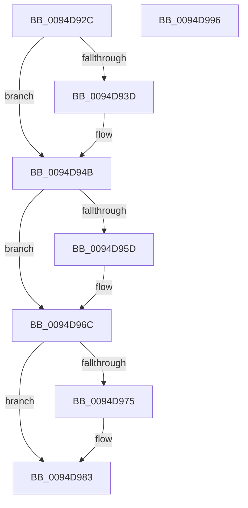

# PiSwQueuedCreateInfoFree

- RVA: `0x0094D92C`–`0x0094D997` (길이 `107` bytes)
- VA: `0x000000014094D92C`
- 실행 섹션: `PAGE`
- PDB 이름 있음: `예`; PDB Function 태그: `아니요`
- unwind 정보 RVA: `0x0005CF00`
- 디코드: `30`개 명령, `107/107` bytes 표시
- 미해석 바이트: `0` (있으면 어셈블리에 `.byte`로 보존)

> 이 문서는 커널 이미지의 기계어와 PDB 기호를 분석해 생성했습니다. 4번과 5번은 함수 원형과 자료형을 바이너리 사용 방식에서 추정한 C 해석이며 원본 소스 복구 결과는 아닙니다.

## 1. Dependencies

- 직접 호출 지점: **5**; 고유 호출 대상: **3**
- 직접 호출자로 확인된 함수: **5**
- RIP 상대 이미지 참조: **0**

### Outgoing calls
- `0x0094D942` → [ExFreePoolWithTag](../../poolcode/B8/ExFreePoolWithTag_function_00B82870.md) (function, `0x00B82870`)
- `0x0094D94F` → [PiSwPnPInfoFree](../8D/PiSwPnPInfoFree_function_008DA6F8.md) (function, `0x008DA6F8`)
- `0x0094D962` → [ExFreePoolWithTag](../../poolcode/B8/ExFreePoolWithTag_function_00B82870.md) (function, `0x00B82870`)
- `0x0094D97E` → [PnpFreeDevPropertyArray](../8D/PnpFreeDevPropertyArray_function_008DE78C.md) (function, `0x008DE78C`)
- `0x0094D98B` → [ExFreePoolWithTag](../../poolcode/B8/ExFreePoolWithTag_function_00B82870.md) (function, `0x00B82870`)

### Direct callers
- [PiSwQueuedCreateInfoCreate](../73/PiSwQueuedCreateInfoCreate_function_0073B1BC.md) at `0x0073B2AA`
- [PiSwDeviceFree](../8D/PiSwDeviceFree_function_008DA63C.md) at `0x008DA6D1`
- [PiSwProcessRemove](PiSwProcessRemove_function_0094E3B8.md) at `0x0094E5C9`
- [PiSwCloseDevice](../AA/PiSwCloseDevice_function_00AAB6F4.md) at `0x00AAB777`
- [sub_00B1C4F6](../B1/Unknown_function_00B1C4F6.md) at `0x00B1C5FF`

### Static image references
- 디코드된 RIP-relative 메모리 참조가 없습니다.

## 2. Other-region calls and transfers

- 다른 실행 섹션으로 향하는 call: **3**
  - `0x0094D942` → [ExFreePoolWithTag](../../poolcode/B8/ExFreePoolWithTag_function_00B82870.md) (`PAGE` → `POOLCODE`)
  - `0x0094D962` → [ExFreePoolWithTag](../../poolcode/B8/ExFreePoolWithTag_function_00B82870.md) (`PAGE` → `POOLCODE`)
  - `0x0094D98B` → [ExFreePoolWithTag](../../poolcode/B8/ExFreePoolWithTag_function_00B82870.md) (`PAGE` → `POOLCODE`)
- 별도 외부 분기/꼬리 이동을 확인하지 못했습니다.

## 3. Assembly (complete function range)

```asm
0094D92C  40 53                           push rbx
0094D92E  48 83 EC 20                     sub rsp, 0x20
0094D932  48 8B D9                        mov rbx, rcx
0094D935  48 8B 09                        mov rcx, qword ptr [rcx]
0094D938  48 85 C9                        test rcx, rcx
0094D93B  74 0E                           je 0x14094d94b
0094D93D  BA 50 6E 70 57                  mov edx, 0x57706e50
0094D942  E8 29 4F 23 00                  call 0x140b82870
0094D947  48 83 23 00                     and qword ptr [rbx], 0
0094D94B  48 8D 4B 08                     lea rcx, [rbx + 8]
0094D94F  E8 A4 CD F8 FF                  call 0x1408da6f8
0094D954  48 8B 4B 38                     mov rcx, qword ptr [rbx + 0x38]
0094D958  48 85 C9                        test rcx, rcx
0094D95B  74 0F                           je 0x14094d96c
0094D95D  BA 50 6E 70 57                  mov edx, 0x57706e50
0094D962  E8 09 4F 23 00                  call 0x140b82870
0094D967  48 83 63 38 00                  and qword ptr [rbx + 0x38], 0
0094D96C  48 8B 53 48                     mov rdx, qword ptr [rbx + 0x48]
0094D970  48 85 D2                        test rdx, rdx
0094D973  74 0E                           je 0x14094d983
0094D975  8B 4B 50                        mov ecx, dword ptr [rbx + 0x50]
0094D978  41 B8 50 6E 70 57               mov r8d, 0x57706e50
0094D97E  E8 09 0E F9 FF                  call 0x1408de78c
0094D983  BA 50 6E 70 57                  mov edx, 0x57706e50
0094D988  48 8B CB                        mov rcx, rbx
0094D98B  E8 E0 4E 23 00                  call 0x140b82870
0094D990  48 83 C4 20                     add rsp, 0x20
0094D994  5B                              pop rbx
0094D995  C3                              ret
0094D996  CC                              int3
```

## 4. C-style interpretation (structured pseudocode)

```c
__int64 __fastcall PiSwQueuedCreateInfoFree(__int64 a1)
{
    __int64 result;
    __int64 v_rsp;

    v_rsp = (v_rsp) - (32);
    if (*(unsigned __int64 *)(a1) != 0) {
        a2 = 0x57706E50ULL;
        result = ExFreePoolWithTag(*(unsigned __int64 *)(a1), a2, a3, a4);
    }
    result = PiSwPnPInfoFree(a1 + 8, a2, a3, a4);
    if (*(unsigned __int64 *)(a1 + 56) != 0) {
        a2 = 0x57706E50ULL;
        result = ExFreePoolWithTag(*(unsigned __int64 *)(a1 + 56), a2, a3, a4);
    }
    if (*(unsigned __int64 *)(a1 + 72) != 0) {
        a1 = *(unsigned int *)(a1 + 80);
        a3 = 0x57706E50ULL;
        result = PnpFreeDevPropertyArray(a1, *(unsigned __int64 *)(a1 + 72), a3, a4);
    }
    result = ExFreePoolWithTag(a1, (unsigned int)(0x57706E50ULL), a3, a4);
    v_rsp = (v_rsp) + (32);
    return result;
}
```

## 5. (Beta) C Style

```c
int64_t PiSwQueuedCreateInfoFree(void *Arg1)
{
    uint8_t *arg1 = (uint8_t *)Arg1;

    int64_t result;
    int64_t local_rsp;

    local_rsp = (local_rsp) - (32);
    if (*(uint64_t *)(arg1) != 0) {
        a2 = 0x57706E50ULL;
        result = ExFreePoolWithTag(*(uint64_t *)(arg1), a2, a3, a4);
    }
    result = PiSwPnPInfoFree(Arg1 + 8, a2, a3, a4);
    if (*(uint64_t *)(arg1 + 0x38) != 0) {
        a2 = 0x57706E50ULL;
        result = ExFreePoolWithTag(*(uint64_t *)(arg1 + 0x38), a2, a3, a4);
    }
    if (*(uint64_t *)(arg1 + 0x48) != 0) {
        Arg1 = *(uint32_t *)(arg1 + 0x50);
        a3 = 0x57706E50ULL;
        result = PnpFreeDevPropertyArray(Arg1, *(uint64_t *)(arg1 + 0x48), a3, a4);
    }
    result = ExFreePoolWithTag(Arg1, (uint32_t)(0x57706E50ULL), a3, a4);
    local_rsp = (local_rsp) + (32);
    return result;
}
```

### 관측된 메모리 오프셋

구조체 형식이 확인되지 않은 접근은 인자 기준의 오프셋으로만 기록했습니다.

| 기준 인자 | 오프셋 표현 | 폭 (bit) | 접근 |
|---|---:|---:|---|
| `Arg1` | `+ 0x0` | `64` | `R` |
| `Arg1` | `+ 0x0` | `64` | `R/W` |
| `Arg1` | `+ 0x8` | `64` | `R` |
| `Arg1` | `+ 0x38` | `64` | `R` |
| `Arg1` | `+ 0x38` | `64` | `R/W` |
| `Arg1` | `+ 0x48` | `64` | `R` |
| `Arg1` | `+ 0x50` | `32` | `R` |

## 6. Execution-region graph

[열기: 2D/3D 그래프와 함수 탐색 컨트롤 패널](../../../control-panel.html?section=page&rva=0x0094D92C&view=graph)

- 2D 그래프는 위에서 아래로 흐르고, 3D 그래프는 빈 공간을 드래그해 회전합니다. Shift+드래그는 이동, 휠은 확대·축소, 함수 노드 선택은 대상 보고서 이동입니다.

### Static fallback


