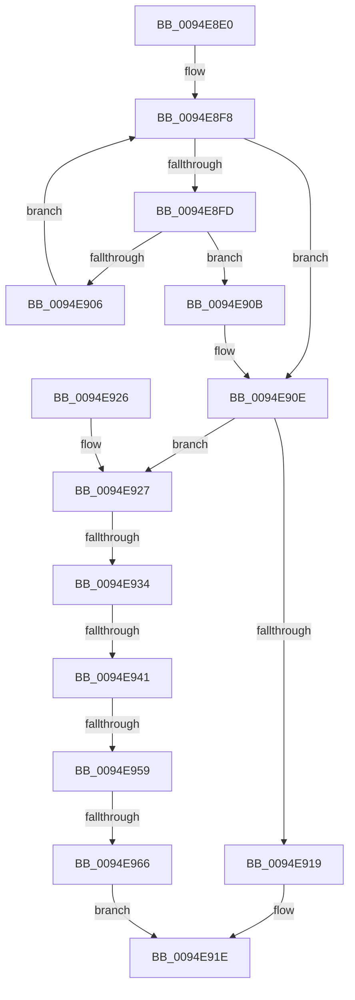

# PiSwRemovePdoAssociation

- RVA: `0x0094E8E0`–`0x0094E974` (길이 `148` bytes)
- VA: `0x000000014094E8E0`
- 실행 섹션: `PAGE`
- PDB 이름 있음: `예`; PDB Function 태그: `예`
- unwind 정보 RVA: `0x00091A50`
- 디코드: `44`개 명령, `148/148` bytes 표시
- 미해석 바이트: `0` (있으면 어셈블리에 `.byte`로 보존)

> 이 문서는 커널 이미지의 기계어와 PDB 기호를 분석해 생성했습니다. 4번과 5번은 함수 원형과 자료형을 바이너리 사용 방식에서 추정한 C 해석이며 원본 소스 복구 결과는 아닙니다.

## 1. Dependencies

- 직접 호출 지점: **1**; 고유 호출 대상: **1**
- 직접 호출자로 확인된 함수: **1**
- RIP 상대 이미지 참조: **0**

### Outgoing calls
- `0x0094E96D` → [PiSwPdoAssociationFree](../AB/PiSwPdoAssociationFree_function_00AB45FC.md) (function, `0x00AB45FC`)

### Direct callers
- [PiSwUnassociateDeviceObject](PiSwUnassociateDeviceObject_function_0094E868.md) at `0x0094E884`

### Static image references
- 디코드된 RIP-relative 메모리 참조가 없습니다.

## 2. Other-region calls and transfers

- 다른 실행 섹션으로 향하는 call: **0**
- call이 아닌 외부 분기/꼬리 이동: **4**
  - `0x0094E92E` → [sub_00B26012](../B2/Unknown_function_00B26012.md) (`tail-transfer`)
  - `0x0094E93B` → [sub_00B26012](../B2/Unknown_function_00B26012.md) (`tail-transfer`)
  - `0x0094E953` → [sub_00B26012](../B2/Unknown_function_00B26012.md) (`tail-transfer`)
  - `0x0094E960` → [sub_00B26012](../B2/Unknown_function_00B26012.md) (`tail-transfer`)

## 3. Assembly (complete function range)

```asm
0094E8E0  40 53                           push rbx
0094E8E2  48 83 EC 20                     sub rsp, 0x20
0094E8E6  33 DB                           xor ebx, ebx
0094E8E8  4C 8D 91 80 00 00 00            lea r10, [rcx + 0x80]
0094E8EF  49 8B 0A                        mov rcx, qword ptr [r10]
0094E8F2  44 8B CB                        mov r9d, ebx
0094E8F5  44 8A C3                        mov r8b, bl
0094E8F8  49 3B CA                        cmp rcx, r10
0094E8FB  74 11                           je 0x14094e90e
0094E8FD  4C 8B C9                        mov r9, rcx
0094E900  48 39 51 28                     cmp qword ptr [rcx + 0x28], rdx
0094E904  74 05                           je 0x14094e90b
0094E906  48 8B 09                        mov rcx, qword ptr [rcx]
0094E909  EB ED                           jmp 0x14094e8f8
0094E90B  41 B0 01                        mov r8b, 1
0094E90E  41 F6 D8                        neg r8b
0094E911  48 1B C9                        sbb rcx, rcx
0094E914  49 23 C9                        and rcx, r9
0094E917  75 0E                           jne 0x14094e927
0094E919  BB 25 02 00 C0                  mov ebx, 0xc0000225
0094E91E  8B C3                           mov eax, ebx
0094E920  48 83 C4 20                     add rsp, 0x20
0094E924  5B                              pop rbx
0094E925  C3                              ret
0094E926  CC                              int3
0094E927  48 8B 11                        mov rdx, qword ptr [rcx]
0094E92A  48 39 4A 08                     cmp qword ptr [rdx + 8], rcx
0094E92E  0F 85 DE 76 1D 00               jne 0x140b26012
0094E934  48 8B 41 08                     mov rax, qword ptr [rcx + 8]
0094E938  48 39 08                        cmp qword ptr [rax], rcx
0094E93B  0F 85 D1 76 1D 00               jne 0x140b26012
0094E941  48 89 10                        mov qword ptr [rax], rdx
0094E944  48 89 42 08                     mov qword ptr [rdx + 8], rax
0094E948  48 8D 51 10                     lea rdx, [rcx + 0x10]
0094E94C  4C 8B 02                        mov r8, qword ptr [rdx]
0094E94F  49 39 50 08                     cmp qword ptr [r8 + 8], rdx
0094E953  0F 85 B9 76 1D 00               jne 0x140b26012
0094E959  48 8B 42 08                     mov rax, qword ptr [rdx + 8]
0094E95D  48 39 10                        cmp qword ptr [rax], rdx
0094E960  0F 85 AC 76 1D 00               jne 0x140b26012
0094E966  4C 89 00                        mov qword ptr [rax], r8
0094E969  49 89 40 08                     mov qword ptr [r8 + 8], rax
0094E96D  E8 8A 5C 16 00                  call 0x140ab45fc
0094E972  EB AA                           jmp 0x14094e91e
```

## 4. C-style interpretation (structured pseudocode)

```c
__int64 __fastcall PiSwRemovePdoAssociation(__int64 a1, __int64 a2)
{
    __int64 result;
    __int64 v_rbx;
    __int64 v_rsp;

    v_rsp = (v_rsp) - (32);
    v_rbx = 0;
loc_0094E8F8:
    if ((*(unsigned __int64 *)(a1 + 128)) == (a1 + 128)) goto loc_0094E90E;
    if ((*(unsigned __int64 *)(*(unsigned __int64 *)(a1 + 128) + 40)) == a2) goto loc_0094E90B;
    goto loc_0094E8F8;
loc_0094E90B:
loc_0094E90E:
    a3 = (unsigned __int8)(-(1));
    a1 = (*(unsigned __int64 *)(*(unsigned __int64 *)(a1 + 128))) & (*(unsigned __int64 *)(a1 + 128));
    if (condition_is_not_equal) goto loc_0094E927;
loc_0094E91E:
    v_rsp = (v_rsp) + (32);
    return (unsigned int)((unsigned int)((unsigned int)(0xC0000225ULL)));
loc_0094E927:
    *(unsigned __int64 *)(*(unsigned __int64 *)(a1 + 8)) = *(unsigned __int64 *)(a1);
    *(unsigned __int64 *)(*(unsigned __int64 *)(a1) + 8) = *(unsigned __int64 *)(a1 + 8);
    *(unsigned __int64 *)(*(unsigned __int64 *)(a1 + 16 + 8)) = *(unsigned __int64 *)(a1 + 16);
    *(unsigned __int64 *)(*(unsigned __int64 *)(a1 + 16) + 8) = *(unsigned __int64 *)(a1 + 16 + 8);
    result = PiSwPdoAssociationFree(a1, a1 + 16, *(unsigned __int64 *)(a1 + 16), *(unsigned __int64 *)(a1 + 128));
    goto loc_0094E91E;
}
```

## 5. (Beta) C Style

```c
int64_t PiSwRemovePdoAssociation(void *Arg1, int64_t Arg2)
{
    uint8_t *arg1 = (uint8_t *)Arg1;

    int64_t result;
    int64_t local_rbx;
    int64_t local_rsp;

    local_rsp = (local_rsp) - (32);
    local_rbx = 0;
loc_0094E8F8:
    if ((*(uint64_t *)(arg1 + 0x80)) == (Arg1 + 128)) goto loc_0094E90E;
    if ((*(uint64_t *)(*(uint64_t *)(arg1 + 0x80) + 0x28)) == Arg2) goto loc_0094E90B;
    goto loc_0094E8F8;
loc_0094E90B:
loc_0094E90E:
    a3 = (uint8_t)(-(1));
    Arg1 = (*(uint64_t *)(*(uint64_t *)(arg1 + 0x80))) & (*(uint64_t *)(arg1 + 0x80));
    if (condition_is_not_equal) goto loc_0094E927;
loc_0094E91E:
    local_rsp = (local_rsp) + (32);
    return (uint32_t)((uint32_t)((uint32_t)(0xC0000225ULL)));
loc_0094E927:
    *(uint64_t *)(*(uint64_t *)(arg1 + 0x8)) = *(uint64_t *)(arg1);
    *(uint64_t *)(*(uint64_t *)(arg1) + 0x8) = *(uint64_t *)(arg1 + 0x8);
    *(uint64_t *)(*(uint64_t *)(arg1 + 0x10 + 0x8)) = *(uint64_t *)(arg1 + 0x10);
    *(uint64_t *)(*(uint64_t *)(arg1 + 0x10) + 0x8) = *(uint64_t *)(arg1 + 0x10 + 0x8);
    result = PiSwPdoAssociationFree(Arg1, Arg1 + 16, *(uint64_t *)(arg1 + 0x10), *(uint64_t *)(arg1 + 0x80));
    goto loc_0094E91E;
}
```

### 관측된 메모리 오프셋

구조체 형식이 확인되지 않은 접근은 인자 기준의 오프셋으로만 기록했습니다.

| 기준 인자 | 오프셋 표현 | 폭 (bit) | 접근 |
|---|---:|---:|---|
| `Arg1` | `+ 0x0` | `64` | `R` |
| `Arg1` | `+ 0x80` | `64` | `R` |

## 6. Execution-region graph

[열기: 2D/3D 그래프와 함수 탐색 컨트롤 패널](../../../control-panel.html?section=page&rva=0x0094E8E0&view=graph)

- 2D 그래프는 위에서 아래로 흐르고, 3D 그래프는 빈 공간을 드래그해 회전합니다. Shift+드래그는 이동, 휠은 확대·축소, 함수 노드 선택은 대상 보고서 이동입니다.

### Static fallback


