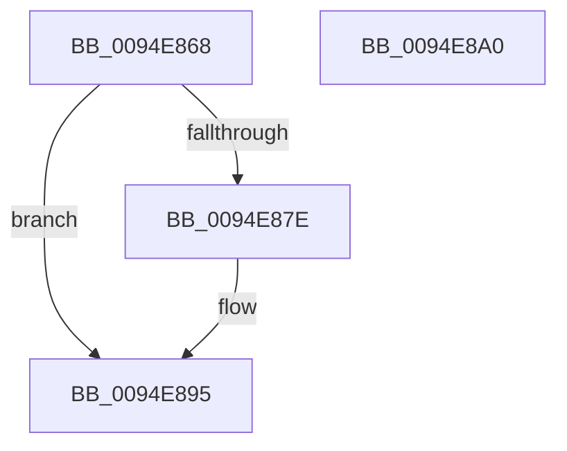

# PiSwUnassociateDeviceObject

- RVA: `0x0094E868`–`0x0094E8A1` (길이 `57` bytes)
- VA: `0x000000014094E868`
- 실행 섹션: `PAGE`
- PDB 이름 있음: `예`; PDB Function 태그: `아니요`
- unwind 정보 RVA: `0x0005CAAC`
- 디코드: `18`개 명령, `57/57` bytes 표시
- 미해석 바이트: `0` (있으면 어셈블리에 `.byte`로 보존)

> 이 문서는 커널 이미지의 기계어와 PDB 기호를 분석해 생성했습니다. 4번과 5번은 함수 원형과 자료형을 바이너리 사용 방식에서 추정한 C 해석이며 원본 소스 복구 결과는 아닙니다.

## 1. Dependencies

- 직접 호출 지점: **2**; 고유 호출 대상: **2**
- 직접 호출자로 확인된 함수: **2**
- RIP 상대 이미지 참조: **0**

### Outgoing calls
- `0x0094E884` → [PiSwRemovePdoAssociation](PiSwRemovePdoAssociation_function_0094E8E0.md) (function, `0x0094E8E0`)
- `0x0094E88C` → [PiSwDeviceDereference](PiSwDeviceDereference_function_0094E8A8.md) (function, `0x0094E8A8`)

### Direct callers
- [PiSwDestroyDeviceObject](PiSwDestroyDeviceObject_function_0094E384.md) at `0x0094E395`
- [PiSwProcessRemove](PiSwProcessRemove_function_0094E3B8.md) at `0x0094E453`

### Static image references
- 디코드된 RIP-relative 메모리 참조가 없습니다.

## 2. Other-region calls and transfers

- 다른 실행 섹션으로 향하는 call: **0**
- 별도 외부 분기/꼬리 이동을 확인하지 못했습니다.

## 3. Assembly (complete function range)

```asm
0094E868  48 89 5C 24 08                  mov qword ptr [rsp + 8], rbx
0094E86D  57                              push rdi
0094E86E  48 83 EC 20                     sub rsp, 0x20
0094E872  48 8B 79 40                     mov rdi, qword ptr [rcx + 0x40]
0094E876  48 8B 1F                        mov rbx, qword ptr [rdi]
0094E879  48 85 DB                        test rbx, rbx
0094E87C  74 17                           je 0x14094e895
0094E87E  48 8B D1                        mov rdx, rcx
0094E881  48 8B CB                        mov rcx, rbx
0094E884  E8 57 00 00 00                  call 0x14094e8e0
0094E889  48 8B CB                        mov rcx, rbx
0094E88C  E8 17 00 00 00                  call 0x14094e8a8
0094E891  48 83 27 00                     and qword ptr [rdi], 0
0094E895  48 8B 5C 24 30                  mov rbx, qword ptr [rsp + 0x30]
0094E89A  48 83 C4 20                     add rsp, 0x20
0094E89E  5F                              pop rdi
0094E89F  C3                              ret
0094E8A0  CC                              int3
```

## 4. C-style interpretation (structured pseudocode)

```c
__int64 __fastcall PiSwUnassociateDeviceObject(__int64 a1)
{
    __int64 result;
    __int64 v_rsp;
    unsigned __int64 v_stack_p8;

    v_stack_p8 = v_rbx;
    v_rsp = (v_rsp) - (32);
    if (*(unsigned __int64 *)(*(unsigned __int64 *)(a1 + 64)) != 0) {
        a2 = a1;
        a1 = *(unsigned __int64 *)(*(unsigned __int64 *)(a1 + 64));
        result = PiSwRemovePdoAssociation(a1, a2, a3, a4);
        a1 = *(unsigned __int64 *)(*(unsigned __int64 *)(a1 + 64));
        result = PiSwDeviceDereference(a1, a2, a3, a4);
    }
    v_rsp = (v_rsp) + (32);
    return result;
}
```

## 5. (Beta) C Style

```c
int64_t PiSwUnassociateDeviceObject(void *Arg1)
{
    uint8_t *arg1 = (uint8_t *)Arg1;

    int64_t result;
    int64_t local_rsp;
    uint64_t v_stack_p8;

    v_stack_p8 = local_rbx;
    local_rsp = (local_rsp) - (32);
    if (*(uint64_t *)(*(uint64_t *)(arg1 + 0x40)) != 0) {
        a2 = Arg1;
        Arg1 = *(uint64_t *)(*(uint64_t *)(arg1 + 0x40));
        result = PiSwRemovePdoAssociation(Arg1, a2, a3, a4);
        Arg1 = *(uint64_t *)(*(uint64_t *)(arg1 + 0x40));
        result = PiSwDeviceDereference(Arg1, a2, a3, a4);
    }
    local_rsp = (local_rsp) + (32);
    return result;
}
```

### 관측된 메모리 오프셋

구조체 형식이 확인되지 않은 접근은 인자 기준의 오프셋으로만 기록했습니다.

| 기준 인자 | 오프셋 표현 | 폭 (bit) | 접근 |
|---|---:|---:|---|
| `Arg1` | `+ 0x40` | `64` | `R` |

## 6. Execution-region graph

[열기: 2D/3D 그래프와 함수 탐색 컨트롤 패널](../../../control-panel.html?section=page&rva=0x0094E868&view=graph)

- 2D 그래프는 위에서 아래로 흐르고, 3D 그래프는 빈 공간을 드래그해 회전합니다. Shift+드래그는 이동, 휠은 확대·축소, 함수 노드 선택은 대상 보고서 이동입니다.

### Static fallback


