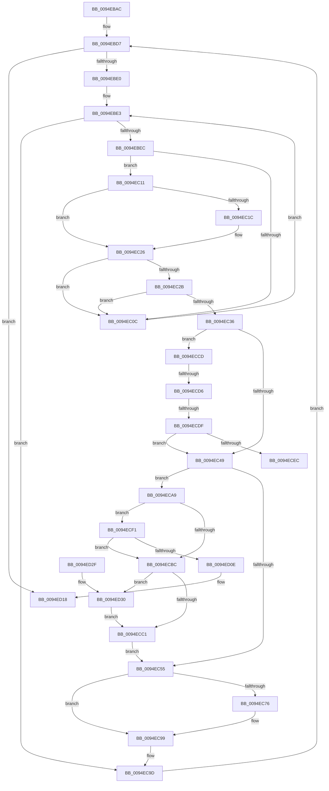

# PiSwUpdateArrayProperties

- RVA: `0x0094EBAC`–`0x0094ED3F` (길이 `403` bytes)
- VA: `0x000000014094EBAC`
- 실행 섹션: `PAGE`
- PDB 이름 있음: `예`; PDB Function 태그: `예`
- unwind 정보 RVA: `0x00091AA0`
- 디코드: `115`개 명령, `403/403` bytes 표시
- 미해석 바이트: `0` (있으면 어셈블리에 `.byte`로 보존)

> 이 문서는 커널 이미지의 기계어와 PDB 기호를 분석해 생성했습니다. 4번과 5번은 함수 원형과 자료형을 바이너리 사용 방식에서 추정한 C 해석이며 원본 소스 복구 결과는 아닙니다.

## 1. Dependencies

- 직접 호출 지점: **4**; 고유 호출 대상: **4**
- 직접 호출자로 확인된 함수: **3**
- RIP 상대 이미지 참조: **0**

### Outgoing calls
- `0x0094EC94` → [memcpy](../../text/6C/memcpy_function_006C6840.md) (function, `0x006C6840`)
- `0x0094ECDF` → [wcsicmp](../../text/50/wcsicmp_function_00500080.md) (function, `0x00500080`)
- `0x0094ECFF` → [ExAllocatePool2](../../poolcode/B8/ExAllocatePool2_function_00B820F0.md) (function, `0x00B820F0`)
- `0x0094ED38` → [ExFreePoolWithTag](../../poolcode/B8/ExFreePoolWithTag_function_00B82870.md) (function, `0x00B82870`)

### Direct callers
- [PiSwIrpInterfacePropertySet](../8F/PiSwIrpInterfacePropertySet_function_008F7900.md) at `0x008F7A38`
- [PiSwIrpPropertySet](PiSwIrpPropertySet_function_0094E97C.md) at `0x0094EAC0`
- [PiSwIrpInterfaceRegister](PiSwIrpInterfaceRegister_function_0094F01C.md) at `0x0094F2CD`

### Static image references
- 디코드된 RIP-relative 메모리 참조가 없습니다.

## 2. Other-region calls and transfers

- 다른 실행 섹션으로 향하는 call: **4**
  - `0x0094EC94` → [memcpy](../../text/6C/memcpy_function_006C6840.md) (`PAGE` → `.text`)
  - `0x0094ECDF` → [wcsicmp](../../text/50/wcsicmp_function_00500080.md) (`PAGE` → `.text`)
  - `0x0094ECFF` → [ExAllocatePool2](../../poolcode/B8/ExAllocatePool2_function_00B820F0.md) (`PAGE` → `POOLCODE`)
  - `0x0094ED38` → [ExFreePoolWithTag](../../poolcode/B8/ExFreePoolWithTag_function_00B82870.md) (`PAGE` → `POOLCODE`)
- call이 아닌 외부 분기/꼬리 이동: **3**
  - `0x0094ECD0` → [sub_00B2601A](../B2/Unknown_function_00B2601A.md) (`tail-transfer`)
  - `0x0094ECD9` → [sub_00B2601A](../B2/Unknown_function_00B2601A.md) (`tail-transfer`)
  - `0x0094ECEC` → [sub_00B2601A](../B2/Unknown_function_00B2601A.md) (`tail-transfer`)

## 3. Assembly (complete function range)

```asm
0094EBAC  48 89 5C 24 08                  mov qword ptr [rsp + 8], rbx
0094EBB1  44 89 4C 24 20                  mov dword ptr [rsp + 0x20], r9d
0094EBB6  89 54 24 10                     mov dword ptr [rsp + 0x10], edx
0094EBBA  55                              push rbp
0094EBBB  56                              push rsi
0094EBBC  57                              push rdi
0094EBBD  41 54                           push r12
0094EBBF  41 55                           push r13
0094EBC1  41 56                           push r14
0094EBC3  41 57                           push r15
0094EBC5  48 83 EC 20                     sub rsp, 0x20
0094EBC9  33 DB                           xor ebx, ebx
0094EBCB  41 8B C1                        mov eax, r9d
0094EBCE  44 8B EB                        mov r13d, ebx
0094EBD1  49 8B E8                        mov rbp, r8
0094EBD4  48 8B F9                        mov rdi, rcx
0094EBD7  44 3B E8                        cmp r13d, eax
0094EBDA  0F 83 38 01 00 00               jae 0x14094ed18
0094EBE0  44 8B FB                        mov r15d, ebx
0094EBE3  44 3B FA                        cmp r15d, edx
0094EBE6  0F 83 B1 00 00 00               jae 0x14094ec9d
0094EBEC  41 8B C7                        mov eax, r15d
0094EBEF  48 8D 34 40                     lea rsi, [rax + rax*2]
0094EBF3  41 8B C5                        mov eax, r13d
0094EBF6  48 C1 E6 04                     shl rsi, 4
0094EBFA  4C 8D 34 40                     lea r14, [rax + rax*2]
0094EBFE  8B 44 3E 10                     mov eax, dword ptr [rsi + rdi + 0x10]
0094EC02  4D 03 F6                        add r14, r14
0094EC05  42 39 44 F5 10                  cmp dword ptr [rbp + r14*8 + 0x10], eax
0094EC0A  74 05                           je 0x14094ec11
0094EC0C  41 FF C7                        inc r15d
0094EC0F  EB D2                           jmp 0x14094ebe3
0094EC11  4A 8B 4C F5 00                  mov rcx, qword ptr [rbp + r14*8]
0094EC16  48 2B 0C 3E                     sub rcx, qword ptr [rsi + rdi]
0094EC1A  75 0A                           jne 0x14094ec26
0094EC1C  4A 8B 4C F5 08                  mov rcx, qword ptr [rbp + r14*8 + 8]
0094EC21  48 2B 4C 3E 08                  sub rcx, qword ptr [rsi + rdi + 8]
0094EC26  48 85 C9                        test rcx, rcx
0094EC29  75 E1                           jne 0x14094ec0c
0094EC2B  8B 44 3E 14                     mov eax, dword ptr [rsi + rdi + 0x14]
0094EC2F  42 39 44 F5 14                  cmp dword ptr [rbp + r14*8 + 0x14], eax
0094EC34  75 D6                           jne 0x14094ec0c
0094EC36  4A 8B 4C F5 18                  mov rcx, qword ptr [rbp + r14*8 + 0x18]
0094EC3B  48 8B 54 3E 18                  mov rdx, qword ptr [rsi + rdi + 0x18]
0094EC40  48 3B CA                        cmp rcx, rdx
0094EC43  0F 85 84 00 00 00               jne 0x14094eccd
0094EC49  44 8B 44 3E 24                  mov r8d, dword ptr [rsi + rdi + 0x24]
0094EC4E  46 39 44 F5 24                  cmp dword ptr [rbp + r14*8 + 0x24], r8d
0094EC53  75 54                           jne 0x14094eca9
0094EC55  41 8B C5                        mov eax, r13d
0094EC58  48 8D 14 40                     lea rdx, [rax + rax*2]
0094EC5C  41 8B C7                        mov eax, r15d
0094EC5F  48 03 D2                        add rdx, rdx
0094EC62  48 8D 0C 40                     lea rcx, [rax + rax*2]
0094EC66  8B 44 D5 20                     mov eax, dword ptr [rbp + rdx*8 + 0x20]
0094EC6A  48 03 C9                        add rcx, rcx
0094EC6D  89 44 CF 20                     mov dword ptr [rdi + rcx*8 + 0x20], eax
0094EC71  45 85 C0                        test r8d, r8d
0094EC74  74 23                           je 0x14094ec99
0094EC76  41 8B C5                        mov eax, r13d
0094EC79  48 8D 14 40                     lea rdx, [rax + rax*2]
0094EC7D  41 8B C7                        mov eax, r15d
0094EC80  48 03 D2                        add rdx, rdx
0094EC83  48 8D 0C 40                     lea rcx, [rax + rax*2]
0094EC87  48 8B 54 D5 28                  mov rdx, qword ptr [rbp + rdx*8 + 0x28]
0094EC8C  48 03 C9                        add rcx, rcx
0094EC8F  48 8B 4C CF 28                  mov rcx, qword ptr [rdi + rcx*8 + 0x28]
0094EC94  E8 A7 7B D7 FF                  call 0x1406c6840
0094EC99  8B 54 24 68                     mov edx, dword ptr [rsp + 0x68]
0094EC9D  8B 44 24 78                     mov eax, dword ptr [rsp + 0x78]
0094ECA1  41 FF C5                        inc r13d
0094ECA4  E9 2E FF FF FF                  jmp 0x14094ebd7
0094ECA9  4C 8B 64 3E 28                  mov r12, qword ptr [rsi + rdi + 0x28]
0094ECAE  48 89 5C 3E 28                  mov qword ptr [rsi + rdi + 0x28], rbx
0094ECB3  42 8B 44 F5 24                  mov eax, dword ptr [rbp + r14*8 + 0x24]
0094ECB8  85 C0                           test eax, eax
0094ECBA  75 35                           jne 0x14094ecf1
0094ECBC  4D 85 E4                        test r12, r12
0094ECBF  75 6F                           jne 0x14094ed30
0094ECC1  46 8B 44 F5 24                  mov r8d, dword ptr [rbp + r14*8 + 0x24]
0094ECC6  44 89 44 3E 24                  mov dword ptr [rsi + rdi + 0x24], r8d
0094ECCB  EB 88                           jmp 0x14094ec55
0094ECCD  48 85 C9                        test rcx, rcx
0094ECD0  0F 84 44 73 1D 00               je 0x140b2601a
0094ECD6  48 85 D2                        test rdx, rdx
0094ECD9  0F 84 3B 73 1D 00               je 0x140b2601a
0094ECDF  E8 9C 13 BB FF                  call 0x140500080
0094ECE4  85 C0                           test eax, eax
0094ECE6  0F 84 5D FF FF FF               je 0x14094ec49
0094ECEC  E9 29 73 1D 00                  jmp 0x140b2601a
0094ECF1  48 8B D0                        mov rdx, rax
0094ECF4  B9 00 01 00 00                  mov ecx, 0x100
0094ECF9  41 B8 50 6E 70 57               mov r8d, 0x57706e50
0094ECFF  E8 EC 33 23 00                  call 0x140b820f0
0094ED04  48 89 44 3E 28                  mov qword ptr [rsi + rdi + 0x28], rax
0094ED09  48 85 C0                        test rax, rax
0094ED0C  75 AE                           jne 0x14094ecbc
0094ED0E  4C 89 64 3E 28                  mov qword ptr [rsi + rdi + 0x28], r12
0094ED13  BB 9A 00 00 C0                  mov ebx, 0xc000009a
0094ED18  8B C3                           mov eax, ebx
0094ED1A  48 8B 5C 24 60                  mov rbx, qword ptr [rsp + 0x60]
0094ED1F  48 83 C4 20                     add rsp, 0x20
0094ED23  41 5F                           pop r15
0094ED25  41 5E                           pop r14
0094ED27  41 5D                           pop r13
0094ED29  41 5C                           pop r12
0094ED2B  5F                              pop rdi
0094ED2C  5E                              pop rsi
0094ED2D  5D                              pop rbp
0094ED2E  C3                              ret
0094ED2F  CC                              int3
0094ED30  BA 50 6E 70 57                  mov edx, 0x57706e50
0094ED35  49 8B CC                        mov rcx, r12
0094ED38  E8 33 3B 23 00                  call 0x140b82870
0094ED3D  EB 82                           jmp 0x14094ecc1
```

## 4. C-style interpretation (structured pseudocode)

```c
__int64 __fastcall PiSwUpdateArrayProperties(__int64 a1, int a2, __int64 a3, int a4)
{
    __int64 result;
    __int64 v_r13;
    __int64 v_r14;
    __int64 v_r15;
    __int64 v_rbx;
    __int64 v_rsi;
    __int64 v_rsp;
    unsigned int v_stack_p10;
    unsigned int v_stack_p20;
    unsigned __int64 v_stack_p8;

    v_stack_p8 = v_rbx;
    v_stack_p20 = a4;
    v_stack_p10 = a2;
    v_rsp = (v_rsp) - (32);
    v_rbx = 0;
loc_0094EBD7:
    if (0 >= ((unsigned int)((unsigned int)(a4)))) goto loc_0094ED18;
loc_0094EBE3:
    if (0 >= a2) goto loc_0094EC9D;
    v_rsi = (0 + 0 * 2) << (4);
    v_r14 = (0 + 0 * 2) + (0 + 0 * 2);
    if ((*(unsigned int *)(a3 + v_r14 * 8 + 16)) == ((unsigned int)((unsigned int)(*(unsigned int *)(v_rsi + a1 * 1 + 16))))) goto loc_0094EC11;
loc_0094EC0C:
    v_r15 = (unsigned int)((0) + 1);
    goto loc_0094EBE3;
loc_0094EC11:
    a1 = (*(unsigned __int64 *)(a3 + v_r14 * 8)) - (*(unsigned __int64 *)(v_rsi + a1 * 1));
    if (!(condition_is_not_equal)) {
        a1 = *(unsigned __int64 *)(a3 + v_r14 * 8 + 8);
        a1 = (a1) - (*(unsigned __int64 *)(v_rsi + a1 * 1 + 8));
    }
    if (a1 != 0) goto loc_0094EC0C;
    if ((*(unsigned int *)(a3 + v_r14 * 8 + 20)) != ((unsigned int)((unsigned int)(*(unsigned int *)(v_rsi + a1 * 1 + 20))))) goto loc_0094EC0C;
    if ((*(unsigned __int64 *)(a3 + v_r14 * 8 + 24)) != (*(unsigned __int64 *)(v_rsi + a1 * 1 + 24))) goto loc_0094ECCD;
loc_0094EC49:
    if ((*(unsigned int *)(a3 + v_r14 * 8 + 36)) != ((unsigned int)((unsigned int)(*(unsigned int *)(v_rsi + a1 * 1 + 36))))) goto loc_0094ECA9;
loc_0094EC55:
    a2 = (0 + 0 * 2) + (0 + 0 * 2);
    a1 = ((unsigned int)((unsigned int)(v_r15)) + (unsigned int)((unsigned int)(v_r15)) * 2) + ((unsigned int)((unsigned int)(v_r15)) + (unsigned int)((unsigned int)(v_r15)) * 2);
    *(unsigned int *)(a1 + a1 * 8 + 32) = (unsigned int)((unsigned int)(*(unsigned int *)(a3 + a2 * 8 + 32)));
    result = (unsigned int)(*(unsigned int *)(a3 + a2 * 8 + 32));
    if ((unsigned int)((unsigned int)(*(unsigned int *)(v_rsi + a1 * 1 + 36))) != 0) {
        result = 0;
        a2 = result + result * 2;
        result = (unsigned int)(v_r15);
        a2 = (a2) + (a2);
        a1 = result + result * 2;
        a2 = *(unsigned __int64 *)(a3 + a2 * 8 + 40);
        a1 = (a1) + (a1);
        a1 = *(unsigned __int64 *)(a1 + a1 * 8 + 40);
        result = memcpy(a1, a2, (unsigned int)(*(unsigned int *)(v_rsi + a1 * 1 + 36)), a4);
    }
loc_0094EC9D:
    v_r13 = (unsigned int)((0) + 1);
    goto loc_0094EBD7;
loc_0094ECA9:
    *(unsigned __int64 *)(v_rsi + a1 * 1 + 40) = 0;
    if ((unsigned int)((unsigned int)(*(unsigned int *)(a3 + v_r14 * 8 + 36))) != 0) goto loc_0094ECF1;
loc_0094ECBC:
    if (*(unsigned __int64 *)(v_rsi + a1 * 1 + 40) != 0) goto loc_0094ED30;
loc_0094ECC1:
    *(unsigned int *)(v_rsi + a1 * 1 + 36) = (unsigned int)((unsigned int)(*(unsigned int *)(a3 + v_r14 * 8 + 36)));
    goto loc_0094EC55;
loc_0094ECCD:
    result = wcsicmp(a1, (unsigned int)(v_stack_p10), (unsigned int)(*(unsigned int *)(a3 + v_r14 * 8 + 36)), a4);
    if ((unsigned int)(result) == 0) goto loc_0094EC49;
loc_0094ECF1:
    result = ExAllocatePool2(256, result, (unsigned int)(0x57706E50ULL), a4);
    *(unsigned __int64 *)(v_rsi + a1 * 1 + 40) = result;
    if (result != 0) goto loc_0094ECBC;
    *(unsigned __int64 *)(v_rsi + a1 * 1 + 40) = *(unsigned __int64 *)(v_rsi + a1 * 1 + 40);
loc_0094ED18:
    v_rsp = (v_rsp) + (32);
    return (unsigned int)((unsigned int)((unsigned int)(0xC000009AULL)));
loc_0094ED30:
    result = ExFreePoolWithTag(*(unsigned __int64 *)(v_rsi + a1 * 1 + 40), (unsigned int)(0x57706E50ULL), (unsigned int)(0x57706E50ULL), a4);
    goto loc_0094ECC1;
}
```

## 5. (Beta) C Style

```c
int64_t PiSwUpdateArrayProperties(void *Arg1, int32_t Arg2, void *Arg3, int32_t Arg4)
{
    uint8_t *arg1 = (uint8_t *)Arg1;
    uint8_t *arg3 = (uint8_t *)Arg3;

    int64_t result;
    int64_t local_r13;
    int64_t local_r14;
    int64_t local_r15;
    int64_t local_rbx;
    int64_t local_rsi;
    int64_t local_rsp;
    uint32_t v_stack_p10;
    uint32_t v_stack_p20;
    uint64_t v_stack_p8;

    v_stack_p8 = local_rbx;
    v_stack_p20 = Arg4;
    v_stack_p10 = Arg2;
    local_rsp = (local_rsp) - (32);
    local_rbx = 0;
loc_0094EBD7:
    if (0 >= ((uint32_t)((uint32_t)(Arg4)))) goto loc_0094ED18;
loc_0094EBE3:
    if (0 >= Arg2) goto loc_0094EC9D;
    local_rsi = (0 + 0 * 2) << (4);
    local_r14 = (0 + 0 * 2) + (0 + 0 * 2);
    if ((*(uint32_t *)(arg3 + local_r14 * 8 + 0x10)) == ((uint32_t)((uint32_t)(*(uint32_t *)(local_rsi + arg1 * 1 + 0x10))))) goto loc_0094EC11;
loc_0094EC0C:
    local_r15 = (uint32_t)((0) + 1);
    goto loc_0094EBE3;
loc_0094EC11:
    Arg1 = (*(uint64_t *)(arg3 + local_r14 * 8)) - (*(uint64_t *)(local_rsi + arg1 * 1));
    if (!(condition_is_not_equal)) {
        Arg1 = *(uint64_t *)(arg3 + local_r14 * 8 + 0x8);
        Arg1 = (Arg1) - (*(uint64_t *)(local_rsi + arg1 * 1 + 0x8));
    }
    if (Arg1 != NULL) goto loc_0094EC0C;
    if ((*(uint32_t *)(arg3 + local_r14 * 8 + 0x14)) != ((uint32_t)((uint32_t)(*(uint32_t *)(local_rsi + arg1 * 1 + 0x14))))) goto loc_0094EC0C;
    if ((*(uint64_t *)(arg3 + local_r14 * 8 + 0x18)) != (*(uint64_t *)(local_rsi + arg1 * 1 + 0x18))) goto loc_0094ECCD;
loc_0094EC49:
    if ((*(uint32_t *)(arg3 + local_r14 * 8 + 0x24)) != ((uint32_t)((uint32_t)(*(uint32_t *)(local_rsi + arg1 * 1 + 0x24))))) goto loc_0094ECA9;
loc_0094EC55:
    Arg2 = (0 + 0 * 2) + (0 + 0 * 2);
    Arg1 = ((uint32_t)((uint32_t)(local_r15)) + (uint32_t)((uint32_t)(local_r15)) * 2) + ((uint32_t)((uint32_t)(local_r15)) + (uint32_t)((uint32_t)(local_r15)) * 2);
    *(uint32_t *)(arg1 + arg1 * 8 + 0x20) = (uint32_t)((uint32_t)(*(uint32_t *)(arg3 + Arg2 * 8 + 0x20)));
    result = (uint32_t)(*(uint32_t *)(arg3 + Arg2 * 8 + 0x20));
    if ((uint32_t)((uint32_t)(*(uint32_t *)(local_rsi + arg1 * 1 + 0x24))) != 0) {
        result = 0;
        Arg2 = result + result * 2;
        result = (uint32_t)(local_r15);
        Arg2 = (Arg2) + (Arg2);
        Arg1 = result + result * 2;
        Arg2 = *(uint64_t *)(arg3 + Arg2 * 8 + 0x28);
        Arg1 = (Arg1) + (Arg1);
        Arg1 = *(uint64_t *)(arg1 + arg1 * 8 + 0x28);
        result = memcpy(Arg1, Arg2, (uint32_t)(*(uint32_t *)(local_rsi + arg1 * 1 + 0x24)), Arg4);
    }
loc_0094EC9D:
    local_r13 = (uint32_t)((0) + 1);
    goto loc_0094EBD7;
loc_0094ECA9:
    *(uint64_t *)(local_rsi + arg1 * 1 + 0x28) = 0;
    if ((uint32_t)((uint32_t)(*(uint32_t *)(arg3 + local_r14 * 8 + 0x24))) != 0) goto loc_0094ECF1;
loc_0094ECBC:
    if (*(uint64_t *)(local_rsi + arg1 * 1 + 0x28) != 0) goto loc_0094ED30;
loc_0094ECC1:
    *(uint32_t *)(local_rsi + arg1 * 1 + 0x24) = (uint32_t)((uint32_t)(*(uint32_t *)(arg3 + local_r14 * 8 + 0x24)));
    goto loc_0094EC55;
loc_0094ECCD:
    result = wcsicmp(Arg1, (uint32_t)(v_stack_p10), (uint32_t)(*(uint32_t *)(arg3 + local_r14 * 8 + 0x24)), Arg4);
    if ((uint32_t)(result) == 0) goto loc_0094EC49;
loc_0094ECF1:
    result = ExAllocatePool2(256, result, (uint32_t)(0x57706E50ULL), Arg4);
    *(uint64_t *)(local_rsi + arg1 * 1 + 0x28) = result;
    if (result != 0) goto loc_0094ECBC;
    *(uint64_t *)(local_rsi + arg1 * 1 + 0x28) = *(uint64_t *)(local_rsi + arg1 * 1 + 0x28);
loc_0094ED18:
    local_rsp = (local_rsp) + (32);
    return (uint32_t)((uint32_t)((uint32_t)(0xC000009AULL)));
loc_0094ED30:
    result = ExFreePoolWithTag(*(uint64_t *)(local_rsi + arg1 * 1 + 0x28), (uint32_t)(0x57706E50ULL), (uint32_t)(0x57706E50ULL), Arg4);
    goto loc_0094ECC1;
}
```

### 관측된 메모리 오프셋

구조체 형식이 확인되지 않은 접근은 인자 기준의 오프셋으로만 기록했습니다.

| 기준 인자 | 오프셋 표현 | 폭 (bit) | 접근 |
|---|---:|---:|---|
| `Arg1` | `+ 0x20 + rcx*8` | `32` | `W` |
| `Arg1` | `+ 0x28 + rcx*8` | `64` | `R` |
| `Arg3` | `+ 0x0 + r14*8` | `64` | `R` |
| `Arg3` | `+ 0x8 + r14*8` | `64` | `R` |
| `Arg3` | `+ 0x10 + r14*8` | `32` | `R` |
| `Arg3` | `+ 0x14 + r14*8` | `32` | `R` |
| `Arg3` | `+ 0x18 + r14*8` | `64` | `R` |
| `Arg3` | `+ 0x20 + rdx*8` | `32` | `R` |
| `Arg3` | `+ 0x24 + r14*8` | `32` | `R` |
| `Arg3` | `+ 0x28 + rdx*8` | `64` | `R` |

## 6. Execution-region graph

[열기: 2D/3D 그래프와 함수 탐색 컨트롤 패널](../../../control-panel.html?section=page&rva=0x0094EBAC&view=graph)

- 2D 그래프는 위에서 아래로 흐르고, 3D 그래프는 빈 공간을 드래그해 회전합니다. Shift+드래그는 이동, 휠은 확대·축소, 함수 노드 선택은 대상 보고서 이동입니다.

### Static fallback


