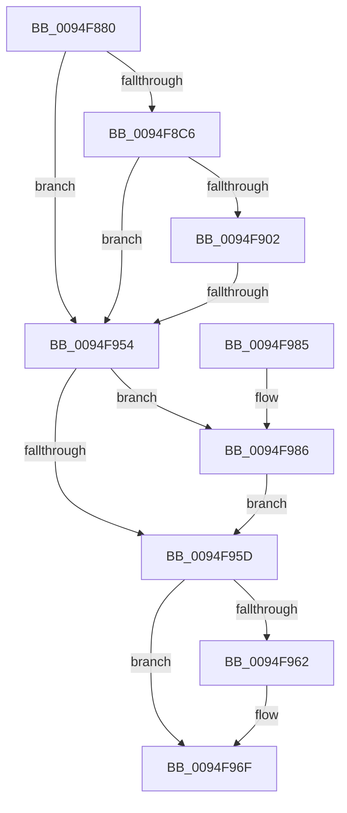

# PipCheckForDenyExecute

- RVA: `0x0094F880`–`0x0094F98D` (길이 `269` bytes)
- VA: `0x000000014094F880`
- 실행 섹션: `PAGE`
- PDB 이름 있음: `예`; PDB Function 태그: `예`
- unwind 정보 RVA: `0x00091B98`
- 디코드: `68`개 명령, `269/269` bytes 표시
- 미해석 바이트: `0` (있으면 어셈블리에 `.byte`로 보존)

> 이 문서는 커널 이미지의 기계어와 PDB 기호를 분석해 생성했습니다. 4번과 5번은 함수 원형과 자료형을 바이너리 사용 방식에서 추정한 C 해석이며 원본 소스 복구 결과는 아닙니다.

## 1. Dependencies

- 직접 호출 지점: **6**; 고유 호출 대상: **6**
- 직접 호출자로 확인된 함수: **1**
- RIP 상대 이미지 참조: **3**

### Outgoing calls
- `0x0094F8B9` → [wcsicmp](../../text/50/wcsicmp_function_00500080.md) (function, `0x00500080`)
- `0x0094F8F5` → [PnpConcatPWSTR](../99/PnpConcatPWSTR_function_00990A00.md) (function, `0x00990A00`)
- `0x0094F909` → [RtlInitUnicodeString](../../text/42/RtlInitUnicodeString_function_0042A780.md) (function, `0x0042A780`)
- `0x0094F947` → [ZwOpenKey](../../text/6A/ZwOpenKey_function_006AD310.md) (function, `0x006AD310`)
- `0x0094F96A` → [ExFreePoolWithTag](../../poolcode/B8/ExFreePoolWithTag_function_00B82870.md) (function, `0x00B82870`)
- `0x0094F986` → [ZwClose](../../text/6A/ZwClose_function_006AD2B0.md) (function, `0x006AD2B0`)

### Direct callers
- [IopRegisterDeviceInterface](../95/IopRegisterDeviceInterface_function_009501B0.md) at `0x009505F1`

### Static image references
- `0x0094F8A7` → RVA `0x00AFD7F0` (` ?? ::NNGAKEGL::`string'`; read)
- `0x0094F8C6` → RVA `0x00AFC990` (` ?? ::NNGAKEGL::`string'`; read)
- `0x0094F8DB` → RVA `0x00AFD840` (` ?? ::NNGAKEGL::`string'`; read)

## 2. Other-region calls and transfers

- 다른 실행 섹션으로 향하는 call: **5**
  - `0x0094F8B9` → [wcsicmp](../../text/50/wcsicmp_function_00500080.md) (`PAGE` → `.text`)
  - `0x0094F909` → [RtlInitUnicodeString](../../text/42/RtlInitUnicodeString_function_0042A780.md) (`PAGE` → `.text`)
  - `0x0094F947` → [ZwOpenKey](../../text/6A/ZwOpenKey_function_006AD310.md) (`PAGE` → `.text`)
  - `0x0094F96A` → [ExFreePoolWithTag](../../poolcode/B8/ExFreePoolWithTag_function_00B82870.md) (`PAGE` → `POOLCODE`)
  - `0x0094F986` → [ZwClose](../../text/6A/ZwClose_function_006AD2B0.md) (`PAGE` → `.text`)
- call이 아닌 외부 분기/꼬리 이동: **1**
  - `0x0094F94E` → [sub_00B26086](../B2/Unknown_function_00B26086.md) (`tail-transfer`)

## 3. Assembly (complete function range)

```asm
0094F880  48 89 5C 24 08                  mov qword ptr [rsp + 8], rbx
0094F885  55                              push rbp
0094F886  56                              push rsi
0094F887  57                              push rdi
0094F888  48 8B EC                        mov rbp, rsp
0094F88B  48 81 EC 80 00 00 00            sub rsp, 0x80
0094F892  48 83 65 38 00                  and qword ptr [rbp + 0x38], 0
0094F897  48 8B F1                        mov rsi, rcx
0094F89A  48 83 65 30 00                  and qword ptr [rbp + 0x30], 0
0094F89F  0F 57 C0                        xorps xmm0, xmm0
0094F8A2  48 8B D1                        mov rdx, rcx
0094F8A5  33 DB                           xor ebx, ebx
0094F8A7  48 8D 0D 42 DF 1A 00            lea rcx, [rip + 0x1adf42]
0094F8AE  48 89 5D 28                     mov qword ptr [rbp + 0x28], rbx
0094F8B2  0F 11 45 C0                     movups xmmword ptr [rbp - 0x40], xmm0
0094F8B6  40 32 FF                        xor dil, dil
0094F8B9  E8 C2 07 BB FF                  call 0x140500080
0094F8BE  85 C0                           test eax, eax
0094F8C0  0F 84 8E 00 00 00               je 0x14094f954
0094F8C6  48 8D 05 C3 D0 1A 00            lea rax, [rip + 0x1ad0c3]
0094F8CD  48 89 74 24 30                  mov qword ptr [rsp + 0x30], rsi
0094F8D2  48 89 44 24 28                  mov qword ptr [rsp + 0x28], rax
0094F8D7  44 8D 4B 03                     lea r9d, [rbx + 3]
0094F8DB  48 8D 05 5E DF 1A 00            lea rax, [rip + 0x1adf5e]
0094F8E2  BA 50 6E 70 47                  mov edx, 0x47706e50
0094F8E7  4C 8D 45 28                     lea r8, [rbp + 0x28]
0094F8EB  48 89 44 24 20                  mov qword ptr [rsp + 0x20], rax
0094F8F0  B9 00 02 00 00                  mov ecx, 0x200
0094F8F5  E8 06 11 04 00                  call 0x140990a00
0094F8FA  48 8B 5D 28                     mov rbx, qword ptr [rbp + 0x28]
0094F8FE  85 C0                           test eax, eax
0094F900  78 52                           js 0x14094f954
0094F902  48 8B D3                        mov rdx, rbx
0094F905  48 8D 4D C0                     lea rcx, [rbp - 0x40]
0094F909  E8 72 AE AD FF                  call 0x14042a780
0094F90E  83 65 EC 00                     and dword ptr [rbp - 0x14], 0
0094F912  48 8D 45 C0                     lea rax, [rbp - 0x40]
0094F916  48 83 65 D8 00                  and qword ptr [rbp - 0x28], 0
0094F91B  4C 8D 45 D0                     lea r8, [rbp - 0x30]
0094F91F  0F 57 C0                        xorps xmm0, xmm0
0094F922  48 C7 45 D0 30 00 00 00         mov qword ptr [rbp - 0x30], 0x30
0094F92A  83 65 D4 00                     and dword ptr [rbp - 0x2c], 0
0094F92E  48 8D 4D 30                     lea rcx, [rbp + 0x30]
0094F932  BA 19 00 02 00                  mov edx, 0x20019
0094F937  48 89 45 E0                     mov qword ptr [rbp - 0x20], rax
0094F93B  F3 0F 7F 45 F0                  movdqu xmmword ptr [rbp - 0x10], xmm0
0094F940  C7 45 E8 40 02 00 00            mov dword ptr [rbp - 0x18], 0x240
0094F947  E8 C4 D9 D5 FF                  call 0x1406ad310
0094F94C  85 C0                           test eax, eax
0094F94E  0F 89 32 67 1D 00               jns 0x140b26086
0094F954  48 8B 4D 30                     mov rcx, qword ptr [rbp + 0x30]
0094F958  48 85 C9                        test rcx, rcx
0094F95B  75 29                           jne 0x14094f986
0094F95D  48 85 DB                        test rbx, rbx
0094F960  74 0D                           je 0x14094f96f
0094F962  BA 50 6E 70 47                  mov edx, 0x47706e50
0094F967  48 8B CB                        mov rcx, rbx
0094F96A  E8 01 2F 23 00                  call 0x140b82870
0094F96F  48 8B 9C 24 A0 00 00 00         mov rbx, qword ptr [rsp + 0xa0]
0094F977  40 8A C7                        mov al, dil
0094F97A  48 81 C4 80 00 00 00            add rsp, 0x80
0094F981  5F                              pop rdi
0094F982  5E                              pop rsi
0094F983  5D                              pop rbp
0094F984  C3                              ret
0094F985  CC                              int3
0094F986  E8 25 D9 D5 FF                  call 0x1406ad2b0
0094F98B  EB D0                           jmp 0x14094f95d
```

## 4. C-style interpretation (structured pseudocode)

```c
__int64 __fastcall PipCheckForDenyExecute(__int64 a1)
{
    __int64 result;
    __int64 v_rbx;
    __int64 v_rdi;
    __int64 v_rsp;
    unsigned __int64 v_stack_m28;
    unsigned int v_stack_m2C;
    unsigned int v_stack_m30;
    unsigned __int64 v_stack_m38;
    unsigned __int64 v_stack_m40;
    unsigned int v_stack_m44;
    unsigned __int64 v_stack_m48;
    unsigned __int64 v_stack_m58;
    unsigned __int64 v_stack_m68;
    unsigned __int64 v_stack_m70;
    unsigned __int64 v_stack_m78;
    unsigned __int64 v_stack_p10;
    unsigned __int64 v_stack_p18;
    unsigned __int64 v_stack_p20;
    unsigned __int64 v_stack_p8;

    v_stack_p8 = v_rbx;
    v_rsp = (v_rsp) - (128);
    v_rbx = 0;
    v_stack_p10 = 0;
    v_stack_m58 = v_xmm0;
    v_rdi = 0;
    result = wcsicmp(v_rip + 1761090, a1, a3, a4);
    if ((unsigned int)(result) == 0) goto loc_0094F954;
    v_stack_m68 = a1;
    v_stack_m70 = v_rip + 1757379;
    v_stack_m78 = v_rip + 1761118;
    result = PnpConcatPWSTR(512, (unsigned int)(0x47706E50ULL), v_stack_p10, v_rbx + 3);
    if (sign_flag) goto loc_0094F954;
    result = RtlInitUnicodeString(v_stack_m58, v_stack_p10, v_stack_p10, v_rbx + 3);
    v_stack_m48 = 48;
    v_stack_m38 = v_stack_m58;
    v_stack_m28 = v_xmm0;
    v_stack_m30 = 576;
    result = ZwOpenKey(v_stack_p18, (unsigned int)(0x20019ULL), v_stack_m48, v_rbx + 3);
loc_0094F954:
    if (v_stack_p18 != 0) goto loc_0094F986;
loc_0094F95D:
    if (v_stack_p10 != 0) {
        a2 = 0x47706E50ULL;
        a1 = v_stack_p10;
        result = ExFreePoolWithTag(a1, a2, v_stack_m48, v_rbx + 3);
    }
    v_rsp = (v_rsp) + (128);
    return 0;
loc_0094F986:
    result = ZwClose(a1, a2, v_stack_m48, v_rbx + 3);
    goto loc_0094F95D;
}
```

## 5. (Beta) C Style

```c
int64_t PipCheckForDenyExecute(int64_t Arg1)
{
    int64_t result;
    int64_t local_rbx;
    int64_t local_rdi;
    int64_t local_rsp;
    uint64_t v_stack_m28;
    uint32_t v_stack_m2C;
    uint32_t v_stack_m30;
    uint64_t v_stack_m38;
    uint64_t v_stack_m40;
    uint32_t v_stack_m44;
    uint64_t v_stack_m48;
    uint64_t v_stack_m58;
    uint64_t v_stack_m68;
    uint64_t v_stack_m70;
    uint64_t v_stack_m78;
    uint64_t v_stack_p10;
    uint64_t v_stack_p18;
    uint64_t v_stack_p20;
    uint64_t v_stack_p8;

    v_stack_p8 = local_rbx;
    local_rsp = (local_rsp) - (128);
    local_rbx = 0;
    v_stack_p10 = 0;
    v_stack_m58 = v_xmm0;
    local_rdi = 0;
    result = wcsicmp(v_rip + 1761090, Arg1, a3, a4);
    if ((uint32_t)(result) == 0) goto loc_0094F954;
    v_stack_m68 = Arg1;
    v_stack_m70 = v_rip + 1757379;
    v_stack_m78 = v_rip + 1761118;
    result = PnpConcatPWSTR(512, (uint32_t)(0x47706E50ULL), v_stack_p10, local_rbx + 3);
    if (sign_flag) goto loc_0094F954;
    result = RtlInitUnicodeString(v_stack_m58, v_stack_p10, v_stack_p10, local_rbx + 3);
    v_stack_m48 = 48;
    v_stack_m38 = v_stack_m58;
    v_stack_m28 = v_xmm0;
    v_stack_m30 = 576;
    result = ZwOpenKey(v_stack_p18, (uint32_t)(0x20019ULL), v_stack_m48, local_rbx + 3);
loc_0094F954:
    if (v_stack_p18 != 0) goto loc_0094F986;
loc_0094F95D:
    if (v_stack_p10 != 0) {
        a2 = 0x47706E50ULL;
        Arg1 = v_stack_p10;
        result = ExFreePoolWithTag(Arg1, a2, v_stack_m48, local_rbx + 3);
    }
    local_rsp = (local_rsp) + (128);
    return 0;
loc_0094F986:
    result = ZwClose(Arg1, a2, v_stack_m48, local_rbx + 3);
    goto loc_0094F95D;
}
```

## 6. Execution-region graph

[열기: 2D/3D 그래프와 함수 탐색 컨트롤 패널](../../../control-panel.html?section=page&rva=0x0094F880&view=graph)

- 2D 그래프는 위에서 아래로 흐르고, 3D 그래프는 빈 공간을 드래그해 회전합니다. Shift+드래그는 이동, 휠은 확대·축소, 함수 노드 선택은 대상 보고서 이동입니다.

### Static fallback


