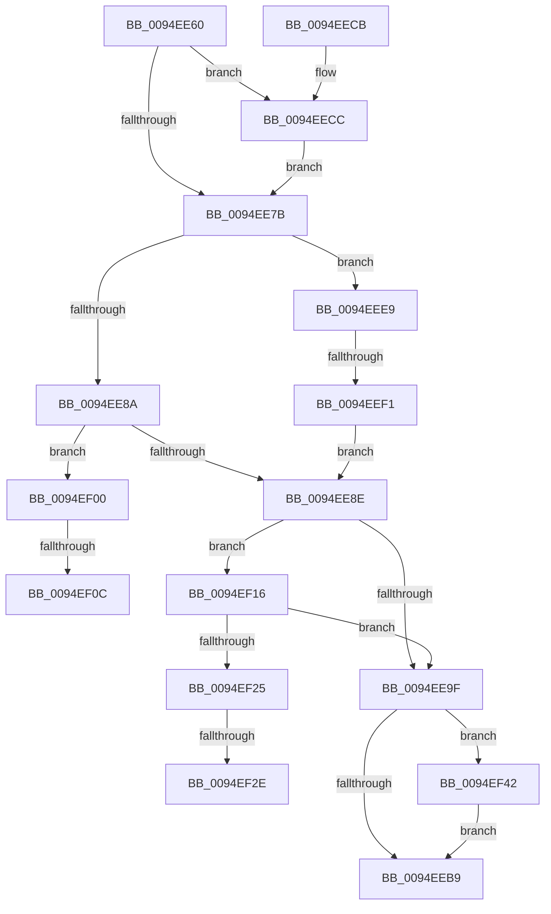

# PipProcessStartPhase2

- RVA: `0x0094EE60`–`0x0094EF62` (길이 `258` bytes)
- VA: `0x000000014094EE60`
- 실행 섹션: `PAGE`
- PDB 이름 있음: `예`; PDB Function 태그: `예`
- unwind 정보 RVA: `0x00091AE4`
- 디코드: `60`개 명령, `258/258` bytes 표시
- 미해석 바이트: `0` (있으면 어셈블리에 `.byte`로 보존)

> 이 문서는 커널 이미지의 기계어와 PDB 기호를 분석해 생성했습니다. 4번과 5번은 함수 원형과 자료형을 바이너리 사용 방식에서 추정한 C 해석이며 원본 소스 복구 결과는 아닙니다.

## 1. Dependencies

- 직접 호출 지점: **6**; 고유 호출 대상: **5**
- 직접 호출자로 확인된 함수: **1**
- RIP 상대 이미지 참조: **4**

### Outgoing calls
- `0x0094EE91` → [IopDoDeferredSetInterfaceState](IopDoDeferredSetInterfaceState_function_0094EF68.md) (function, `0x0094EF68`)
- `0x0094EEA7` → [PipSetDevNodeState](../../text/47/PipSetDevNodeState_function_00470708.md) (function, `0x00470708`)
- `0x0094EEE2` → [McTemplateK0dz_EtwWriteTransfer](../../text/42/McTemplateK0dz_EtwWriteTransfer_function_0042316C.md) (function, `0x0042316C`)
- `0x0094EEF9` → [PpProfileCommitTransitioningDock](../73/PpProfileCommitTransitioningDock_function_00737A4C.md) (function, `0x00737A4C`)
- `0x0094EF37` → [IopAllocateLegacyBootResources](../../init/C3/IopAllocateLegacyBootResources_function_00C34138.md) (function, `0x00C34138`)
- `0x0094EF58` → [McTemplateK0dz_EtwWriteTransfer](../../text/42/McTemplateK0dz_EtwWriteTransfer_function_0042316C.md) (function, `0x0042316C`)

### Direct callers
- [PipProcessDevNodeTree](../8F/PipProcessDevNodeTree_function_008F9068.md) at `0x008F96D5`

### Static image references
- `0x0094EE6F` → RVA `0x00EF012B` (`.data`; read)
- `0x0094EE96` → RVA `0x00F8C5F8` (`.data`; read)
- `0x0094EED0` → RVA `0x00011740` (`.rdata`; read)
- `0x0094EF46` → RVA `0x00011768` (`.rdata`; read)

## 2. Other-region calls and transfers

- 다른 실행 섹션으로 향하는 call: **4**
  - `0x0094EEA7` → [PipSetDevNodeState](../../text/47/PipSetDevNodeState_function_00470708.md) (`PAGE` → `.text`)
  - `0x0094EEE2` → [McTemplateK0dz_EtwWriteTransfer](../../text/42/McTemplateK0dz_EtwWriteTransfer_function_0042316C.md) (`PAGE` → `.text`)
  - `0x0094EF37` → [IopAllocateLegacyBootResources](../../init/C3/IopAllocateLegacyBootResources_function_00C34138.md) (`PAGE` → `INIT`)
  - `0x0094EF58` → [McTemplateK0dz_EtwWriteTransfer](../../text/42/McTemplateK0dz_EtwWriteTransfer_function_0042316C.md) (`PAGE` → `.text`)
- call이 아닌 외부 분기/꼬리 이동: **5**
  - `0x0094EEEB` → [sub_00B26024](../B2/Unknown_function_00B26024.md) (`tail-transfer`)
  - `0x0094EF06` → [sub_00B26024 + 0xB](../B2/Unknown_function_00B26024.md) (`tail-transfer`)
  - `0x0094EF11` → [sub_00B26024 + 0x1F](../B2/Unknown_function_00B26024.md) (`tail-transfer`)
  - `0x0094EF28` → [sub_00B26024 + 0x4B](../B2/Unknown_function_00B26024.md) (`tail-transfer`)
  - `0x0094EF3D` → [sub_00B26024 + 0x4B](../B2/Unknown_function_00B26024.md) (`tail-transfer`)

## 3. Assembly (complete function range)

```asm
0094EE60  48 89 5C 24 08                  mov qword ptr [rsp + 8], rbx
0094EE65  48 89 74 24 10                  mov qword ptr [rsp + 0x10], rsi
0094EE6A  57                              push rdi
0094EE6B  48 83 EC 30                     sub rsp, 0x30
0094EE6F  F6 05 B5 12 5A 00 20            test byte ptr [rip + 0x5a12b5], 0x20
0094EE76  48 8B D9                        mov rbx, rcx
0094EE79  75 51                           jne 0x14094eecc
0094EE7B  83 BB 38 02 00 00 00            cmp dword ptr [rbx + 0x238], 0
0094EE82  8B BB 88 01 00 00               mov edi, dword ptr [rbx + 0x188]
0094EE88  75 5F                           jne 0x14094eee9
0094EE8A  85 FF                           test edi, edi
0094EE8C  78 72                           js 0x14094ef00
0094EE8E  48 8B CB                        mov rcx, rbx
0094EE91  E8 D2 00 00 00                  call 0x14094ef68
0094EE96  80 3D 5B D7 63 00 00            cmp byte ptr [rip + 0x63d75b], 0
0094EE9D  74 77                           je 0x14094ef16
0094EE9F  BA 09 03 00 00                  mov edx, 0x309
0094EEA4  48 8B CB                        mov rcx, rbx
0094EEA7  E8 5C 18 B2 FF                  call 0x140470708
0094EEAC  F6 05 78 12 5A 00 20            test byte ptr [rip + 0x5a1278], 0x20
0094EEB3  0F 85 89 00 00 00               jne 0x14094ef42
0094EEB9  48 8B 5C 24 40                  mov rbx, qword ptr [rsp + 0x40]
0094EEBE  8B C7                           mov eax, edi
0094EEC0  48 8B 74 24 48                  mov rsi, qword ptr [rsp + 0x48]
0094EEC5  48 83 C4 30                     add rsp, 0x30
0094EEC9  5F                              pop rdi
0094EECA  C3                              ret
0094EECB  CC                              int3
0094EECC  48 8B 41 30                     mov rax, qword ptr [rcx + 0x30]
0094EED0  48 8D 15 69 28 6C FF            lea rdx, [rip - 0x93d797]
0094EED7  41 B9 02 00 00 00               mov r9d, 2
0094EEDD  48 89 44 24 20                  mov qword ptr [rsp + 0x20], rax
0094EEE2  E8 85 42 AD FF                  call 0x14042316c
0094EEE7  EB 92                           jmp 0x14094ee7b
0094EEE9  85 FF                           test edi, edi
0094EEEB  0F 88 33 71 1D 00               js 0x140b26024
0094EEF1  BA 02 00 00 00                  mov edx, 2
0094EEF6  48 8B CB                        mov rcx, rbx
0094EEF9  E8 4E 8B DE FF                  call 0x140737a4c
0094EEFE  EB 8E                           jmp 0x14094ee8e
0094EF00  81 FF D2 02 00 C0               cmp edi, 0xc00002d2
0094EF06  0F 84 23 71 1D 00               je 0x140b2602f
0094EF0C  BE 0A 00 00 00                  mov esi, 0xa
0094EF11  E9 2D 71 1D 00                  jmp 0x140b26043
0094EF16  8B 83 C0 01 00 00               mov eax, dword ptr [rbx + 0x1c0]
0094EF1C  83 F8 FF                        cmp eax, -1
0094EF1F  0F 84 7A FF FF FF               je 0x14094ee9f
0094EF25  83 F8 01                        cmp eax, 1
0094EF28  0F 85 41 71 1D 00               jne 0x140b2606f
0094EF2E  8B 93 C4 01 00 00               mov edx, dword ptr [rbx + 0x1c4]
0094EF34  8D 48 01                        lea ecx, [rax + 1]
0094EF37  E8 FC 51 2E 00                  call 0x140c34138
0094EF3C  90                              nop
0094EF3D  E9 2D 71 1D 00                  jmp 0x140b2606f
0094EF42  48 8B 4B 30                     mov rcx, qword ptr [rbx + 0x30]
0094EF46  48 8D 15 1B 28 6C FF            lea rdx, [rip - 0x93d7e5]
0094EF4D  41 B9 02 00 00 00               mov r9d, 2
0094EF53  48 89 4C 24 20                  mov qword ptr [rsp + 0x20], rcx
0094EF58  E8 0F 42 AD FF                  call 0x14042316c
0094EF5D  E9 57 FF FF FF                  jmp 0x14094eeb9
```

## 4. C-style interpretation (structured pseudocode)

```c
__int64 __fastcall PipProcessStartPhase2(__int64 a1)
{
    __int64 result;
    __int64 v_rsp;
    unsigned __int64 v_stack_p10;
    unsigned __int64 v_stack_p20;
    unsigned __int64 v_stack_p8;

    v_stack_p8 = v_rbx;
    v_stack_p10 = v_rsi;
    v_rsp = (v_rsp) - (48);
    if (((*(unsigned __int8 *)(v_rip + 5903029)) & (32)) != 0) goto loc_0094EECC;
loc_0094EE7B:
    if ((*(unsigned int *)(a1 + 568)) != 0) goto loc_0094EEE9;
    if (sign_flag) goto loc_0094EF00;
loc_0094EE8E:
    result = IopDoDeferredSetInterfaceState(a1, a2, a3, a4);
    if ((*(unsigned __int8 *)(v_rip + 6543195)) == 0) goto loc_0094EF16;
loc_0094EE9F:
    result = PipSetDevNodeState(a1, 777, a3, a4);
    if (((*(unsigned __int8 *)(v_rip + 5902968)) & (32)) != 0) goto loc_0094EF42;
loc_0094EEB9:
    v_rsp = (v_rsp) + (48);
    return (unsigned int)((unsigned int)((unsigned int)(*(unsigned int *)(a1 + 392))));
loc_0094EECC:
    v_stack_p20 = *(unsigned __int64 *)(a1 + 48);
    result = McTemplateK0dz_EtwWriteTransfer(a1, v_rip - 9688983, a3, 2);
    goto loc_0094EE7B;
loc_0094EEE9:
    result = PpProfileCommitTransitioningDock(v_stack_p8, 2, a3, 2);
    goto loc_0094EE8E;
loc_0094EF00:
loc_0094EF16:
    if (((unsigned int)((unsigned int)(*(unsigned int *)(v_stack_p8 + 448)))) == -1) goto loc_0094EE9F;
    result = IopAllocateLegacyBootResources((unsigned int)(*(unsigned int *)(v_stack_p8 + 448)) + 1, (unsigned int)(*(unsigned int *)(v_stack_p8 + 452)), a3, 2);
loc_0094EF42:
    v_stack_p20 = *(unsigned __int64 *)(v_stack_p8 + 48);
    result = McTemplateK0dz_EtwWriteTransfer(*(unsigned __int64 *)(v_stack_p8 + 48), v_rip - 9689061, a3, 2);
    goto loc_0094EEB9;
}
```

## 5. (Beta) C Style

```c
int64_t PipProcessStartPhase2(void *Arg1)
{
    uint8_t *arg1 = (uint8_t *)Arg1;

    int64_t result;
    int64_t local_rsp;
    uint64_t v_stack_p10;
    uint64_t v_stack_p20;
    uint64_t v_stack_p8;

    v_stack_p8 = local_rbx;
    v_stack_p10 = local_rsi;
    local_rsp = (local_rsp) - (48);
    if (((*(uint8_t *)(v_rip + 0x5A12B5)) & (32)) != 0) goto loc_0094EECC;
loc_0094EE7B:
    if ((*(uint32_t *)(arg1 + 0x238)) != 0) goto loc_0094EEE9;
    if (sign_flag) goto loc_0094EF00;
loc_0094EE8E:
    result = IopDoDeferredSetInterfaceState(Arg1, a2, a3, a4);
    if ((*(uint8_t *)(v_rip + 0x63D75B)) == 0) goto loc_0094EF16;
loc_0094EE9F:
    result = PipSetDevNodeState(Arg1, 777, a3, a4);
    if (((*(uint8_t *)(v_rip + 0x5A1278)) & (32)) != 0) goto loc_0094EF42;
loc_0094EEB9:
    local_rsp = (local_rsp) + (48);
    return (uint32_t)((uint32_t)((uint32_t)(*(uint32_t *)(arg1 + 0x188))));
loc_0094EECC:
    v_stack_p20 = *(uint64_t *)(arg1 + 0x30);
    result = McTemplateK0dz_EtwWriteTransfer(Arg1, v_rip - 9688983, a3, 2);
    goto loc_0094EE7B;
loc_0094EEE9:
    result = PpProfileCommitTransitioningDock(v_stack_p8, 2, a3, 2);
    goto loc_0094EE8E;
loc_0094EF00:
loc_0094EF16:
    if (((uint32_t)((uint32_t)(*(uint32_t *)(v_stack_p8 + 0x1C0)))) == -1) goto loc_0094EE9F;
    result = IopAllocateLegacyBootResources((uint32_t)(*(uint32_t *)(v_stack_p8 + 0x1C0)) + 1, (uint32_t)(*(uint32_t *)(v_stack_p8 + 0x1C4)), a3, 2);
loc_0094EF42:
    v_stack_p20 = *(uint64_t *)(v_stack_p8 + 0x30);
    result = McTemplateK0dz_EtwWriteTransfer(*(uint64_t *)(v_stack_p8 + 0x30), v_rip - 9689061, a3, 2);
    goto loc_0094EEB9;
}
```

### 관측된 메모리 오프셋

구조체 형식이 확인되지 않은 접근은 인자 기준의 오프셋으로만 기록했습니다.

| 기준 인자 | 오프셋 표현 | 폭 (bit) | 접근 |
|---|---:|---:|---|
| `Arg1` | `+ 0x30` | `64` | `R` |
| `Arg1` | `+ 0x188` | `32` | `R` |
| `Arg1` | `+ 0x1C0` | `32` | `R` |
| `Arg1` | `+ 0x1C4` | `32` | `R` |
| `Arg1` | `+ 0x238` | `32` | `R` |

## 6. Execution-region graph

[열기: 2D/3D 그래프와 함수 탐색 컨트롤 패널](../../../control-panel.html?section=page&rva=0x0094EE60&view=graph)

- 2D 그래프는 위에서 아래로 흐르고, 3D 그래프는 빈 공간을 드래그해 회전합니다. Shift+드래그는 이동, 휠은 확대·축소, 함수 노드 선택은 대상 보고서 이동입니다.

### Static fallback


