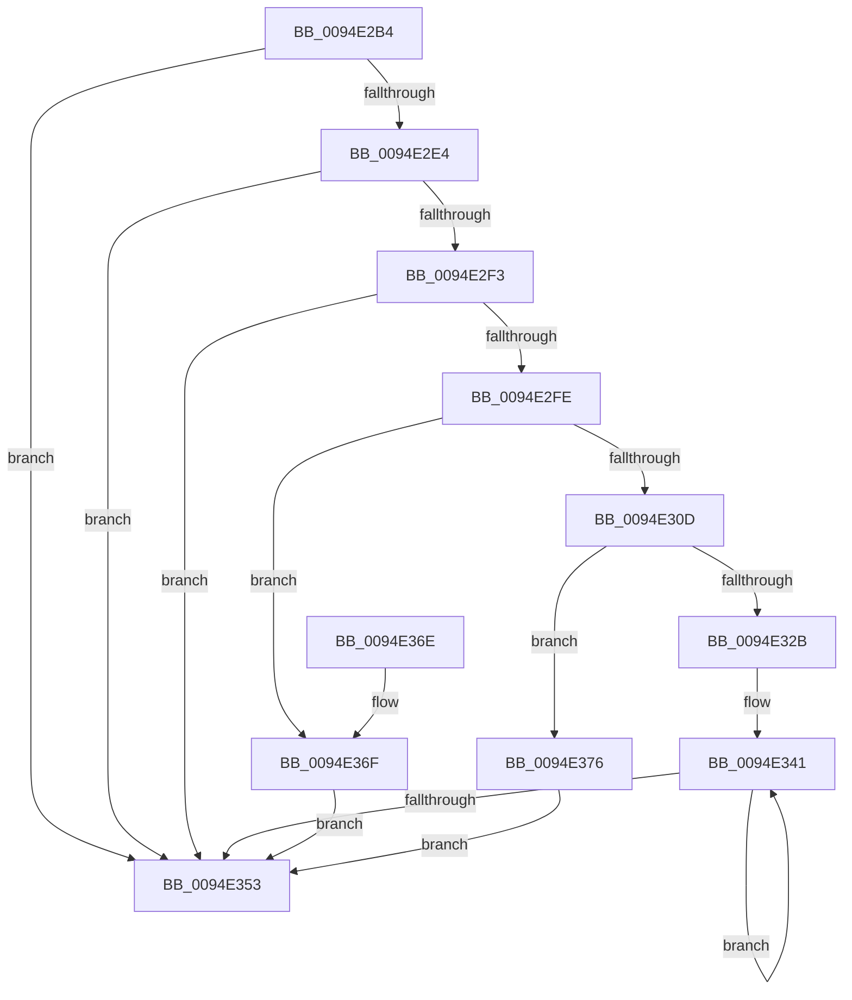

# PnpAllocateMultiSZ

- RVA: `0x0094E2B4`–`0x0094E37D` (길이 `201` bytes)
- VA: `0x000000014094E2B4`
- 실행 섹션: `PAGE`
- PDB 이름 있음: `예`; PDB Function 태그: `아니요`
- unwind 정보 RVA: `0x000919E0`
- 디코드: `62`개 명령, `201/201` bytes 표시
- 미해석 바이트: `0` (있으면 어셈블리에 `.byte`로 보존)

> 이 문서는 커널 이미지의 기계어와 PDB 기호를 분석해 생성했습니다. 4번과 5번은 함수 원형과 자료형을 바이너리 사용 방식에서 추정한 C 해석이며 원본 소스 복구 결과는 아닙니다.

## 1. Dependencies

- 직접 호출 지점: **3**; 고유 호출 대상: **3**
- 직접 호출자로 확인된 함수: **2**
- RIP 상대 이미지 참조: **0**

### Outgoing calls
- `0x0094E2E8` → [PnpGetMultiSzLength](PnpGetMultiSzLength_function_0094E690.md) (function, `0x0094E690`)
- `0x0094E31E` → [ExAllocatePool2](../../poolcode/B8/ExAllocatePool2_function_00B820F0.md) (function, `0x00B820F0`)
- `0x0094E334` → [memcpy](../../text/6C/memcpy_function_006C6840.md) (function, `0x006C6840`)

### Direct callers
- [PiSwPnPInfoInit](../8D/PiSwPnPInfoInit_function_008DB2DC.md) at `0x008DB2FC`
- [PiSwPnPInfoInit](../8D/PiSwPnPInfoInit_function_008DB2DC.md) at `0x008DB310`
- [PiSwPdoPnPDispatch](PiSwPdoPnPDispatch_function_0094DDF0.md) at `0x0094DE7E`

### Static image references
- 디코드된 RIP-relative 메모리 참조가 없습니다.

## 2. Other-region calls and transfers

- 다른 실행 섹션으로 향하는 call: **2**
  - `0x0094E31E` → [ExAllocatePool2](../../poolcode/B8/ExAllocatePool2_function_00B820F0.md) (`PAGE` → `POOLCODE`)
  - `0x0094E334` → [memcpy](../../text/6C/memcpy_function_006C6840.md) (`PAGE` → `.text`)
- 별도 외부 분기/꼬리 이동을 확인하지 못했습니다.

## 3. Assembly (complete function range)

```asm
0094E2B4  48 8B C4                        mov rax, rsp
0094E2B7  48 89 58 10                     mov qword ptr [rax + 0x10], rbx
0094E2BB  48 89 68 18                     mov qword ptr [rax + 0x18], rbp
0094E2BF  48 89 70 20                     mov qword ptr [rax + 0x20], rsi
0094E2C3  57                              push rdi
0094E2C4  41 56                           push r14
0094E2C6  41 57                           push r15
0094E2C8  48 83 EC 20                     sub rsp, 0x20
0094E2CC  45 33 FF                        xor r15d, r15d
0094E2CF  4D 8B F1                        mov r14, r9
0094E2D2  4C 89 78 08                     mov qword ptr [rax + 8], r15
0094E2D6  48 8B F1                        mov rsi, rcx
0094E2D9  4D 89 39                        mov qword ptr [r9], r15
0094E2DC  41 8B DF                        mov ebx, r15d
0094E2DF  48 85 C9                        test rcx, rcx
0094E2E2  74 6F                           je 0x14094e353
0094E2E4  4C 8D 40 08                     lea r8, [rax + 8]
0094E2E8  E8 A3 03 00 00                  call 0x14094e690
0094E2ED  8B D8                           mov ebx, eax
0094E2EF  85 C0                           test eax, eax
0094E2F1  78 60                           js 0x14094e353
0094E2F3  48 8B 7C 24 40                  mov rdi, qword ptr [rsp + 0x40]
0094E2F8  48 83 FF 02                     cmp rdi, 2
0094E2FC  76 55                           jbe 0x14094e353
0094E2FE  41 8D 47 02                     lea eax, [r15 + 2]
0094E302  48 F7 E7                        mul rdi
0094E305  48 8B E8                        mov rbp, rax
0094E308  48 85 D2                        test rdx, rdx
0094E30B  75 62                           jne 0x14094e36f
0094E30D  41 B8 50 6E 70 57               mov r8d, 0x57706e50
0094E313  48 8B D0                        mov rdx, rax
0094E316  B9 00 01 00 00                  mov ecx, 0x100
0094E31B  41 8B DF                        mov ebx, r15d
0094E31E  E8 CD 3D 23 00                  call 0x140b820f0
0094E323  49 89 06                        mov qword ptr [r14], rax
0094E326  48 85 C0                        test rax, rax
0094E329  74 4B                           je 0x14094e376
0094E32B  4C 8B C5                        mov r8, rbp
0094E32E  48 8B D6                        mov rdx, rsi
0094E331  48 8B C8                        mov rcx, rax
0094E334  E8 07 85 D7 FF                  call 0x1406c6840
0094E339  48 8D 0C 3F                     lea rcx, [rdi + rdi]
0094E33D  41 8D 57 02                     lea edx, [r15 + 2]
0094E341  49 8B 06                        mov rax, qword ptr [r14]
0094E344  48 8D 49 FE                     lea rcx, [rcx - 2]
0094E348  66 44 89 3C 01                  mov word ptr [rcx + rax], r15w
0094E34D  48 83 EA 01                     sub rdx, 1
0094E351  75 EE                           jne 0x14094e341
0094E353  48 8B 6C 24 50                  mov rbp, qword ptr [rsp + 0x50]
0094E358  8B C3                           mov eax, ebx
0094E35A  48 8B 5C 24 48                  mov rbx, qword ptr [rsp + 0x48]
0094E35F  48 8B 74 24 58                  mov rsi, qword ptr [rsp + 0x58]
0094E364  48 83 C4 20                     add rsp, 0x20
0094E368  41 5F                           pop r15
0094E36A  41 5E                           pop r14
0094E36C  5F                              pop rdi
0094E36D  C3                              ret
0094E36E  CC                              int3
0094E36F  BB 95 00 00 C0                  mov ebx, 0xc0000095
0094E374  EB DD                           jmp 0x14094e353
0094E376  BB 9A 00 00 C0                  mov ebx, 0xc000009a
0094E37B  EB D6                           jmp 0x14094e353
```

## 4. C-style interpretation (structured pseudocode)

```c
__int64 __fastcall PnpAllocateMultiSZ(__int64 a1, __int64 a2, __int64 a3, __int64 a4)
{
    __int64 result;
    __int64 v_r15;
    __int64 v_rsp;
    unsigned __int64 v_stack_p10;
    unsigned __int64 v_stack_p18;
    unsigned __int64 v_stack_p20;
    unsigned __int64 v_stack_p8;

    *(unsigned __int64 *)(v_rsp + 16) = v_rbx;
    *(unsigned __int64 *)(v_rsp + 24) = v_rbp;
    *(unsigned __int64 *)(v_rsp + 32) = v_rsi;
    v_rsp = (v_rsp) - (32);
    v_r15 = 0;
    *(unsigned __int64 *)(v_rsp + 8) = 0;
    *(unsigned __int64 *)(a4) = 0;
    if (a1 == 0) goto loc_0094E353;
    result = PnpGetMultiSzLength(a1, a2, v_rsp + 8, a4);
    if (sign_flag) goto loc_0094E353;
    if (v_stack_p8 <= 2) goto loc_0094E353;
    if (a2 != 0) goto loc_0094E36F;
    result = ExAllocatePool2(256, v_r15 + 2, (unsigned int)(0x57706E50ULL), a4);
    *(unsigned __int64 *)(a4) = result;
    if (result == 0) goto loc_0094E376;
    result = memcpy(result, a1, v_r15 + 2, a4);
loc_0094E341:
    *(unsigned __int16 *)(v_stack_p8 + v_stack_p8 * 1 - 2 + *(unsigned __int64 *)(a4) * 1) = 0;
    a2 = (v_r15 + 2) - (1);
    if (condition_is_not_equal) goto loc_0094E341;
loc_0094E353:
    v_rsp = (v_rsp) + (32);
    return 0;
loc_0094E36F:
    goto loc_0094E353;
loc_0094E376:
    goto loc_0094E353;
}
```

## 5. (Beta) C Style

```c
int64_t PnpAllocateMultiSZ(int64_t Arg1, int64_t Arg2, int64_t Arg3, void *Arg4)
{
    uint8_t *arg4 = (uint8_t *)Arg4;

    int64_t result;
    int64_t local_r15;
    int64_t local_rsp;
    uint64_t v_stack_p10;
    uint64_t v_stack_p18;
    uint64_t v_stack_p20;
    uint64_t v_stack_p8;

    *(uint64_t *)(local_rsp + 0x10) = local_rbx;
    *(uint64_t *)(local_rsp + 0x18) = local_rbp;
    *(uint64_t *)(local_rsp + 0x20) = local_rsi;
    local_rsp = (local_rsp) - (32);
    local_r15 = 0;
    *(uint64_t *)(local_rsp + 0x8) = 0;
    *(uint64_t *)(arg4) = 0;
    if (Arg1 == 0) goto loc_0094E353;
    result = PnpGetMultiSzLength(Arg1, Arg2, local_rsp + 8, Arg4);
    if (sign_flag) goto loc_0094E353;
    if (v_stack_p8 <= 2) goto loc_0094E353;
    if (Arg2 != 0) goto loc_0094E36F;
    result = ExAllocatePool2(256, local_r15 + 2, (uint32_t)(0x57706E50ULL), Arg4);
    *(uint64_t *)(arg4) = result;
    if (result == 0) goto loc_0094E376;
    result = memcpy(result, Arg1, local_r15 + 2, Arg4);
loc_0094E341:
    *(uint16_t *)(v_stack_p8 + v_stack_p8 * 1 - 0x2 + *(uint64_t *)(arg4) * 1) = 0;
    Arg2 = (local_r15 + 2) - (1);
    if (condition_is_not_equal) goto loc_0094E341;
loc_0094E353:
    local_rsp = (local_rsp) + (32);
    return 0;
loc_0094E36F:
    goto loc_0094E353;
loc_0094E376:
    goto loc_0094E353;
}
```

### 관측된 메모리 오프셋

구조체 형식이 확인되지 않은 접근은 인자 기준의 오프셋으로만 기록했습니다.

| 기준 인자 | 오프셋 표현 | 폭 (bit) | 접근 |
|---|---:|---:|---|
| `Arg4` | `+ 0x0` | `64` | `R` |
| `Arg4` | `+ 0x0` | `64` | `W` |

## 6. Execution-region graph

[열기: 2D/3D 그래프와 함수 탐색 컨트롤 패널](../../../control-panel.html?section=page&rva=0x0094E2B4&view=graph)

- 2D 그래프는 위에서 아래로 흐르고, 3D 그래프는 빈 공간을 드래그해 회전합니다. Shift+드래그는 이동, 휠은 확대·축소, 함수 노드 선택은 대상 보고서 이동입니다.

### Static fallback


