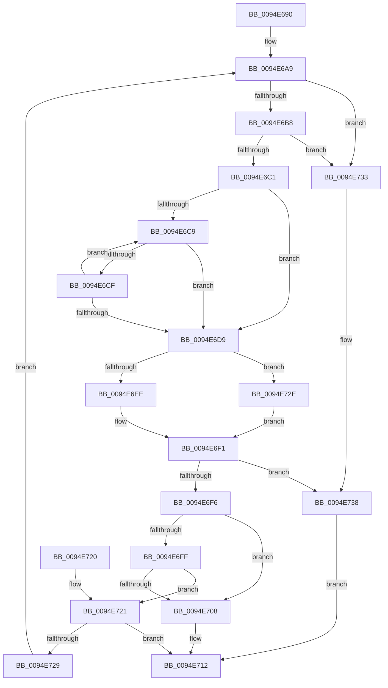

# PnpGetMultiSzLength

- RVA: `0x0094E690`–`0x0094E73D` (길이 `173` bytes)
- VA: `0x000000014094E690`
- 실행 섹션: `PAGE`
- PDB 이름 있음: `예`; PDB Function 태그: `아니요`
- unwind 정보 RVA: `0x00091A24`
- 디코드: `54`개 명령, `173/173` bytes 표시
- 미해석 바이트: `0` (있으면 어셈블리에 `.byte`로 보존)

> 이 문서는 커널 이미지의 기계어와 PDB 기호를 분석해 생성했습니다. 4번과 5번은 함수 원형과 자료형을 바이너리 사용 방식에서 추정한 C 해석이며 원본 소스 복구 결과는 아닙니다.

## 1. Dependencies

- 직접 호출 지점: **0**; 고유 호출 대상: **0**
- 직접 호출자로 확인된 함수: **3**
- RIP 상대 이미지 참조: **0**

### Outgoing calls
- 직접 디코드된 call 명령이 없습니다.

### Direct callers
- [PiSwStartCreate](../73/PiSwStartCreate_function_0073B2CC.md) at `0x0073B393`
- [PiSwStartCreate](../73/PiSwStartCreate_function_0073B2CC.md) at `0x0073B3B5`
- [PnpCompareMultiSz](../73/PnpCompareMultiSz_function_0073D27C.md) at `0x0073D2AC`
- [PnpCompareMultiSz](../73/PnpCompareMultiSz_function_0073D27C.md) at `0x0073D2C2`
- [PnpAllocateMultiSZ](PnpAllocateMultiSZ_function_0094E2B4.md) at `0x0094E2E8`

### Static image references
- 디코드된 RIP-relative 메모리 참조가 없습니다.

## 2. Other-region calls and transfers

- 다른 실행 섹션으로 향하는 call: **0**
- 별도 외부 분기/꼬리 이동을 확인하지 못했습니다.

## 3. Assembly (complete function range)

```asm
0094E690  48 89 5C 24 08                  mov qword ptr [rsp + 8], rbx
0094E695  48 89 7C 24 10                  mov qword ptr [rsp + 0x10], rdi
0094E69A  45 33 C9                        xor r9d, r9d
0094E69D  48 8B DA                        mov rbx, rdx
0094E6A0  4D 89 08                        mov qword ptr [r8], r9
0094E6A3  45 8B D9                        mov r11d, r9d
0094E6A6  48 8B F9                        mov rdi, rcx
0094E6A9  4C 8B D3                        mov r10, rbx
0094E6AC  4A 8D 04 5F                     lea rax, [rdi + r11*2]
0094E6B0  4D 2B D3                        sub r10, r11
0094E6B3  48 85 C0                        test rax, rax
0094E6B6  74 7B                           je 0x14094e733
0094E6B8  49 81 FA FF FF FF 7F            cmp r10, 0x7fffffff
0094E6BF  77 72                           ja 0x14094e733
0094E6C1  49 8B D2                        mov rdx, r10
0094E6C4  4D 85 D2                        test r10, r10
0094E6C7  74 10                           je 0x14094e6d9
0094E6C9  66 44 39 08                     cmp word ptr [rax], r9w
0094E6CD  74 0A                           je 0x14094e6d9
0094E6CF  48 83 C0 02                     add rax, 2
0094E6D3  48 83 EA 01                     sub rdx, 1
0094E6D7  75 F0                           jne 0x14094e6c9
0094E6D9  48 8B C2                        mov rax, rdx
0094E6DC  48 F7 D8                        neg rax
0094E6DF  1B C9                           sbb ecx, ecx
0094E6E1  F7 D1                           not ecx
0094E6E3  81 E1 0D 00 00 C0               and ecx, 0xc000000d
0094E6E9  48 85 D2                        test rdx, rdx
0094E6EC  74 40                           je 0x14094e72e
0094E6EE  4C 2B D2                        sub r10, rdx
0094E6F1  48 85 D2                        test rdx, rdx
0094E6F4  74 42                           je 0x14094e738
0094E6F6  4B 8D 04 1A                     lea rax, [r10 + r11]
0094E6FA  49 3B C3                        cmp rax, r11
0094E6FD  72 09                           jb 0x14094e708
0094E6FF  4C 8D 58 01                     lea r11, [rax + 1]
0094E703  4C 3B D8                        cmp r11, rax
0094E706  73 19                           jae 0x14094e721
0094E708  49 83 08 FF                     or qword ptr [r8], 0xffffffffffffffff
0094E70C  41 B9 95 00 00 C0               mov r9d, 0xc0000095
0094E712  48 8B 5C 24 08                  mov rbx, qword ptr [rsp + 8]
0094E717  41 8B C1                        mov eax, r9d
0094E71A  48 8B 7C 24 10                  mov rdi, qword ptr [rsp + 0x10]
0094E71F  C3                              ret
0094E720  CC                              int3
0094E721  4D 89 18                        mov qword ptr [r8], r11
0094E724  4D 85 D2                        test r10, r10
0094E727  74 E9                           je 0x14094e712
0094E729  E9 7B FF FF FF                  jmp 0x14094e6a9
0094E72E  4D 8B D1                        mov r10, r9
0094E731  EB BE                           jmp 0x14094e6f1
0094E733  B9 0D 00 00 C0                  mov ecx, 0xc000000d
0094E738  44 8B C9                        mov r9d, ecx
0094E73B  EB D5                           jmp 0x14094e712
```

## 4. C-style interpretation (structured pseudocode)

```c
__int64 __fastcall PnpGetMultiSzLength(__int64 a1, __int64 a2, __int64 a3, int a4)
{
    __int64 result;
    __int64 v_r10;
    unsigned __int64 v_stack_p10;
    unsigned __int64 v_stack_p8;

    v_stack_p8 = v_rbx;
    v_stack_p10 = v_rdi;
    a4 = 0;
    *(unsigned __int64 *)(a3) = 0;
loc_0094E6A9:
    v_r10 = (a2) - (0);
    if (a1 + 0 * 2 == 0) goto loc_0094E733;
    if (v_r10 > 0x7FFFFFFFULL) goto loc_0094E733;
    if (v_r10 == 0) goto loc_0094E6D9;
loc_0094E6C9:
    if ((*(unsigned __int16 *)(a1 + 0 * 2)) == 0) goto loc_0094E6D9;
    result = (a1 + 0 * 2) + (2);
    a2 = (v_r10) - (1);
    if (condition_is_not_equal) goto loc_0094E6C9;
loc_0094E6D9:
    result = -(a2);
    a1 = (unsigned int)(~(a1));
    a1 = (unsigned int)((a1) & (0xC000000DULL));
    if (a2 == 0) goto loc_0094E72E;
    v_r10 = (v_r10) - (a2);
loc_0094E6F1:
    if (a2 == 0) goto loc_0094E738;
    if ((v_r10 + 0 * 1) < 0) goto loc_0094E708;
    if ((v_r10 + 0 * 1 + 1) >= (v_r10 + 0 * 1)) goto loc_0094E721;
loc_0094E708:
loc_0094E712:
    return (unsigned int)((unsigned int)((unsigned int)(0xC0000095ULL)));
loc_0094E721:
    *(unsigned __int64 *)(a3) = v_r10 + 0 * 1 + 1;
    if (v_r10 == 0) goto loc_0094E712;
    goto loc_0094E6A9;
loc_0094E72E:
    goto loc_0094E6F1;
loc_0094E733:
loc_0094E738:
    goto loc_0094E712;
}
```

## 5. (Beta) C Style

```c
int64_t PnpGetMultiSzLength(void *Arg1, int64_t Arg2, void *Arg3, int32_t Arg4)
{
    uint8_t *arg1 = (uint8_t *)Arg1;
    uint8_t *arg3 = (uint8_t *)Arg3;

    int64_t result;
    int64_t local_r10;
    uint64_t v_stack_p10;
    uint64_t v_stack_p8;

    v_stack_p8 = local_rbx;
    v_stack_p10 = local_rdi;
    Arg4 = 0;
    *(uint64_t *)(arg3) = 0;
loc_0094E6A9:
    local_r10 = (Arg2) - (0);
    if (Arg1 + 0 * 2 == 0) goto loc_0094E733;
    if (local_r10 > 0x7FFFFFFFULL) goto loc_0094E733;
    if (local_r10 == 0) goto loc_0094E6D9;
loc_0094E6C9:
    if ((*(uint16_t *)(arg1 + 0x0 * 2)) == 0) goto loc_0094E6D9;
    result = (Arg1 + 0 * 2) + (2);
    Arg2 = (local_r10) - (1);
    if (condition_is_not_equal) goto loc_0094E6C9;
loc_0094E6D9:
    result = -(Arg2);
    Arg1 = (uint32_t)(~(Arg1));
    Arg1 = (uint32_t)((Arg1) & (0xC000000DULL));
    if (Arg2 == 0) goto loc_0094E72E;
    local_r10 = (local_r10) - (Arg2);
loc_0094E6F1:
    if (Arg2 == 0) goto loc_0094E738;
    if ((local_r10 + 0 * 1) < 0) goto loc_0094E708;
    if ((local_r10 + 0 * 1 + 1) >= (local_r10 + 0 * 1)) goto loc_0094E721;
loc_0094E708:
loc_0094E712:
    return (uint32_t)((uint32_t)((uint32_t)(0xC0000095ULL)));
loc_0094E721:
    *(uint64_t *)(arg3) = local_r10 + 0 * 1 + 1;
    if (local_r10 == 0) goto loc_0094E712;
    goto loc_0094E6A9;
loc_0094E72E:
    goto loc_0094E6F1;
loc_0094E733:
loc_0094E738:
    goto loc_0094E712;
}
```

### 관측된 메모리 오프셋

구조체 형식이 확인되지 않은 접근은 인자 기준의 오프셋으로만 기록했습니다.

| 기준 인자 | 오프셋 표현 | 폭 (bit) | 접근 |
|---|---:|---:|---|
| `Arg1` | `+ 0x0 + r11*2` | `64` | `R` |
| `Arg3` | `+ 0x0` | `64` | `R/W` |
| `Arg3` | `+ 0x0` | `64` | `W` |

## 6. Execution-region graph

[열기: 2D/3D 그래프와 함수 탐색 컨트롤 패널](../../../control-panel.html?section=page&rva=0x0094E690&view=graph)

- 2D 그래프는 위에서 아래로 흐르고, 3D 그래프는 빈 공간을 드래그해 회전합니다. Shift+드래그는 이동, 휠은 확대·축소, 함수 노드 선택은 대상 보고서 이동입니다.

### Static fallback


