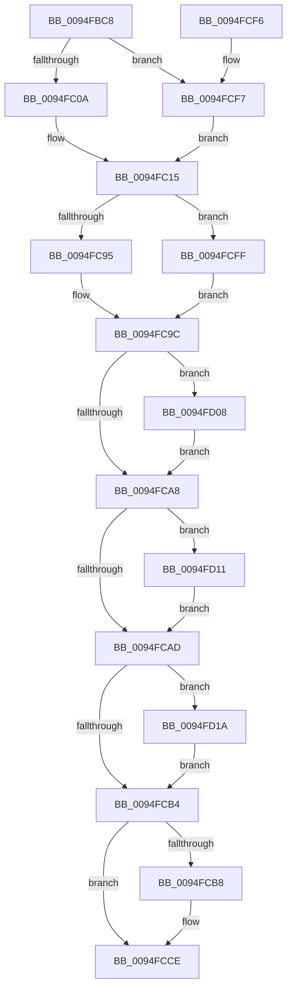

# PnpInitializeTargetDeviceRemoveEvent

- RVA: `0x0094FBC8`–`0x0094FD23` (길이 `347` bytes)
- VA: `0x000000014094FBC8`
- 실행 섹션: `PAGE`
- PDB 이름 있음: `예`; PDB Function 태그: `아니요`
- unwind 정보 RVA: `0x00068810`
- 디코드: `83`개 명령, `347/347` bytes 표시
- 미해석 바이트: `0` (있으면 어셈블리에 `.byte`로 보존)

> 이 문서는 커널 이미지의 기계어와 PDB 기호를 분석해 생성했습니다. 4번과 5번은 함수 원형과 자료형을 바이너리 사용 방식에서 추정한 C 해석이며 원본 소스 복구 결과는 아닙니다.

## 1. Dependencies

- 직접 호출 지점: **3**; 고유 호출 대상: **3**
- 직접 호출자로 확인된 함수: **4**
- RIP 상대 이미지 참조: **2**

### Outgoing calls
- `0x0094FBF9` → [ObfReferenceObjectWithTag](../../text/21/ObfReferenceObjectWithTag_function_00210710.md) (function, `0x00210710`)
- `0x0094FC23` → [memset](../../text/6C/memset_function_006C6C40.md) (function, `0x006C6C40`)
- `0x0094FCC9` → [memcpy](../../text/6C/memcpy_function_006C6840.md) (function, `0x006C6840`)

### Direct callers
- [PnpShutdownDevices](../72/PnpShutdownDevices_function_00723F20.md) at `0x007240DA`
- [PnpQueueQueryAndRemoveEvent](PnpQueueQueryAndRemoveEvent_function_0094FD2C.md) at `0x0094FEDA`
- [sub_00B1FAB0](../B1/Unknown_function_00B1FAB0.md) at `0x00B1FB27`
- [sub_00B49E1C](../B4/Unknown_function_00B49E1C.md) at `0x00B49EBA`

### Static image references
- `0x0094FC95` → RVA `0x00014D48` (`.rdata`; read)
- `0x0094FCFF` → RVA `0x00014D38` (`.rdata`; read)

## 2. Other-region calls and transfers

- 다른 실행 섹션으로 향하는 call: **3**
  - `0x0094FBF9` → [ObfReferenceObjectWithTag](../../text/21/ObfReferenceObjectWithTag_function_00210710.md) (`PAGE` → `.text`)
  - `0x0094FC23` → [memset](../../text/6C/memset_function_006C6C40.md) (`PAGE` → `.text`)
  - `0x0094FCC9` → [memcpy](../../text/6C/memcpy_function_006C6840.md) (`PAGE` → `.text`)
- 별도 외부 분기/꼬리 이동을 확인하지 못했습니다.

## 3. Assembly (complete function range)

```asm
0094FBC8  48 8B C4                        mov rax, rsp
0094FBCB  48 89 58 08                     mov qword ptr [rax + 8], rbx
0094FBCF  48 89 68 10                     mov qword ptr [rax + 0x10], rbp
0094FBD3  48 89 70 18                     mov qword ptr [rax + 0x18], rsi
0094FBD7  48 89 78 20                     mov qword ptr [rax + 0x20], rdi
0094FBDB  41 54                           push r12
0094FBDD  41 56                           push r14
0094FBDF  41 57                           push r15
0094FBE1  48 83 EC 20                     sub rsp, 0x20
0094FBE5  44 8B FA                        mov r15d, edx
0094FBE8  48 8B D9                        mov rbx, rcx
0094FBEB  BA 50 6E 70 56                  mov edx, 0x56706e50
0094FBF0  49 8B C8                        mov rcx, r8
0094FBF3  45 8B F1                        mov r14d, r9d
0094FBF6  49 8B F0                        mov rsi, r8
0094FBF9  E8 12 0B 8C FF                  call 0x140210710
0094FBFE  45 33 E4                        xor r12d, r12d
0094FC01  48 85 F6                        test rsi, rsi
0094FC04  0F 84 ED 00 00 00               je 0x14094fcf7
0094FC0A  48 8B 86 38 01 00 00            mov rax, qword ptr [rsi + 0x138]
0094FC11  48 8B 68 28                     mov rbp, qword ptr [rax + 0x28]
0094FC15  0F B7 7D 28                     movzx edi, word ptr [rbp + 0x28]
0094FC19  4D 8B C7                        mov r8, r15
0094FC1C  33 D2                           xor edx, edx
0094FC1E  D1 EF                           shr edi, 1
0094FC20  48 8B CB                        mov rcx, rbx
0094FC23  E8 18 70 D7 FF                  call 0x1406c6c40
0094FC28  B9 01 00 00 00                  mov ecx, 1
0094FC2D  48 8B 84 24 88 00 00 00         mov rax, qword ptr [rsp + 0x88]
0094FC35  48 89 43 18                     mov qword ptr [rbx + 0x18], rax
0094FC39  8B 44 24 78                     mov eax, dword ptr [rsp + 0x78]
0094FC3D  89 43 10                        mov dword ptr [rbx + 0x10], eax
0094FC40  8B 84 24 80 00 00 00            mov eax, dword ptr [rsp + 0x80]
0094FC47  89 43 14                        mov dword ptr [rbx + 0x14], eax
0094FC4A  48 8B 84 24 98 00 00 00         mov rax, qword ptr [rsp + 0x98]
0094FC52  48 89 43 30                     mov qword ptr [rbx + 0x30], rax
0094FC56  48 8B 84 24 A0 00 00 00         mov rax, qword ptr [rsp + 0xa0]
0094FC5E  48 89 43 38                     mov qword ptr [rbx + 0x38], rax
0094FC62  8D 04 7D 52 00 00 00            lea eax, [rdi*2 + 0x52]
0094FC69  89 4B 40                        mov dword ptr [rbx + 0x40], ecx
0094FC6C  89 83 9C 00 00 00               mov dword ptr [rbx + 0x9c], eax
0094FC72  48 8B 84 24 90 00 00 00         mov rax, qword ptr [rsp + 0x90]
0094FC7A  48 89 83 90 00 00 00            mov qword ptr [rbx + 0x90], rax
0094FC81  48 89 B3 A0 00 00 00            mov qword ptr [rbx + 0xa0], rsi
0094FC88  89 8B 88 00 00 00               mov dword ptr [rbx + 0x88], ecx
0094FC8E  44 39 64 24 68                  cmp dword ptr [rsp + 0x68], r12d
0094FC93  74 6A                           je 0x14094fcff
0094FC95  0F 10 05 AC 50 6C FF            movups xmm0, xmmword ptr [rip - 0x93af54]
0094FC9C  F3 0F 7F 43 78                  movdqu xmmword ptr [rbx + 0x78], xmm0
0094FCA1  44 39 64 24 60                  cmp dword ptr [rsp + 0x60], r12d
0094FCA6  75 60                           jne 0x14094fd08
0094FCA8  45 85 F6                        test r14d, r14d
0094FCAB  75 64                           jne 0x14094fd11
0094FCAD  44 39 64 24 70                  cmp dword ptr [rsp + 0x70], r12d
0094FCB2  75 66                           jne 0x14094fd1a
0094FCB4  85 FF                           test edi, edi
0094FCB6  74 16                           je 0x14094fcce
0094FCB8  48 8B 55 30                     mov rdx, qword ptr [rbp + 0x30]
0094FCBC  48 8D 8B A8 00 00 00            lea rcx, [rbx + 0xa8]
0094FCC3  44 8B C7                        mov r8d, edi
0094FCC6  4D 03 C0                        add r8, r8
0094FCC9  E8 72 6B D7 FF                  call 0x1406c6840
0094FCCE  48 8B 6C 24 48                  mov rbp, qword ptr [rsp + 0x48]
0094FCD3  48 8B 74 24 50                  mov rsi, qword ptr [rsp + 0x50]
0094FCD8  66 44 89 A4 7B A8 00 00 00      mov word ptr [rbx + rdi*2 + 0xa8], r12w
0094FCE1  48 8B 5C 24 40                  mov rbx, qword ptr [rsp + 0x40]
0094FCE6  48 8B 7C 24 58                  mov rdi, qword ptr [rsp + 0x58]
0094FCEB  48 83 C4 20                     add rsp, 0x20
0094FCEF  41 5F                           pop r15
0094FCF1  41 5E                           pop r14
0094FCF3  41 5C                           pop r12
0094FCF5  C3                              ret
0094FCF6  CC                              int3
0094FCF7  49 8B EC                        mov rbp, r12
0094FCFA  E9 16 FF FF FF                  jmp 0x14094fc15
0094FCFF  0F 10 05 32 50 6C FF            movups xmm0, xmmword ptr [rip - 0x93afce]
0094FD06  EB 94                           jmp 0x14094fc9c
0094FD08  83 8B 98 00 00 00 02            or dword ptr [rbx + 0x98], 2
0094FD0F  EB 97                           jmp 0x14094fca8
0094FD11  83 8B 98 00 00 00 04            or dword ptr [rbx + 0x98], 4
0094FD18  EB 93                           jmp 0x14094fcad
0094FD1A  83 8B 98 00 00 00 08            or dword ptr [rbx + 0x98], 8
0094FD21  EB 91                           jmp 0x14094fcb4
```

## 4. C-style interpretation (structured pseudocode)

```c
__int64 __fastcall PnpInitializeTargetDeviceRemoveEvent(__int64 a1, int a2, __int64 a3, int a4, unsigned int a5, unsigned int a6, unsigned int a7, unsigned int a8, unsigned int a9, __int64 a10, __int64 a11, __int64 a12, __int64 a13)
{
    __int64 result;
    __int64 v_r12;
    __int64 v_rdi;
    __int64 v_rsp;
    unsigned __int64 v_stack_p10;
    unsigned __int64 v_stack_p18;
    unsigned __int64 v_stack_p20;
    unsigned __int64 v_stack_p8;

    *(unsigned __int64 *)(v_rsp + 8) = v_rbx;
    *(unsigned __int64 *)(v_rsp + 16) = v_rbp;
    *(unsigned __int64 *)(v_rsp + 24) = v_rsi;
    *(unsigned __int64 *)(v_rsp + 32) = v_rdi;
    v_rsp = (v_rsp) - (32);
    result = ObfReferenceObjectWithTag(a3, (unsigned int)(0x56706E50ULL), a3, a4);
    v_r12 = 0;
    if (a3 == 0) goto loc_0094FCF7;
loc_0094FC15:
    a2 = 0;
    v_rdi = (unsigned int)((*(unsigned __int16 *)(*(unsigned __int64 *)(*(unsigned __int64 *)(a3 + 312) + 40) + 40)) >> (1));
    result = memset(a1, a2, (unsigned int)(a2), a4);
    *(unsigned __int64 *)(a1 + 24) = a10;
    *(unsigned int *)(a1 + 16) = (unsigned int)((unsigned int)(a8));
    *(unsigned int *)(a1 + 20) = (unsigned int)((unsigned int)(a9));
    *(unsigned __int64 *)(a1 + 48) = a12;
    *(unsigned __int64 *)(a1 + 56) = a13;
    *(unsigned int *)(a1 + 64) = 1;
    *(unsigned int *)(a1 + 156) = (unsigned int)(v_rdi * 2 + 82);
    *(unsigned __int64 *)(a1 + 144) = a11;
    *(unsigned __int64 *)(a1 + 160) = a3;
    *(unsigned int *)(a1 + 136) = 1;
    if (a6 == 0) goto loc_0094FCFF;
loc_0094FC9C:
    *(unsigned __int64 *)(a1 + 120) = v_xmm0;
    if (a5 != 0) goto loc_0094FD08;
loc_0094FCA8:
    if ((unsigned int)((unsigned int)(a4)) != 0) goto loc_0094FD11;
loc_0094FCAD:
    if (a7 != 0) goto loc_0094FD1A;
loc_0094FCB4:
    result = a11;
    if ((unsigned int)(v_rdi) != 0) {
        a2 = *(unsigned __int64 *)(*(unsigned __int64 *)(*(unsigned __int64 *)(a3 + 312) + 40) + 48);
        a1 = a1 + 168;
        a3 = (unsigned int)(v_rdi);
        a3 = (a3) + (a3);
        result = memcpy(a1, a2, a3, a4);
    }
    *(unsigned __int16 *)(a1 + v_rdi * 2 + 168) = 0;
    v_rsp = (v_rsp) + (32);
    return result;
loc_0094FCF7:
    goto loc_0094FC15;
loc_0094FCFF:
    goto loc_0094FC9C;
loc_0094FD08:
    goto loc_0094FCA8;
loc_0094FD11:
    goto loc_0094FCAD;
loc_0094FD1A:
    goto loc_0094FCB4;
}
```

## 5. (Beta) C Style

```c
int64_t PnpInitializeTargetDeviceRemoveEvent(void *Arg1, int32_t Arg2, int64_t Arg3, int32_t Arg4, uint32_t Arg5, uint32_t Arg6, uint32_t Arg7, uint32_t Arg8, uint32_t Arg9, int64_t Arg10, int64_t Arg11, int64_t Arg12, int64_t Arg13)
{
    uint8_t *arg1 = (uint8_t *)Arg1;

    int64_t result;
    int64_t local_r12;
    int64_t local_rdi;
    int64_t local_rsp;
    uint64_t v_stack_p10;
    uint64_t v_stack_p18;
    uint64_t v_stack_p20;
    uint64_t v_stack_p8;

    *(uint64_t *)(local_rsp + 0x8) = local_rbx;
    *(uint64_t *)(local_rsp + 0x10) = local_rbp;
    *(uint64_t *)(local_rsp + 0x18) = local_rsi;
    *(uint64_t *)(local_rsp + 0x20) = local_rdi;
    local_rsp = (local_rsp) - (32);
    result = ObfReferenceObjectWithTag(Arg3, (uint32_t)(0x56706E50ULL), Arg3, Arg4);
    local_r12 = 0;
    if (Arg3 == 0) goto loc_0094FCF7;
loc_0094FC15:
    Arg2 = 0;
    local_rdi = (uint32_t)((*(uint16_t *)(*(uint64_t *)(*(uint64_t *)(Arg3 + 0x138) + 0x28) + 0x28)) >> (1));
    result = memset(Arg1, Arg2, (uint32_t)(Arg2), Arg4);
    *(uint64_t *)(arg1 + 0x18) = Arg10;
    *(uint32_t *)(arg1 + 0x10) = (uint32_t)((uint32_t)(Arg8));
    *(uint32_t *)(arg1 + 0x14) = (uint32_t)((uint32_t)(Arg9));
    *(uint64_t *)(arg1 + 0x30) = Arg12;
    *(uint64_t *)(arg1 + 0x38) = Arg13;
    *(uint32_t *)(arg1 + 0x40) = 1;
    *(uint32_t *)(arg1 + 0x9C) = (uint32_t)(local_rdi * 2 + 82);
    *(uint64_t *)(arg1 + 0x90) = Arg11;
    *(uint64_t *)(arg1 + 0xA0) = Arg3;
    *(uint32_t *)(arg1 + 0x88) = 1;
    if (Arg6 == 0) goto loc_0094FCFF;
loc_0094FC9C:
    *(uint64_t *)(arg1 + 0x78) = v_xmm0;
    if (Arg5 != 0) goto loc_0094FD08;
loc_0094FCA8:
    if ((uint32_t)((uint32_t)(Arg4)) != 0) goto loc_0094FD11;
loc_0094FCAD:
    if (Arg7 != 0) goto loc_0094FD1A;
loc_0094FCB4:
    result = Arg11;
    if ((uint32_t)(local_rdi) != 0) {
        Arg2 = *(uint64_t *)(*(uint64_t *)(*(uint64_t *)(Arg3 + 0x138) + 0x28) + 0x30);
        Arg1 = Arg1 + 168;
        Arg3 = (uint32_t)(local_rdi);
        Arg3 = (Arg3) + (Arg3);
        result = memcpy(Arg1, Arg2, Arg3, Arg4);
    }
    *(uint16_t *)(arg1 + local_rdi * 2 + 0xA8) = 0;
    local_rsp = (local_rsp) + (32);
    return result;
loc_0094FCF7:
    goto loc_0094FC15;
loc_0094FCFF:
    goto loc_0094FC9C;
loc_0094FD08:
    goto loc_0094FCA8;
loc_0094FD11:
    goto loc_0094FCAD;
loc_0094FD1A:
    goto loc_0094FCB4;
}
```

### 관측된 메모리 오프셋

구조체 형식이 확인되지 않은 접근은 인자 기준의 오프셋으로만 기록했습니다.

| 기준 인자 | 오프셋 표현 | 폭 (bit) | 접근 |
|---|---:|---:|---|
| `Arg1` | `+ 0x10` | `32` | `W` |
| `Arg1` | `+ 0x14` | `32` | `W` |
| `Arg1` | `+ 0x18` | `64` | `W` |
| `Arg1` | `+ 0x30` | `64` | `W` |
| `Arg1` | `+ 0x38` | `64` | `W` |
| `Arg1` | `+ 0x40` | `32` | `W` |
| `Arg1` | `+ 0x78` | `128` | `W` |
| `Arg1` | `+ 0x88` | `32` | `W` |
| `Arg1` | `+ 0x90` | `64` | `W` |
| `Arg1` | `+ 0x98` | `32` | `R/W` |
| `Arg1` | `+ 0x9C` | `32` | `W` |
| `Arg1` | `+ 0xA0` | `64` | `W` |
| `Arg1` | `+ 0xA8` | `64` | `R` |
| `Arg1` | `+ 0xA8 + rdi*2` | `16` | `W` |

## 6. Execution-region graph

[열기: 2D/3D 그래프와 함수 탐색 컨트롤 패널](../../../control-panel.html?section=page&rva=0x0094FBC8&view=graph)

- 2D 그래프는 위에서 아래로 흐르고, 3D 그래프는 빈 공간을 드래그해 회전합니다. Shift+드래그는 이동, 휠은 확대·축소, 함수 노드 선택은 대상 보고서 이동입니다.

### Static fallback


