# PnpQueueQueryAndRemoveEvent

- RVA: `0x0094FD2C`–`0x00950122` (길이 `1,014` bytes)
- VA: `0x000000014094FD2C`
- 실행 섹션: `PAGE`
- PDB 이름 있음: `예`; PDB Function 태그: `예`
- unwind 정보 RVA: `0x00091BDC`
- 디코드: `239`개 명령, `1,014/1,014` bytes 표시
- 미해석 바이트: `0` (있으면 어셈블리에 `.byte`로 보존)

> 이 문서는 커널 이미지의 기계어와 PDB 기호를 분석해 생성했습니다. 4번과 5번은 함수 원형과 자료형을 바이너리 사용 방식에서 추정한 C 해석이며 원본 소스 복구 결과는 아닙니다.

## 1. Dependencies

- 직접 호출 지점: **13**; 고유 호출 대상: **12**
- 직접 호출자로 확인된 함수: **2**
- RIP 상대 이미지 참조: **5**

### Outgoing calls
- `0x0094FD9C` → [PnpDeviceObjectFromDeviceInstanceWithTag](../8E/PnpDeviceObjectFromDeviceInstanceWithTag_function_008E7490.md) (function, `0x008E7490`)
- `0x0094FE27` → [KeInitializeEvent](../../text/40/KeInitializeEvent_function_0040DD10.md) (function, `0x0040DD10`)
- `0x0094FE77` → [PnpAllocateCriticalMemory](../A0/PnpAllocateCriticalMemory_function_00A07924.md) (function, `0x00A07924`)
- `0x0094FEDA` → [PnpInitializeTargetDeviceRemoveEvent](PnpInitializeTargetDeviceRemoveEvent_function_0094FBC8.md) (function, `0x0094FBC8`)
- `0x0094FEF8` → [PnpInsertEventInQueue](../95/PnpInsertEventInQueue_function_00951B78.md) (function, `0x00951B78`)
- `0x0094FF1C` → [KeWaitForSingleObject](../../text/20/KeWaitForSingleObject_function_0020E6B0.md) (function, `0x0020E6B0`)
- `0x0094FF8B` → [ObfDereferenceObjectWithTag](../../text/2F/ObfDereferenceObjectWithTag_function_002F78E0.md) (function, `0x002F78E0`)
- `0x0094FFAF` → [ExFreePoolWithTag](../../poolcode/B8/ExFreePoolWithTag_function_00B82870.md) (function, `0x00B82870`)
- `0x00950005` → [PnpDiagnosticTraceObject](../../text/26/PnpDiagnosticTraceObject_function_0026E834.md) (function, `0x0026E834`)
- `0x0095003C` → [ExAllocatePool2](../../poolcode/B8/ExAllocatePool2_function_00B820F0.md) (function, `0x00B820F0`)
- `0x00950091` → [PnpRemoveEventFromQueue](../73/PnpRemoveEventFromQueue_function_0073808C.md) (function, `0x0073808C`)
- `0x00950109` → [PnpDiagnosticTraceDeviceOperation](../../text/26/PnpDiagnosticTraceDeviceOperation_function_0026E1B8.md) (function, `0x0026E1B8`)
- `0x00950118` → [ExFreePoolWithTag](../../poolcode/B8/ExFreePoolWithTag_function_00B82870.md) (function, `0x00B82870`)

### Direct callers
- [PnpRequestDeviceEjectExWorker](../72/PnpRequestDeviceEjectExWorker_function_0072A6D0.md) at `0x0072A71F`
- [PiCMQueryRemove](../AD/PiCMQueryRemove_function_00AD43F4.md) at `0x00AD475F`

### Static image references
- `0x0094FDCB` → RVA `0x00F8C438` (`.data`; read)
- `0x0094FE36` → RVA `0x00F8C5E4` (`.data`; read)
- `0x0094FE40` → RVA `0x00E663B0` (`.data`; read)
- `0x0094FFFE` → RVA `0x000272D0` (`.rdata`; read)
- `0x009500EA` → RVA `0x00027340` (`.rdata`; read)

## 2. Other-region calls and transfers

- 다른 실행 섹션으로 향하는 call: **8**
  - `0x0094FE27` → [KeInitializeEvent](../../text/40/KeInitializeEvent_function_0040DD10.md) (`PAGE` → `.text`)
  - `0x0094FF1C` → [KeWaitForSingleObject](../../text/20/KeWaitForSingleObject_function_0020E6B0.md) (`PAGE` → `.text`)
  - `0x0094FF8B` → [ObfDereferenceObjectWithTag](../../text/2F/ObfDereferenceObjectWithTag_function_002F78E0.md) (`PAGE` → `.text`)
  - `0x0094FFAF` → [ExFreePoolWithTag](../../poolcode/B8/ExFreePoolWithTag_function_00B82870.md) (`PAGE` → `POOLCODE`)
  - `0x00950005` → [PnpDiagnosticTraceObject](../../text/26/PnpDiagnosticTraceObject_function_0026E834.md) (`PAGE` → `.text`)
  - `0x0095003C` → [ExAllocatePool2](../../poolcode/B8/ExAllocatePool2_function_00B820F0.md) (`PAGE` → `POOLCODE`)
  - `0x00950109` → [PnpDiagnosticTraceDeviceOperation](../../text/26/PnpDiagnosticTraceDeviceOperation_function_0026E1B8.md) (`PAGE` → `.text`)
  - `0x00950118` → [ExFreePoolWithTag](../../poolcode/B8/ExFreePoolWithTag_function_00B82870.md) (`PAGE` → `POOLCODE`)
- call이 아닌 외부 분기/꼬리 이동: **8**
  - `0x0094FE84` → [sub_00B260E4 + 0x49](../B2/Unknown_function_00B260E4.md) (`tail-transfer`)
  - `0x00950047` → [sub_00B260E4](../B2/Unknown_function_00B260E4.md) (`tail-transfer`)
  - `0x00950071` → [sub_00B260E4 + 0x3F](../B2/Unknown_function_00B260E4.md) (`tail-transfer`)
  - `0x00950089` → [sub_00B260E4 + 0x4E](../B2/Unknown_function_00B260E4.md) (`tail-transfer`)
  - `0x00950098` → [sub_00B260E4 + 0x5B](../B2/Unknown_function_00B260E4.md) (`tail-transfer`)
  - `0x009500B3` → [sub_00B260E4 + 0x9E](../B2/Unknown_function_00B260E4.md) (`tail-transfer`)
  - `0x009500C4` → [sub_00B260E4 + 0x9E](../B2/Unknown_function_00B260E4.md) (`tail-transfer`)
  - `0x009500DE` → [sub_00B260E4 + 0xC9](../B2/Unknown_function_00B260E4.md) (`tail-transfer`)

## 3. Assembly (complete function range)

```asm
0094FD2C  4C 8B DC                        mov r11, rsp
0094FD2F  49 89 5B 20                     mov qword ptr [r11 + 0x20], rbx
0094FD33  4D 89 43 18                     mov qword ptr [r11 + 0x18], r8
0094FD37  49 89 53 10                     mov qword ptr [r11 + 0x10], rdx
0094FD3B  49 89 4B 08                     mov qword ptr [r11 + 8], rcx
0094FD3F  55                              push rbp
0094FD40  56                              push rsi
0094FD41  57                              push rdi
0094FD42  41 54                           push r12
0094FD44  41 55                           push r13
0094FD46  41 56                           push r14
0094FD48  41 57                           push r15
0094FD4A  48 81 EC B0 00 00 00            sub rsp, 0xb0
0094FD51  8B 9C 24 10 01 00 00            mov ebx, dword ptr [rsp + 0x110]
0094FD58  33 C0                           xor eax, eax
0094FD5A  48 8B E9                        mov rbp, rcx
0094FD5D  49 89 43 B8                     mov qword ptr [r11 - 0x48], rax
0094FD61  33 C9                           xor ecx, ecx
0094FD63  0F 57 C0                        xorps xmm0, xmm0
0094FD66  89 4C 24 74                     mov dword ptr [rsp + 0x74], ecx
0094FD6A  4D 8B F9                        mov r15, r9
0094FD6D  48 89 8C 24 88 00 00 00         mov qword ptr [rsp + 0x88], rcx
0094FD75  4C 8B E2                        mov r12, rdx
0094FD78  88 4C 24 70                     mov byte ptr [rsp + 0x70], cl
0094FD7C  44 8B E9                        mov r13d, ecx
0094FD7F  89 0A                           mov dword ptr [rdx], ecx
0094FD81  8B F1                           mov esi, ecx
0094FD83  44 8A F1                        mov r14b, cl
0094FD86  41 0F 11 43 A8                  movups xmmword ptr [r11 - 0x58], xmm0
0094FD8B  83 E3 08                        and ebx, 8
0094FD8E  0F 85 67 02 00 00               jne 0x14094fffb
0094FD94  BA 50 6E 70 43                  mov edx, 0x43706e50
0094FD99  48 8B CD                        mov rcx, rbp
0094FD9C  E8 EF 76 F9 FF                  call 0x1408e7490
0094FDA1  33 D2                           xor edx, edx
0094FDA3  48 89 84 24 80 00 00 00         mov qword ptr [rsp + 0x80], rax
0094FDAB  48 8B F8                        mov rdi, rax
0094FDAE  48 85 C0                        test rax, rax
0094FDB1  0F 84 58 02 00 00               je 0x14095000f
0094FDB7  48 8B 80 38 01 00 00            mov rax, qword ptr [rax + 0x138]
0094FDBE  48 8B 48 28                     mov rcx, qword ptr [rax + 0x28]
0094FDC2  48 85 C9                        test rcx, rcx
0094FDC5  0F 84 4B 02 00 00               je 0x140950016
0094FDCB  48 3B 0D 66 C6 63 00            cmp rcx, qword ptr [rip + 0x63c666]
0094FDD2  0F 84 45 02 00 00               je 0x14095001d
0094FDD8  41 8B 07                        mov eax, dword ptr [r15]
0094FDDB  85 C0                           test eax, eax
0094FDDD  0F 85 47 02 00 00               jne 0x14095002a
0094FDE3  8D 6A 01                        lea ebp, [rdx + 1]
0094FDE6  44 8B F5                        mov r14d, ebp
0094FDE9  85 DB                           test ebx, ebx
0094FDEB  0F 85 6E 02 00 00               jne 0x14095005f
0094FDF1  F6 84 24 10 01 00 00 0B         test byte ptr [rsp + 0x110], 0xb
0094FDF9  8B C2                           mov eax, edx
0094FDFB  0F 95 C0                        setne al
0094FDFE  89 44 24 78                     mov dword ptr [rsp + 0x78], eax
0094FE02  B8 02 00 00 00                  mov eax, 2
0094FE07  84 84 24 10 01 00 00            test byte ptr [rsp + 0x110], al
0094FE0E  0F 84 5B 02 00 00               je 0x14095006f
0094FE14  8D 58 14                        lea ebx, [rax + 0x14]
0094FE17  44 8B E2                        mov r12d, edx
0094FE1A  45 33 C0                        xor r8d, r8d
0094FE1D  48 8D 8C 24 90 00 00 00         lea rcx, [rsp + 0x90]
0094FE25  33 D2                           xor edx, edx
0094FE27  E8 E4 DE AB FF                  call 0x14040dd10
0094FE2C  33 C9                           xor ecx, ecx
0094FE2E  C7 44 24 74 03 01 00 00         mov dword ptr [rsp + 0x74], 0x103
0094FE36  39 0D A8 C7 63 00               cmp dword ptr [rip + 0x63c7a8], ecx
0094FE3C  74 11                           je 0x14094fe4f
0094FE3E  33 C0                           xor eax, eax
0094FE40  F0 48 0F B1 0D 67 65 51 00      lock cmpxchg qword ptr [rip + 0x516567], rcx
0094FE49  0F 84 35 02 00 00               je 0x140950084
0094FE4F  48 8B 87 38 01 00 00            mov rax, qword ptr [rdi + 0x138]
0094FE56  BA 00 01 00 00                  mov edx, 0x100
0094FE5B  41 B9 50 6E 70 4B               mov r9d, 0x4b706e50
0094FE61  48 8B 48 28                     mov rcx, qword ptr [rax + 0x28]
0094FE65  0F B7 41 28                     movzx eax, word ptr [rcx + 0x28]
0094FE69  33 C9                           xor ecx, ecx
0094FE6B  05 CA 00 00 00                  add eax, 0xca
0094FE70  44 8B C0                        mov r8d, eax
0094FE73  89 44 24 7C                     mov dword ptr [rsp + 0x7c], eax
0094FE77  E8 A8 7A 0B 00                  call 0x140a07924
0094FE7C  33 C9                           xor ecx, ecx
0094FE7E  48 8B F8                        mov rdi, rax
0094FE81  48 85 C0                        test rax, rax
0094FE84  0F 84 A3 62 1D 00               je 0x140b2612d
0094FE8A  8B 54 24 7C                     mov edx, dword ptr [rsp + 0x7c]
0094FE8E  48 8D 44 24 74                  lea rax, [rsp + 0x74]
0094FE93  48 89 74 24 60                  mov qword ptr [rsp + 0x60], rsi
0094FE98  45 33 C9                        xor r9d, r9d
0094FE9B  4C 89 6C 24 58                  mov qword ptr [rsp + 0x58], r13
0094FEA0  48 89 44 24 50                  mov qword ptr [rsp + 0x50], rax
0094FEA5  48 8D 84 24 90 00 00 00         lea rax, [rsp + 0x90]
0094FEAD  48 89 44 24 48                  mov qword ptr [rsp + 0x48], rax
0094FEB2  8B 44 24 78                     mov eax, dword ptr [rsp + 0x78]
0094FEB6  89 4C 24 40                     mov dword ptr [rsp + 0x40], ecx
0094FEBA  48 8B CF                        mov rcx, rdi
0094FEBD  89 5C 24 38                     mov dword ptr [rsp + 0x38], ebx
0094FEC1  44 89 74 24 30                  mov dword ptr [rsp + 0x30], r14d
0094FEC6  4C 8B B4 24 80 00 00 00         mov r14, qword ptr [rsp + 0x80]
0094FECE  4D 8B C6                        mov r8, r14
0094FED1  44 89 64 24 28                  mov dword ptr [rsp + 0x28], r12d
0094FED6  89 44 24 20                     mov dword ptr [rsp + 0x20], eax
0094FEDA  E8 E9 FC FF FF                  call 0x14094fbc8
0094FEDF  01 6F 40                        add dword ptr [rdi + 0x40], ebp
0094FEE2  45 33 E4                        xor r12d, r12d
0094FEE5  48 8B CF                        mov rcx, rdi
0094FEE8  4C 89 67 20                     mov qword ptr [rdi + 0x20], r12
0094FEEC  4C 89 67 28                     mov qword ptr [rdi + 0x28], r12
0094FEF0  48 89 BC 24 88 00 00 00         mov qword ptr [rsp + 0x88], rdi
0094FEF8  E8 7B 1C 00 00                  call 0x140951b78
0094FEFD  8B D8                           mov ebx, eax
0094FEFF  85 C0                           test eax, eax
0094FF01  0F 88 9C 01 00 00               js 0x1409500a3
0094FF07  44 8A CD                        mov r9b, bpl
0094FF0A  4C 89 64 24 20                  mov qword ptr [rsp + 0x20], r12
0094FF0F  45 33 C0                        xor r8d, r8d
0094FF12  48 8D 8C 24 90 00 00 00         lea rcx, [rsp + 0x90]
0094FF1A  33 D2                           xor edx, edx
0094FF1C  E8 8F E7 8B FF                  call 0x14020e6b0
0094FF21  8B D8                           mov ebx, eax
0094FF23  3D 01 01 00 00                  cmp eax, 0x101
0094FF28  0F 84 60 01 00 00               je 0x14095008e
0094FF2E  4C 8B A4 24 F8 00 00 00         mov r12, qword ptr [rsp + 0xf8]
0094FF36  85 DB                           test ebx, ebx
0094FF38  0F 49 5C 24 74                  cmovns ebx, dword ptr [rsp + 0x74]
0094FF3D  4D 85 ED                        test r13, r13
0094FF40  74 08                           je 0x14094ff4a
0094FF42  41 8B 45 00                     mov eax, dword ptr [r13]
0094FF46  41 89 04 24                     mov dword ptr [r12], eax
0094FF4A  45 33 C0                        xor r8d, r8d
0094FF4D  48 85 F6                        test rsi, rsi
0094FF50  0F 84 98 00 00 00               je 0x14094ffee
0094FF56  0F B7 0E                        movzx ecx, word ptr [rsi]
0094FF59  66 85 C9                        test cx, cx
0094FF5C  0F 85 4E 01 00 00               jne 0x1409500b0
0094FF62  48 8B BC 24 00 01 00 00         mov rdi, qword ptr [rsp + 0x100]
0094FF6A  0F B7 06                        movzx eax, word ptr [rsi]
0094FF6D  41 89 07                        mov dword ptr [r15], eax
0094FF70  41 83 3C 24 06                  cmp dword ptr [r12], 6
0094FF75  0F 84 4E 01 00 00               je 0x1409500c9
0094FF7B  48 8B AC 24 F0 00 00 00         mov rbp, qword ptr [rsp + 0xf0]
0094FF83  BA 50 6E 70 43                  mov edx, 0x43706e50
0094FF88  49 8B CE                        mov rcx, r14
0094FF8B  E8 50 79 9A FF                  call 0x1402f78e0
0094FF90  48 8B 8C 24 88 00 00 00         mov rcx, qword ptr [rsp + 0x88]
0094FF98  48 85 C9                        test rcx, rcx
0094FF9B  74 17                           je 0x14094ffb4
0094FF9D  83 C8 FF                        or eax, 0xffffffff
0094FFA0  F0 0F C1 41 40                  lock xadd dword ptr [rcx + 0x40], eax
0094FFA5  83 F8 01                        cmp eax, 1
0094FFA8  75 0A                           jne 0x14094ffb4
0094FFAA  BA 50 6E 70 4B                  mov edx, 0x4b706e50
0094FFAF  E8 BC 28 23 00                  call 0x140b82870
0094FFB4  44 8A 74 24 70                  mov r14b, byte ptr [rsp + 0x70]
0094FFB9  F6 84 24 10 01 00 00 08         test byte ptr [rsp + 0x110], 8
0094FFC1  0F 85 1C 01 00 00               jne 0x1409500e3
0094FFC7  45 84 F6                        test r14b, r14b
0094FFCA  0F 85 43 01 00 00               jne 0x140950113
0094FFD0  8B C3                           mov eax, ebx
0094FFD2  48 8B 9C 24 08 01 00 00         mov rbx, qword ptr [rsp + 0x108]
0094FFDA  48 81 C4 B0 00 00 00            add rsp, 0xb0
0094FFE1  41 5F                           pop r15
0094FFE3  41 5E                           pop r14
0094FFE5  41 5D                           pop r13
0094FFE7  41 5C                           pop r12
0094FFE9  5F                              pop rdi
0094FFEA  5E                              pop rsi
0094FFEB  5D                              pop rbp
0094FFEC  C3                              ret
0094FFED  CC                              int3
0094FFEE  48 8B BC 24 00 01 00 00         mov rdi, qword ptr [rsp + 0x100]
0094FFF6  E9 75 FF FF FF                  jmp 0x14094ff70
0094FFFB  48 8B D5                        mov rdx, rbp
0094FFFE  48 8D 0D CB 72 6D FF            lea rcx, [rip - 0x928d35]
00950005  E8 2A E8 91 FF                  call 0x14026e834
0095000A  E9 85 FD FF FF                  jmp 0x14094fd94
0095000F  BB 0E 00 00 C0                  mov ebx, 0xc000000e
00950014  EB A3                           jmp 0x14094ffb9
00950016  BB 0E 00 00 C0                  mov ebx, 0xc000000e
0095001B  EB 05                           jmp 0x140950022
0095001D  BB 22 00 00 C0                  mov ebx, 0xc0000022
00950022  4C 8B F7                        mov r14, rdi
00950025  E9 59 FF FF FF                  jmp 0x14094ff83
0095002A  41 B8 50 70 20 20               mov r8d, 0x20207050
00950030  48 8D 50 14                     lea rdx, [rax + 0x14]
00950034  B9 00 01 00 00                  mov ecx, 0x100
00950039  48 8B F8                        mov rdi, rax
0095003C  E8 AF 20 23 00                  call 0x140b820f0
00950041  4C 8B E8                        mov r13, rax
00950044  48 85 C0                        test rax, rax
00950047  0F 85 97 60 1D 00               jne 0x140b260e4
0095004D  4C 8B B4 24 80 00 00 00         mov r14, qword ptr [rsp + 0x80]
00950055  BB 9A 00 00 C0                  mov ebx, 0xc000009a
0095005A  E9 24 FF FF FF                  jmp 0x14094ff83
0095005F  39 94 24 18 01 00 00            cmp dword ptr [rsp + 0x118], edx
00950066  44 0F 45 F5                     cmovne r14d, ebp
0095006A  E9 82 FD FF FF                  jmp 0x14094fdf1
0095006F  85 DB                           test ebx, ebx
00950071  0F 84 AC 60 1D 00               je 0x140b26123
00950077  BB 2F 00 00 00                  mov ebx, 0x2f
0095007C  44 8B E5                        mov r12d, ebp
0095007F  E9 96 FD FF FF                  jmp 0x14094fe1a
00950084  BB 89 01 00 C0                  mov ebx, 0xc0000189
00950089  E9 A4 60 1D 00                  jmp 0x140b26132
0095008E  48 8B CF                        mov rcx, rdi
00950091  E8 F6 7F DE FF                  call 0x14073808c
00950096  85 C0                           test eax, eax
00950098  0F 84 A1 60 1D 00               je 0x140b2613f
0095009E  BB 20 01 00 C0                  mov ebx, 0xc0000120
009500A3  4C 8B A4 24 F8 00 00 00         mov r12, qword ptr [rsp + 0xf8]
009500AB  E9 CB FE FF FF                  jmp 0x14094ff7b
009500B0  41 3B 0F                        cmp ecx, dword ptr [r15]
009500B3  0F 82 C9 60 1D 00               jb 0x140b26182
009500B9  41 0F B7 0F                     movzx ecx, word ptr [r15]
009500BD  66 83 E9 02                     sub cx, 2
009500C1  66 89 0E                        mov word ptr [rsi], cx
009500C4  E9 B9 60 1D 00                  jmp 0x140b26182
009500C9  41 B9 02 00 00 00               mov r9d, 2
009500CF  45 39 0F                        cmp dword ptr [r15], r9d
009500D2  0F 82 A3 FE FF FF               jb 0x14094ff7b
009500D8  41 8B C8                        mov ecx, r8d
009500DB  48 8B C7                        mov rax, rdi
009500DE  E9 CA 60 1D 00                  jmp 0x140b261ad
009500E3  F7 9C 24 18 01 00 00            neg dword ptr [rsp + 0x118]
009500EA  48 8D 0D 4F 72 6D FF            lea rcx, [rip - 0x928db1]
009500F1  4C 8B CE                        mov r9, rsi
009500F4  44 8B C3                        mov r8d, ebx
009500F7  1B C0                           sbb eax, eax
009500F9  48 8B D5                        mov rdx, rbp
009500FC  25 00 00 00 80                  and eax, 0x80000000
00950101  41 0B 04 24                     or eax, dword ptr [r12]
00950105  89 44 24 20                     mov dword ptr [rsp + 0x20], eax
00950109  E8 AA E0 91 FF                  call 0x14026e1b8
0095010E  E9 B4 FE FF FF                  jmp 0x14094ffc7
00950113  33 D2                           xor edx, edx
00950115  49 8B CD                        mov rcx, r13
00950118  E8 53 27 23 00                  call 0x140b82870
0095011D  E9 AE FE FF FF                  jmp 0x14094ffd0
```

## 4. C-style interpretation (structured pseudocode)

```c
__int64 __fastcall PnpQueueQueryAndRemoveEvent(__int64 a1, __int64 a2, __int64 a3, __int64 a4, unsigned __int8 a5, unsigned int a6)
{
    __int64 result;
    __int64 v_r12;
    __int64 v_r14;
    __int64 v_rbx;
    __int64 v_rsp;
    unsigned __int64 v_stack_m58;
    unsigned __int64 v_stack_m60;
    unsigned __int64 v_stack_m68;
    unsigned int v_stack_m6C;
    unsigned int v_stack_m70;
    unsigned int v_stack_m74;
    unsigned __int8 v_stack_m78;
    unsigned __int64 v_stack_m88;
    unsigned __int64 v_stack_m90;
    unsigned __int64 v_stack_m98;
    unsigned __int64 v_stack_mA0;
    unsigned int v_stack_mA8;
    unsigned int v_stack_mB0;
    unsigned int v_stack_mB8;
    unsigned int v_stack_mC0;
    unsigned int v_stack_mC8;
    unsigned __int64 v_stack_p10;
    unsigned __int64 v_stack_p100;
    unsigned __int64 v_stack_p18;
    unsigned __int64 v_stack_p20;
    unsigned __int8 v_stack_p28;
    unsigned __int64 v_stack_p8;
    unsigned __int64 v_stack_p80;
    unsigned __int64 v_stack_pF8;

    *(unsigned __int64 *)(v_rsp + 32) = v_rbx;
    *(unsigned __int64 *)(v_rsp + 24) = a3;
    *(unsigned __int64 *)(v_rsp + 16) = a2;
    *(unsigned __int64 *)(v_rsp + 8) = a1;
    v_rsp = (v_rsp) - (176);
    result = 0;
    *(unsigned __int64 *)(v_rsp - 72) = 0;
    a1 = 0;
    v_stack_m74 = 0;
    v_stack_m60 = 0;
    v_stack_m78 = 0;
    *(unsigned int *)(a2) = 0;
    *(unsigned __int64 *)(v_rsp - 88) = v_xmm0;
    v_rbx = (unsigned int)(((unsigned int)(a5)) & (8));
    if (condition_is_not_equal) goto loc_0094FFFB;
loc_0094FD94:
    result = PnpDeviceObjectFromDeviceInstanceWithTag(0, (unsigned int)(0x43706E50ULL), a3, a4);
    a2 = 0;
    v_stack_m68 = result;
    if (result == 0) goto loc_0095000F;
    if (*(unsigned __int64 *)(*(unsigned __int64 *)(result + 312) + 40) == 0) goto loc_00950016;
    if ((*(unsigned __int64 *)(*(unsigned __int64 *)(result + 312) + 40)) == (*(unsigned __int64 *)(v_rip + 6538854))) goto loc_0095001D;
    if ((unsigned int)((unsigned int)(*(unsigned int *)(a4))) != 0) goto loc_0095002A;
    if ((unsigned int)(v_rbx) != 0) goto loc_0095005F;
loc_0094FDF1:
    result = (((a5) & (11)) != 0) ? 1 : 0;
    v_stack_m70 = (unsigned int)(result);
    if (((v_stack_p28) & (2)) == 0) goto loc_0095006F;
loc_0094FE1A:
    a3 = 0;
    a2 = 0;
    result = KeInitializeEvent(v_stack_m58, a2, a3, a4);
    a1 = 0;
    v_stack_m74 = 259;
    if ((*(unsigned int *)(v_rip + 6539176)) == 0) goto loc_0094FE4F;
    result = 0;
    if (condition_is_equal) goto loc_00950084;
loc_0094FE4F:
    a1 = 0;
    result = (unsigned int)((*(unsigned __int16 *)(*(unsigned __int64 *)(*(unsigned __int64 *)(result + 312) + 40) + 40)) + (202));
    v_stack_m6C = (unsigned int)(result);
    result = PnpAllocateCriticalMemory(a1, 256, (unsigned int)((unsigned int)(result)), (unsigned int)(0x4B706E50ULL));
    a1 = 0;
    v_stack_m88 = 0;
    a4 = 0;
    v_stack_m90 = 0;
    v_stack_m98 = v_stack_m74;
    v_stack_mA0 = v_stack_m58;
    v_stack_mA8 = 0;
    v_stack_mB0 = (unsigned int)(2 + 20);
    v_stack_mB8 = (unsigned int)((unsigned int)((unsigned int)(a2 + 1)));
    v_stack_mC0 = 0;
    v_stack_mC8 = (unsigned int)((unsigned int)(v_stack_m70));
    result = PnpInitializeTargetDeviceRemoveEvent(result, (unsigned int)(v_stack_m6C), v_stack_m68, a4);
    v_r12 = 0;
    *(unsigned __int64 *)(result + 32) = 0;
    *(unsigned __int64 *)(result + 40) = 0;
    v_stack_m60 = result;
    result = PnpInsertEventInQueue(result, (unsigned int)(v_stack_m6C), v_stack_m68, a4);
    if (sign_flag) goto loc_009500A3;
    v_stack_mC8 = 0;
    a3 = 0;
    a2 = 0;
    result = KeWaitForSingleObject(v_stack_m58, a2, a3, (unsigned __int8)(a2 + 1));
    if (((unsigned int)(result)) == 257) goto loc_0095008E;
    v_rbx = (unsigned int)((unsigned int)(result));
    if (!sign_flag) { v_rbx = v_stack_m74; }
    if (0 != 0) {
        result = *(unsigned int *)(0);
        *(unsigned int *)(v_stack_p10) = (unsigned int)(result);
    }
    a3 = 0;
    if (0 == 0) goto loc_0094FFEE;
    if ((unsigned __int16)(*(unsigned __int16 *)(0)) != 0) goto loc_009500B0;
    *(unsigned int *)(a4) = (unsigned int)(*(unsigned __int16 *)(0));
loc_0094FF70:
    if ((*(unsigned int *)(v_stack_p10)) == 6) goto loc_009500C9;
loc_0094FF7B:
loc_0094FF83:
    result = ObfDereferenceObjectWithTag(v_stack_m68, (unsigned int)(0x43706E50ULL), a3, (unsigned __int8)(a2 + 1));
    if (v_stack_m60 == 0) goto loc_0094FFB4;
    result = (unsigned int)((result) | (0xFFFFFFFFULL));
    if (((unsigned int)(result)) == 1) {
        a2 = 0x4B706E50ULL;
        result = ExFreePoolWithTag(v_stack_m60, a2, a3, (unsigned __int8)(a2 + 1));
    }
loc_0094FFB9:
    if (((a5) & (8)) != 0) goto loc_009500E3;
loc_0094FFC7:
    if ((unsigned __int8)(v_stack_m78) != 0) goto loc_00950113;
loc_0094FFD0:
    v_rsp = (v_rsp) + (176);
    return (unsigned int)((unsigned int)(v_rbx));
loc_0094FFEE:
    goto loc_0094FF70;
loc_0094FFFB:
    result = PnpDiagnosticTraceObject(v_rip - 9604405, v_stack_p8, a3, (unsigned __int8)(a2 + 1));
    goto loc_0094FD94;
loc_0095000F:
    goto loc_0094FFB9;
loc_00950016:
    goto loc_00950022;
loc_0095001D:
loc_00950022:
    goto loc_0094FF83;
loc_0095002A:
    result = ExAllocatePool2(256, result + 20, (unsigned int)(0x20207050ULL), (unsigned __int8)(a2 + 1));
    goto loc_0094FF83;
loc_0095005F:
    v_r14 = v_stack_p80;
    if (a6 != ((unsigned int)(result + 20))) { v_r14 = (unsigned int)(v_stack_p8); }
    goto loc_0094FDF1;
loc_0095006F:
    goto loc_0094FE1A;
loc_00950084:
loc_0095008E:
    result = PnpRemoveEventFromQueue(result, result + 20, (unsigned int)(0x20207050ULL), (unsigned __int8)(a2 + 1));
loc_009500A3:
    goto loc_0094FF7B;
loc_009500B0:
    a1 = (unsigned __int16)((*(unsigned __int16 *)(a4)) - (2));
    *(unsigned __int16 *)(0) = (unsigned __int16)(a1);
loc_009500C9:
    if ((*(unsigned int *)(a4)) < 2) goto loc_0094FF7B;
loc_009500E3:
    result = (unsigned int)((result) & (0x80000000ULL));
    result = (unsigned int)((result) | (*(unsigned int *)(v_stack_pF8)));
    v_stack_p20 = (unsigned int)(result);
    result = PnpDiagnosticTraceDeviceOperation(v_rip - 9604529, v_stack_p8, (unsigned int)((unsigned int)((unsigned int)(0xC0000120ULL))), 0);
    goto loc_0094FFC7;
loc_00950113:
    a2 = 0;
    result = ExFreePoolWithTag(result, a2, (unsigned int)((unsigned int)((unsigned int)(0xC0000120ULL))), 0);
    goto loc_0094FFD0;
}
```

## 5. (Beta) C Style

```c
int64_t PnpQueueQueryAndRemoveEvent(int64_t Arg1, void *Arg2, int64_t Arg3, void *Arg4, uint8_t Arg5, uint32_t Arg6)
{
    uint8_t *arg2 = (uint8_t *)Arg2;
    uint8_t *arg4 = (uint8_t *)Arg4;

    int64_t result;
    int64_t local_r12;
    int64_t local_r14;
    int64_t local_rbx;
    int64_t local_rsp;
    uint64_t v_stack_m58;
    uint64_t v_stack_m60;
    uint64_t v_stack_m68;
    uint32_t v_stack_m6C;
    uint32_t v_stack_m70;
    uint32_t v_stack_m74;
    uint8_t v_stack_m78;
    uint64_t v_stack_m88;
    uint64_t v_stack_m90;
    uint64_t v_stack_m98;
    uint64_t v_stack_mA0;
    uint32_t v_stack_mA8;
    uint32_t v_stack_mB0;
    uint32_t v_stack_mB8;
    uint32_t v_stack_mC0;
    uint32_t v_stack_mC8;
    uint64_t v_stack_p10;
    uint64_t v_stack_p100;
    uint64_t v_stack_p18;
    uint64_t v_stack_p20;
    uint8_t v_stack_p28;
    uint64_t v_stack_p8;
    uint64_t v_stack_p80;
    uint64_t v_stack_pF8;

    *(uint64_t *)(local_rsp + 0x20) = local_rbx;
    *(uint64_t *)(local_rsp + 0x18) = Arg3;
    *(void **)(local_rsp + 0x10) = Arg2;
    *(uint64_t *)(local_rsp + 0x8) = Arg1;
    local_rsp = (local_rsp) - (176);
    result = 0;
    *(uint64_t *)(local_rsp - 0x48) = 0;
    Arg1 = 0;
    v_stack_m74 = 0;
    v_stack_m60 = 0;
    v_stack_m78 = 0;
    *(uint32_t *)(arg2) = 0;
    *(uint64_t *)(local_rsp - 0x58) = v_xmm0;
    local_rbx = (uint32_t)(((uint32_t)(Arg5)) & (8));
    if (condition_is_not_equal) goto loc_0094FFFB;
loc_0094FD94:
    result = PnpDeviceObjectFromDeviceInstanceWithTag(0, (uint32_t)(0x43706E50ULL), Arg3, Arg4);
    Arg2 = 0;
    v_stack_m68 = result;
    if (result == 0) goto loc_0095000F;
    if (*(uint64_t *)(*(uint64_t *)(result + 0x138) + 0x28) == 0) goto loc_00950016;
    if ((*(uint64_t *)(*(uint64_t *)(result + 0x138) + 0x28)) == (*(uint64_t *)(v_rip + 0x63C666))) goto loc_0095001D;
    if ((uint32_t)((uint32_t)(*(uint32_t *)(arg4))) != 0) goto loc_0095002A;
    if ((uint32_t)(local_rbx) != 0) goto loc_0095005F;
loc_0094FDF1:
    result = (((Arg5) & (11)) != 0) ? 1 : 0;
    v_stack_m70 = (uint32_t)(result);
    if (((v_stack_p28) & (2)) == 0) goto loc_0095006F;
loc_0094FE1A:
    Arg3 = 0;
    Arg2 = 0;
    result = KeInitializeEvent(v_stack_m58, Arg2, Arg3, Arg4);
    Arg1 = 0;
    v_stack_m74 = 259;
    if ((*(uint32_t *)(v_rip + 0x63C7A8)) == 0) goto loc_0094FE4F;
    result = 0;
    if (condition_is_equal) goto loc_00950084;
loc_0094FE4F:
    Arg1 = 0;
    result = (uint32_t)((*(uint16_t *)(*(uint64_t *)(*(uint64_t *)(result + 0x138) + 0x28) + 0x28)) + (202));
    v_stack_m6C = (uint32_t)(result);
    result = PnpAllocateCriticalMemory(Arg1, 256, (uint32_t)((uint32_t)(result)), (uint32_t)(0x4B706E50ULL));
    Arg1 = 0;
    v_stack_m88 = 0;
    Arg4 = 0;
    v_stack_m90 = 0;
    v_stack_m98 = v_stack_m74;
    v_stack_mA0 = v_stack_m58;
    v_stack_mA8 = 0;
    v_stack_mB0 = (uint32_t)(2 + 20);
    v_stack_mB8 = (uint32_t)((uint32_t)((uint32_t)(Arg2 + 1)));
    v_stack_mC0 = 0;
    v_stack_mC8 = (uint32_t)((uint32_t)(v_stack_m70));
    result = PnpInitializeTargetDeviceRemoveEvent(result, (uint32_t)(v_stack_m6C), v_stack_m68, Arg4);
    local_r12 = 0;
    *(uint64_t *)(result + 0x20) = 0;
    *(uint64_t *)(result + 0x28) = 0;
    v_stack_m60 = result;
    result = PnpInsertEventInQueue(result, (uint32_t)(v_stack_m6C), v_stack_m68, Arg4);
    if (sign_flag) goto loc_009500A3;
    v_stack_mC8 = 0;
    Arg3 = 0;
    Arg2 = 0;
    result = KeWaitForSingleObject(v_stack_m58, Arg2, Arg3, (uint8_t)(Arg2 + 1));
    if (((uint32_t)(result)) == 257) goto loc_0095008E;
    local_rbx = (uint32_t)((uint32_t)(result));
    if (!sign_flag) { local_rbx = v_stack_m74; }
    if (0 != 0) {
        result = *(uint32_t *)(0);
        *(uint32_t *)(v_stack_p10) = (uint32_t)(result);
    }
    Arg3 = 0;
    if (0 == 0) goto loc_0094FFEE;
    if ((uint16_t)(*(uint16_t *)(0)) != 0) goto loc_009500B0;
    *(uint32_t *)(arg4) = (uint32_t)(*(uint16_t *)(0));
loc_0094FF70:
    if ((*(uint32_t *)(v_stack_p10)) == 6) goto loc_009500C9;
loc_0094FF7B:
loc_0094FF83:
    result = ObfDereferenceObjectWithTag(v_stack_m68, (uint32_t)(0x43706E50ULL), Arg3, (uint8_t)(Arg2 + 1));
    if (v_stack_m60 == 0) goto loc_0094FFB4;
    result = (uint32_t)((result) | (0xFFFFFFFFULL));
    if (((uint32_t)(result)) == 1) {
        Arg2 = 0x4B706E50ULL;
        result = ExFreePoolWithTag(v_stack_m60, Arg2, Arg3, (uint8_t)(Arg2 + 1));
    }
loc_0094FFB9:
    if (((Arg5) & (8)) != 0) goto loc_009500E3;
loc_0094FFC7:
    if ((uint8_t)(v_stack_m78) != 0) goto loc_00950113;
loc_0094FFD0:
    local_rsp = (local_rsp) + (176);
    return (uint32_t)((uint32_t)(local_rbx));
loc_0094FFEE:
    goto loc_0094FF70;
loc_0094FFFB:
    result = PnpDiagnosticTraceObject(v_rip - 9604405, v_stack_p8, Arg3, (uint8_t)(Arg2 + 1));
    goto loc_0094FD94;
loc_0095000F:
    goto loc_0094FFB9;
loc_00950016:
    goto loc_00950022;
loc_0095001D:
loc_00950022:
    goto loc_0094FF83;
loc_0095002A:
    result = ExAllocatePool2(256, result + 20, (uint32_t)(0x20207050ULL), (uint8_t)(Arg2 + 1));
    goto loc_0094FF83;
loc_0095005F:
    local_r14 = v_stack_p80;
    if (Arg6 != ((uint32_t)(result + 20))) { local_r14 = (uint32_t)(v_stack_p8); }
    goto loc_0094FDF1;
loc_0095006F:
    goto loc_0094FE1A;
loc_00950084:
loc_0095008E:
    result = PnpRemoveEventFromQueue(result, result + 20, (uint32_t)(0x20207050ULL), (uint8_t)(Arg2 + 1));
loc_009500A3:
    goto loc_0094FF7B;
loc_009500B0:
    Arg1 = (uint16_t)((*(uint16_t *)(arg4)) - (2));
    *(uint16_t *)(0) = (uint16_t)(Arg1);
loc_009500C9:
    if ((*(uint32_t *)(arg4)) < 2) goto loc_0094FF7B;
loc_009500E3:
    result = (uint32_t)((result) & (0x80000000ULL));
    result = (uint32_t)((result) | (*(uint32_t *)(v_stack_pF8)));
    v_stack_p20 = (uint32_t)(result);
    result = PnpDiagnosticTraceDeviceOperation(v_rip - 9604529, v_stack_p8, (uint32_t)((uint32_t)((uint32_t)(0xC0000120ULL))), 0);
    goto loc_0094FFC7;
loc_00950113:
    Arg2 = 0;
    result = ExFreePoolWithTag(result, Arg2, (uint32_t)((uint32_t)((uint32_t)(0xC0000120ULL))), 0);
    goto loc_0094FFD0;
}
```

### 관측된 메모리 오프셋

구조체 형식이 확인되지 않은 접근은 인자 기준의 오프셋으로만 기록했습니다.

| 기준 인자 | 오프셋 표현 | 폭 (bit) | 접근 |
|---|---:|---:|---|
| `Arg2` | `+ 0x0` | `32` | `W` |
| `Arg4` | `+ 0x0` | `16` | `R` |
| `Arg4` | `+ 0x0` | `32` | `R` |
| `Arg4` | `+ 0x0` | `32` | `W` |

## 6. Execution-region graph

[열기: 2D/3D 그래프와 함수 탐색 컨트롤 패널](../../../control-panel.html?section=page&rva=0x0094FD2C&view=graph)

- 2D 그래프는 위에서 아래로 흐르고, 3D 그래프는 빈 공간을 드래그해 회전합니다. Shift+드래그는 이동, 휠은 확대·축소, 함수 노드 선택은 대상 보고서 이동입니다.

### Static fallback

```mermaid
flowchart TD
  bb_0094FD2C[BB_0094FD2C]
  bb_0094FD94[BB_0094FD94]
  bb_0094FDB7[BB_0094FDB7]
  bb_0094FDCB[BB_0094FDCB]
  bb_0094FDD8[BB_0094FDD8]
  bb_0094FDE3[BB_0094FDE3]
  bb_0094FDF1[BB_0094FDF1]
  bb_0094FE14[BB_0094FE14]
  bb_0094FE1A[BB_0094FE1A]
  bb_0094FE3E[BB_0094FE3E]
  bb_0094FE4F[BB_0094FE4F]
  bb_0094FE8A[BB_0094FE8A]
  bb_0094FF07[BB_0094FF07]
  bb_0094FF2E[BB_0094FF2E]
  bb_0094FF42[BB_0094FF42]
  bb_0094FF4A[BB_0094FF4A]
  bb_0094FF56[BB_0094FF56]
  bb_0094FF62[BB_0094FF62]
  bb_0094FF70[BB_0094FF70]
  bb_0094FF7B[BB_0094FF7B]
  bb_0094FF83[BB_0094FF83]
  bb_0094FF9D[BB_0094FF9D]
  bb_0094FFAA[BB_0094FFAA]
  bb_0094FFB4[BB_0094FFB4]
  bb_0094FFB9[BB_0094FFB9]
  bb_0094FFC7[BB_0094FFC7]
  bb_0094FFD0[BB_0094FFD0]
  bb_0094FFED[BB_0094FFED]
  bb_0094FFEE[BB_0094FFEE]
  bb_0094FFFB[BB_0094FFFB]
  bb_0095000F[BB_0095000F]
  bb_00950016[BB_00950016]
  bb_0095001D[BB_0095001D]
  bb_00950022[BB_00950022]
  bb_0095002A[BB_0095002A]
  bb_0095004D[BB_0095004D]
  bb_0095005F[BB_0095005F]
  bb_0095006F[BB_0095006F]
  bb_00950077[BB_00950077]
  bb_00950084[BB_00950084]
  bb_0095008E[BB_0095008E]
  bb_0095009E[BB_0095009E]
  bb_009500A3[BB_009500A3]
  bb_009500B0[BB_009500B0]
  bb_009500B9[BB_009500B9]
  bb_009500C9[BB_009500C9]
  bb_009500D8[BB_009500D8]
  bb_009500E3[BB_009500E3]
  bb_00950113[BB_00950113]
  bb_0094FD2C -->|branch| bb_0094FFFB
  bb_0094FD2C -->|fallthrough| bb_0094FD94
  bb_0094FD94 -->|branch| bb_0095000F
  bb_0094FD94 -->|fallthrough| bb_0094FDB7
  bb_0094FDB7 -->|branch| bb_00950016
  bb_0094FDB7 -->|fallthrough| bb_0094FDCB
  bb_0094FDCB -->|branch| bb_0095001D
  bb_0094FDCB -->|fallthrough| bb_0094FDD8
  bb_0094FDD8 -->|branch| bb_0095002A
  bb_0094FDD8 -->|fallthrough| bb_0094FDE3
  bb_0094FDE3 -->|branch| bb_0095005F
  bb_0094FDE3 -->|fallthrough| bb_0094FDF1
  bb_0094FDF1 -->|branch| bb_0095006F
  bb_0094FDF1 -->|fallthrough| bb_0094FE14
  bb_0094FE14 -->|flow| bb_0094FE1A
  bb_0094FE1A -->|branch| bb_0094FE4F
  bb_0094FE1A -->|fallthrough| bb_0094FE3E
  bb_0094FE3E -->|branch| bb_00950084
  bb_0094FE3E -->|fallthrough| bb_0094FE4F
  bb_0094FE4F -->|fallthrough| bb_0094FE8A
  bb_0094FE8A -->|branch| bb_009500A3
  bb_0094FE8A -->|fallthrough| bb_0094FF07
  bb_0094FF07 -->|branch| bb_0095008E
  bb_0094FF07 -->|fallthrough| bb_0094FF2E
  bb_0094FF2E -->|branch| bb_0094FF4A
  bb_0094FF2E -->|fallthrough| bb_0094FF42
  bb_0094FF42 -->|flow| bb_0094FF4A
  bb_0094FF4A -->|branch| bb_0094FFEE
  bb_0094FF4A -->|fallthrough| bb_0094FF56
  bb_0094FF56 -->|branch| bb_009500B0
  bb_0094FF56 -->|fallthrough| bb_0094FF62
  bb_0094FF62 -->|flow| bb_0094FF70
  bb_0094FF70 -->|branch| bb_009500C9
  bb_0094FF70 -->|fallthrough| bb_0094FF7B
  bb_0094FF7B -->|flow| bb_0094FF83
  bb_0094FF83 -->|branch| bb_0094FFB4
  bb_0094FF83 -->|fallthrough| bb_0094FF9D
  bb_0094FF9D -->|branch| bb_0094FFB4
  bb_0094FF9D -->|fallthrough| bb_0094FFAA
  bb_0094FFAA -->|flow| bb_0094FFB4
  bb_0094FFB4 -->|flow| bb_0094FFB9
  bb_0094FFB9 -->|branch| bb_009500E3
  bb_0094FFB9 -->|fallthrough| bb_0094FFC7
  bb_0094FFC7 -->|branch| bb_00950113
  bb_0094FFC7 -->|fallthrough| bb_0094FFD0
  bb_0094FFED -->|flow| bb_0094FFEE
  bb_0094FFEE -->|branch| bb_0094FF70
  bb_0094FFFB -->|branch| bb_0094FD94
  bb_0095000F -->|branch| bb_0094FFB9
  bb_00950016 -->|branch| bb_00950022
  bb_0095001D -->|flow| bb_00950022
  bb_00950022 -->|branch| bb_0094FF83
  bb_0095002A -->|fallthrough| bb_0095004D
  bb_0095004D -->|branch| bb_0094FF83
  bb_0095005F -->|branch| bb_0094FDF1
  bb_0095006F -->|fallthrough| bb_00950077
  bb_00950077 -->|branch| bb_0094FE1A
  bb_0095008E -->|fallthrough| bb_0095009E
  bb_0095009E -->|flow| bb_009500A3
  bb_009500A3 -->|branch| bb_0094FF7B
  bb_009500B0 -->|fallthrough| bb_009500B9
  bb_009500C9 -->|branch| bb_0094FF7B
  bb_009500C9 -->|fallthrough| bb_009500D8
  bb_009500E3 -->|branch| bb_0094FFC7
  bb_00950113 -->|branch| bb_0094FFD0
```


