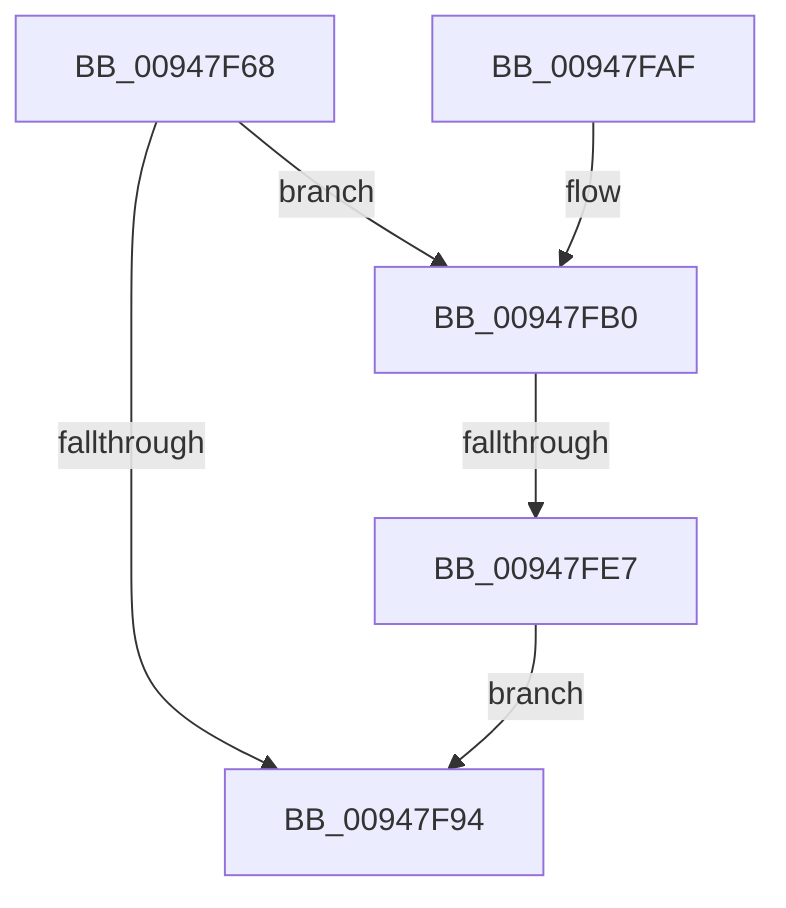

# PspInheritSyscallProvider

- RVA: `0x00947F68`–`0x00947FEE` (길이 `134` bytes)
- VA: `0x0000000140947F68`
- 실행 섹션: `PAGE`
- PDB 이름 있음: `예`; PDB Function 태그: `예`
- unwind 정보 RVA: `0x00088E50`
- 디코드: `37`개 명령, `134/134` bytes 표시
- 미해석 바이트: `0` (있으면 어셈블리에 `.byte`로 보존)

> 이 문서는 커널 이미지의 기계어와 PDB 기호를 분석해 생성했습니다. 4번과 5번은 함수 원형과 자료형을 바이너리 사용 방식에서 추정한 C 해석이며 원본 소스 복구 결과는 아닙니다.

## 1. Dependencies

- 직접 호출 지점: **3**; 고유 호출 대상: **3**
- 직접 호출자로 확인된 함수: **1**
- RIP 상대 이미지 참조: **0**

### Outgoing calls
- `0x00947FBF` → [PspLockProcessShared](../../text/40/PspLockProcessShared_function_004016D0.md) (function, `0x004016D0`)
- `0x00947FD1` → [PspUnlockProcessShared](../../text/26/PspUnlockProcessShared_function_00263950.md) (function, `0x00263950`)
- `0x00947FDA` → [ExAcquireRundownProtection](../../text/21/ExAcquireRundownProtection_function_00216620.md) (function, `0x00216620`)

### Direct callers
- [PspInsertProcess](PspInsertProcess_function_009472CC.md) at `0x0094735B`

### Static image references
- 디코드된 RIP-relative 메모리 참조가 없습니다.

## 2. Other-region calls and transfers

- 다른 실행 섹션으로 향하는 call: **3**
  - `0x00947FBF` → [PspLockProcessShared](../../text/40/PspLockProcessShared_function_004016D0.md) (`PAGE` → `.text`)
  - `0x00947FD1` → [PspUnlockProcessShared](../../text/26/PspUnlockProcessShared_function_00263950.md) (`PAGE` → `.text`)
  - `0x00947FDA` → [ExAcquireRundownProtection](../../text/21/ExAcquireRundownProtection_function_00216620.md) (`PAGE` → `.text`)
- call이 아닌 외부 분기/꼬리 이동: **1**
  - `0x00947FE1` → [sub_00B258BA](../B2/Unknown_function_00B258BA.md) (`tail-transfer`)

## 3. Assembly (complete function range)

```asm
00947F68  48 89 5C 24 08                  mov qword ptr [rsp + 8], rbx
00947F6D  48 89 6C 24 10                  mov qword ptr [rsp + 0x10], rbp
00947F72  48 89 74 24 18                  mov qword ptr [rsp + 0x18], rsi
00947F77  57                              push rdi
00947F78  41 56                           push r14
00947F7A  41 57                           push r15
00947F7C  48 83 EC 20                     sub rsp, 0x20
00947F80  48 8B B2 B8 07 00 00            mov rsi, qword ptr [rdx + 0x7b8]
00947F87  33 FF                           xor edi, edi
00947F89  48 8B EA                        mov rbp, rdx
00947F8C  4C 8B F1                        mov r14, rcx
00947F8F  48 85 F6                        test rsi, rsi
00947F92  75 1C                           jne 0x140947fb0
00947F94  48 8B 5C 24 40                  mov rbx, qword ptr [rsp + 0x40]
00947F99  8B C7                           mov eax, edi
00947F9B  48 8B 6C 24 48                  mov rbp, qword ptr [rsp + 0x48]
00947FA0  48 8B 74 24 50                  mov rsi, qword ptr [rsp + 0x50]
00947FA5  48 83 C4 20                     add rsp, 0x20
00947FA9  41 5F                           pop r15
00947FAB  41 5E                           pop r14
00947FAD  5F                              pop rdi
00947FAE  C3                              ret
00947FAF  CC                              int3
00947FB0  65 48 8B 1C 25 88 01 00 00      mov rbx, qword ptr gs:[0x188]
00947FB9  48 8B CD                        mov rcx, rbp
00947FBC  48 8B D3                        mov rdx, rbx
00947FBF  E8 0C 97 AB FF                  call 0x1404016d0
00947FC4  44 8B BD D0 07 00 00            mov r15d, dword ptr [rbp + 0x7d0]
00947FCB  48 8B D3                        mov rdx, rbx
00947FCE  48 8B CD                        mov rcx, rbp
00947FD1  E8 7A B9 91 FF                  call 0x140263950
00947FD6  48 8D 4E 38                     lea rcx, [rsi + 0x38]
00947FDA  E8 41 E6 8C FF                  call 0x140216620
00947FDF  84 C0                           test al, al
00947FE1  0F 85 D3 D8 1D 00               jne 0x140b258ba
00947FE7  BF 56 00 00 C0                  mov edi, 0xc0000056
00947FEC  EB A6                           jmp 0x140947f94
```

## 4. C-style interpretation (structured pseudocode)

```c
__int64 __fastcall PspInheritSyscallProvider(__int64 a1, __int64 a2)
{
    __int64 result;
    __int64 v_rdi;
    __int64 v_rsp;
    unsigned __int64 v_stack_p10;
    unsigned __int64 v_stack_p18;
    unsigned __int64 v_stack_p8;

    v_stack_p8 = v_rbx;
    v_stack_p10 = v_rbp;
    v_stack_p18 = v_rsi;
    v_rsp = (v_rsp) - (32);
    v_rdi = 0;
    if (*(unsigned __int64 *)(a2 + 1976) != 0) goto loc_00947FB0;
loc_00947F94:
    v_rsp = (v_rsp) + (32);
    return 0;
loc_00947FB0:
    result = PspLockProcessShared(v_stack_p10, *(unsigned __int64 *)(gs_base + (0 + 392)), a3, a4);
    result = PspUnlockProcessShared(v_stack_p10, *(unsigned __int64 *)(gs_base + (0 + 392)), a3, a4);
    result = ExAcquireRundownProtection(v_stack_p18 + 56, *(unsigned __int64 *)(gs_base + (0 + 392)), a3, a4);
    goto loc_00947F94;
}
```

## 5. (Beta) C Style

```c
int64_t PspInheritSyscallProvider(int64_t Arg1, void *Arg2)
{
    uint8_t *arg2 = (uint8_t *)Arg2;

    int64_t result;
    int64_t local_rdi;
    int64_t local_rsp;
    uint64_t v_stack_p10;
    uint64_t v_stack_p18;
    uint64_t v_stack_p8;

    v_stack_p8 = local_rbx;
    v_stack_p10 = local_rbp;
    v_stack_p18 = local_rsi;
    local_rsp = (local_rsp) - (32);
    local_rdi = 0;
    if (*(uint64_t *)(arg2 + 0x7B8) != 0) goto loc_00947FB0;
loc_00947F94:
    local_rsp = (local_rsp) + (32);
    return 0;
loc_00947FB0:
    result = PspLockProcessShared(v_stack_p10, *(uint64_t *)(gs_base + (0 + 0x188)), a3, a4);
    result = PspUnlockProcessShared(v_stack_p10, *(uint64_t *)(gs_base + (0 + 0x188)), a3, a4);
    result = ExAcquireRundownProtection(v_stack_p18 + 56, *(uint64_t *)(gs_base + (0 + 0x188)), a3, a4);
    goto loc_00947F94;
}
```

### 관측된 메모리 오프셋

구조체 형식이 확인되지 않은 접근은 인자 기준의 오프셋으로만 기록했습니다.

| 기준 인자 | 오프셋 표현 | 폭 (bit) | 접근 |
|---|---:|---:|---|
| `Arg2` | `+ 0x7B8` | `64` | `R` |
| `Arg2` | `+ 0x7D0` | `32` | `R` |

## 6. Execution-region graph

[열기: 2D/3D 그래프와 함수 탐색 컨트롤 패널](../../../control-panel.html?section=page&rva=0x00947F68&view=graph)

- 2D 그래프는 위에서 아래로 흐르고, 3D 그래프는 빈 공간을 드래그해 회전합니다. Shift+드래그는 이동, 휠은 확대·축소, 함수 노드 선택은 대상 보고서 이동입니다.

### Static fallback


