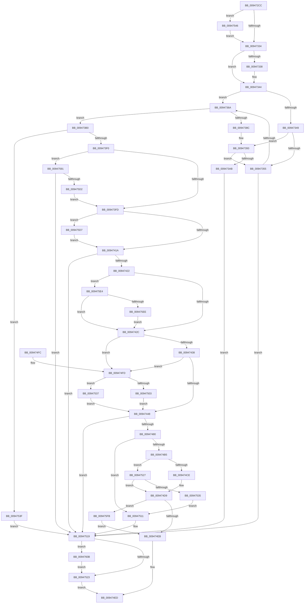

# PspInsertProcess

- RVA: `0x009472CC`–`0x0094761B` (길이 `847` bytes)
- VA: `0x00000001409472CC`
- 실행 섹션: `PAGE`
- PDB 이름 있음: `예`; PDB Function 태그: `아니요`
- unwind 정보 RVA: `0x00090AA4`
- 디코드: `212`개 명령, `847/847` bytes 표시
- 미해석 바이트: `0` (있으면 어셈블리에 `.byte`로 보존)

> 이 문서는 커널 이미지의 기계어와 PDB 기호를 분석해 생성했습니다. 4번과 5번은 함수 원형과 자료형을 바이너리 사용 방식에서 추정한 C 해석이며 원본 소스 복구 결과는 아닙니다.

## 1. Dependencies

- 직접 호출 지점: **21**; 고유 호출 대상: **20**
- 직접 호출자로 확인된 함수: **3**
- RIP 상대 이미지 참조: **9**

### Outgoing calls
- `0x0094731F` → [SepAuditingForSubCategory](../../text/47/SepAuditingForSubCategory_function_00477E84.md) (function, `0x00477E84`)
- `0x0094733F` → [SeAuditProcessCreation](SeAuditProcessCreation_function_00947624.md) (function, `0x00947624`)
- `0x0094735B` → [PspInheritSyscallProvider](PspInheritSyscallProvider_function_00947F68.md) (function, `0x00947F68`)
- `0x0094736D` → [PspLockProcessListExclusive](../../text/22/PspLockProcessListExclusive_function_0022578C.md) (function, `0x0022578C`)
- `0x009473A0` → [PspImplicitAssignProcessToJob](../87/PspImplicitAssignProcessToJob_function_0087D584.md) (function, `0x0087D584`)
- `0x009473DC` → [PspUnlockProcessListExclusive](../../text/2D/PspUnlockProcessListExclusive_function_002DFD18.md) (function, `0x002DFD18`)
- `0x0094740A` → [DbgkCopyProcessDebugPort](DbgkCopyProcessDebugPort_function_00947BE8.md) (function, `0x00947BE8`)
- `0x00947471` → [SeCreateAccessStateEx](SeCreateAccessStateEx_function_00947A80.md) (function, `0x00947A80`)
- `0x00947488` → [ObfReferenceObjectWithTag](../../text/21/ObfReferenceObjectWithTag_function_00210710.md) (function, `0x00210710`)
- `0x009474AA` → [ObInsertObjectEx](../8B/ObInsertObjectEx_function_008B97A0.md) (function, `0x008B97A0`)
- `0x009474BD` → [ObfDereferenceObjectWithTag](../../text/2F/ObfDereferenceObjectWithTag_function_002F78E0.md) (function, `0x002F78E0`)
- `0x009474DC` → [ObCheckRefTraceProcess](ObCheckRefTraceProcess_function_00947CD0.md) (function, `0x00947CD0`)
- `0x00947514` → [SeDeleteAccessState](../8C/SeDeleteAccessState_function_008C5F70.md) (function, `0x008C5F70`)
- `0x0094752A` → [PspValidateJobAffinityState](../A8/PspValidateJobAffinityState_function_00A85298.md) (function, `0x00A85298`)
- `0x00947555` → [SeCaptureSubjectContext](../86/SeCaptureSubjectContext_function_0086B820.md) (function, `0x0086B820`)
- `0x0094757B` → [SepAdtIncorporatePerUserPolicy](../79/SepAdtIncorporatePerUserPolicy_function_0079FC18.md) (function, `0x0079FC18`)
- `0x00947584` → [SeReleaseSubjectContext](../86/SeReleaseSubjectContext_function_0086B710.md) (function, `0x0086B710`)
- `0x009475BF` → [ObReferenceObjectByHandle](../86/ObReferenceObjectByHandle_function_00868DB0.md) (function, `0x00868DB0`)
- `0x009475DA` → [ObfDereferenceObject](../../text/2F/ObfDereferenceObject_function_002F9350.md) (function, `0x002F9350`)
- `0x00947601` → [PspUnlockProcessExclusive](../../text/46/PspUnlockProcessExclusive_function_004601C0.md) (function, `0x004601C0`)
- `0x00947611` → [PspUnlockProcessExclusive](../../text/46/PspUnlockProcessExclusive_function_004601C0.md) (function, `0x004601C0`)

### Direct callers
- [PsCreateMinimalProcess](../78/PsCreateMinimalProcess_function_00786D14.md) at `0x00786FFC`
- [PspCreateProcess](../A1/PspCreateProcess_function_00A12758.md) at `0x00A12C69`
- [NtCreateUserProcess](../AE/NtCreateUserProcess_function_00AEA680.md) at `0x00AEB5ED`

### Static image references
- `0x00947324` → RVA `0x00F04C68` (`.data`; read)
- `0x00947372` → RVA `0x00F067C8` (`.data`; read)
- `0x00947379` → RVA `0x00F067C0` (`.data`; read)
- `0x009473BD` → RVA `0x00F067C8` (`.data`; write)
- `0x009473C4` → RVA `0x00F066B0` (`.data`; read)
- `0x009473CE` → RVA `0x00F066B0` (`.data`; write)
- `0x00947438` → RVA `0x00FC6AB0` (`ALMOSTRO`; read)
- `0x0094744E` → RVA `0x00FC6A98` (`ALMOSTRO`; read)
- `0x0094759F` → RVA `0x00FC5140` (`ALMOSTRO`; read)

## 2. Other-region calls and transfers

- 다른 실행 섹션으로 향하는 call: **8**
  - `0x0094731F` → [SepAuditingForSubCategory](../../text/47/SepAuditingForSubCategory_function_00477E84.md) (`PAGE` → `.text`)
  - `0x0094736D` → [PspLockProcessListExclusive](../../text/22/PspLockProcessListExclusive_function_0022578C.md) (`PAGE` → `.text`)
  - `0x009473DC` → [PspUnlockProcessListExclusive](../../text/2D/PspUnlockProcessListExclusive_function_002DFD18.md) (`PAGE` → `.text`)
  - `0x00947488` → [ObfReferenceObjectWithTag](../../text/21/ObfReferenceObjectWithTag_function_00210710.md) (`PAGE` → `.text`)
  - `0x009474BD` → [ObfDereferenceObjectWithTag](../../text/2F/ObfDereferenceObjectWithTag_function_002F78E0.md) (`PAGE` → `.text`)
  - `0x009475DA` → [ObfDereferenceObject](../../text/2F/ObfDereferenceObject_function_002F9350.md) (`PAGE` → `.text`)
  - `0x00947601` → [PspUnlockProcessExclusive](../../text/46/PspUnlockProcessExclusive_function_004601C0.md) (`PAGE` → `.text`)
  - `0x00947611` → [PspUnlockProcessExclusive](../../text/46/PspUnlockProcessExclusive_function_004601C0.md) (`PAGE` → `.text`)
- 별도 외부 분기/꼬리 이동을 확인하지 못했습니다.

## 3. Assembly (complete function range)

```asm
009472CC  44 89 4C 24 20                  mov dword ptr [rsp + 0x20], r9d
009472D1  44 89 44 24 18                  mov dword ptr [rsp + 0x18], r8d
009472D6  55                              push rbp
009472D7  53                              push rbx
009472D8  56                              push rsi
009472D9  57                              push rdi
009472DA  41 55                           push r13
009472DC  41 56                           push r14
009472DE  41 57                           push r15
009472E0  48 8B EC                        mov rbp, rsp
009472E3  48 83 EC 70                     sub rsp, 0x70
009472E7  65 4C 8B 3C 25 88 01 00 00      mov r15, qword ptr gs:[0x188]
009472F0  48 8B D9                        mov rbx, rcx
009472F3  4C 8B 91 00 03 00 00            mov r10, qword ptr [rcx + 0x300]
009472FA  48 8B F2                        mov rsi, rdx
009472FD  8B 81 D0 01 00 00               mov eax, dword ptr [rcx + 0x1d0]
00947303  45 33 F6                        xor r14d, r14d
00947306  B2 01                           mov dl, 1
00947308  44 88 75 48                     mov byte ptr [rbp + 0x48], r14b
0094730C  4D 8B AF B8 00 00 00            mov r13, qword ptr [r15 + 0xb8]
00947313  B9 86 00 00 00                  mov ecx, 0x86
00947318  41 89 42 28                     mov dword ptr [r10 + 0x28], eax
0094731C  41 8B F9                        mov edi, r9d
0094731F  E8 60 0B B3 FF                  call 0x140477e84
00947324  44 39 35 3D D9 5B 00            cmp dword ptr [rip + 0x5bd93d], r14d
0094732B  88 45 40                        mov byte ptr [rbp + 0x40], al
0094732E  0F 85 12 02 00 00               jne 0x140947546
00947334  84 C0                           test al, al
00947336  74 0C                           je 0x140947344
00947338  48 8B 55 70                     mov rdx, qword ptr [rbp + 0x70]
0094733C  48 8B CB                        mov rcx, rbx
0094733F  E8 E0 02 00 00                  call 0x140947624
00947344  48 85 F6                        test rsi, rsi
00947347  74 21                           je 0x14094736a
00947349  48 8B 86 A0 02 00 00            mov rax, qword ptr [rsi + 0x2a0]
00947350  48 85 C0                        test rax, rax
00947353  75 3E                           jne 0x140947393
00947355  48 8B D6                        mov rdx, rsi
00947358  48 8B CB                        mov rcx, rbx
0094735B  E8 08 0C 00 00                  call 0x140947f68
00947360  8B F8                           mov edi, eax
00947362  85 C0                           test eax, eax
00947364  0F 88 AF 01 00 00               js 0x140947519
0094736A  49 8B CF                        mov rcx, r15
0094736D  E8 1A E4 8D FF                  call 0x14022578c
00947372  48 8B 0D 4F F4 5B 00            mov rcx, qword ptr [rip + 0x5bf44f]
00947379  48 8D 15 40 F4 5B 00            lea rdx, [rip + 0x5bf440]
00947380  48 8D 83 D8 01 00 00            lea rax, [rbx + 0x1d8]
00947387  48 39 11                        cmp qword ptr [rcx], rdx
0094738A  74 24                           je 0x1409473b0
0094738C  B9 03 00 00 00                  mov ecx, 3
00947391  CD 29                           int 0x29
00947393  48 8B 8E A0 02 00 00            mov rcx, qword ptr [rsi + 0x2a0]
0094739A  44 8B C7                        mov r8d, edi
0094739D  48 8B D3                        mov rdx, rbx
009473A0  E8 DF 61 F3 FF                  call 0x14087d584
009473A5  8B F8                           mov edi, eax
009473A7  85 C0                           test eax, eax
009473A9  79 AA                           jns 0x140947355
009473AB  E9 69 01 00 00                  jmp 0x140947519
009473B0  48 89 48 08                     mov qword ptr [rax + 8], rcx
009473B4  48 89 10                        mov qword ptr [rax], rdx
009473B7  48 89 01                        mov qword ptr [rcx], rax
009473BA  49 8B CF                        mov rcx, r15
009473BD  48 89 05 04 F4 5B 00            mov qword ptr [rip + 0x5bf404], rax
009473C4  48 8B 05 E5 F2 5B 00            mov rax, qword ptr [rip + 0x5bf2e5]
009473CB  48 FF C0                        inc rax
009473CE  48 89 05 DB F2 5B 00            mov qword ptr [rip + 0x5bf2db], rax
009473D5  48 89 83 78 06 00 00            mov qword ptr [rbx + 0x678], rax
009473DC  E8 37 89 99 FF                  call 0x1402dfd18
009473E1  41 8B 85 F4 01 00 00            mov eax, dword ptr [r13 + 0x1f4]
009473E8  A8 08                           test al, 8
009473EA  0F 85 4F 01 00 00               jne 0x14094753f
009473F0  48 8B 4D 60                     mov rcx, qword ptr [rbp + 0x60]
009473F4  48 85 C9                        test rcx, rcx
009473F7  0F 85 94 01 00 00               jne 0x140947591
009473FD  4C 8D 4D 48                     lea r9, [rbp + 0x48]
00947401  4D 8B C6                        mov r8, r14
00947404  49 8B D5                        mov rdx, r13
00947407  48 8B CB                        mov rcx, rbx
0094740A  E8 D9 07 00 00                  call 0x140947be8
0094740F  8B F8                           mov edi, eax
00947411  4D 85 F6                        test r14, r14
00947414  0F 85 BD 01 00 00               jne 0x1409475d7
0094741A  85 FF                           test edi, edi
0094741C  0F 88 F7 00 00 00               js 0x140947519
00947422  80 7D 48 00                     cmp byte ptr [rbp + 0x48], 0
00947426  0F 85 B8 01 00 00               jne 0x1409475e4
0094742C  45 33 F6                        xor r14d, r14d
0094742F  48 85 F6                        test rsi, rsi
00947432  0F 84 C5 00 00 00               je 0x1409474fd
00947438  48 8B 15 71 F6 67 00            mov rdx, qword ptr [rip + 0x67f671]
0094743F  48 3B F2                        cmp rsi, rdx
00947442  0F 85 B5 00 00 00               jne 0x1409474fd
00947448  48 8B 75 78                     mov rsi, qword ptr [rbp + 0x78]
0094744C  33 C9                           xor ecx, ecx
0094744E  48 8B 05 43 F6 67 00            mov rax, qword ptr [rip + 0x67f643]
00947455  4C 8B C6                        mov r8, rsi
00947458  44 8B 6D 50                     mov r13d, dword ptr [rbp + 0x50]
0094745C  48 83 C0 4C                     add rax, 0x4c
00947460  48 89 44 24 28                  mov qword ptr [rsp + 0x28], rax
00947465  4C 8D 8E A0 00 00 00            lea r9, [rsi + 0xa0]
0094746C  44 89 6C 24 20                  mov dword ptr [rsp + 0x20], r13d
00947471  E8 0A 06 00 00                  call 0x140947a80
00947476  8B F8                           mov edi, eax
00947478  85 C0                           test eax, eax
0094747A  0F 88 99 00 00 00               js 0x140947519
00947480  BA 50 73 43 72                  mov edx, 0x72437350
00947485  48 8B CB                        mov rcx, rbx
00947488  E8 83 92 8C FF                  call 0x140210710
0094748D  48 83 64 24 30 00               and qword ptr [rsp + 0x30], 0
00947493  45 33 C9                        xor r9d, r9d
00947496  48 83 64 24 28 00               and qword ptr [rsp + 0x28], 0
0094749C  45 8B C5                        mov r8d, r13d
0094749F  48 8B D6                        mov rdx, rsi
009474A2  44 89 74 24 20                  mov dword ptr [rsp + 0x20], r14d
009474A7  48 8B CB                        mov rcx, rbx
009474AA  E8 F1 22 F7 FF                  call 0x1408b97a0
009474AF  8B F8                           mov edi, eax
009474B1  85 C0                           test eax, eax
009474B3  78 5C                           js 0x140947511
009474B5  BA 50 73 43 72                  mov edx, 0x72437350
009474BA  48 8B CB                        mov rcx, rbx
009474BD  E8 1E 04 9B FF                  call 0x1402f78e0
009474C2  48 8B 8B A0 02 00 00            mov rcx, qword ptr [rbx + 0x2a0]
009474C9  48 85 C9                        test rcx, rcx
009474CC  75 59                           jne 0x140947527
009474CE  F0 81 8B F4 01 00 00 00 00 00 04  lock or dword ptr [rbx + 0x1f4], 0x4000000
009474D9  48 8B CB                        mov rcx, rbx
009474DC  E8 EF 07 00 00                  call 0x140947cd0
009474E1  F6 45 68 01                     test byte ptr [rbp + 0x68], 1
009474E5  0F 85 10 01 00 00               jne 0x1409475fb
009474EB  33 C0                           xor eax, eax
009474ED  48 83 C4 70                     add rsp, 0x70
009474F1  41 5F                           pop r15
009474F3  41 5E                           pop r14
009474F5  41 5D                           pop r13
009474F7  5F                              pop rdi
009474F8  5E                              pop rsi
009474F9  5B                              pop rbx
009474FA  5D                              pop rbp
009474FB  C3                              ret
009474FC  CC                              int3
009474FD  F6 45 68 02                     test byte ptr [rbp + 0x68], 2
00947501  74 34                           je 0x140947537
00947503  48 8B D3                        mov rdx, rbx
00947506  41 BE 01 00 00 00               mov r14d, 1
0094750C  E9 37 FF FF FF                  jmp 0x140947448
00947511  48 8B CE                        mov rcx, rsi
00947514  E8 57 EA F7 FF                  call 0x1408c5f70
00947519  F6 45 68 01                     test byte ptr [rbp + 0x68], 1
0094751D  0F 85 E8 00 00 00               jne 0x14094760b
00947523  8B C7                           mov eax, edi
00947525  EB C6                           jmp 0x1409474ed
00947527  48 8B D3                        mov rdx, rbx
0094752A  E8 69 DD 13 00                  call 0x140a85298
0094752F  8B F8                           mov edi, eax
00947531  85 C0                           test eax, eax
00947533  79 A4                           jns 0x1409474d9
00947535  EB DA                           jmp 0x140947511
00947537  49 8B D5                        mov rdx, r13
0094753A  E9 09 FF FF FF                  jmp 0x140947448
0094753F  BF 0A 01 00 C0                  mov edi, 0xc000010a
00947544  EB D3                           jmp 0x140947519
00947546  0F 57 C0                        xorps xmm0, xmm0
00947549  48 8D 4D D8                     lea rcx, [rbp - 0x28]
0094754D  0F 11 45 D8                     movups xmmword ptr [rbp - 0x28], xmm0
00947551  0F 11 45 E8                     movups xmmword ptr [rbp - 0x18], xmm0
00947555  E8 C6 42 F2 FF                  call 0x14086b820
0094755A  48 8B 45 D8                     mov rax, qword ptr [rbp - 0x28]
0094755E  B2 01                           mov dl, 1
00947560  4C 8B 4D E8                     mov r9, qword ptr [rbp - 0x18]
00947564  48 85 C0                        test rax, rax
00947567  4C 0F 45 C8                     cmovne r9, rax
0094756B  45 33 C0                        xor r8d, r8d
0094756E  48 8D 45 40                     lea rax, [rbp + 0x40]
00947572  48 89 44 24 20                  mov qword ptr [rsp + 0x20], rax
00947577  41 8D 48 22                     lea ecx, [r8 + 0x22]
0094757B  E8 98 86 E5 FF                  call 0x14079fc18
00947580  48 8D 4D D8                     lea rcx, [rbp - 0x28]
00947584  E8 87 41 F2 FF                  call 0x14086b710
00947589  8A 45 40                        mov al, byte ptr [rbp + 0x40]
0094758C  E9 A3 FD FF FF                  jmp 0x140947334
00947591  65 48 8B 04 25 88 01 00 00      mov rax, qword ptr gs:[0x188]
0094759A  BA 02 00 00 00                  mov edx, 2
0094759F  4C 8B 05 9A DB 67 00            mov r8, qword ptr [rip + 0x67db9a]
009475A6  4C 89 74 24 28                  mov qword ptr [rsp + 0x28], r14
009475AB  4C 89 75 D0                     mov qword ptr [rbp - 0x30], r14
009475AF  44 8A 88 32 02 00 00            mov r9b, byte ptr [rax + 0x232]
009475B6  48 8D 45 D0                     lea rax, [rbp - 0x30]
009475BA  48 89 44 24 20                  mov qword ptr [rsp + 0x20], rax
009475BF  E8 EC 17 F2 FF                  call 0x140868db0
009475C4  4C 8B 75 D0                     mov r14, qword ptr [rbp - 0x30]
009475C8  8B F8                           mov edi, eax
009475CA  85 C0                           test eax, eax
009475CC  0F 88 47 FF FF FF               js 0x140947519
009475D2  E9 26 FE FF FF                  jmp 0x1409473fd
009475D7  49 8B CE                        mov rcx, r14
009475DA  E8 71 1D 9B FF                  call 0x1402f9350
009475DF  E9 36 FE FF FF                  jmp 0x14094741a
009475E4  F6 45 58 02                     test byte ptr [rbp + 0x58], 2
009475E8  0F 84 3E FE FF FF               je 0x14094742c
009475EE  F0 83 8B F4 01 00 00 02         lock or dword ptr [rbx + 0x1f4], 2
009475F6  E9 31 FE FF FF                  jmp 0x14094742c
009475FB  49 8B D7                        mov rdx, r15
009475FE  48 8B CB                        mov rcx, rbx
00947601  E8 BA 8B B1 FF                  call 0x1404601c0
00947606  E9 E0 FE FF FF                  jmp 0x1409474eb
0094760B  49 8B D7                        mov rdx, r15
0094760E  48 8B CB                        mov rcx, rbx
00947611  E8 AA 8B B1 FF                  call 0x1404601c0
00947616  E9 08 FF FF FF                  jmp 0x140947523
```

## 4. C-style interpretation (structured pseudocode)

```c
__int64 __fastcall PspInsertProcess(__int64 a1, __int64 a2, int a3, int a4, __int64 a5, unsigned __int8 a6, __int64 a7, __int64 a8)
{
    __int64 result;
    __int64 v_r14;
    __int64 v_rsp;
    unsigned __int64 v_stack_m50;
    unsigned __int64 v_stack_m60;
    unsigned __int64 v_stack_m68;
    unsigned __int64 v_stack_m78;
    unsigned __int64 v_stack_m80;
    unsigned int v_stack_m88;
    unsigned __int8 v_stack_p10;
    unsigned int v_stack_p18;
    unsigned int v_stack_p20;
    unsigned __int64 v_stack_p28;
    unsigned __int8 v_stack_p8;

    v_stack_p20 = a4;
    v_stack_p18 = a3;
    v_rsp = (v_rsp) - (112);
    v_r14 = 0;
    v_stack_p10 = 0;
    *(unsigned int *)(*(unsigned __int64 *)(a1 + 768) + 40) = (unsigned int)((unsigned int)(*(unsigned int *)(a1 + 464)));
    result = SepAuditingForSubCategory(134, 1, a3, a4);
    v_stack_p8 = (unsigned __int8)(result);
    if ((*(unsigned int *)(v_rip + 6019389)) != 0) goto loc_00947546;
loc_00947334:
    if ((unsigned __int8)(result) != 0) {
        a2 = a7;
        a1 = a1;
        result = SeAuditProcessCreation(a1, a2, a3, a4);
    }
    if (a2 == 0) goto loc_0094736A;
    if (*(unsigned __int64 *)(a2 + 672) != 0) goto loc_00947393;
loc_00947355:
    result = PspInheritSyscallProvider(a1, a2, a3, a4);
    if (sign_flag) goto loc_00947519;
loc_0094736A:
    result = PspLockProcessListExclusive(*(unsigned __int64 *)(gs_base + (0 + 392)), a2, a3, a4);
    if ((*(unsigned __int64 *)(*(unsigned __int64 *)(v_rip + 6026319))) == (v_rip + 6026304)) goto loc_009473B0;
loc_00947393:
    result = PspImplicitAssignProcessToJob(*(unsigned __int64 *)(a2 + 672), a1, (unsigned int)((unsigned int)((unsigned int)((unsigned int)(result)))), a4);
    if (!sign_flag) goto loc_00947355;
    goto loc_00947519;
loc_009473B0:
    *(unsigned __int64 *)(result + 8) = *(unsigned __int64 *)(a2 + 672);
    *(unsigned __int64 *)(result) = a1;
    *(unsigned __int64 *)(*(unsigned __int64 *)(a2 + 672)) = result;
    *(unsigned __int64 *)(v_rip + 6026244) = result;
    result = (*(unsigned __int64 *)(v_rip + 6025957)) + 1;
    *(unsigned __int64 *)(v_rip + 6025947) = result;
    *(unsigned __int64 *)(a1 + 1656) = result;
    result = PspUnlockProcessListExclusive(*(unsigned __int64 *)(gs_base + (0 + 392)), a1, (unsigned int)((unsigned int)((unsigned int)((unsigned int)(result)))), a4);
    if ((((unsigned __int8)((unsigned int)(*(unsigned int *)(*(unsigned __int64 *)(*(unsigned __int64 *)(gs_base + (0 + 392)) + 184) + 500)))) & (8)) != 0) goto loc_0094753F;
    if (a5 != 0) goto loc_00947591;
loc_009473FD:
    result = DbgkCopyProcessDebugPort(a1, *(unsigned __int64 *)(*(unsigned __int64 *)(gs_base + (0 + 392)) + 184), 0, v_stack_p10);
    if (0 != 0) goto loc_009475D7;
loc_0094741A:
    if (sign_flag) goto loc_00947519;
    if (v_stack_p10 != 0) goto loc_009475E4;
loc_0094742C:
    v_r14 = 0;
    if (a2 == 0) goto loc_009474FD;
    if (a2 != (*(unsigned __int64 *)(v_rip + 6813297))) goto loc_009474FD;
loc_00947448:
    a1 = 0;
    result = (*(unsigned __int64 *)(v_rip + 6813251)) + (76);
    v_stack_m80 = result;
    v_stack_m88 = (unsigned int)((unsigned int)(v_stack_p18));
    result = SeCreateAccessStateEx(a1, *(unsigned __int64 *)(v_rip + 6813297), a8, a8 + 160);
    if (sign_flag) goto loc_00947519;
    result = ObfReferenceObjectWithTag(0, (unsigned int)(0x72437350ULL), a8, a8 + 160);
    a4 = 0;
    v_stack_m88 = 0;
    result = ObInsertObjectEx(0, a8, (unsigned int)((unsigned int)((unsigned int)(v_stack_p18))), a4);
    if (sign_flag) goto loc_00947511;
    result = ObfDereferenceObjectWithTag(0, (unsigned int)(0x72437350ULL), (unsigned int)((unsigned int)((unsigned int)(v_stack_p18))), a4);
    if (*(unsigned __int64 *)(a1 + 672) != 0) goto loc_00947527;
loc_009474D9:
    result = ObCheckRefTraceProcess(0, (unsigned int)(0x72437350ULL), (unsigned int)((unsigned int)((unsigned int)(v_stack_p18))), a4);
    if (((a6) & (1)) != 0) goto loc_009475FB;
loc_009474EB:
    result = 0;
loc_009474ED:
    v_rsp = (v_rsp) + (112);
    return result;
loc_009474FD:
    if (((a6) & (2)) == 0) goto loc_00947537;
    goto loc_00947448;
loc_00947511:
    result = SeDeleteAccessState(a8, 0, (unsigned int)((unsigned int)((unsigned int)(v_stack_p18))), a4);
loc_00947519:
    if (((a6) & (1)) != 0) goto loc_0094760B;
loc_00947523:
    goto loc_009474ED;
loc_00947527:
    result = PspValidateJobAffinityState(a8, 0, (unsigned int)((unsigned int)((unsigned int)(v_stack_p18))), a4);
    if (!sign_flag) goto loc_009474D9;
    goto loc_00947511;
loc_00947537:
    goto loc_00947448;
loc_0094753F:
    goto loc_00947519;
loc_00947546:
    v_stack_m60 = v_xmm0;
    v_stack_m50 = v_xmm0;
    result = SeCaptureSubjectContext(v_stack_m60, (unsigned int)(v_stack_p18), (unsigned int)((unsigned int)((unsigned int)(v_stack_p18))), a4);
    a4 = v_stack_m50;
    if (v_stack_m60 != 0) { a4 = v_stack_m60; }
    a3 = 0;
    v_stack_p20 = v_stack_p8;
    result = SepAdtIncorporatePerUserPolicy(a3 + 34, 1, a3, a4);
    result = SeReleaseSubjectContext(v_stack_m60, 1, a3, a4);
    goto loc_00947334;
loc_00947591:
    v_stack_p28 = 1;
    v_stack_m68 = 1;
    v_stack_p20 = v_stack_m68;
    result = ObReferenceObjectByHandle(v_stack_m60, 2, *(unsigned __int64 *)(v_rip + 6806426), *(unsigned __int8 *)(*(unsigned __int64 *)(gs_base + (0 + 392)) + 562));
    if (sign_flag) goto loc_00947519;
    goto loc_009473FD;
loc_009475D7:
    result = ObfDereferenceObject(v_stack_m68, 2, *(unsigned __int64 *)(v_rip + 6806426), *(unsigned __int8 *)(*(unsigned __int64 *)(gs_base + (0 + 392)) + 562));
    goto loc_0094741A;
loc_009475E4:
    if (((v_stack_p20) & (2)) == 0) goto loc_0094742C;
    goto loc_0094742C;
loc_009475FB:
    result = PspUnlockProcessExclusive(0, *(unsigned __int64 *)(gs_base + (0 + 392)), *(unsigned __int64 *)(v_rip + 6806426), *(unsigned __int8 *)(*(unsigned __int64 *)(gs_base + (0 + 392)) + 562));
    goto loc_009474EB;
loc_0094760B:
    result = PspUnlockProcessExclusive(0, *(unsigned __int64 *)(gs_base + (0 + 392)), *(unsigned __int64 *)(v_rip + 6806426), *(unsigned __int8 *)(*(unsigned __int64 *)(gs_base + (0 + 392)) + 562));
    goto loc_00947523;
}
```

## 5. (Beta) C Style

```c
int64_t PspInsertProcess(void *Arg1, int64_t Arg2, int32_t Arg3, int32_t Arg4, int64_t Arg5, uint8_t Arg6, int64_t Arg7, void *Arg8)
{
    uint8_t *arg1 = (uint8_t *)Arg1;
    uint8_t *arg8 = (uint8_t *)Arg8;

    int64_t result;
    int64_t local_r14;
    int64_t local_rsp;
    uint64_t v_stack_m50;
    uint64_t v_stack_m60;
    uint64_t v_stack_m68;
    uint64_t v_stack_m78;
    uint64_t v_stack_m80;
    uint32_t v_stack_m88;
    uint8_t v_stack_p10;
    uint32_t v_stack_p18;
    uint32_t v_stack_p20;
    uint64_t v_stack_p28;
    uint8_t v_stack_p8;

    v_stack_p20 = Arg4;
    v_stack_p18 = Arg3;
    local_rsp = (local_rsp) - (112);
    local_r14 = 0;
    v_stack_p10 = 0;
    *(uint32_t *)(*(uint64_t *)(arg1 + 0x300) + 0x28) = (uint32_t)((uint32_t)(*(uint32_t *)(arg1 + 0x1D0)));
    result = SepAuditingForSubCategory(134, 1, Arg3, Arg4);
    v_stack_p8 = (uint8_t)(result);
    if ((*(uint32_t *)(v_rip + 0x5BD93D)) != 0) goto loc_00947546;
loc_00947334:
    if ((uint8_t)(result) != 0) {
        Arg2 = Arg7;
        Arg1 = Arg1;
        result = SeAuditProcessCreation(Arg1, Arg2, Arg3, Arg4);
    }
    if (Arg2 == 0) goto loc_0094736A;
    if (*(uint64_t *)(Arg2 + 0x2A0) != 0) goto loc_00947393;
loc_00947355:
    result = PspInheritSyscallProvider(Arg1, Arg2, Arg3, Arg4);
    if (sign_flag) goto loc_00947519;
loc_0094736A:
    result = PspLockProcessListExclusive(*(uint64_t *)(gs_base + (0 + 0x188)), Arg2, Arg3, Arg4);
    if ((*(uint64_t *)(*(uint64_t *)(v_rip + 0x5BF44F))) == (v_rip + 6026304)) goto loc_009473B0;
loc_00947393:
    result = PspImplicitAssignProcessToJob(*(uint64_t *)(Arg2 + 0x2A0), Arg1, (uint32_t)((uint32_t)((uint32_t)((uint32_t)(result)))), Arg4);
    if (!sign_flag) goto loc_00947355;
    goto loc_00947519;
loc_009473B0:
    *(uint64_t *)(result + 0x8) = *(uint64_t *)(Arg2 + 0x2A0);
    *(void **)(result) = Arg1;
    *(uint64_t *)(*(uint64_t *)(Arg2 + 0x2A0)) = result;
    *(uint64_t *)(v_rip + 0x5BF404) = result;
    result = (*(uint64_t *)(v_rip + 0x5BF2E5)) + 1;
    *(uint64_t *)(v_rip + 0x5BF2DB) = result;
    *(uint64_t *)(arg1 + 0x678) = result;
    result = PspUnlockProcessListExclusive(*(uint64_t *)(gs_base + (0 + 0x188)), Arg1, (uint32_t)((uint32_t)((uint32_t)((uint32_t)(result)))), Arg4);
    if ((((uint8_t)((uint32_t)(*(uint32_t *)(*(uint64_t *)(*(uint64_t *)(gs_base + (0 + 0x188)) + 0xB8) + 0x1F4)))) & (8)) != 0) goto loc_0094753F;
    if (Arg5 != 0) goto loc_00947591;
loc_009473FD:
    result = DbgkCopyProcessDebugPort(Arg1, *(uint64_t *)(*(uint64_t *)(gs_base + (0 + 0x188)) + 0xB8), 0, v_stack_p10);
    if (0 != 0) goto loc_009475D7;
loc_0094741A:
    if (sign_flag) goto loc_00947519;
    if (v_stack_p10 != 0) goto loc_009475E4;
loc_0094742C:
    local_r14 = 0;
    if (Arg2 == 0) goto loc_009474FD;
    if (Arg2 != (*(uint64_t *)(v_rip + 0x67F671))) goto loc_009474FD;
loc_00947448:
    Arg1 = 0;
    result = (*(uint64_t *)(v_rip + 0x67F643)) + (76);
    v_stack_m80 = result;
    v_stack_m88 = (uint32_t)((uint32_t)(v_stack_p18));
    result = SeCreateAccessStateEx(Arg1, *(uint64_t *)(v_rip + 0x67F671), Arg8, Arg8 + 160);
    if (sign_flag) goto loc_00947519;
    result = ObfReferenceObjectWithTag(0, (uint32_t)(0x72437350ULL), Arg8, Arg8 + 160);
    Arg4 = 0;
    v_stack_m88 = 0;
    result = ObInsertObjectEx(0, Arg8, (uint32_t)((uint32_t)((uint32_t)(v_stack_p18))), Arg4);
    if (sign_flag) goto loc_00947511;
    result = ObfDereferenceObjectWithTag(0, (uint32_t)(0x72437350ULL), (uint32_t)((uint32_t)((uint32_t)(v_stack_p18))), Arg4);
    if (*(uint64_t *)(arg1 + 0x2A0) != 0) goto loc_00947527;
loc_009474D9:
    result = ObCheckRefTraceProcess(0, (uint32_t)(0x72437350ULL), (uint32_t)((uint32_t)((uint32_t)(v_stack_p18))), Arg4);
    if (((Arg6) & (1)) != 0) goto loc_009475FB;
loc_009474EB:
    result = 0;
loc_009474ED:
    local_rsp = (local_rsp) + (112);
    return result;
loc_009474FD:
    if (((Arg6) & (2)) == 0) goto loc_00947537;
    goto loc_00947448;
loc_00947511:
    result = SeDeleteAccessState(Arg8, 0, (uint32_t)((uint32_t)((uint32_t)(v_stack_p18))), Arg4);
loc_00947519:
    if (((Arg6) & (1)) != 0) goto loc_0094760B;
loc_00947523:
    goto loc_009474ED;
loc_00947527:
    result = PspValidateJobAffinityState(Arg8, 0, (uint32_t)((uint32_t)((uint32_t)(v_stack_p18))), Arg4);
    if (!sign_flag) goto loc_009474D9;
    goto loc_00947511;
loc_00947537:
    goto loc_00947448;
loc_0094753F:
    goto loc_00947519;
loc_00947546:
    v_stack_m60 = v_xmm0;
    v_stack_m50 = v_xmm0;
    result = SeCaptureSubjectContext(v_stack_m60, (uint32_t)(v_stack_p18), (uint32_t)((uint32_t)((uint32_t)(v_stack_p18))), Arg4);
    Arg4 = v_stack_m50;
    if (v_stack_m60 != 0) { Arg4 = v_stack_m60; }
    Arg3 = 0;
    v_stack_p20 = v_stack_p8;
    result = SepAdtIncorporatePerUserPolicy(Arg3 + 34, 1, Arg3, Arg4);
    result = SeReleaseSubjectContext(v_stack_m60, 1, Arg3, Arg4);
    goto loc_00947334;
loc_00947591:
    v_stack_p28 = 1;
    v_stack_m68 = 1;
    v_stack_p20 = v_stack_m68;
    result = ObReferenceObjectByHandle(v_stack_m60, 2, *(uint64_t *)(v_rip + 0x67DB9A), *(uint8_t *)(*(uint64_t *)(gs_base + (0 + 0x188)) + 0x232));
    if (sign_flag) goto loc_00947519;
    goto loc_009473FD;
loc_009475D7:
    result = ObfDereferenceObject(v_stack_m68, 2, *(uint64_t *)(v_rip + 0x67DB9A), *(uint8_t *)(*(uint64_t *)(gs_base + (0 + 0x188)) + 0x232));
    goto loc_0094741A;
loc_009475E4:
    if (((v_stack_p20) & (2)) == 0) goto loc_0094742C;
    goto loc_0094742C;
loc_009475FB:
    result = PspUnlockProcessExclusive(0, *(uint64_t *)(gs_base + (0 + 0x188)), *(uint64_t *)(v_rip + 0x67DB9A), *(uint8_t *)(*(uint64_t *)(gs_base + (0 + 0x188)) + 0x232));
    goto loc_009474EB;
loc_0094760B:
    result = PspUnlockProcessExclusive(0, *(uint64_t *)(gs_base + (0 + 0x188)), *(uint64_t *)(v_rip + 0x67DB9A), *(uint8_t *)(*(uint64_t *)(gs_base + (0 + 0x188)) + 0x232));
    goto loc_00947523;
}
```

### 관측된 메모리 오프셋

구조체 형식이 확인되지 않은 접근은 인자 기준의 오프셋으로만 기록했습니다.

| 기준 인자 | 오프셋 표현 | 폭 (bit) | 접근 |
|---|---:|---:|---|
| `Arg1` | `+ 0x0` | `64` | `W` |
| `Arg1` | `+ 0x8` | `64` | `W` |
| `Arg1` | `+ 0x1D0` | `32` | `R` |
| `Arg1` | `+ 0x1D8` | `64` | `R` |
| `Arg1` | `+ 0x1F4` | `32` | `R/W` |
| `Arg1` | `+ 0x2A0` | `64` | `R` |
| `Arg1` | `+ 0x300` | `64` | `R` |
| `Arg1` | `+ 0x678` | `64` | `W` |
| `Arg8` | `+ 0xA0` | `64` | `R` |

## 6. Execution-region graph

[열기: 2D/3D 그래프와 함수 탐색 컨트롤 패널](../../../control-panel.html?section=page&rva=0x009472CC&view=graph)

- 2D 그래프는 위에서 아래로 흐르고, 3D 그래프는 빈 공간을 드래그해 회전합니다. Shift+드래그는 이동, 휠은 확대·축소, 함수 노드 선택은 대상 보고서 이동입니다.

### Static fallback


