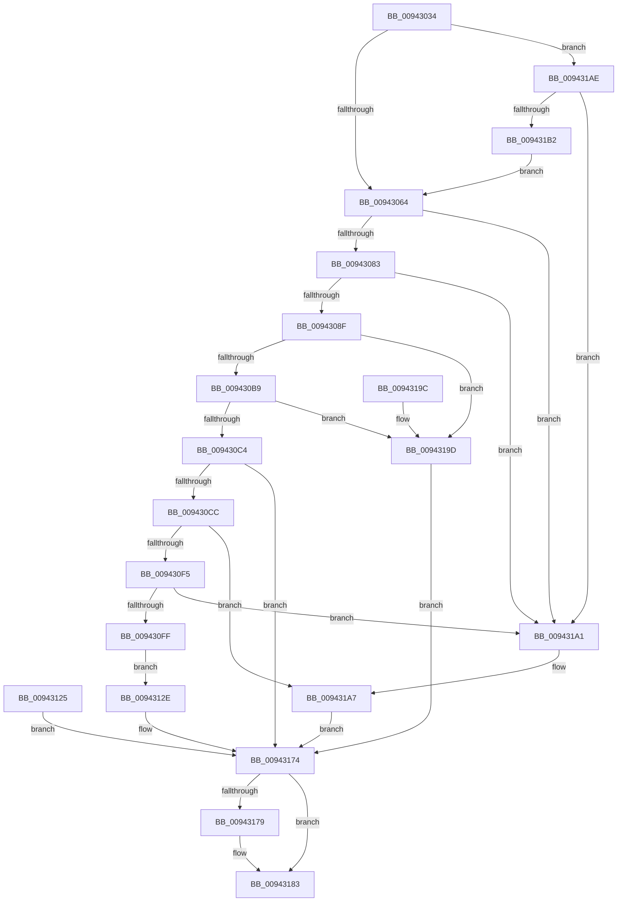

# RtlCreateFunctionOverrideFixupInfo

- RVA: `0x00943034`–`0x009431B7` (길이 `387` bytes)
- VA: `0x0000000140943034`
- 실행 섹션: `PAGE`
- PDB 이름 있음: `예`; PDB Function 태그: `아니요`
- unwind 정보 RVA: `0x00090504`
- 디코드: `95`개 명령, `387/387` bytes 표시
- 미해석 바이트: `0` (있으면 어셈블리에 `.byte`로 보존)

> 이 문서는 커널 이미지의 기계어와 PDB 기호를 분석해 생성했습니다. 4번과 5번은 함수 원형과 자료형을 바이너리 사용 방식에서 추정한 C 해석이며 원본 소스 복구 결과는 아닙니다.

## 1. Dependencies

- 직접 호출 지점: **6**; 고유 호출 대상: **6**
- 직접 호출자로 확인된 함수: **2**
- RIP 상대 이미지 참조: **0**

### Outgoing calls
- `0x009430A7` → [RtlpFindFunctionOverrideDvrtRecord](RtlpFindFunctionOverrideDvrtRecord_function_009431C0.md) (function, `0x009431C0`)
- `0x009430DF` → [ExAllocatePool2](../../poolcode/B8/ExAllocatePool2_function_00B820F0.md) (function, `0x00B820F0`)
- `0x0094311E` → [gsl::copy<unsigned char const ,-1,unsigned char,-1>](../../text/49/gsl_copy_unsigned_char_const_-1_unsigned_char_-1__function_0049D878.md) (function, `0x0049D878`)
- `0x0094316D` → [RtlpCreateFunctionOverrideFixupInfo](RtlpCreateFunctionOverrideFixupInfo_function_009433D8.md) (function, `0x009433D8`)
- `0x0094317E` → [ExFreePoolWithTag](../../poolcode/B8/ExFreePoolWithTag_function_00B82870.md) (function, `0x00B82870`)
- `0x009431A1` → [gsl::details::terminate](../../text/4F/gsl_details_terminate_function_004F9AA0.md) (function, `0x004F9AA0`)

### Direct callers
- [RtlApplyFunctionOverrideFixupsToImage](../79/RtlApplyFunctionOverrideFixupsToImage_function_007954E0.md) at `0x00795586`
- [MiParseImageLoadConfig](MiParseImageLoadConfig_function_00940D18.md) at `0x009412E8`

### Static image references
- 디코드된 RIP-relative 메모리 참조가 없습니다.

## 2. Other-region calls and transfers

- 다른 실행 섹션으로 향하는 call: **4**
  - `0x009430DF` → [ExAllocatePool2](../../poolcode/B8/ExAllocatePool2_function_00B820F0.md) (`PAGE` → `POOLCODE`)
  - `0x0094311E` → [gsl::copy<unsigned char const ,-1,unsigned char,-1>](../../text/49/gsl_copy_unsigned_char_const_-1_unsigned_char_-1__function_0049D878.md) (`PAGE` → `.text`)
  - `0x0094317E` → [ExFreePoolWithTag](../../poolcode/B8/ExFreePoolWithTag_function_00B82870.md) (`PAGE` → `POOLCODE`)
  - `0x009431A1` → [gsl::details::terminate](../../text/4F/gsl_details_terminate_function_004F9AA0.md) (`PAGE` → `.text`)
- 별도 외부 분기/꼬리 이동을 확인하지 못했습니다.

## 3. Assembly (complete function range)

```asm
00943034  48 8B C4                        mov rax, rsp
00943037  48 89 58 08                     mov qword ptr [rax + 8], rbx
0094303B  48 89 70 10                     mov qword ptr [rax + 0x10], rsi
0094303F  48 89 78 18                     mov qword ptr [rax + 0x18], rdi
00943043  41 56                           push r14
00943045  48 83 EC 60                     sub rsp, 0x60
00943049  44 8B F2                        mov r14d, edx
0094304C  4C 8B D1                        mov r10, rcx
0094304F  33 FF                           xor edi, edi
00943051  48 21 78 D8                     and qword ptr [rax - 0x28], rdi
00943055  48 21 78 E0                     and qword ptr [rax - 0x20], rdi
00943059  8B C2                           mov eax, edx
0094305B  48 85 C9                        test rcx, rcx
0094305E  0F 84 4A 01 00 00               je 0x1409431ae
00943064  48 8B B4 24 A0 00 00 00         mov rsi, qword ptr [rsp + 0xa0]
0094306C  48 21 3E                        and qword ptr [rsi], rdi
0094306F  41 8B 49 04                     mov ecx, dword ptr [r9 + 4]
00943073  48 83 C1 08                     add rcx, 8
00943077  41 8B D0                        mov edx, r8d
0094307A  48 3B C2                        cmp rax, rdx
0094307D  0F 82 1E 01 00 00               jb 0x1409431a1
00943083  48 2B C2                        sub rax, rdx
00943086  48 3B C1                        cmp rax, rcx
00943089  0F 82 12 01 00 00               jb 0x1409431a1
0094308F  4A 8D 04 12                     lea rax, [rdx + r10]
00943093  48 89 4C 24 30                  mov qword ptr [rsp + 0x30], rcx
00943098  48 89 44 24 38                  mov qword ptr [rsp + 0x38], rax
0094309D  48 8D 54 24 40                  lea rdx, [rsp + 0x40]
009430A2  48 8D 4C 24 30                  lea rcx, [rsp + 0x30]
009430A7  E8 14 01 00 00                  call 0x1409431c0
009430AC  8B D8                           mov ebx, eax
009430AE  3D 25 02 00 C0                  cmp eax, 0xc0000225
009430B3  0F 84 E4 00 00 00               je 0x14094319d
009430B9  3D BB 00 00 C0                  cmp eax, 0xc00000bb
009430BE  0F 84 D9 00 00 00               je 0x14094319d
009430C4  85 C0                           test eax, eax
009430C6  0F 88 A8 00 00 00               js 0x140943174
009430CC  41 B8 52 74 46 6F               mov r8d, 0x6f467452
009430D2  48 8B 5C 24 40                  mov rbx, qword ptr [rsp + 0x40]
009430D7  48 8B D3                        mov rdx, rbx
009430DA  B9 00 01 00 00                  mov ecx, 0x100
009430DF  E8 0C F0 23 00                  call 0x140b820f0
009430E4  48 8B F8                        mov rdi, rax
009430E7  48 89 44 24 30                  mov qword ptr [rsp + 0x30], rax
009430EC  48 85 C0                        test rax, rax
009430EF  0F 84 B2 00 00 00               je 0x1409431a7
009430F5  48 83 FB FF                     cmp rbx, -1
009430F9  0F 84 A2 00 00 00               je 0x1409431a1
009430FF  48 89 5C 24 50                  mov qword ptr [rsp + 0x50], rbx
00943104  48 89 44 24 58                  mov qword ptr [rsp + 0x58], rax
00943109  0F 28 44 24 40                  movaps xmm0, xmmword ptr [rsp + 0x40]
0094310E  66 0F 7F 44 24 40               movdqa xmmword ptr [rsp + 0x40], xmm0
00943114  48 8D 54 24 50                  lea rdx, [rsp + 0x50]
00943119  48 8D 4C 24 40                  lea rcx, [rsp + 0x40]
0094311E  E8 55 A7 B5 FF                  call 0x14049d878
00943123  EB 09                           jmp 0x14094312e
00943125  8B D8                           mov ebx, eax
00943127  48 8B 7C 24 30                  mov rdi, qword ptr [rsp + 0x30]
0094312C  EB 46                           jmp 0x140943174
0094312E  48 89 5C 24 50                  mov qword ptr [rsp + 0x50], rbx
00943133  48 89 7C 24 58                  mov qword ptr [rsp + 0x58], rdi
00943138  0F 28 44 24 50                  movaps xmm0, xmmword ptr [rsp + 0x50]
0094313D  66 0F 7F 44 24 50               movdqa xmmword ptr [rsp + 0x50], xmm0
00943143  48 8B 84 24 A8 00 00 00         mov rax, qword ptr [rsp + 0xa8]
0094314B  48 89 44 24 28                  mov qword ptr [rsp + 0x28], rax
00943150  48 89 74 24 20                  mov qword ptr [rsp + 0x20], rsi
00943155  4C 8B 8C 24 98 00 00 00         mov r9, qword ptr [rsp + 0x98]
0094315D  44 8B 84 24 90 00 00 00         mov r8d, dword ptr [rsp + 0x90]
00943165  41 8B D6                        mov edx, r14d
00943168  48 8D 4C 24 50                  lea rcx, [rsp + 0x50]
0094316D  E8 66 02 00 00                  call 0x1409433d8
00943172  8B D8                           mov ebx, eax
00943174  48 85 FF                        test rdi, rdi
00943177  74 0A                           je 0x140943183
00943179  33 D2                           xor edx, edx
0094317B  48 8B CF                        mov rcx, rdi
0094317E  E8 ED F6 23 00                  call 0x140b82870
00943183  8B C3                           mov eax, ebx
00943185  4C 8D 5C 24 60                  lea r11, [rsp + 0x60]
0094318A  49 8B 5B 10                     mov rbx, qword ptr [r11 + 0x10]
0094318E  49 8B 73 18                     mov rsi, qword ptr [r11 + 0x18]
00943192  49 8B 7B 20                     mov rdi, qword ptr [r11 + 0x20]
00943196  49 8B E3                        mov rsp, r11
00943199  41 5E                           pop r14
0094319B  C3                              ret
0094319C  CC                              int3
0094319D  33 DB                           xor ebx, ebx
0094319F  EB D3                           jmp 0x140943174
009431A1  E8 FA 68 BB FF                  call 0x1404f9aa0
009431A6  CC                              int3
009431A7  BB 17 00 00 C0                  mov ebx, 0xc0000017
009431AC  EB C6                           jmp 0x140943174
009431AE  85 D2                           test edx, edx
009431B0  75 EF                           jne 0x1409431a1
009431B2  E9 AD FE FF FF                  jmp 0x140943064
```

## 4. C-style interpretation (structured pseudocode)

```c
__int64 __fastcall RtlCreateFunctionOverrideFixupInfo(__int64 a1, int a2, int a3, __int64 a4, unsigned int a5, __int64 a6, __int64 a7, __int64 a8)
{
    __int64 result;
    __int64 v_rbx;
    __int64 v_rdi;
    __int64 v_rsp;
    unsigned __int64 v_stack_m10;
    unsigned __int64 v_stack_m18;
    unsigned __int64 v_stack_m28;
    unsigned __int64 v_stack_m30;
    unsigned __int64 v_stack_m38;
    unsigned __int64 v_stack_m40;
    unsigned __int64 v_stack_m48;
    unsigned __int64 v_stack_m8;

    *(unsigned __int64 *)(v_rsp + 8) = v_rbx;
    *(unsigned __int64 *)(v_rsp + 16) = v_rsi;
    *(unsigned __int64 *)(v_rsp + 24) = v_rdi;
    v_rsp = (v_rsp) - (96);
    v_rdi = 0;
    if (a1 == 0) goto loc_009431AE;
loc_00943064:
    a1 = ((unsigned int)(*(unsigned int *)(a4 + 4))) + (8);
    if (((unsigned int)(a2)) < ((unsigned int)(a3))) goto loc_009431A1;
    result = ((unsigned int)(a2)) - ((unsigned int)(a3));
    if (result < a1) goto loc_009431A1;
    v_stack_m38 = a1;
    v_stack_m30 = (unsigned int)(a3) + a1 * 1;
    result = RtlpFindFunctionOverrideDvrtRecord(v_stack_m38, v_stack_m28, a3, a4);
    if (((unsigned int)(result)) == 0xC0000225ULL) goto loc_0094319D;
    if (((unsigned int)(result)) == 0xC00000BBULL) goto loc_0094319D;
    if (sign_flag) goto loc_00943174;
    result = ExAllocatePool2(256, v_stack_m28, (unsigned int)(0x6F467452ULL), a4);
    v_stack_m38 = result;
    if (result == 0) goto loc_009431A7;
    if (v_stack_m28 == -1) goto loc_009431A1;
    v_stack_m18 = v_stack_m28;
    v_stack_m10 = result;
    v_stack_m28 = v_xmm0;
    result = gsl__copy_unsigned_char_const___1_unsigned_char__1_(v_stack_m28, v_stack_m18, (unsigned int)(0x6F467452ULL), a4);
    goto loc_0094312E;
loc_0094312E:
    v_stack_m18 = v_stack_m28;
    v_stack_m10 = result;
    v_stack_m18 = v_xmm0;
    v_stack_m40 = a8;
    v_stack_m48 = a7;
    result = RtlpCreateFunctionOverrideFixupInfo(v_stack_m18, (unsigned int)((unsigned int)((unsigned int)(a2))), (unsigned int)(a5), a6);
loc_00943174:
    if (result != 0) {
        a2 = 0;
        a1 = result;
        result = ExFreePoolWithTag(a1, a2, (unsigned int)(a5), a6);
    }
    return (unsigned int)((unsigned int)((unsigned int)((unsigned int)(result))));
loc_0094319D:
    v_rbx = 0;
    goto loc_00943174;
loc_009431A1:
    result = gsl__details__terminate(a1, a2, (unsigned int)(a5), a6);
loc_009431A7:
    goto loc_00943174;
loc_009431AE:
    if (0 != 0) goto loc_009431A1;
    goto loc_00943064;
}
```

## 5. (Beta) C Style

```c
int64_t RtlCreateFunctionOverrideFixupInfo(int64_t Arg1, int32_t Arg2, void *Arg3, void *Arg4, uint32_t Arg5, int64_t Arg6, void *Arg7, int64_t Arg8)
{
    uint8_t *arg3 = (uint8_t *)Arg3;
    uint8_t *arg4 = (uint8_t *)Arg4;
    uint8_t *arg7 = (uint8_t *)Arg7;

    int64_t result;
    int64_t local_rbx;
    int64_t local_rdi;
    int64_t local_rsp;
    uint64_t v_stack_m10;
    uint64_t v_stack_m18;
    uint64_t v_stack_m28;
    uint64_t v_stack_m30;
    uint64_t v_stack_m38;
    uint64_t v_stack_m40;
    uint64_t v_stack_m48;
    uint64_t v_stack_m8;

    *(uint64_t *)(local_rsp + 0x8) = local_rbx;
    *(uint64_t *)(local_rsp + 0x10) = local_rsi;
    *(uint64_t *)(local_rsp + 0x18) = local_rdi;
    local_rsp = (local_rsp) - (96);
    local_rdi = 0;
    if (Arg1 == 0) goto loc_009431AE;
loc_00943064:
    Arg1 = ((uint32_t)(*(uint32_t *)(arg4 + 0x4))) + (8);
    if (((uint32_t)(Arg2)) < ((uint32_t)(Arg3))) goto loc_009431A1;
    result = ((uint32_t)(Arg2)) - ((uint32_t)(Arg3));
    if (result < Arg1) goto loc_009431A1;
    v_stack_m38 = Arg1;
    v_stack_m30 = (uint32_t)(Arg3) + Arg1 * 1;
    result = RtlpFindFunctionOverrideDvrtRecord(v_stack_m38, v_stack_m28, Arg3, Arg4);
    if (((uint32_t)(result)) == 0xC0000225ULL) goto loc_0094319D;
    if (((uint32_t)(result)) == 0xC00000BBULL) goto loc_0094319D;
    if (sign_flag) goto loc_00943174;
    result = ExAllocatePool2(256, v_stack_m28, (uint32_t)(0x6F467452ULL), Arg4);
    v_stack_m38 = result;
    if (result == 0) goto loc_009431A7;
    if (v_stack_m28 == -1) goto loc_009431A1;
    v_stack_m18 = v_stack_m28;
    v_stack_m10 = result;
    v_stack_m28 = v_xmm0;
    result = gsl__copy_unsigned_char_const___1_unsigned_char__1_(v_stack_m28, v_stack_m18, (uint32_t)(0x6F467452ULL), Arg4);
    goto loc_0094312E;
loc_0094312E:
    v_stack_m18 = v_stack_m28;
    v_stack_m10 = result;
    v_stack_m18 = v_xmm0;
    v_stack_m40 = Arg8;
    v_stack_m48 = Arg7;
    result = RtlpCreateFunctionOverrideFixupInfo(v_stack_m18, (uint32_t)((uint32_t)((uint32_t)(Arg2))), (uint32_t)(Arg5), Arg6);
loc_00943174:
    if (result != 0) {
        Arg2 = 0;
        Arg1 = result;
        result = ExFreePoolWithTag(Arg1, Arg2, (uint32_t)(Arg5), Arg6);
    }
    return (uint32_t)((uint32_t)((uint32_t)((uint32_t)(result))));
loc_0094319D:
    local_rbx = 0;
    goto loc_00943174;
loc_009431A1:
    result = gsl__details__terminate(Arg1, Arg2, (uint32_t)(Arg5), Arg6);
loc_009431A7:
    goto loc_00943174;
loc_009431AE:
    if (0 != 0) goto loc_009431A1;
    goto loc_00943064;
}
```

### 관측된 메모리 오프셋

구조체 형식이 확인되지 않은 접근은 인자 기준의 오프셋으로만 기록했습니다.

| 기준 인자 | 오프셋 표현 | 폭 (bit) | 접근 |
|---|---:|---:|---|
| `Arg3` | `+ 0x0 + r10*1` | `64` | `R` |
| `Arg4` | `+ 0x4` | `32` | `R` |
| `Arg7` | `+ 0x0` | `64` | `R/W` |

## 6. Execution-region graph

[열기: 2D/3D 그래프와 함수 탐색 컨트롤 패널](../../../control-panel.html?section=page&rva=0x00943034&view=graph)

- 2D 그래프는 위에서 아래로 흐르고, 3D 그래프는 빈 공간을 드래그해 회전합니다. Shift+드래그는 이동, 휠은 확대·축소, 함수 노드 선택은 대상 보고서 이동입니다.

### Static fallback


