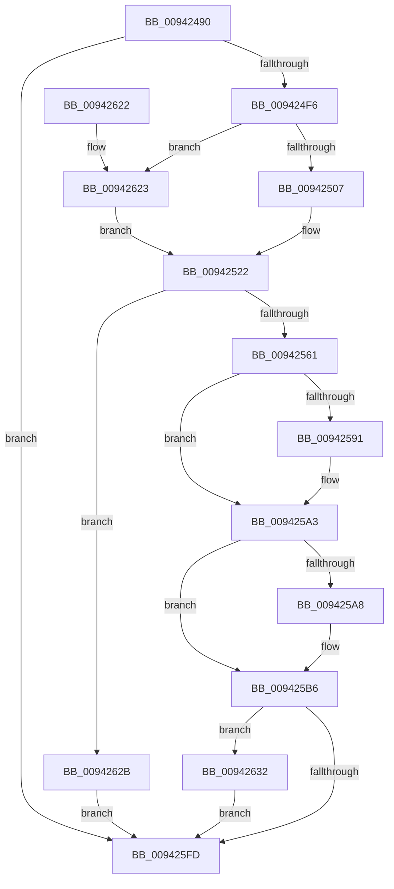

# RtlCreateRvaList

- RVA: `0x00942490`–`0x00942643` (길이 `435` bytes)
- VA: `0x0000000140942490`
- 실행 섹션: `PAGE`
- PDB 이름 있음: `예`; PDB Function 태그: `아니요`
- unwind 정보 RVA: `0x000903BC`
- 디코드: `114`개 명령, `435/435` bytes 표시
- 미해석 바이트: `0` (있으면 어셈블리에 `.byte`로 보존)

> 이 문서는 커널 이미지의 기계어와 PDB 기호를 분석해 생성했습니다. 4번과 5번은 함수 원형과 자료형을 바이너리 사용 방식에서 추정한 C 해석이며 원본 소스 복구 결과는 아닙니다.

## 1. Dependencies

- 직접 호출 지점: **6**; 고유 호출 대상: **5**
- 직접 호출자로 확인된 함수: **1**
- RIP 상대 이미지 참조: **2**

### Outgoing calls
- `0x009424E7` → [RtlpCompressRvaList](RtlpCompressRvaList_function_00942650.md) (function, `0x00942650`)
- `0x00942550` → [ExAllocatePool2](../../poolcode/B8/ExAllocatePool2_function_00B820F0.md) (function, `0x00B820F0`)
- `0x0094257C` → [memset](../../text/6C/memset_function_006C6C40.md) (function, `0x006C6C40`)
- `0x0094259B` → [memcpy](../../text/6C/memcpy_function_006C6840.md) (function, `0x006C6840`)
- `0x009425F2` → [RtlpCompressRvaList](RtlpCompressRvaList_function_00942650.md) (function, `0x00942650`)
- `0x0094263A` → [ExFreePoolWithTag](../../poolcode/B8/ExFreePoolWithTag_function_00B82870.md) (function, `0x00B82870`)

### Direct callers
- [MiParseImageLoadConfig](MiParseImageLoadConfig_function_00940D18.md) at `0x009410EC`

### Static image references
- `0x009424C2` → RVA `0x00942A70` (`MiImageRvaRawEnumNext`; read)
- `0x009424D4` → RVA `0x009423E0` (`MiImageRvaRawEnumFirst`; read)

## 2. Other-region calls and transfers

- 다른 실행 섹션으로 향하는 call: **4**
  - `0x00942550` → [ExAllocatePool2](../../poolcode/B8/ExAllocatePool2_function_00B820F0.md) (`PAGE` → `POOLCODE`)
  - `0x0094257C` → [memset](../../text/6C/memset_function_006C6C40.md) (`PAGE` → `.text`)
  - `0x0094259B` → [memcpy](../../text/6C/memcpy_function_006C6840.md) (`PAGE` → `.text`)
  - `0x0094263A` → [ExFreePoolWithTag](../../poolcode/B8/ExFreePoolWithTag_function_00B82870.md) (`PAGE` → `POOLCODE`)
- 별도 외부 분기/꼬리 이동을 확인하지 못했습니다.

## 3. Assembly (complete function range)

```asm
00942490  48 8B C4                        mov rax, rsp
00942493  48 89 58 20                     mov qword ptr [rax + 0x20], rbx
00942497  4C 89 40 18                     mov qword ptr [rax + 0x18], r8
0094249B  48 89 50 10                     mov qword ptr [rax + 0x10], rdx
0094249F  48 89 48 08                     mov qword ptr [rax + 8], rcx
009424A3  55                              push rbp
009424A4  56                              push rsi
009424A5  57                              push rdi
009424A6  41 54                           push r12
009424A8  41 55                           push r13
009424AA  41 56                           push r14
009424AC  41 57                           push r15
009424AE  48 83 EC 40                     sub rsp, 0x40
009424B2  48 8B D1                        mov rdx, rcx
009424B5  45 8B F1                        mov r14d, r9d
009424B8  33 F6                           xor esi, esi
009424BA  48 8D 48 18                     lea rcx, [rax + 0x18]
009424BE  48 89 48 B8                     mov qword ptr [rax - 0x48], rcx
009424C2  4C 8D 0D A7 05 00 00            lea r9, [rip + 0x5a7]
009424C9  48 8D 48 10                     lea rcx, [rax + 0x10]
009424CD  89 70 18                        mov dword ptr [rax + 0x18], esi
009424D0  48 89 48 B0                     mov qword ptr [rax - 0x50], rcx
009424D4  4C 8D 05 05 FF FF FF            lea r8, [rip - 0xfb]
009424DB  33 C9                           xor ecx, ecx
009424DD  48 89 70 10                     mov qword ptr [rax + 0x10], rsi
009424E1  8B DE                           mov ebx, esi
009424E3  48 89 70 A8                     mov qword ptr [rax - 0x58], rsi
009424E7  E8 64 01 00 00                  call 0x140942650
009424EC  8B F8                           mov edi, eax
009424EE  85 C0                           test eax, eax
009424F0  0F 88 07 01 00 00               js 0x1409425fd
009424F6  8B AC 24 90 00 00 00            mov ebp, dword ptr [rsp + 0x90]
009424FD  41 83 FE 01                     cmp r14d, 1
00942501  0F 86 1C 01 00 00               jbe 0x140942623
00942507  8B FD                           mov edi, ebp
00942509  48 B8 F8 FF FF FF FF FF FF 1F   movabs rax, 0x1ffffffffffffff8
00942513  41 0F AF FE                     imul edi, r14d
00942517  48 83 C7 3F                     add rdi, 0x3f
0094251B  48 C1 EF 03                     shr rdi, 3
0094251F  48 23 F8                        and rdi, rax
00942522  48 8B B4 24 88 00 00 00         mov rsi, qword ptr [rsp + 0x88]
0094252A  4E 8D 3C B5 00 00 00 00         lea r15, [r14*4]
00942532  B9 00 01 00 00                  mov ecx, 0x100
00942537  41 B8 52 76 61 4C               mov r8d, 0x4c617652
0094253D  4C 8D 66 07                     lea r12, [rsi + 7]
00942541  49 83 E4 F8                     and r12, 0xfffffffffffffff8
00942545  4F 8D 2C 27                     lea r13, [r15 + r12]
00942549  4C 03 EF                        add r13, rdi
0094254C  49 8D 55 40                     lea rdx, [r13 + 0x40]
00942550  E8 9B FB 23 00                  call 0x140b820f0
00942555  48 8B D8                        mov rbx, rax
00942558  48 85 C0                        test rax, rax
0094255B  0F 84 CA 00 00 00               je 0x14094262b
00942561  48 89 70 18                     mov qword ptr [rax + 0x18], rsi
00942565  4D 8B C5                        mov r8, r13
00942568  48 8D 70 40                     lea rsi, [rax + 0x40]
0094256C  48 89 28                        mov qword ptr [rax], rbp
0094256F  48 8B CE                        mov rcx, rsi
00942572  44 89 70 08                     mov dword ptr [rax + 8], r14d
00942576  33 D2                           xor edx, edx
00942578  48 89 70 10                     mov qword ptr [rax + 0x10], rsi
0094257C  E8 BF 46 D8 FF                  call 0x1406c6c40
00942581  48 8B 94 24 A0 00 00 00         mov rdx, qword ptr [rsp + 0xa0]
00942589  49 03 F4                        add rsi, r12
0094258C  48 85 D2                        test rdx, rdx
0094258F  74 12                           je 0x1409425a3
00942591  4D 8B C7                        mov r8, r15
00942594  48 89 73 30                     mov qword ptr [rbx + 0x30], rsi
00942598  48 8B CE                        mov rcx, rsi
0094259B  E8 A0 42 D8 FF                  call 0x1406c6840
009425A0  49 03 F7                        add rsi, r15
009425A3  48 85 FF                        test rdi, rdi
009425A6  74 0E                           je 0x1409425b6
009425A8  41 0F AF EE                     imul ebp, r14d
009425AC  48 89 73 28                     mov qword ptr [rbx + 0x28], rsi
009425B0  8B C5                           mov eax, ebp
009425B2  48 89 43 20                     mov qword ptr [rbx + 0x20], rax
009425B6  48 8B 94 24 80 00 00 00         mov rdx, qword ptr [rsp + 0x80]
009425BE  48 8D 84 24 90 00 00 00         lea rax, [rsp + 0x90]
009425C6  48 89 44 24 30                  mov qword ptr [rsp + 0x30], rax
009425CB  4C 8D 0D 9E 04 00 00            lea r9, [rip + 0x49e]
009425D2  48 8D 84 24 88 00 00 00         lea rax, [rsp + 0x88]
009425DA  48 8B CB                        mov rcx, rbx
009425DD  48 89 44 24 28                  mov qword ptr [rsp + 0x28], rax
009425E2  4C 8D 05 F7 FD FF FF            lea r8, [rip - 0x209]
009425E9  48 8B 43 10                     mov rax, qword ptr [rbx + 0x10]
009425ED  48 89 44 24 20                  mov qword ptr [rsp + 0x20], rax
009425F2  E8 59 00 00 00                  call 0x140942650
009425F7  8B F8                           mov edi, eax
009425F9  85 C0                           test eax, eax
009425FB  78 35                           js 0x140942632
009425FD  48 8B 84 24 B0 00 00 00         mov rax, qword ptr [rsp + 0xb0]
00942605  48 89 18                        mov qword ptr [rax], rbx
00942608  8B C7                           mov eax, edi
0094260A  48 8B 9C 24 98 00 00 00         mov rbx, qword ptr [rsp + 0x98]
00942612  48 83 C4 40                     add rsp, 0x40
00942616  41 5F                           pop r15
00942618  41 5E                           pop r14
0094261A  41 5D                           pop r13
0094261C  41 5C                           pop r12
0094261E  5F                              pop rdi
0094261F  5E                              pop rsi
00942620  5D                              pop rbp
00942621  C3                              ret
00942622  CC                              int3
00942623  48 8B FE                        mov rdi, rsi
00942626  E9 F7 FE FF FF                  jmp 0x140942522
0094262B  BF 9A 00 00 C0                  mov edi, 0xc000009a
00942630  EB CB                           jmp 0x1409425fd
00942632  BA 52 76 61 4C                  mov edx, 0x4c617652
00942637  48 8B CB                        mov rcx, rbx
0094263A  E8 31 02 24 00                  call 0x140b82870
0094263F  33 DB                           xor ebx, ebx
00942641  EB BA                           jmp 0x1409425fd
```

## 4. C-style interpretation (structured pseudocode)

```c
__int64 __fastcall RtlCreateRvaList(__int64 a1, __int64 a2, __int64 a3, int a4, __int64 a5, __int64 a6, __int64 a7)
{
    __int64 result;
    __int64 v_r12;
    __int64 v_r13;
    __int64 v_rbp;
    __int64 v_rbx;
    __int64 v_rdi;
    __int64 v_rsi;
    __int64 v_rsp;
    unsigned __int64 v_stack_m48;
    unsigned __int64 v_stack_m50;
    unsigned __int64 v_stack_m58;
    unsigned __int64 v_stack_p10;
    unsigned int v_stack_p18;
    unsigned __int64 v_stack_p20;
    unsigned __int64 v_stack_p8;

    *(unsigned __int64 *)(v_rsp + 32) = v_rbx;
    *(unsigned __int64 *)(v_rsp + 24) = a3;
    *(unsigned __int64 *)(v_rsp + 16) = a2;
    *(unsigned __int64 *)(v_rsp + 8) = a1;
    v_rsp = (v_rsp) - (64);
    v_rsi = 0;
    *(unsigned __int64 *)(v_rsp - 72) = v_rsp + 24;
    *(unsigned int *)(v_rsp + 24) = 0;
    *(unsigned __int64 *)(v_rsp - 80) = v_rsp + 16;
    a1 = 0;
    *(unsigned __int64 *)(v_rsp + 16) = 0;
    *(unsigned __int64 *)(v_rsp - 88) = 0;
    result = RtlpCompressRvaList(a1, a1, v_rip - 251, v_rip + 1447);
    if (sign_flag) goto loc_009425FD;
    if (((unsigned int)((unsigned int)(a4))) <= 1) goto loc_00942623;
    v_rdi = (unsigned int)(((unsigned int)((unsigned int)((unsigned int)(v_stack_p18)))) * ((unsigned int)((unsigned int)(a4))));
    v_rdi = (v_rdi) + (63);
    v_rdi = (v_rdi) >> (3);
    v_rdi = (v_rdi) & (result);
loc_00942522:
    v_r12 = (v_stack_p10 + 7) & (-8);
    v_r13 = ((unsigned int)(a4) * 4 + v_r12 * 1) + (v_rdi);
    result = ExAllocatePool2(256, v_r13 + 64, (unsigned int)(0x4C617652ULL), v_rip + 1447);
    if (result == 0) goto loc_0094262B;
    *(unsigned __int64 *)(result + 24) = v_stack_p10;
    *(unsigned __int64 *)(result) = (unsigned int)(v_stack_p18);
    *(unsigned int *)(result + 8) = (unsigned int)((unsigned int)(a4));
    a2 = 0;
    *(unsigned __int64 *)(result + 16) = result + 64;
    result = memset(result + 64, a2, v_r13, v_rip + 1447);
    v_rsi = (result + 64) + (v_r12);
    if (a5 != 0) {
        a3 = (unsigned int)(a4) * 4;
        *(unsigned __int64 *)(result + 48) = v_rsi;
        a1 = v_rsi;
        result = memcpy(a1, a5, a3, v_rip + 1447);
        v_rsi = (v_rsi) + ((unsigned int)(a4) * 4);
    }
    v_rbp = (unsigned int)(v_stack_p18);
    if (v_rdi != 0) {
        v_rbp = (unsigned int)(((unsigned int)(v_stack_p18)) * ((unsigned int)((unsigned int)(a4))));
        *(unsigned __int64 *)(result + 40) = v_rsi;
        result = (unsigned int)(v_rbp);
        *(unsigned __int64 *)(result + 32) = result;
    }
    v_stack_m48 = v_stack_p18;
    v_stack_m50 = v_stack_p10;
    v_stack_m58 = *(unsigned __int64 *)(result + 16);
    result = RtlpCompressRvaList(result, v_stack_p8, v_rip - 521, v_rip + 1182);
    if (sign_flag) goto loc_00942632;
loc_009425FD:
    *(unsigned __int64 *)(a7) = result;
    v_rsp = (v_rsp) + (64);
    return (unsigned int)((unsigned int)((unsigned int)((unsigned int)(result))));
loc_00942623:
    goto loc_00942522;
loc_0094262B:
    goto loc_009425FD;
loc_00942632:
    result = ExFreePoolWithTag(v_stack_p20, (unsigned int)(0x4C617652ULL), v_rip - 521, v_rip + 1182);
    v_rbx = 0;
    goto loc_009425FD;
}
```

## 5. (Beta) C Style

```c
int64_t RtlCreateRvaList(int64_t Arg1, int64_t Arg2, int64_t Arg3, int32_t Arg4, int64_t Arg5, uint64_t Arg6, void *Arg7)
{
    uint8_t *arg7 = (uint8_t *)Arg7;

    int64_t result;
    int64_t local_r12;
    int64_t local_r13;
    int64_t local_rbp;
    int64_t local_rbx;
    int64_t local_rdi;
    int64_t local_rsi;
    int64_t local_rsp;
    uint64_t v_stack_m48;
    uint64_t v_stack_m50;
    uint64_t v_stack_m58;
    uint64_t v_stack_p10;
    uint32_t v_stack_p18;
    uint64_t v_stack_p20;
    uint64_t v_stack_p8;

    *(uint64_t *)(local_rsp + 0x20) = local_rbx;
    *(uint64_t *)(local_rsp + 0x18) = Arg3;
    *(uint64_t *)(local_rsp + 0x10) = Arg2;
    *(uint64_t *)(local_rsp + 0x8) = Arg1;
    local_rsp = (local_rsp) - (64);
    local_rsi = 0;
    *(uint64_t *)(local_rsp - 0x48) = local_rsp + 24;
    *(uint32_t *)(local_rsp + 0x18) = 0;
    *(uint64_t *)(local_rsp - 0x50) = local_rsp + 16;
    Arg1 = 0;
    *(uint64_t *)(local_rsp + 0x10) = 0;
    *(uint64_t *)(local_rsp - 0x58) = 0;
    result = RtlpCompressRvaList(Arg1, Arg1, v_rip - 251, v_rip + 1447);
    if (sign_flag) goto loc_009425FD;
    if (((uint32_t)((uint32_t)(Arg4))) <= 1) goto loc_00942623;
    local_rdi = (uint32_t)(((uint32_t)((uint32_t)((uint32_t)(v_stack_p18)))) * ((uint32_t)((uint32_t)(Arg4))));
    local_rdi = (local_rdi) + (63);
    local_rdi = (local_rdi) >> (3);
    local_rdi = (local_rdi) & (result);
loc_00942522:
    local_r12 = (v_stack_p10 + 7) & (-8);
    local_r13 = ((uint32_t)(Arg4) * 4 + local_r12 * 1) + (local_rdi);
    result = ExAllocatePool2(256, local_r13 + 64, (uint32_t)(0x4C617652ULL), v_rip + 1447);
    if (result == 0) goto loc_0094262B;
    *(uint64_t *)(result + 0x18) = v_stack_p10;
    *(uint64_t *)(result) = (uint32_t)(v_stack_p18);
    *(uint32_t *)(result + 0x8) = (uint32_t)((uint32_t)(Arg4));
    Arg2 = 0;
    *(uint64_t *)(result + 0x10) = result + 64;
    result = memset(result + 64, Arg2, local_r13, v_rip + 1447);
    local_rsi = (result + 64) + (local_r12);
    if (Arg5 != 0) {
        Arg3 = (uint32_t)(Arg4) * 4;
        *(uint64_t *)(result + 0x30) = local_rsi;
        Arg1 = local_rsi;
        result = memcpy(Arg1, Arg5, Arg3, v_rip + 1447);
        local_rsi = (local_rsi) + ((uint32_t)(Arg4) * 4);
    }
    local_rbp = (uint32_t)(v_stack_p18);
    if (local_rdi != 0) {
        local_rbp = (uint32_t)(((uint32_t)(v_stack_p18)) * ((uint32_t)((uint32_t)(Arg4))));
        *(uint64_t *)(result + 0x28) = local_rsi;
        result = (uint32_t)(local_rbp);
        *(uint64_t *)(result + 0x20) = result;
    }
    v_stack_m48 = v_stack_p18;
    v_stack_m50 = v_stack_p10;
    v_stack_m58 = *(uint64_t *)(result + 0x10);
    result = RtlpCompressRvaList(result, v_stack_p8, v_rip - 521, v_rip + 1182);
    if (sign_flag) goto loc_00942632;
loc_009425FD:
    *(uint64_t *)(arg7) = result;
    local_rsp = (local_rsp) + (64);
    return (uint32_t)((uint32_t)((uint32_t)((uint32_t)(result))));
loc_00942623:
    goto loc_00942522;
loc_0094262B:
    goto loc_009425FD;
loc_00942632:
    result = ExFreePoolWithTag(v_stack_p20, (uint32_t)(0x4C617652ULL), v_rip - 521, v_rip + 1182);
    local_rbx = 0;
    goto loc_009425FD;
}
```

### 관측된 메모리 오프셋

구조체 형식이 확인되지 않은 접근은 인자 기준의 오프셋으로만 기록했습니다.

| 기준 인자 | 오프셋 표현 | 폭 (bit) | 접근 |
|---|---:|---:|---|
| `Arg7` | `+ 0x0` | `64` | `W` |

## 6. Execution-region graph

[열기: 2D/3D 그래프와 함수 탐색 컨트롤 패널](../../../control-panel.html?section=page&rva=0x00942490&view=graph)

- 2D 그래프는 위에서 아래로 흐르고, 3D 그래프는 빈 공간을 드래그해 회전합니다. Shift+드래그는 이동, 휠은 확대·축소, 함수 노드 선택은 대상 보고서 이동입니다.

### Static fallback


