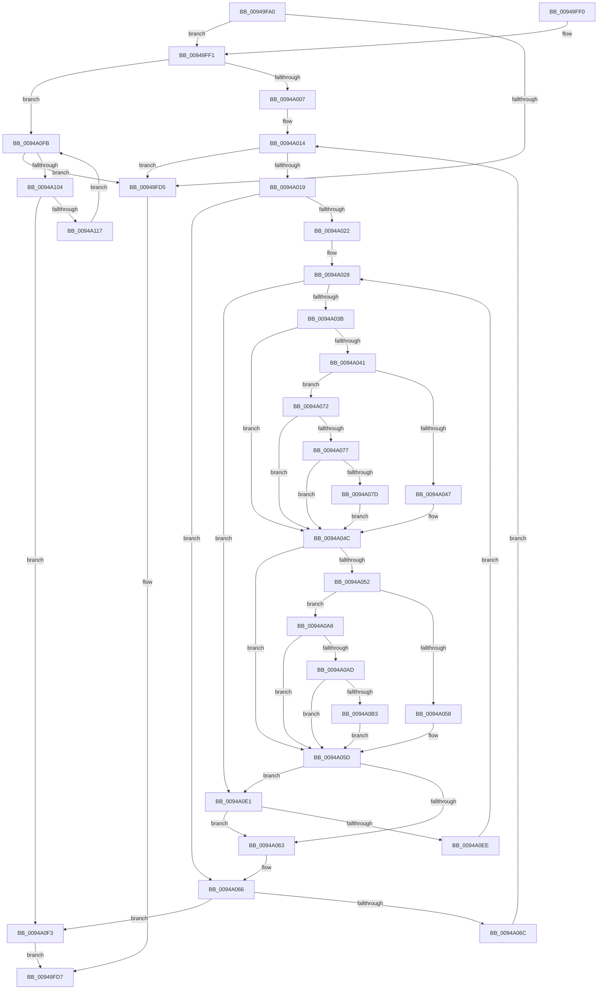

# RtlFindUnicodeSubstring

- RVA: `0x00949FA0`–`0x0094A11D` (길이 `381` bytes)
- VA: `0x0000000140949FA0`
- 실행 섹션: `PAGE`
- PDB 이름 있음: `예`; PDB Function 태그: `아니요`
- unwind 정보 RVA: `0x00090DF0`
- 디코드: `111`개 명령, `381/381` bytes 표시
- 미해석 바이트: `0` (있으면 어셈블리에 `.byte`로 보존)

> 이 문서는 커널 이미지의 기계어와 PDB 기호를 분석해 생성했습니다. 4번과 5번은 함수 원형과 자료형을 바이너리 사용 방식에서 추정한 C 해석이며 원본 소스 복구 결과는 아닙니다.

## 1. Dependencies

- 직접 호출 지점: **2**; 고유 호출 대상: **2**
- 직접 호출자로 확인된 함수: **3**
- RIP 상대 이미지 참조: **0**

### Outgoing calls
- `0x00949FBE` → [PsGetCurrentServerSiloGlobals](../../text/2F/PsGetCurrentServerSiloGlobals_function_002FE1F0.md) (function, `0x002FE1F0`)
- `0x0094A10E` → [memcmp](../../text/6C/memcmp_function_006C6B10.md) (function, `0x006C6B10`)

### Direct callers
- [PiDrvDbFindSystemFilePathToken](../74/PiDrvDbFindSystemFilePathToken_function_00741088.md) at `0x007410D2`
- [PiDrvDbRegisterNode](../74/PiDrvDbRegisterNode_function_00742658.md) at `0x0074283A`
- [CmpTraceSecurityChanging](CmpTraceSecurityChanging_function_00949EEC.md) at `0x00949F4B`

### Static image references
- 디코드된 RIP-relative 메모리 참조가 없습니다.

## 2. Other-region calls and transfers

- 다른 실행 섹션으로 향하는 call: **2**
  - `0x00949FBE` → [PsGetCurrentServerSiloGlobals](../../text/2F/PsGetCurrentServerSiloGlobals_function_002FE1F0.md) (`PAGE` → `.text`)
  - `0x0094A10E` → [memcmp](../../text/6C/memcmp_function_006C6B10.md) (`PAGE` → `.text`)
- 별도 외부 분기/꼬리 이동을 확인하지 못했습니다.

## 3. Assembly (complete function range)

```asm
00949FA0  48 89 5C 24 08                  mov qword ptr [rsp + 8], rbx
00949FA5  48 89 6C 24 10                  mov qword ptr [rsp + 0x10], rbp
00949FAA  48 89 74 24 18                  mov qword ptr [rsp + 0x18], rsi
00949FAF  57                              push rdi
00949FB0  41 56                           push r14
00949FB2  41 57                           push r15
00949FB4  48 83 EC 20                     sub rsp, 0x20
00949FB8  4C 8B F2                        mov r14, rdx
00949FBB  48 8B D9                        mov rbx, rcx
00949FBE  E8 2D 42 9B FF                  call 0x1402fe1f0
00949FC3  0F B7 3A                        movzx edi, word ptr [rdx]
00949FC6  4C 8B 98 B0 04 00 00            mov r11, qword ptr [rax + 0x4b0]
00949FCD  0F B7 03                        movzx eax, word ptr [rbx]
00949FD0  66 3B C7                        cmp ax, di
00949FD3  73 1C                           jae 0x140949ff1
00949FD5  33 C0                           xor eax, eax
00949FD7  48 8B 5C 24 40                  mov rbx, qword ptr [rsp + 0x40]
00949FDC  48 8B 6C 24 48                  mov rbp, qword ptr [rsp + 0x48]
00949FE1  48 8B 74 24 50                  mov rsi, qword ptr [rsp + 0x50]
00949FE6  48 83 C4 20                     add rsp, 0x20
00949FEA  41 5F                           pop r15
00949FEC  41 5E                           pop r14
00949FEE  5F                              pop rdi
00949FEF  C3                              ret
00949FF0  CC                              int3
00949FF1  48 8B 5B 08                     mov rbx, qword ptr [rbx + 8]
00949FF5  48 8B F0                        mov rsi, rax
00949FF8  48 2B F7                        sub rsi, rdi
00949FFB  48 03 F3                        add rsi, rbx
00949FFE  45 84 C0                        test r8b, r8b
0094A001  0F 84 F4 00 00 00               je 0x14094a0fb
0094A007  48 8B 6A 08                     mov rbp, qword ptr [rdx + 8]
0094A00B  41 BF C0 00 00 00               mov r15d, 0xc0
0094A011  48 03 EF                        add rbp, rdi
0094A014  48 3B DE                        cmp rbx, rsi
0094A017  77 BC                           ja 0x140949fd5
0094A019  4D 8B 56 08                     mov r10, qword ptr [r14 + 8]
0094A01D  4C 3B D5                        cmp r10, rbp
0094A020  73 44                           jae 0x14094a066
0094A022  48 8B FB                        mov rdi, rbx
0094A025  49 2B FA                        sub rdi, r10
0094A028  46 0F B7 04 17                  movzx r8d, word ptr [rdi + r10]
0094A02D  45 0F B7 0A                     movzx r9d, word ptr [r10]
0094A031  66 45 3B C1                     cmp r8w, r9w
0094A035  0F 84 A6 00 00 00               je 0x14094a0e1
0094A03B  41 83 F8 61                     cmp r8d, 0x61
0094A03F  72 0B                           jb 0x14094a04c
0094A041  41 83 F8 7A                     cmp r8d, 0x7a
0094A045  77 2B                           ja 0x14094a072
0094A047  66 41 83 E8 20                  sub r8w, 0x20
0094A04C  41 83 F9 61                     cmp r9d, 0x61
0094A050  72 0B                           jb 0x14094a05d
0094A052  41 83 F9 7A                     cmp r9d, 0x7a
0094A056  77 50                           ja 0x14094a0a8
0094A058  66 41 83 E9 20                  sub r9w, 0x20
0094A05D  66 45 3B C1                     cmp r8w, r9w
0094A061  74 7E                           je 0x14094a0e1
0094A063  4C 3B D5                        cmp r10, rbp
0094A066  0F 84 87 00 00 00               je 0x14094a0f3
0094A06C  48 83 C3 02                     add rbx, 2
0094A070  EB A2                           jmp 0x14094a014
0094A072  4D 85 DB                        test r11, r11
0094A075  74 D5                           je 0x14094a04c
0094A077  66 45 3B C7                     cmp r8w, r15w
0094A07B  72 CF                           jb 0x14094a04c
0094A07D  49 8B C0                        mov rax, r8
0094A080  41 8B D0                        mov edx, r8d
0094A083  48 C1 E8 08                     shr rax, 8
0094A087  83 E2 0F                        and edx, 0xf
0094A08A  41 0F B7 0C 43                  movzx ecx, word ptr [r11 + rax*2]
0094A08F  41 8B C0                        mov eax, r8d
0094A092  C1 E8 04                        shr eax, 4
0094A095  83 E0 0F                        and eax, 0xf
0094A098  03 C8                           add ecx, eax
0094A09A  41 0F B7 0C 4B                  movzx ecx, word ptr [r11 + rcx*2]
0094A09F  03 CA                           add ecx, edx
0094A0A1  66 45 03 04 4B                  add r8w, word ptr [r11 + rcx*2]
0094A0A6  EB A4                           jmp 0x14094a04c
0094A0A8  4D 85 DB                        test r11, r11
0094A0AB  74 B0                           je 0x14094a05d
0094A0AD  66 45 3B CF                     cmp r9w, r15w
0094A0B1  72 AA                           jb 0x14094a05d
0094A0B3  49 8B C1                        mov rax, r9
0094A0B6  41 8B D1                        mov edx, r9d
0094A0B9  48 C1 E8 08                     shr rax, 8
0094A0BD  83 E2 0F                        and edx, 0xf
0094A0C0  41 0F B7 0C 43                  movzx ecx, word ptr [r11 + rax*2]
0094A0C5  41 8B C1                        mov eax, r9d
0094A0C8  C1 E8 04                        shr eax, 4
0094A0CB  83 E0 0F                        and eax, 0xf
0094A0CE  03 C8                           add ecx, eax
0094A0D0  41 0F B7 0C 4B                  movzx ecx, word ptr [r11 + rcx*2]
0094A0D5  03 CA                           add ecx, edx
0094A0D7  66 45 03 0C 4B                  add r9w, word ptr [r11 + rcx*2]
0094A0DC  E9 7C FF FF FF                  jmp 0x14094a05d
0094A0E1  49 83 C2 02                     add r10, 2
0094A0E5  4C 3B D5                        cmp r10, rbp
0094A0E8  0F 83 75 FF FF FF               jae 0x14094a063
0094A0EE  E9 35 FF FF FF                  jmp 0x14094a028
0094A0F3  48 8B C3                        mov rax, rbx
0094A0F6  E9 DC FE FF FF                  jmp 0x140949fd7
0094A0FB  48 3B DE                        cmp rbx, rsi
0094A0FE  0F 87 D1 FE FF FF               ja 0x140949fd5
0094A104  49 8B 56 08                     mov rdx, qword ptr [r14 + 8]
0094A108  4C 8B C7                        mov r8, rdi
0094A10B  48 8B CB                        mov rcx, rbx
0094A10E  E8 FD C9 D7 FF                  call 0x1406c6b10
0094A113  85 C0                           test eax, eax
0094A115  74 DC                           je 0x14094a0f3
0094A117  48 83 C3 02                     add rbx, 2
0094A11B  EB DE                           jmp 0x14094a0fb
```

## 4. C-style interpretation (structured pseudocode)

```c
__int64 __fastcall RtlFindUnicodeSubstring(__int64 a1, __int64 a2, unsigned __int8 a3)
{
    __int64 result;
    __int64 v_r10;
    __int64 v_rbp;
    __int64 v_rbx;
    __int64 v_rdi;
    __int64 v_rsi;
    __int64 v_rsp;
    unsigned __int64 v_stack_p10;
    unsigned __int64 v_stack_p18;
    unsigned __int64 v_stack_p8;

    v_stack_p8 = v_rbx;
    v_stack_p10 = v_rbp;
    v_stack_p18 = v_rsi;
    v_rsp = (v_rsp) - (32);
    result = PsGetCurrentServerSiloGlobals(a1, a2, a3, a4);
    if (((unsigned __int16)(*(unsigned __int16 *)(a1))) >= ((unsigned __int16)(*(unsigned __int16 *)(a2)))) goto loc_00949FF1;
loc_00949FD5:
    result = 0;
loc_00949FD7:
    v_rsp = (v_rsp) + (32);
    return result;
loc_00949FF1:
    v_rsi = (0) - (*(unsigned __int16 *)(a2));
    v_rsi = (v_rsi) + (*(unsigned __int64 *)(v_stack_p8 + 8));
    if (a3 == 0) goto loc_0094A0FB;
    v_rbp = (*(unsigned __int64 *)(a2 + 8)) + (*(unsigned __int16 *)(a2));
loc_0094A014:
    if ((*(unsigned __int64 *)(v_stack_p8 + 8)) > v_rsi) goto loc_00949FD5;
    if ((*(unsigned __int64 *)(a2 + 8)) >= v_rbp) goto loc_0094A066;
    v_rdi = (*(unsigned __int64 *)(v_stack_p8 + 8)) - (*(unsigned __int64 *)(a2 + 8));
loc_0094A028:
    if (((unsigned __int16)(*(unsigned __int16 *)(v_rdi + *(unsigned __int64 *)(a2 + 8) * 1))) == ((unsigned __int16)(*(unsigned __int16 *)(*(unsigned __int64 *)(a2 + 8))))) goto loc_0094A0E1;
    if (((unsigned int)(*(unsigned __int16 *)(v_rdi + *(unsigned __int64 *)(a2 + 8) * 1))) < 97) goto loc_0094A04C;
    if (((unsigned int)(*(unsigned __int16 *)(v_rdi + *(unsigned __int64 *)(a2 + 8) * 1))) > 122) goto loc_0094A072;
    a3 = (unsigned __int16)((*(unsigned __int16 *)(v_rdi + *(unsigned __int64 *)(a2 + 8) * 1)) - (32));
loc_0094A04C:
    if (((unsigned int)(*(unsigned __int16 *)(*(unsigned __int64 *)(a2 + 8)))) < 97) goto loc_0094A05D;
    if (((unsigned int)(*(unsigned __int16 *)(*(unsigned __int64 *)(a2 + 8)))) > 122) goto loc_0094A0A8;
    a4 = (unsigned __int16)((*(unsigned __int16 *)(*(unsigned __int64 *)(a2 + 8))) - (32));
loc_0094A05D:
    if (a3 == ((unsigned __int16)(a4))) goto loc_0094A0E1;
loc_0094A063:
loc_0094A066:
    if ((*(unsigned __int64 *)(a2 + 8)) == v_rbp) goto loc_0094A0F3;
    v_rbx = (*(unsigned __int64 *)(v_stack_p8 + 8)) + (2);
    goto loc_0094A014;
loc_0094A072:
    if (*(unsigned __int64 *)(result + 1200) == 0) goto loc_0094A04C;
    if (a3 < 192) goto loc_0094A04C;
    result = (a3) >> (8);
    a2 = (unsigned int)(((unsigned int)(a3)) & (15));
    result = (unsigned int)(((unsigned int)(a3)) >> (4));
    result = (unsigned int)((result) & (15));
    a1 = (unsigned int)((*(unsigned __int16 *)(*(unsigned __int64 *)(result + 1200) + result * 2)) + ((unsigned int)(result)));
    a1 = (unsigned int)((*(unsigned __int16 *)(*(unsigned __int64 *)(result + 1200) + a1 * 2)) + ((unsigned int)(a2)));
    a3 = (unsigned __int16)((a3) + (*(unsigned __int16 *)(*(unsigned __int64 *)(result + 1200) + a1 * 2)));
    goto loc_0094A04C;
loc_0094A0A8:
    if (*(unsigned __int64 *)(result + 1200) == 0) goto loc_0094A05D;
    if (((unsigned __int16)(a4)) < 192) goto loc_0094A05D;
    result = (a4) >> (8);
    a2 = (unsigned int)(((unsigned int)((unsigned int)(a4))) & (15));
    result = (unsigned int)(((unsigned int)((unsigned int)(a4))) >> (4));
    result = (unsigned int)((result) & (15));
    a1 = (unsigned int)((*(unsigned __int16 *)(*(unsigned __int64 *)(result + 1200) + result * 2)) + ((unsigned int)(result)));
    a1 = (unsigned int)((*(unsigned __int16 *)(*(unsigned __int64 *)(result + 1200) + a1 * 2)) + ((unsigned int)(a2)));
    a4 = (unsigned __int16)((a4) + (*(unsigned __int16 *)(*(unsigned __int64 *)(result + 1200) + a1 * 2)));
    goto loc_0094A05D;
loc_0094A0E1:
    v_r10 = (*(unsigned __int64 *)(a2 + 8)) + (2);
    if (v_r10 >= v_rbp) goto loc_0094A063;
    goto loc_0094A028;
loc_0094A0F3:
    goto loc_00949FD7;
loc_0094A0FB:
    if (v_rbx > v_rsi) goto loc_00949FD5;
    result = memcmp(v_rbx, *(unsigned __int64 *)(a2 + 8), v_rdi, a4);
    if ((unsigned int)(result) == 0) goto loc_0094A0F3;
    v_rbx = (v_rbx) + (2);
    goto loc_0094A0FB;
}
```

## 5. (Beta) C Style

```c
int64_t RtlFindUnicodeSubstring(void *Arg1, void *Arg2, uint8_t Arg3)
{
    uint8_t *arg1 = (uint8_t *)Arg1;
    uint8_t *arg2 = (uint8_t *)Arg2;

    int64_t result;
    int64_t local_r10;
    int64_t local_rbp;
    int64_t local_rbx;
    int64_t local_rdi;
    int64_t local_rsi;
    int64_t local_rsp;
    uint64_t v_stack_p10;
    uint64_t v_stack_p18;
    uint64_t v_stack_p8;

    v_stack_p8 = local_rbx;
    v_stack_p10 = local_rbp;
    v_stack_p18 = local_rsi;
    local_rsp = (local_rsp) - (32);
    result = PsGetCurrentServerSiloGlobals(Arg1, Arg2, Arg3, a4);
    if (((uint16_t)(*(uint16_t *)(arg1))) >= ((uint16_t)(*(uint16_t *)(arg2)))) goto loc_00949FF1;
loc_00949FD5:
    result = 0;
loc_00949FD7:
    local_rsp = (local_rsp) + (32);
    return result;
loc_00949FF1:
    local_rsi = (0) - (*(uint16_t *)(arg2));
    local_rsi = (local_rsi) + (*(uint64_t *)(v_stack_p8 + 0x8));
    if (Arg3 == 0) goto loc_0094A0FB;
    local_rbp = (*(uint64_t *)(arg2 + 0x8)) + (*(uint16_t *)(arg2));
loc_0094A014:
    if ((*(uint64_t *)(v_stack_p8 + 0x8)) > local_rsi) goto loc_00949FD5;
    if ((*(uint64_t *)(arg2 + 0x8)) >= local_rbp) goto loc_0094A066;
    local_rdi = (*(uint64_t *)(v_stack_p8 + 0x8)) - (*(uint64_t *)(arg2 + 0x8));
loc_0094A028:
    if (((uint16_t)(*(uint16_t *)(local_rdi + *(uint64_t *)(arg2 + 0x8) * 1))) == ((uint16_t)(*(uint16_t *)(*(uint64_t *)(arg2 + 0x8))))) goto loc_0094A0E1;
    if (((uint32_t)(*(uint16_t *)(local_rdi + *(uint64_t *)(arg2 + 0x8) * 1))) < 97) goto loc_0094A04C;
    if (((uint32_t)(*(uint16_t *)(local_rdi + *(uint64_t *)(arg2 + 0x8) * 1))) > 122) goto loc_0094A072;
    Arg3 = (uint16_t)((*(uint16_t *)(local_rdi + *(uint64_t *)(arg2 + 0x8) * 1)) - (32));
loc_0094A04C:
    if (((uint32_t)(*(uint16_t *)(*(uint64_t *)(arg2 + 0x8)))) < 97) goto loc_0094A05D;
    if (((uint32_t)(*(uint16_t *)(*(uint64_t *)(arg2 + 0x8)))) > 122) goto loc_0094A0A8;
    a4 = (uint16_t)((*(uint16_t *)(*(uint64_t *)(arg2 + 0x8))) - (32));
loc_0094A05D:
    if (Arg3 == ((uint16_t)(a4))) goto loc_0094A0E1;
loc_0094A063:
loc_0094A066:
    if ((*(uint64_t *)(arg2 + 0x8)) == local_rbp) goto loc_0094A0F3;
    local_rbx = (*(uint64_t *)(v_stack_p8 + 0x8)) + (2);
    goto loc_0094A014;
loc_0094A072:
    if (*(uint64_t *)(result + 0x4B0) == 0) goto loc_0094A04C;
    if (Arg3 < 192) goto loc_0094A04C;
    result = (Arg3) >> (8);
    Arg2 = (uint32_t)(((uint32_t)(Arg3)) & (15));
    result = (uint32_t)(((uint32_t)(Arg3)) >> (4));
    result = (uint32_t)((result) & (15));
    Arg1 = (uint32_t)((*(uint16_t *)(*(uint64_t *)(result + 0x4B0) + result * 2)) + ((uint32_t)(result)));
    Arg1 = (uint32_t)((*(uint16_t *)(*(uint64_t *)(result + 0x4B0) + arg1 * 2)) + ((uint32_t)(Arg2)));
    Arg3 = (uint16_t)((Arg3) + (*(uint16_t *)(*(uint64_t *)(result + 0x4B0) + arg1 * 2)));
    goto loc_0094A04C;
loc_0094A0A8:
    if (*(uint64_t *)(result + 0x4B0) == 0) goto loc_0094A05D;
    if (((uint16_t)(a4)) < 192) goto loc_0094A05D;
    result = (a4) >> (8);
    Arg2 = (uint32_t)(((uint32_t)((uint32_t)(a4))) & (15));
    result = (uint32_t)(((uint32_t)((uint32_t)(a4))) >> (4));
    result = (uint32_t)((result) & (15));
    Arg1 = (uint32_t)((*(uint16_t *)(*(uint64_t *)(result + 0x4B0) + result * 2)) + ((uint32_t)(result)));
    Arg1 = (uint32_t)((*(uint16_t *)(*(uint64_t *)(result + 0x4B0) + arg1 * 2)) + ((uint32_t)(Arg2)));
    a4 = (uint16_t)((a4) + (*(uint16_t *)(*(uint64_t *)(result + 0x4B0) + arg1 * 2)));
    goto loc_0094A05D;
loc_0094A0E1:
    local_r10 = (*(uint64_t *)(arg2 + 0x8)) + (2);
    if (local_r10 >= local_rbp) goto loc_0094A063;
    goto loc_0094A028;
loc_0094A0F3:
    goto loc_00949FD7;
loc_0094A0FB:
    if (local_rbx > local_rsi) goto loc_00949FD5;
    result = memcmp(local_rbx, *(uint64_t *)(arg2 + 0x8), local_rdi, a4);
    if ((uint32_t)(result) == 0) goto loc_0094A0F3;
    local_rbx = (local_rbx) + (2);
    goto loc_0094A0FB;
}
```

### 관측된 메모리 오프셋

구조체 형식이 확인되지 않은 접근은 인자 기준의 오프셋으로만 기록했습니다.

| 기준 인자 | 오프셋 표현 | 폭 (bit) | 접근 |
|---|---:|---:|---|
| `Arg1` | `+ 0x0` | `16` | `R` |
| `Arg1` | `+ 0x8` | `64` | `R` |
| `Arg2` | `+ 0x8` | `64` | `R` |

## 6. Execution-region graph

[열기: 2D/3D 그래프와 함수 탐색 컨트롤 패널](../../../control-panel.html?section=page&rva=0x00949FA0&view=graph)

- 2D 그래프는 위에서 아래로 흐르고, 3D 그래프는 빈 공간을 드래그해 회전합니다. Shift+드래그는 이동, 휠은 확대·축소, 함수 노드 선택은 대상 보고서 이동입니다.

### Static fallback


