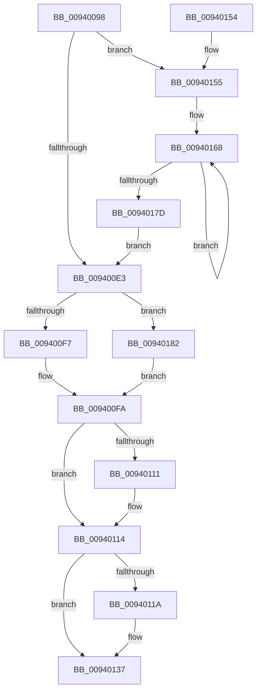

# RtlInitializeImageSystemOverride

- RVA: `0x00940098`–`0x0094018A` (길이 `242` bytes)
- VA: `0x0000000140940098`
- 실행 섹션: `PAGE`
- PDB 이름 있음: `예`; PDB Function 태그: `아니요`
- unwind 정보 RVA: `0x000901E0`
- 디코드: `65`개 명령, `242/242` bytes 표시
- 미해석 바이트: `0` (있으면 어셈블리에 `.byte`로 보존)

> 이 문서는 커널 이미지의 기계어와 PDB 기호를 분석해 생성했습니다. 4번과 5번은 함수 원형과 자료형을 바이너리 사용 방식에서 추정한 C 해석이며 원본 소스 복구 결과는 아닙니다.

## 1. Dependencies

- 직접 호출 지점: **0**; 고유 호출 대상: **0**
- 직접 호출자로 확인된 함수: **2**
- RIP 상대 이미지 참조: **6**

### Outgoing calls
- 직접 디코드된 call 명령이 없습니다.

### Direct callers
- [MiParseImageLoadConfig](MiParseImageLoadConfig_function_00940D18.md) at `0x0094126E`
- [MiApplyFunctionOverrideToBootDriver](../../init/C6/MiApplyFunctionOverrideToBootDriver_function_00C6B19C.md) at `0x00C6B235`

### Static image references
- `0x009400A2` → RVA `0x00E2D8A0` (`.data`; read)
- `0x009400E3` → RVA `0x00FC6B30` (`ALMOSTRO`; read)
- `0x009400EA` → RVA `0x00E2D830` (`.data`; read)
- `0x009400FA` → RVA `0x00E375B0` (`.data`; read)
- `0x00940100` → RVA `0x00E375AC` (`.data`; read)
- `0x00940155` → RVA `0x00012248` (`.rdata`; read)

## 2. Other-region calls and transfers

- 다른 실행 섹션으로 향하는 call: **0**
- 별도 외부 분기/꼬리 이동을 확인하지 못했습니다.

## 3. Assembly (complete function range)

```asm
00940098  48 89 5C 24 08                  mov qword ptr [rsp + 8], rbx
0094009D  48 89 7C 24 10                  mov qword ptr [rsp + 0x10], rdi
009400A2  8B 1D F8 D7 4E 00               mov ebx, dword ptr [rip + 0x4ed7f8]
009400A8  44 8D 8A FF 0F 00 00            lea r9d, [rdx + 0xfff]
009400AF  33 C0                           xor eax, eax
009400B1  0F 57 C0                        xorps xmm0, xmm0
009400B4  0F 11 01                        movups xmmword ptr [rcx], xmm0
009400B7  41 81 E1 00 F0 FF FF            and r9d, 0xfffff000
009400BE  41 8B F8                        mov edi, r8d
009400C1  0F 11 41 10                     movups xmmword ptr [rcx + 0x10], xmm0
009400C5  44 8B DA                        mov r11d, edx
009400C8  0F 11 41 20                     movups xmmword ptr [rcx + 0x20], xmm0
009400CC  48 89 41 30                     mov qword ptr [rcx + 0x30], rax
009400D0  89 41 38                        mov dword ptr [rcx + 0x38], eax
009400D3  8D 83 FF 0F 00 00               lea eax, [rbx + 0xfff]
009400D9  41 03 C1                        add eax, r9d
009400DC  3D FF FF FF 7F                  cmp eax, 0x7fffffff
009400E1  72 72                           jb 0x140940155
009400E3  F6 05 46 6A 68 00 01            test byte ptr [rip + 0x686a46], 1
009400EA  48 8B 05 3F D7 4E 00            mov rax, qword ptr [rip + 0x4ed73f]
009400F1  0F 84 8B 00 00 00               je 0x140940182
009400F7  8B 50 54                        mov edx, dword ptr [rax + 0x54]
009400FA  03 15 B0 74 4F 00               add edx, dword ptr [rip + 0x4f74b0]
00940100  03 15 A6 74 4F 00               add edx, dword ptr [rip + 0x4f74a6]
00940106  42 8D 04 1A                     lea eax, [rdx + r11]
0094010A  3D FF FF FF 7F                  cmp eax, 0x7fffffff
0094010F  73 03                           jae 0x140940114
00940111  89 41 10                        mov dword ptr [rcx + 0x10], eax
00940114  33 D2                           xor edx, edx
00940116  85 FF                           test edi, edi
00940118  74 1D                           je 0x140940137
0094011A  8B 41 04                        mov eax, dword ptr [rcx + 4]
0094011D  89 01                           mov dword ptr [rcx], eax
0094011F  8B 41 0C                        mov eax, dword ptr [rcx + 0xc]
00940122  89 41 08                        mov dword ptr [rcx + 8], eax
00940125  8B 41 1C                        mov eax, dword ptr [rcx + 0x1c]
00940128  89 41 18                        mov dword ptr [rcx + 0x18], eax
0094012B  8B 41 24                        mov eax, dword ptr [rcx + 0x24]
0094012E  89 41 20                        mov dword ptr [rcx + 0x20], eax
00940131  8B 41 2C                        mov eax, dword ptr [rcx + 0x2c]
00940134  89 41 28                        mov dword ptr [rcx + 0x28], eax
00940137  48 8B 5C 24 08                  mov rbx, qword ptr [rsp + 8]
0094013C  48 8B C1                        mov rax, rcx
0094013F  48 8B 7C 24 10                  mov rdi, qword ptr [rsp + 0x10]
00940144  89 51 04                        mov dword ptr [rcx + 4], edx
00940147  89 51 0C                        mov dword ptr [rcx + 0xc], edx
0094014A  89 51 1C                        mov dword ptr [rcx + 0x1c], edx
0094014D  89 51 24                        mov dword ptr [rcx + 0x24], edx
00940150  89 51 2C                        mov dword ptr [rcx + 0x2c], edx
00940153  C3                              ret
00940154  CC                              int3
00940155  4C 8D 05 EC 20 6D FF            lea r8, [rip - 0x92df14]
0094015C  48 8B D1                        mov rdx, rcx
0094015F  4C 2B C1                        sub r8, rcx
00940162  41 BA 04 00 00 00               mov r10d, 4
00940168  42 8B 04 02                     mov eax, dword ptr [rdx + r8]
0094016C  41 03 C1                        add eax, r9d
0094016F  03 C3                           add eax, ebx
00940171  89 02                           mov dword ptr [rdx], eax
00940173  48 8D 52 04                     lea rdx, [rdx + 4]
00940177  49 83 EA 01                     sub r10, 1
0094017B  75 EB                           jne 0x140940168
0094017D  E9 61 FF FF FF                  jmp 0x1409400e3
00940182  8B 50 58                        mov edx, dword ptr [rax + 0x58]
00940185  E9 70 FF FF FF                  jmp 0x1409400fa
```

## 4. C-style interpretation (structured pseudocode)

```c
__int64 __fastcall RtlInitializeImageSystemOverride(__int64 a1, __int64 a2, int a3)
{
    __int64 result;
    __int64 v_r10;
    unsigned __int64 v_stack_p10;
    unsigned __int64 v_stack_p8;

    v_stack_p8 = v_rbx;
    v_stack_p10 = v_rdi;
    result = 0;
    *(unsigned __int64 *)(a1) = v_xmm0;
    a4 = (unsigned int)((a2 + 4095) & (0xFFFFF000ULL));
    *(unsigned __int64 *)(a1 + 16) = v_xmm0;
    *(unsigned __int64 *)(a1 + 32) = v_xmm0;
    *(unsigned __int64 *)(a1 + 48) = 0;
    *(unsigned int *)(a1 + 56) = 0;
    result = (unsigned int)(((unsigned int)(*(unsigned int *)(v_rip + 5167096)) + 4095) + ((unsigned int)(a4)));
    if (((unsigned int)(result)) < 0x7FFFFFFFULL) goto loc_00940155;
loc_009400E3:
    if (((*(unsigned __int8 *)(v_rip + 6842950)) & (1)) == 0) goto loc_00940182;
loc_009400FA:
    a2 = (unsigned int)(((unsigned int)(*(unsigned int *)(*(unsigned __int64 *)(v_rip + 5166911) + 84))) + (*(unsigned int *)(v_rip + 5207216)));
    a2 = (unsigned int)((a2) + (*(unsigned int *)(v_rip + 5207206)));
    if (((unsigned int)(a2 + (unsigned int)((unsigned int)(a2)) * 1)) < 0x7FFFFFFFULL) {
        *(unsigned int *)(a1 + 16) = (unsigned int)(a2 + (unsigned int)((unsigned int)(a2)) * 1);
    }
    a2 = 0;
    result = a2 + (unsigned int)((unsigned int)(a2)) * 1;
    if ((unsigned int)((unsigned int)(a3)) != 0) {
        result = *(unsigned int *)(a1 + 4);
        *(unsigned int *)(a1) = (unsigned int)(result);
        result = *(unsigned int *)(a1 + 12);
        *(unsigned int *)(a1 + 8) = (unsigned int)(result);
        result = *(unsigned int *)(a1 + 28);
        *(unsigned int *)(a1 + 24) = (unsigned int)(result);
        result = *(unsigned int *)(a1 + 36);
        *(unsigned int *)(a1 + 32) = (unsigned int)(result);
        result = *(unsigned int *)(a1 + 44);
        *(unsigned int *)(a1 + 40) = (unsigned int)(result);
    }
    *(unsigned int *)(a1 + 4) = 0;
    *(unsigned int *)(a1 + 12) = 0;
    *(unsigned int *)(a1 + 28) = 0;
    *(unsigned int *)(a1 + 36) = 0;
    *(unsigned int *)(a1 + 44) = 0;
    return a1;
loc_00940155:
    a3 = (v_rip - 9625364) - (a1);
loc_00940168:
    result = (unsigned int)(((unsigned int)(*(unsigned int *)(a1 + a3 * 1))) + ((unsigned int)(a4)));
    result = (unsigned int)((result) + ((unsigned int)(v_stack_p8)));
    *(unsigned int *)(a1) = (unsigned int)(result);
    v_r10 = (4) - (1);
    if (condition_is_not_equal) goto loc_00940168;
    goto loc_009400E3;
loc_00940182:
    goto loc_009400FA;
}
```

## 5. (Beta) C Style

```c
void *RtlInitializeImageSystemOverride(void *ImageSystemOverride, void *Arg2, int32_t Arg3)
{
    uint8_t *imageSystemOverride = (uint8_t *)ImageSystemOverride;
    uint8_t *arg2 = (uint8_t *)Arg2;

    int64_t result;
    int64_t local_r10;
    uint64_t v_stack_p10;
    uint64_t v_stack_p8;

    v_stack_p8 = local_rbx;
    v_stack_p10 = local_rdi;
    result = 0;
    *(uint64_t *)(imageSystemOverride) = v_xmm0;
    a4 = (uint32_t)((Arg2 + 4095) & (0xFFFFF000ULL));
    *(uint64_t *)(imageSystemOverride + 0x10) = v_xmm0;
    *(uint64_t *)(imageSystemOverride + 0x20) = v_xmm0;
    *(uint64_t *)(imageSystemOverride + 0x30) = 0;
    *(uint32_t *)(imageSystemOverride + 0x38) = 0;
    result = (uint32_t)(((uint32_t)(*(uint32_t *)(v_rip + 0x4ED7F8)) + 4095) + ((uint32_t)(a4)));
    if (((uint32_t)(result)) < 0x7FFFFFFFULL) goto loc_00940155;
loc_009400E3:
    if (((*(uint8_t *)(v_rip + 0x686A46)) & (1)) == 0) goto loc_00940182;
loc_009400FA:
    Arg2 = (uint32_t)(((uint32_t)(*(uint32_t *)(*(uint64_t *)(v_rip + 0x4ED73F) + 0x54))) + (*(uint32_t *)(v_rip + 0x4F74B0)));
    Arg2 = (uint32_t)((Arg2) + (*(uint32_t *)(v_rip + 0x4F74A6)));
    if (((uint32_t)(Arg2 + (uint32_t)((uint32_t)(Arg2)) * 1)) < 0x7FFFFFFFULL) {
        *(uint32_t *)(imageSystemOverride + 0x10) = (uint32_t)(Arg2 + (uint32_t)((uint32_t)(Arg2)) * 1);
    }
    Arg2 = 0;
    result = Arg2 + (uint32_t)((uint32_t)(Arg2)) * 1;
    if ((uint32_t)((uint32_t)(Arg3)) != 0) {
        result = *(uint32_t *)(imageSystemOverride + 0x4);
        *(uint32_t *)(imageSystemOverride) = (uint32_t)(result);
        result = *(uint32_t *)(imageSystemOverride + 0xC);
        *(uint32_t *)(imageSystemOverride + 0x8) = (uint32_t)(result);
        result = *(uint32_t *)(imageSystemOverride + 0x1C);
        *(uint32_t *)(imageSystemOverride + 0x18) = (uint32_t)(result);
        result = *(uint32_t *)(imageSystemOverride + 0x24);
        *(uint32_t *)(imageSystemOverride + 0x20) = (uint32_t)(result);
        result = *(uint32_t *)(imageSystemOverride + 0x2C);
        *(uint32_t *)(imageSystemOverride + 0x28) = (uint32_t)(result);
    }
    *(uint32_t *)(imageSystemOverride + 0x4) = 0;
    *(uint32_t *)(imageSystemOverride + 0xC) = 0;
    *(uint32_t *)(imageSystemOverride + 0x1C) = 0;
    *(uint32_t *)(imageSystemOverride + 0x24) = 0;
    *(uint32_t *)(imageSystemOverride + 0x2C) = 0;
    return ImageSystemOverride;
loc_00940155:
    Arg3 = (v_rip - 9625364) - (ImageSystemOverride);
loc_00940168:
    result = (uint32_t)(((uint32_t)(*(uint32_t *)(imageSystemOverride + Arg3 * 1))) + ((uint32_t)(a4)));
    result = (uint32_t)((result) + ((uint32_t)(v_stack_p8)));
    *(uint32_t *)(imageSystemOverride) = (uint32_t)(result);
    local_r10 = (4) - (1);
    if (condition_is_not_equal) goto loc_00940168;
    goto loc_009400E3;
loc_00940182:
    goto loc_009400FA;
}
```

### 관측된 메모리 오프셋

구조체 형식이 확인되지 않은 접근은 인자 기준의 오프셋으로만 기록했습니다.

| 기준 인자 | 오프셋 표현 | 폭 (bit) | 접근 |
|---|---:|---:|---|
| `ImageSystemOverride` | `+ 0x0` | `32` | `W` |
| `ImageSystemOverride` | `+ 0x0` | `128` | `R` |
| `ImageSystemOverride` | `+ 0x0 + r8*1` | `32` | `R` |
| `ImageSystemOverride` | `+ 0x4` | `32` | `R` |
| `ImageSystemOverride` | `+ 0x4` | `32` | `W` |
| `ImageSystemOverride` | `+ 0x4` | `64` | `R` |
| `ImageSystemOverride` | `+ 0x8` | `32` | `W` |
| `ImageSystemOverride` | `+ 0xC` | `32` | `R` |
| `ImageSystemOverride` | `+ 0xC` | `32` | `W` |
| `ImageSystemOverride` | `+ 0x10` | `32` | `W` |
| `ImageSystemOverride` | `+ 0x10` | `128` | `R` |
| `ImageSystemOverride` | `+ 0x18` | `32` | `W` |
| `ImageSystemOverride` | `+ 0x1C` | `32` | `R` |
| `ImageSystemOverride` | `+ 0x1C` | `32` | `W` |
| `ImageSystemOverride` | `+ 0x20` | `32` | `W` |
| `ImageSystemOverride` | `+ 0x20` | `128` | `R` |
| `ImageSystemOverride` | `+ 0x24` | `32` | `R` |
| `ImageSystemOverride` | `+ 0x24` | `32` | `W` |
| `ImageSystemOverride` | `+ 0x28` | `32` | `W` |
| `ImageSystemOverride` | `+ 0x2C` | `32` | `R` |
| `ImageSystemOverride` | `+ 0x2C` | `32` | `W` |
| `ImageSystemOverride` | `+ 0x30` | `64` | `W` |
| `ImageSystemOverride` | `+ 0x38` | `32` | `W` |
| `Arg2` | `+ 0xFFF` | `32` | `R` |

## 6. Execution-region graph

[열기: 2D/3D 그래프와 함수 탐색 컨트롤 패널](../../../control-panel.html?section=page&rva=0x00940098&view=graph)

- 2D 그래프는 위에서 아래로 흐르고, 3D 그래프는 빈 공간을 드래그해 회전합니다. Shift+드래그는 이동, 휠은 확대·축소, 함수 노드 선택은 대상 보고서 이동입니다.

### Static fallback


