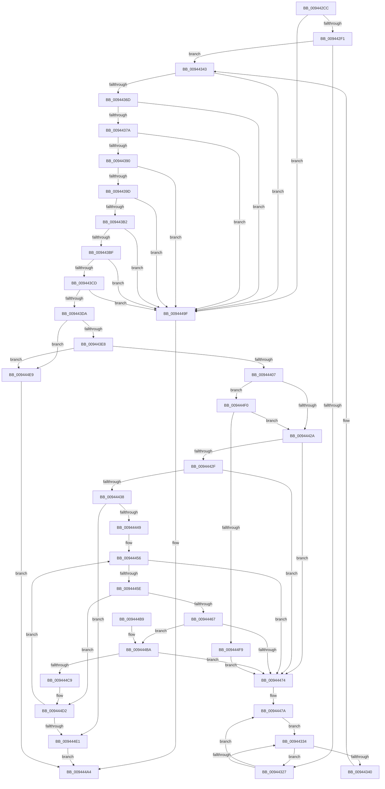

# RtlpAllocateFunctionOverrideInfo

- RVA: `0x009442CC`–`0x009444FE` (길이 `562` bytes)
- VA: `0x00000001409442CC`
- 실행 섹션: `PAGE`
- PDB 이름 있음: `예`; PDB Function 태그: `아니요`
- unwind 정보 RVA: `0x00090614`
- 디코드: `160`개 명령, `562/562` bytes 표시
- 미해석 바이트: `0` (있으면 어셈블리에 `.byte`로 보존)

> 이 문서는 커널 이미지의 기계어와 PDB 기호를 분석해 생성했습니다. 4번과 5번은 함수 원형과 자료형을 바이너리 사용 방식에서 추정한 C 해석이며 원본 소스 복구 결과는 아닙니다.

## 1. Dependencies

- 직접 호출 지점: **2**; 고유 호출 대상: **2**
- 직접 호출자로 확인된 함수: **1**
- RIP 상대 이미지 참조: **0**

### Outgoing calls
- `0x009443F6` → [ExAllocatePool2](../../poolcode/B8/ExAllocatePool2_function_00B820F0.md) (function, `0x00B820F0`)
- `0x00944474` → [gsl::details::terminate](../../text/4F/gsl_details_terminate_function_004F9AA0.md) (function, `0x004F9AA0`)

### Direct callers
- [RtlpCreateFunctionOverrideFixupInfo](RtlpCreateFunctionOverrideFixupInfo_function_009433D8.md) at `0x00943771`

### Static image references
- 디코드된 RIP-relative 메모리 참조가 없습니다.

## 2. Other-region calls and transfers

- 다른 실행 섹션으로 향하는 call: **2**
  - `0x009443F6` → [ExAllocatePool2](../../poolcode/B8/ExAllocatePool2_function_00B820F0.md) (`PAGE` → `POOLCODE`)
  - `0x00944474` → [gsl::details::terminate](../../text/4F/gsl_details_terminate_function_004F9AA0.md) (`PAGE` → `.text`)
- 별도 외부 분기/꼬리 이동을 확인하지 못했습니다.

## 3. Assembly (complete function range)

```asm
009442CC  48 89 5C 24 08                  mov qword ptr [rsp + 8], rbx
009442D1  55                              push rbp
009442D2  56                              push rsi
009442D3  57                              push rdi
009442D4  41 54                           push r12
009442D6  41 55                           push r13
009442D8  41 56                           push r14
009442DA  41 57                           push r15
009442DC  48 83 EC 30                     sub rsp, 0x30
009442E0  45 33 DB                        xor r11d, r11d
009442E3  4D 8B E0                        mov r12, r8
009442E6  4D 89 18                        mov qword ptr [r8], r11
009442E9  85 D2                           test edx, edx
009442EB  0F 84 AE 01 00 00               je 0x14094449f
009442F1  48 8B 41 08                     mov rax, qword ptr [rcx + 8]
009442F5  41 8D 7B 01                     lea edi, [r11 + 1]
009442F9  48 8B 09                        mov rcx, qword ptr [rcx]
009442FC  45 8B F3                        mov r14d, r11d
009442FF  48 89 4C 24 20                  mov qword ptr [rsp + 0x20], rcx
00944304  41 8B DB                        mov ebx, r11d
00944307  45 8A D3                        mov r10b, r11b
0094430A  48 89 84 24 88 00 00 00         mov qword ptr [rsp + 0x88], rax
00944312  41 8B EB                        mov ebp, r11d
00944315  45 8B EB                        mov r13d, r11d
00944318  4C 8D 04 88                     lea r8, [rax + rcx*4]
0094431C  45 8B CB                        mov r9d, r11d
0094431F  48 8B C8                        mov rcx, rax
00944322  49 3B C0                        cmp rax, r8
00944325  74 1C                           je 0x140944343
00944327  8B 01                           mov eax, dword ptr [rcx]
00944329  45 8A DA                        mov r11b, r10b
0094432C  85 C0                           test eax, eax
0094432E  0F 85 46 01 00 00               jne 0x14094447a
00944334  44 03 CF                        add r9d, edi
00944337  48 83 C1 04                     add rcx, 4
0094433B  49 3B C8                        cmp rcx, r8
0094433E  75 E7                           jne 0x140944327
00944340  45 33 DB                        xor r11d, r11d
00944343  8B D2                           mov edx, edx
00944345  B8 10 00 00 00                  mov eax, 0x10
0094434A  4C 89 9C 24 80 00 00 00         mov qword ptr [rsp + 0x80], r11
00944352  41 8B CD                        mov ecx, r13d
00944355  2B CD                           sub ecx, ebp
00944357  48 89 94 24 80 00 00 00         mov qword ptr [rsp + 0x80], rdx
0094435F  48 F7 E2                        mul rdx
00944362  03 CF                           add ecx, edi
00944364  48 85 D2                        test rdx, rdx
00944367  0F 85 32 01 00 00               jne 0x14094449f
0094436D  48 8D 70 28                     lea rsi, [rax + 0x28]
00944371  48 3B F0                        cmp rsi, rax
00944374  0F 82 25 01 00 00               jb 0x14094449f
0094437A  44 8D 42 08                     lea r8d, [rdx + 8]
0094437E  44 8B F9                        mov r15d, ecx
00944381  41 8B C0                        mov eax, r8d
00944384  49 F7 E7                        mul r15
00944387  48 85 D2                        test rdx, rdx
0094438A  0F 85 0F 01 00 00               jne 0x14094449f
00944390  48 8D 3C 30                     lea rdi, [rax + rsi]
00944394  48 3B F8                        cmp rdi, rax
00944397  0F 82 02 01 00 00               jb 0x14094449f
0094439D  41 8B C6                        mov eax, r14d
009443A0  8D 4A 0C                        lea ecx, [rdx + 0xc]
009443A3  48 F7 E1                        mul rcx
009443A6  41 2B DE                        sub ebx, r14d
009443A9  48 85 D2                        test rdx, rdx
009443AC  0F 85 ED 00 00 00               jne 0x14094449f
009443B2  48 8D 0C 38                     lea rcx, [rax + rdi]
009443B6  48 3B C8                        cmp rcx, rax
009443B9  0F 82 E0 00 00 00               jb 0x14094449f
009443BF  8B C3                           mov eax, ebx
009443C1  49 F7 E0                        mul r8
009443C4  48 85 D2                        test rdx, rdx
009443C7  0F 85 D2 00 00 00               jne 0x14094449f
009443CD  48 8D 1C 08                     lea rbx, [rax + rcx]
009443D1  48 3B D8                        cmp rbx, rax
009443D4  0F 82 C5 00 00 00               jb 0x14094449f
009443DA  B8 FF FF FF FF                  mov eax, 0xffffffff
009443DF  48 3B D8                        cmp rbx, rax
009443E2  0F 87 01 01 00 00               ja 0x1409444e9
009443E8  41 B8 52 74 46 6F               mov r8d, 0x6f467452
009443EE  48 8B D3                        mov rdx, rbx
009443F1  B9 00 01 00 00                  mov ecx, 0x100
009443F6  E8 F5 DC 23 00                  call 0x140b820f0
009443FB  48 8B C8                        mov rcx, rax
009443FE  48 85 C0                        test rax, rax
00944401  0F 84 E2 00 00 00               je 0x1409444e9
00944407  48 8B 84 24 80 00 00 00         mov rax, qword ptr [rsp + 0x80]
0094440F  48 8D 14 31                     lea rdx, [rcx + rsi]
00944413  48 89 01                        mov qword ptr [rcx], rax
00944416  48 89 51 18                     mov qword ptr [rcx + 0x18], rdx
0094441A  89 69 20                        mov dword ptr [rcx + 0x20], ebp
0094441D  44 89 69 24                     mov dword ptr [rcx + 0x24], r13d
00944421  48 85 D2                        test rdx, rdx
00944424  0F 84 C6 00 00 00               je 0x1409444f0
0094442A  48 3B DF                        cmp rbx, rdi
0094442D  72 45                           jb 0x140944474
0094442F  48 2B DF                        sub rbx, rdi
00944432  48 83 FB FF                     cmp rbx, -1
00944436  74 3C                           je 0x140944474
00944438  4E 8D 14 FA                     lea r10, [rdx + r15*8]
0094443C  4C 8D 0C 0F                     lea r9, [rdi + rcx]
00944440  49 3B D2                        cmp rdx, r10
00944443  0F 84 98 00 00 00               je 0x1409444e1
00944449  48 8B B4 24 88 00 00 00         mov rsi, qword ptr [rsp + 0x88]
00944451  4C 8B 74 24 20                  mov r14, qword ptr [rsp + 0x20]
00944456  44 8B C5                        mov r8d, ebp
00944459  4D 3B C6                        cmp r8, r14
0094445C  73 16                           jae 0x140944474
0094445E  46 8B 04 86                     mov r8d, dword ptr [rsi + r8*4]
00944462  45 85 C0                        test r8d, r8d
00944465  74 6B                           je 0x1409444d2
00944467  4A 8D 04 C5 04 00 00 00         lea rax, [r8*8 + 4]
0094446F  48 3B D8                        cmp rbx, rax
00944472  73 46                           jae 0x1409444ba
00944474  E8 27 56 BB FF                  call 0x1404f9aa0
00944479  CC                              int3
0094447A  03 D8                           add ebx, eax
0094447C  44 03 F7                        add r14d, edi
0094447F  45 84 D2                        test r10b, r10b
00944482  41 0F B6 C2                     movzx eax, r10b
00944486  45 8B E9                        mov r13d, r9d
00944489  0F 44 C7                        cmove eax, edi
0094448C  45 84 DB                        test r11b, r11b
0094448F  44 8A D0                        mov r10b, al
00944492  41 8B C1                        mov eax, r9d
00944495  0F 45 C5                        cmovne eax, ebp
00944498  8B E8                           mov ebp, eax
0094449A  E9 95 FE FF FF                  jmp 0x140944334
0094449F  B8 7B 00 00 C0                  mov eax, 0xc000007b
009444A4  48 8B 5C 24 70                  mov rbx, qword ptr [rsp + 0x70]
009444A9  48 83 C4 30                     add rsp, 0x30
009444AD  41 5F                           pop r15
009444AF  41 5E                           pop r14
009444B1  41 5D                           pop r13
009444B3  41 5C                           pop r12
009444B5  5F                              pop rdi
009444B6  5E                              pop rsi
009444B7  5D                              pop rbp
009444B8  C3                              ret
009444B9  CC                              int3
009444BA  48 2B D8                        sub rbx, rax
009444BD  4D 8B D9                        mov r11, r9
009444C0  49 8B F9                        mov rdi, r9
009444C3  48 83 FB FF                     cmp rbx, -1
009444C7  74 AB                           je 0x140944474
009444C9  48 89 3A                        mov qword ptr [rdx], rdi
009444CC  4C 03 C8                        add r9, rax
009444CF  44 89 07                        mov dword ptr [rdi], r8d
009444D2  FF C5                           inc ebp
009444D4  48 83 C2 08                     add rdx, 8
009444D8  49 3B D2                        cmp rdx, r10
009444DB  0F 85 75 FF FF FF               jne 0x140944456
009444E1  49 89 0C 24                     mov qword ptr [r12], rcx
009444E5  33 C0                           xor eax, eax
009444E7  EB BB                           jmp 0x1409444a4
009444E9  B8 17 00 00 C0                  mov eax, 0xc0000017
009444EE  EB B4                           jmp 0x1409444a4
009444F0  4D 85 FF                        test r15, r15
009444F3  0F 84 31 FF FF FF               je 0x14094442a
009444F9  E9 76 FF FF FF                  jmp 0x140944474
```

## 4. C-style interpretation (structured pseudocode)

```c
__int64 __fastcall RtlpAllocateFunctionOverrideInfo(__int64 a1, int a2, __int64 a3)
{
    __int64 result;
    __int64 v_r11;
    __int64 v_r14;
    __int64 v_rbp;
    __int64 v_rbx;
    __int64 v_rsp;
    unsigned __int64 v_stack_m48;
    unsigned __int64 v_stack_p18;
    unsigned __int64 v_stack_p20;
    unsigned __int64 v_stack_p8;

    v_stack_p8 = v_rbx;
    v_rsp = (v_rsp) - (48);
    v_r11 = 0;
    *(unsigned __int64 *)(a3) = 0;
    if (a2 == 0) goto loc_0094449F;
    v_stack_m48 = *(unsigned __int64 *)(a1);
    v_stack_p20 = *(unsigned __int64 *)(a1 + 8);
    if ((*(unsigned __int64 *)(a1 + 8)) == (*(unsigned __int64 *)(a1 + 8) + *(unsigned __int64 *)(a1) * 4)) goto loc_00944343;
loc_00944327:
    if ((unsigned int)((unsigned int)(*(unsigned int *)(*(unsigned __int64 *)(a1 + 8)))) != 0) goto loc_0094447A;
loc_00944334:
    a4 = (unsigned int)((0) + ((unsigned int)(v_r11 + 1)));
    a1 = (*(unsigned __int64 *)(a1 + 8)) + (4);
    if (a1 != (*(unsigned __int64 *)(a1 + 8) + *(unsigned __int64 *)(a1) * 4)) goto loc_00944327;
    v_r11 = 0;
loc_00944343:
    v_stack_p18 = 0;
    a1 = (unsigned int)((0) - (0));
    v_stack_p18 = (unsigned int)(a2);
    a1 = (unsigned int)((a1) + ((unsigned int)(v_r11 + 1)));
    if ((unsigned int)(a2) != 0) goto loc_0094449F;
    if ((16 + 40) < 16) goto loc_0094449F;
    if ((unsigned int)(a2) != 0) goto loc_0094449F;
    if (((unsigned int)((unsigned int)((unsigned int)(a2) + 8)) + 16 + 40 * 1) < ((unsigned int)((unsigned int)((unsigned int)(a2) + 8)))) goto loc_0094449F;
    v_rbx = (unsigned int)((0) - (0));
    if ((unsigned int)(a2) != 0) goto loc_0094449F;
    if ((0 + (unsigned int)((unsigned int)((unsigned int)(a2) + 8)) + 16 + 40 * 1 * 1) < 0) goto loc_0094449F;
    if ((unsigned int)(a2) != 0) goto loc_0094449F;
    if (((unsigned int)((unsigned int)(v_rbx)) + 0 + (unsigned int)((unsigned int)((unsigned int)(a2) + 8)) + 16 + 40 * 1 * 1 * 1) < ((unsigned int)((unsigned int)(v_rbx)))) goto loc_0094449F;
    if (((unsigned int)((unsigned int)(v_rbx)) + 0 + (unsigned int)((unsigned int)((unsigned int)(a2) + 8)) + 16 + 40 * 1 * 1 * 1) > ((unsigned int)(0xFFFFFFFFULL))) goto loc_009444E9;
    result = ExAllocatePool2(256, (unsigned int)((unsigned int)(v_rbx)) + 0 + (unsigned int)((unsigned int)((unsigned int)(a2) + 8)) + 16 + 40 * 1 * 1 * 1, (unsigned int)(0x6F467452ULL), a4);
    if (result == 0) goto loc_009444E9;
    *(unsigned __int64 *)(result) = v_stack_p18;
    *(unsigned __int64 *)(result + 24) = result + 16 + 40 * 1;
    *(unsigned int *)(result + 32) = 0;
    *(unsigned int *)(result + 36) = 0;
    if (result + 16 + 40 * 1 == 0) goto loc_009444F0;
loc_0094442A:
    if (((unsigned int)((unsigned int)(v_rbx)) + 0 + (unsigned int)((unsigned int)((unsigned int)(a2) + 8)) + 16 + 40 * 1 * 1 * 1) < ((unsigned int)((unsigned int)((unsigned int)(a2) + 8)) + 16 + 40 * 1)) goto loc_00944474;
    v_rbx = ((unsigned int)((unsigned int)(v_rbx)) + 0 + (unsigned int)((unsigned int)((unsigned int)(a2) + 8)) + 16 + 40 * 1 * 1 * 1) - ((unsigned int)((unsigned int)((unsigned int)(a2) + 8)) + 16 + 40 * 1);
    if (v_rbx == -1) goto loc_00944474;
    if ((result + 16 + 40 * 1) == (result + 16 + 40 * 1 + (unsigned int)((unsigned int)(a1)) * 8)) goto loc_009444E1;
loc_00944456:
    if (0 >= v_stack_m48) goto loc_00944474;
    if ((unsigned int)((unsigned int)(*(unsigned int *)(v_stack_p20 + 0 * 4))) == 0) goto loc_009444D2;
    if (v_rbx >= ((unsigned int)(*(unsigned int *)(v_stack_p20 + 0 * 4)) * 8 + 4)) goto loc_009444BA;
loc_00944474:
    result = gsl__details__terminate(result, result + 16 + 40 * 1, (unsigned int)(*(unsigned int *)(v_stack_p20 + 0 * 4)), (unsigned int)((unsigned int)((unsigned int)(a2) + 8)) + 16 + 40 * 1 + result * 1);
loc_0094447A:
    v_rbx = (unsigned int)((v_rbx) + ((unsigned int)(result)));
    v_r14 = (unsigned int)((v_stack_m48) + ((unsigned int)((unsigned int)((unsigned int)((unsigned int)(a2) + 8)) + 16 + 40 * 1)));
    result = (unsigned __int8)(result + 16 + 40 * 1 + (unsigned int)((unsigned int)(a1)) * 8);
    if ((unsigned __int8)(result + 16 + 40 * 1 + (unsigned int)((unsigned int)(a1)) * 8) == 0) { result = (unsigned int)((unsigned int)((unsigned int)((unsigned int)(a2) + 8)) + 16 + 40 * 1); }
    result = (unsigned int)((unsigned int)((unsigned int)((unsigned int)((unsigned int)(a2) + 8)) + 16 + 40 * 1 + result * 1));
    if (0 != 0) { result = 0; }
    goto loc_00944334;
loc_0094449F:
loc_009444A4:
    v_rsp = (v_rsp) + (48);
    return (unsigned int)(0xC000007BULL);
loc_009444BA:
    v_rbx = (v_stack_p8) - ((unsigned int)(0xC000007BULL));
    if (v_rbx == -1) goto loc_00944474;
    *(unsigned __int64 *)(result + 16 + 40 * 1) = (unsigned int)((unsigned int)((unsigned int)(a2) + 8)) + 16 + 40 * 1 + result * 1;
    a4 = ((unsigned int)((unsigned int)((unsigned int)(a2) + 8)) + 16 + 40 * 1 + result * 1) + ((unsigned int)(0xC000007BULL));
    *(unsigned int *)((unsigned int)((unsigned int)((unsigned int)(a2) + 8)) + 16 + 40 * 1 + result * 1) = (unsigned int)((unsigned int)(*(unsigned int *)(v_stack_p20 + 0 * 4)));
loc_009444D2:
    v_rbp = (unsigned int)(((unsigned int)((unsigned int)(result))) + 1);
    a2 = (result + 16 + 40 * 1) + (8);
    if (a2 != ((unsigned __int8)(result))) goto loc_00944456;
loc_009444E1:
    *(unsigned __int64 *)(a3) = result;
    result = 0;
    goto loc_009444A4;
loc_009444E9:
    goto loc_009444A4;
loc_009444F0:
    if ((unsigned int)((unsigned int)(a1)) == 0) goto loc_0094442A;
    goto loc_00944474;
}
```

## 5. (Beta) C Style

```c
int64_t RtlpAllocateFunctionOverrideInfo(void *Arg1, int32_t Arg2, void *Arg3)
{
    uint8_t *arg1 = (uint8_t *)Arg1;
    uint8_t *arg3 = (uint8_t *)Arg3;

    int64_t result;
    int64_t local_r11;
    int64_t local_r14;
    int64_t local_rbp;
    int64_t local_rbx;
    int64_t local_rsp;
    uint64_t v_stack_m48;
    uint64_t v_stack_p18;
    uint64_t v_stack_p20;
    uint64_t v_stack_p8;

    v_stack_p8 = local_rbx;
    local_rsp = (local_rsp) - (48);
    local_r11 = 0;
    *(uint64_t *)(arg3) = 0;
    if (Arg2 == 0) goto loc_0094449F;
    v_stack_m48 = *(uint64_t *)(arg1);
    v_stack_p20 = *(uint64_t *)(arg1 + 0x8);
    if ((*(uint64_t *)(arg1 + 0x8)) == (*(uint64_t *)(arg1 + 0x8) + *(uint64_t *)(arg1) * 4)) goto loc_00944343;
loc_00944327:
    if ((uint32_t)((uint32_t)(*(uint32_t *)(*(uint64_t *)(arg1 + 0x8)))) != 0) goto loc_0094447A;
loc_00944334:
    a4 = (uint32_t)((0) + ((uint32_t)(local_r11 + 1)));
    Arg1 = (*(uint64_t *)(arg1 + 0x8)) + (4);
    if (Arg1 != (*(uint64_t *)(arg1 + 0x8) + *(uint64_t *)(arg1) * 4)) goto loc_00944327;
    local_r11 = 0;
loc_00944343:
    v_stack_p18 = 0;
    Arg1 = (uint32_t)((0) - (0));
    v_stack_p18 = (uint32_t)(Arg2);
    Arg1 = (uint32_t)((Arg1) + ((uint32_t)(local_r11 + 1)));
    if ((uint32_t)(Arg2) != 0) goto loc_0094449F;
    if ((16 + 40) < 16) goto loc_0094449F;
    if ((uint32_t)(Arg2) != 0) goto loc_0094449F;
    if (((uint32_t)((uint32_t)((uint32_t)(Arg2) + 8)) + 16 + 40 * 1) < ((uint32_t)((uint32_t)((uint32_t)(Arg2) + 8)))) goto loc_0094449F;
    local_rbx = (uint32_t)((0) - (0));
    if ((uint32_t)(Arg2) != 0) goto loc_0094449F;
    if ((0 + (uint32_t)((uint32_t)((uint32_t)(Arg2) + 8)) + 16 + 40 * 1 * 1) < 0) goto loc_0094449F;
    if ((uint32_t)(Arg2) != 0) goto loc_0094449F;
    if (((uint32_t)((uint32_t)(local_rbx)) + 0 + (uint32_t)((uint32_t)((uint32_t)(Arg2) + 8)) + 16 + 40 * 1 * 1 * 1) < ((uint32_t)((uint32_t)(local_rbx)))) goto loc_0094449F;
    if (((uint32_t)((uint32_t)(local_rbx)) + 0 + (uint32_t)((uint32_t)((uint32_t)(Arg2) + 8)) + 16 + 40 * 1 * 1 * 1) > ((uint32_t)(0xFFFFFFFFULL))) goto loc_009444E9;
    result = ExAllocatePool2(256, (uint32_t)((uint32_t)(local_rbx)) + 0 + (uint32_t)((uint32_t)((uint32_t)(Arg2) + 8)) + 16 + 40 * 1 * 1 * 1, (uint32_t)(0x6F467452ULL), a4);
    if (result == 0) goto loc_009444E9;
    *(uint64_t *)(result) = v_stack_p18;
    *(uint64_t *)(result + 0x18) = result + 16 + 40 * 1;
    *(uint32_t *)(result + 0x20) = 0;
    *(uint32_t *)(result + 0x24) = 0;
    if (result + 16 + 40 * 1 == 0) goto loc_009444F0;
loc_0094442A:
    if (((uint32_t)((uint32_t)(local_rbx)) + 0 + (uint32_t)((uint32_t)((uint32_t)(Arg2) + 8)) + 16 + 40 * 1 * 1 * 1) < ((uint32_t)((uint32_t)((uint32_t)(Arg2) + 8)) + 16 + 40 * 1)) goto loc_00944474;
    local_rbx = ((uint32_t)((uint32_t)(local_rbx)) + 0 + (uint32_t)((uint32_t)((uint32_t)(Arg2) + 8)) + 16 + 40 * 1 * 1 * 1) - ((uint32_t)((uint32_t)((uint32_t)(Arg2) + 8)) + 16 + 40 * 1);
    if (local_rbx == -1) goto loc_00944474;
    if ((result + 16 + 40 * 1) == (result + 16 + 40 * 1 + (uint32_t)((uint32_t)(Arg1)) * 8)) goto loc_009444E1;
loc_00944456:
    if (0 >= v_stack_m48) goto loc_00944474;
    if ((uint32_t)((uint32_t)(*(uint32_t *)(v_stack_p20 + 0x0 * 4))) == 0) goto loc_009444D2;
    if (local_rbx >= ((uint32_t)(*(uint32_t *)(v_stack_p20 + 0x0 * 4)) * 8 + 4)) goto loc_009444BA;
loc_00944474:
    result = gsl__details__terminate(result, result + 16 + 40 * 1, (uint32_t)(*(uint32_t *)(v_stack_p20 + 0x0 * 4)), (uint32_t)((uint32_t)((uint32_t)(Arg2) + 8)) + 16 + 40 * 1 + result * 1);
loc_0094447A:
    local_rbx = (uint32_t)((local_rbx) + ((uint32_t)(result)));
    local_r14 = (uint32_t)((v_stack_m48) + ((uint32_t)((uint32_t)((uint32_t)((uint32_t)(Arg2) + 8)) + 16 + 40 * 1)));
    result = (uint8_t)(result + 16 + 40 * 1 + (uint32_t)((uint32_t)(Arg1)) * 8);
    if ((uint8_t)(result + 16 + 40 * 1 + (uint32_t)((uint32_t)(Arg1)) * 8) == 0) { result = (uint32_t)((uint32_t)((uint32_t)((uint32_t)(Arg2) + 8)) + 16 + 40 * 1); }
    result = (uint32_t)((uint32_t)((uint32_t)((uint32_t)((uint32_t)(Arg2) + 8)) + 16 + 40 * 1 + result * 1));
    if (0 != 0) { result = 0; }
    goto loc_00944334;
loc_0094449F:
loc_009444A4:
    local_rsp = (local_rsp) + (48);
    return (uint32_t)(0xC000007BULL);
loc_009444BA:
    local_rbx = (v_stack_p8) - ((uint32_t)(0xC000007BULL));
    if (local_rbx == -1) goto loc_00944474;
    *(uint64_t *)(result + 0x10 + 0x28 * 1) = (uint32_t)((uint32_t)((uint32_t)(Arg2) + 8)) + 16 + 40 * 1 + result * 1;
    a4 = ((uint32_t)((uint32_t)((uint32_t)(Arg2) + 8)) + 16 + 40 * 1 + result * 1) + ((uint32_t)(0xC000007BULL));
    *(uint32_t *)((uint32_t)((uint32_t)((uint32_t)(Arg2) + 0x8)) + 0x10 + 0x28 * 1 + result * 1) = (uint32_t)((uint32_t)(*(uint32_t *)(v_stack_p20 + 0x0 * 4)));
loc_009444D2:
    local_rbp = (uint32_t)(((uint32_t)((uint32_t)(result))) + 1);
    Arg2 = (result + 16 + 40 * 1) + (8);
    if (Arg2 != ((uint8_t)(result))) goto loc_00944456;
loc_009444E1:
    *(uint64_t *)(arg3) = result;
    result = 0;
    goto loc_009444A4;
loc_009444E9:
    goto loc_009444A4;
loc_009444F0:
    if ((uint32_t)((uint32_t)(Arg1)) == 0) goto loc_0094442A;
    goto loc_00944474;
}
```

### 관측된 메모리 오프셋

구조체 형식이 확인되지 않은 접근은 인자 기준의 오프셋으로만 기록했습니다.

| 기준 인자 | 오프셋 표현 | 폭 (bit) | 접근 |
|---|---:|---:|---|
| `Arg1` | `+ 0x0` | `64` | `R` |
| `Arg1` | `+ 0x8` | `64` | `R` |
| `Arg3` | `+ 0x0` | `64` | `W` |

## 6. Execution-region graph

[열기: 2D/3D 그래프와 함수 탐색 컨트롤 패널](../../../control-panel.html?section=page&rva=0x009442CC&view=graph)

- 2D 그래프는 위에서 아래로 흐르고, 3D 그래프는 빈 공간을 드래그해 회전합니다. Shift+드래그는 이동, 휠은 확대·축소, 함수 노드 선택은 대상 보고서 이동입니다.

### Static fallback


