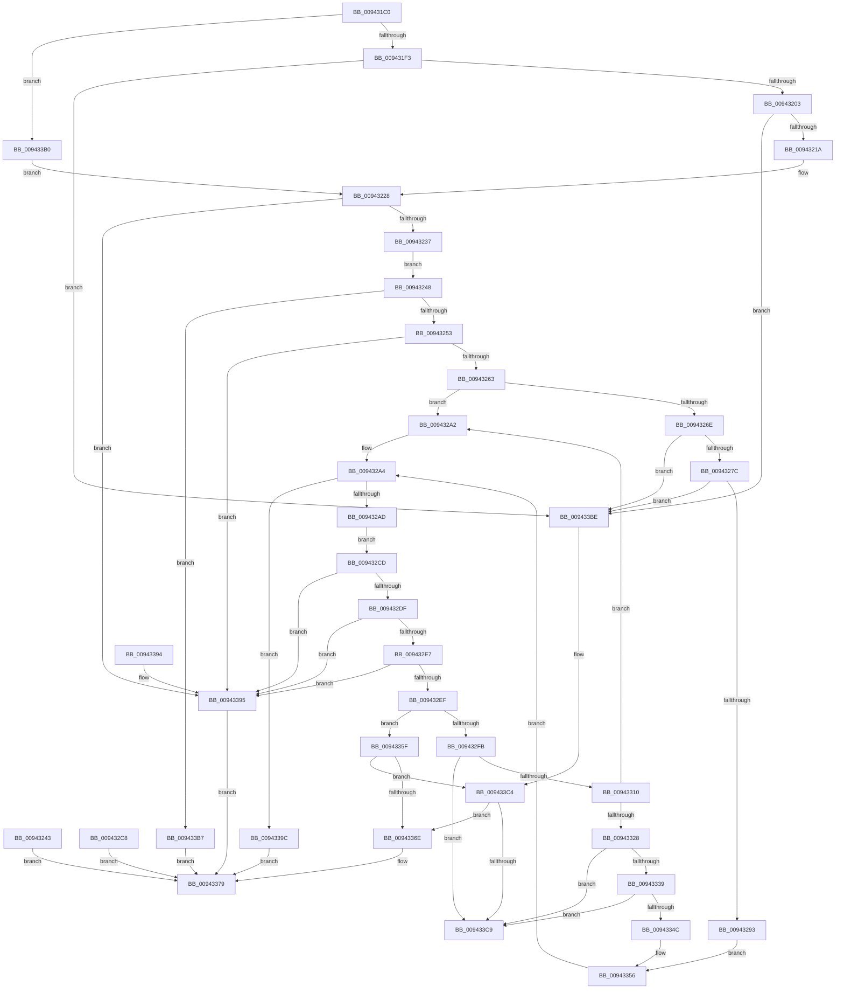

# RtlpFindFunctionOverrideDvrtRecord

- RVA: `0x009431C0`–`0x009433CF` (길이 `527` bytes)
- VA: `0x00000001409431C0`
- 실행 섹션: `PAGE`
- PDB 이름 있음: `예`; PDB Function 태그: `아니요`
- unwind 정보 RVA: `0x00090534`
- 디코드: `132`개 명령, `527/527` bytes 표시
- 미해석 바이트: `0` (있으면 어셈블리에 `.byte`로 보존)

> 이 문서는 커널 이미지의 기계어와 PDB 기호를 분석해 생성했습니다. 4번과 5번은 함수 원형과 자료형을 바이너리 사용 방식에서 추정한 C 해석이며 원본 소스 복구 결과는 아닙니다.

## 1. Dependencies

- 직접 호출 지점: **5**; 고유 호출 대상: **3**
- 직접 호출자로 확인된 함수: **1**
- RIP 상대 이미지 참조: **1**

### Outgoing calls
- `0x0094323C` → [RtlCopyVolatileMemory](../../text/6B/RtlCopyVolatileMemory_function_006BC9D0.md) (function, `0x006BC9D0`)
- `0x009432C1` → [RtlCopyVolatileMemory](../../text/6B/RtlCopyVolatileMemory_function_006BC9D0.md) (function, `0x006BC9D0`)
- `0x00943381` → [_security_check_cookie](../../text/6A/_security_check_cookie_function_006AC640.md) (function, `0x006AC640`)
- `0x009433BE` → [gsl::details::terminate](../../text/4F/gsl_details_terminate_function_004F9AA0.md) (function, `0x004F9AA0`)
- `0x009433C9` → [gsl::details::terminate](../../text/4F/gsl_details_terminate_function_004F9AA0.md) (function, `0x004F9AA0`)

### Direct callers
- [RtlCreateFunctionOverrideFixupInfo](RtlCreateFunctionOverrideFixupInfo_function_00943034.md) at `0x009430A7`

### Static image references
- `0x009431CA` → RVA `0x00E0A740` (`.data`; read)

## 2. Other-region calls and transfers

- 다른 실행 섹션으로 향하는 call: **5**
  - `0x0094323C` → [RtlCopyVolatileMemory](../../text/6B/RtlCopyVolatileMemory_function_006BC9D0.md) (`PAGE` → `.text`)
  - `0x009432C1` → [RtlCopyVolatileMemory](../../text/6B/RtlCopyVolatileMemory_function_006BC9D0.md) (`PAGE` → `.text`)
  - `0x00943381` → [_security_check_cookie](../../text/6A/_security_check_cookie_function_006AC640.md) (`PAGE` → `.text`)
  - `0x009433BE` → [gsl::details::terminate](../../text/4F/gsl_details_terminate_function_004F9AA0.md) (`PAGE` → `.text`)
  - `0x009433C9` → [gsl::details::terminate](../../text/4F/gsl_details_terminate_function_004F9AA0.md) (`PAGE` → `.text`)
- 별도 외부 분기/꼬리 이동을 확인하지 못했습니다.

## 3. Assembly (complete function range)

```asm
009431C0  48 89 5C 24 18                  mov qword ptr [rsp + 0x18], rbx
009431C5  57                              push rdi
009431C6  48 83 EC 60                     sub rsp, 0x60
009431CA  48 8B 05 6F 75 4C 00            mov rax, qword ptr [rip + 0x4c756f]
009431D1  48 33 C4                        xor rax, rsp
009431D4  48 89 44 24 58                  mov qword ptr [rsp + 0x58], rax
009431D9  48 8B FA                        mov rdi, rdx
009431DC  48 8B D9                        mov rbx, rcx
009431DF  41 B8 08 00 00 00               mov r8d, 8
009431E5  4C 39 01                        cmp qword ptr [rcx], r8
009431E8  0F 93 C0                        setae al
009431EB  84 C0                           test al, al
009431ED  0F 84 BD 01 00 00               je 0x1409433b0
009431F3  48 8B 51 08                     mov rdx, qword ptr [rcx + 8]
009431F7  48 8B 09                        mov rcx, qword ptr [rcx]
009431FA  49 3B C8                        cmp rcx, r8
009431FD  0F 82 BB 01 00 00               jb 0x1409433be
00943203  48 8D 42 08                     lea rax, [rdx + 8]
00943207  48 83 C1 F8                     add rcx, -8
0094320B  48 89 4C 24 48                  mov qword ptr [rsp + 0x48], rcx
00943210  48 83 F9 FF                     cmp rcx, -1
00943214  0F 84 A4 01 00 00               je 0x1409433be
0094321A  48 89 44 24 50                  mov qword ptr [rsp + 0x50], rax
0094321F  0F 10 44 24 48                  movups xmm0, xmmword ptr [rsp + 0x48]
00943224  F3 0F 7F 03                     movdqu xmmword ptr [rbx], xmm0
00943228  48 83 64 24 20 00               and qword ptr [rsp + 0x20], 0
0094322E  48 85 D2                        test rdx, rdx
00943231  0F 84 5E 01 00 00               je 0x140943395
00943237  48 8D 4C 24 20                  lea rcx, [rsp + 0x20]
0094323C  E8 8F 97 D7 FF                  call 0x1406bc9d0
00943241  EB 05                           jmp 0x140943248
00943243  E9 31 01 00 00                  jmp 0x140943379
00943248  83 7C 24 20 01                  cmp dword ptr [rsp + 0x20], 1
0094324D  0F 85 64 01 00 00               jne 0x1409433b7
00943253  48 8B 0B                        mov rcx, qword ptr [rbx]
00943256  8B 44 24 24                     mov eax, dword ptr [rsp + 0x24]
0094325A  48 3B C1                        cmp rax, rcx
0094325D  0F 85 32 01 00 00               jne 0x140943395
00943263  48 83 F9 0C                     cmp rcx, 0xc
00943267  0F 93 C0                        setae al
0094326A  84 C0                           test al, al
0094326C  74 34                           je 0x1409432a2
0094326E  48 8B 53 08                     mov rdx, qword ptr [rbx + 8]
00943272  48 83 F9 0C                     cmp rcx, 0xc
00943276  0F 82 42 01 00 00               jb 0x1409433be
0094327C  48 8D 42 0C                     lea rax, [rdx + 0xc]
00943280  48 83 C1 F4                     add rcx, -0xc
00943284  48 89 4C 24 48                  mov qword ptr [rsp + 0x48], rcx
00943289  48 83 F9 FF                     cmp rcx, -1
0094328D  0F 84 2B 01 00 00               je 0x1409433be
00943293  48 89 44 24 50                  mov qword ptr [rsp + 0x50], rax
00943298  0F 10 44 24 48                  movups xmm0, xmmword ptr [rsp + 0x48]
0094329D  E9 B4 00 00 00                  jmp 0x140943356
009432A2  33 D2                           xor edx, edx
009432A4  48 85 D2                        test rdx, rdx
009432A7  0F 84 EF 00 00 00               je 0x14094339c
009432AD  33 C0                           xor eax, eax
009432AF  48 89 44 24 48                  mov qword ptr [rsp + 0x48], rax
009432B4  89 44 24 50                     mov dword ptr [rsp + 0x50], eax
009432B8  44 8D 40 0C                     lea r8d, [rax + 0xc]
009432BC  48 8D 4C 24 48                  lea rcx, [rsp + 0x48]
009432C1  E8 0A 97 D7 FF                  call 0x1406bc9d0
009432C6  EB 05                           jmp 0x1409432cd
009432C8  E9 AC 00 00 00                  jmp 0x140943379
009432CD  8B 44 24 50                     mov eax, dword ptr [rsp + 0x50]
009432D1  8B C8                           mov ecx, eax
009432D3  48 8B 13                        mov rdx, qword ptr [rbx]
009432D6  48 3B C2                        cmp rax, rdx
009432D9  0F 87 B6 00 00 00               ja 0x140943395
009432DF  A8 03                           test al, 3
009432E1  0F 85 AE 00 00 00               jne 0x140943395
009432E7  85 C0                           test eax, eax
009432E9  0F 84 A6 00 00 00               je 0x140943395
009432EF  48 8B 43 08                     mov rax, qword ptr [rbx + 8]
009432F3  48 83 7C 24 48 07               cmp qword ptr [rsp + 0x48], 7
009432F9  74 64                           je 0x14094335f
009432FB  48 03 C1                        add rax, rcx
009432FE  48 2B D1                        sub rdx, rcx
00943301  48 89 54 24 28                  mov qword ptr [rsp + 0x28], rdx
00943306  48 83 FA FF                     cmp rdx, -1
0094330A  0F 84 B9 00 00 00               je 0x1409433c9
00943310  48 89 44 24 30                  mov qword ptr [rsp + 0x30], rax
00943315  0F 10 44 24 28                  movups xmm0, xmmword ptr [rsp + 0x28]
0094331A  F3 0F 7F 03                     movdqu xmmword ptr [rbx], xmm0
0094331E  48 83 FA 0C                     cmp rdx, 0xc
00943322  0F 82 7A FF FF FF               jb 0x1409432a2
00943328  48 8B 53 08                     mov rdx, qword ptr [rbx + 8]
0094332C  48 8B 0B                        mov rcx, qword ptr [rbx]
0094332F  48 83 F9 0C                     cmp rcx, 0xc
00943333  0F 82 90 00 00 00               jb 0x1409433c9
00943339  48 8D 42 0C                     lea rax, [rdx + 0xc]
0094333D  48 83 C1 F4                     add rcx, -0xc
00943341  48 89 4C 24 38                  mov qword ptr [rsp + 0x38], rcx
00943346  48 83 F9 FF                     cmp rcx, -1
0094334A  74 7D                           je 0x1409433c9
0094334C  48 89 44 24 40                  mov qword ptr [rsp + 0x40], rax
00943351  0F 10 44 24 38                  movups xmm0, xmmword ptr [rsp + 0x38]
00943356  F3 0F 7F 03                     movdqu xmmword ptr [rbx], xmm0
0094335A  E9 45 FF FF FF                  jmp 0x1409432a4
0094335F  48 89 4C 24 28                  mov qword ptr [rsp + 0x28], rcx
00943364  48 89 44 24 30                  mov qword ptr [rsp + 0x30], rax
00943369  48 85 C0                        test rax, rax
0094336C  74 56                           je 0x1409433c4
0094336E  0F 10 44 24 28                  movups xmm0, xmmword ptr [rsp + 0x28]
00943373  F3 0F 7F 07                     movdqu xmmword ptr [rdi], xmm0
00943377  33 C0                           xor eax, eax
00943379  48 8B 4C 24 58                  mov rcx, qword ptr [rsp + 0x58]
0094337E  48 33 CC                        xor rcx, rsp
00943381  E8 BA 92 D6 FF                  call 0x1406ac640
00943386  48 8B 9C 24 80 00 00 00         mov rbx, qword ptr [rsp + 0x80]
0094338E  48 83 C4 60                     add rsp, 0x60
00943392  5F                              pop rdi
00943393  C3                              ret
00943394  CC                              int3
00943395  B8 7B 00 00 C0                  mov eax, 0xc000007b
0094339A  EB DD                           jmp 0x140943379
0094339C  48 8B 03                        mov rax, qword ptr [rbx]
0094339F  48 F7 D8                        neg rax
009433A2  1B C0                           sbb eax, eax
009433A4  25 56 FE FF FF                  and eax, 0xfffffe56
009433A9  05 25 02 00 C0                  add eax, 0xc0000225
009433AE  EB C9                           jmp 0x140943379
009433B0  33 D2                           xor edx, edx
009433B2  E9 71 FE FF FF                  jmp 0x140943228
009433B7  B8 BB 00 00 C0                  mov eax, 0xc00000bb
009433BC  EB BB                           jmp 0x140943379
009433BE  E8 DD 66 BB FF                  call 0x1404f9aa0
009433C3  CC                              int3
009433C4  48 85 C9                        test rcx, rcx
009433C7  74 A5                           je 0x14094336e
009433C9  E8 D2 66 BB FF                  call 0x1404f9aa0
009433CE  90                              nop
```

## 4. C-style interpretation (structured pseudocode)

```c
__int64 __fastcall RtlpFindFunctionOverrideDvrtRecord(__int64 a1, __int64 a2)
{
    __int64 result;
    __int64 v_rsp;
    unsigned __int64 v_stack_m10;
    unsigned __int64 v_stack_m18;
    unsigned __int64 v_stack_m20;
    unsigned __int64 v_stack_m28;
    unsigned __int64 v_stack_m30;
    unsigned __int64 v_stack_m38;
    unsigned __int64 v_stack_m40;
    unsigned int v_stack_m44;
    unsigned __int64 v_stack_m48;
    unsigned __int64 v_stack_p18;

    v_stack_p18 = v_rbx;
    v_rsp = (v_rsp) - (96);
    result = (*(unsigned __int64 *)(v_rip + 5010799)) ^ (v_rsp);
    v_stack_m10 = result;
    result = ((*(unsigned __int64 *)(a1)) >= 8) ? 1 : 0;
    if ((unsigned __int8)(result) == 0) goto loc_009433B0;
    if ((*(unsigned __int64 *)(a1)) < 8) goto loc_009433BE;
    a1 = (*(unsigned __int64 *)(a1)) + (-8);
    v_stack_m20 = a1;
    if (a1 == -1) goto loc_009433BE;
    v_stack_m18 = *(unsigned __int64 *)(a1 + 8) + 8;
    *(unsigned __int64 *)(a1) = v_xmm0;
loc_00943228:
    if (*(unsigned __int64 *)(a1 + 8) == 0) goto loc_00943395;
    result = RtlCopyVolatileMemory(v_stack_m48, *(unsigned __int64 *)(a1 + 8), 8, a4);
    goto loc_00943248;
loc_00943248:
    if (v_stack_m48 != 1) goto loc_009433B7;
    if (((unsigned int)(v_stack_m44)) != (*(unsigned __int64 *)(a1))) goto loc_00943395;
    result = ((*(unsigned __int64 *)(a1)) >= 12) ? 1 : 0;
    if ((unsigned __int8)(result) == 0) goto loc_009432A2;
    if ((*(unsigned __int64 *)(a1)) < 12) goto loc_009433BE;
    a1 = (*(unsigned __int64 *)(a1)) + (-12);
    v_stack_m20 = a1;
    if (a1 == -1) goto loc_009433BE;
    v_stack_m18 = *(unsigned __int64 *)(a1 + 8) + 12;
    goto loc_00943356;
loc_009432A2:
    a2 = 0;
loc_009432A4:
    if (0 == 0) goto loc_0094339C;
    result = 0;
    v_stack_m20 = 0;
    v_stack_m18 = 0;
    result = RtlCopyVolatileMemory(v_stack_m20, a2, result + 12, a4);
    goto loc_009432CD;
loc_009432CD:
    if (((unsigned int)(v_stack_m18)) > (*(unsigned __int64 *)(a1))) goto loc_00943395;
    if ((((unsigned __int8)((unsigned int)(v_stack_m18))) & (3)) != 0) goto loc_00943395;
    if ((unsigned int)((unsigned int)(v_stack_m18)) == 0) goto loc_00943395;
    if (v_stack_m20 == 7) goto loc_0094335F;
    result = (*(unsigned __int64 *)(a1 + 8)) + ((unsigned int)((unsigned int)((unsigned int)(v_stack_m18))));
    a2 = (*(unsigned __int64 *)(a1)) - ((unsigned int)((unsigned int)((unsigned int)(v_stack_m18))));
    v_stack_m40 = a2;
    if (a2 == -1) goto loc_009433C9;
    v_stack_m38 = result;
    *(unsigned __int64 *)(a1) = v_xmm0;
    if (a2 < 12) goto loc_009432A2;
    if ((*(unsigned __int64 *)(a1)) < 12) goto loc_009433C9;
    a1 = (*(unsigned __int64 *)(a1)) + (-12);
    v_stack_m30 = a1;
    if (a1 == -1) goto loc_009433C9;
    v_stack_m28 = *(unsigned __int64 *)(a1 + 8) + 12;
loc_00943356:
    *(unsigned __int64 *)(a1) = v_xmm0;
    goto loc_009432A4;
loc_0094335F:
    v_stack_m40 = a1;
    v_stack_m38 = *(unsigned __int64 *)(a1 + 8) + 12;
    if (*(unsigned __int64 *)(a1 + 8) + 12 == 0) goto loc_009433C4;
loc_0094336E:
    *(unsigned __int64 *)(a2) = v_xmm0;
    result = 0;
loc_00943379:
    a1 = (v_stack_m10) ^ (v_rsp);
    result = _security_check_cookie(a1, *(unsigned __int64 *)(a1 + 8), result + 12, a4);
    v_rsp = (v_rsp) + (96);
    return result;
loc_00943395:
    goto loc_00943379;
loc_0094339C:
    result = -(*(unsigned __int64 *)(v_stack_p18));
    result = (unsigned int)((result) & (0xFFFFFE56ULL));
    result = (unsigned int)((result) + (0xC0000225ULL));
    goto loc_00943379;
loc_009433B0:
    a2 = 0;
    goto loc_00943228;
loc_009433B7:
    goto loc_00943379;
loc_009433BE:
    result = gsl__details__terminate(a1, a2, result + 12, a4);
loc_009433C4:
    if (a1 == 0) goto loc_0094336E;
loc_009433C9:
    result = gsl__details__terminate(a1, a2, result + 12, a4);
    return result;
}
```

## 5. (Beta) C Style

```c
int64_t RtlpFindFunctionOverrideDvrtRecord(void *Arg1, void *Arg2)
{
    uint8_t *arg1 = (uint8_t *)Arg1;
    uint8_t *arg2 = (uint8_t *)Arg2;

    int64_t result;
    int64_t local_rsp;
    uint64_t v_stack_m10;
    uint64_t v_stack_m18;
    uint64_t v_stack_m20;
    uint64_t v_stack_m28;
    uint64_t v_stack_m30;
    uint64_t v_stack_m38;
    uint64_t v_stack_m40;
    uint32_t v_stack_m44;
    uint64_t v_stack_m48;
    uint64_t v_stack_p18;

    v_stack_p18 = local_rbx;
    local_rsp = (local_rsp) - (96);
    result = (*(uint64_t *)(v_rip + 0x4C756F)) ^ (local_rsp);
    v_stack_m10 = result;
    result = ((*(uint64_t *)(arg1)) >= 8) ? 1 : 0;
    if ((uint8_t)(result) == 0) goto loc_009433B0;
    if ((*(uint64_t *)(arg1)) < 8) goto loc_009433BE;
    Arg1 = (*(uint64_t *)(arg1)) + (-8);
    v_stack_m20 = Arg1;
    if (Arg1 == -1) goto loc_009433BE;
    v_stack_m18 = *(uint64_t *)(arg1 + 0x8) + 8;
    *(uint64_t *)(arg1) = v_xmm0;
loc_00943228:
    if (*(uint64_t *)(arg1 + 0x8) == 0) goto loc_00943395;
    result = RtlCopyVolatileMemory(v_stack_m48, *(uint64_t *)(arg1 + 0x8), 8, a4);
    goto loc_00943248;
loc_00943248:
    if (v_stack_m48 != 1) goto loc_009433B7;
    if (((uint32_t)(v_stack_m44)) != (*(uint64_t *)(arg1))) goto loc_00943395;
    result = ((*(uint64_t *)(arg1)) >= 12) ? 1 : 0;
    if ((uint8_t)(result) == 0) goto loc_009432A2;
    if ((*(uint64_t *)(arg1)) < 12) goto loc_009433BE;
    Arg1 = (*(uint64_t *)(arg1)) + (-12);
    v_stack_m20 = Arg1;
    if (Arg1 == -1) goto loc_009433BE;
    v_stack_m18 = *(uint64_t *)(arg1 + 0x8) + 12;
    goto loc_00943356;
loc_009432A2:
    Arg2 = 0;
loc_009432A4:
    if (0 == 0) goto loc_0094339C;
    result = 0;
    v_stack_m20 = 0;
    v_stack_m18 = 0;
    result = RtlCopyVolatileMemory(v_stack_m20, Arg2, result + 12, a4);
    goto loc_009432CD;
loc_009432CD:
    if (((uint32_t)(v_stack_m18)) > (*(uint64_t *)(arg1))) goto loc_00943395;
    if ((((uint8_t)((uint32_t)(v_stack_m18))) & (3)) != 0) goto loc_00943395;
    if ((uint32_t)((uint32_t)(v_stack_m18)) == 0) goto loc_00943395;
    if (v_stack_m20 == 7) goto loc_0094335F;
    result = (*(uint64_t *)(arg1 + 0x8)) + ((uint32_t)((uint32_t)((uint32_t)(v_stack_m18))));
    Arg2 = (*(uint64_t *)(arg1)) - ((uint32_t)((uint32_t)((uint32_t)(v_stack_m18))));
    v_stack_m40 = Arg2;
    if (Arg2 == -1) goto loc_009433C9;
    v_stack_m38 = result;
    *(uint64_t *)(arg1) = v_xmm0;
    if (Arg2 < 12) goto loc_009432A2;
    if ((*(uint64_t *)(arg1)) < 12) goto loc_009433C9;
    Arg1 = (*(uint64_t *)(arg1)) + (-12);
    v_stack_m30 = Arg1;
    if (Arg1 == -1) goto loc_009433C9;
    v_stack_m28 = *(uint64_t *)(arg1 + 0x8) + 12;
loc_00943356:
    *(uint64_t *)(arg1) = v_xmm0;
    goto loc_009432A4;
loc_0094335F:
    v_stack_m40 = Arg1;
    v_stack_m38 = *(uint64_t *)(arg1 + 0x8) + 12;
    if (*(uint64_t *)(arg1 + 0x8) + 12 == 0) goto loc_009433C4;
loc_0094336E:
    *(uint64_t *)(arg2) = v_xmm0;
    result = 0;
loc_00943379:
    Arg1 = (v_stack_m10) ^ (local_rsp);
    result = _security_check_cookie(Arg1, *(uint64_t *)(arg1 + 0x8), result + 12, a4);
    local_rsp = (local_rsp) + (96);
    return result;
loc_00943395:
    goto loc_00943379;
loc_0094339C:
    result = -(*(uint64_t *)(v_stack_p18));
    result = (uint32_t)((result) & (0xFFFFFE56ULL));
    result = (uint32_t)((result) + (0xC0000225ULL));
    goto loc_00943379;
loc_009433B0:
    Arg2 = 0;
    goto loc_00943228;
loc_009433B7:
    goto loc_00943379;
loc_009433BE:
    result = gsl__details__terminate(Arg1, Arg2, result + 12, a4);
loc_009433C4:
    if (Arg1 == NULL) goto loc_0094336E;
loc_009433C9:
    result = gsl__details__terminate(Arg1, Arg2, result + 12, a4);
    return result;
}
```

### 관측된 메모리 오프셋

구조체 형식이 확인되지 않은 접근은 인자 기준의 오프셋으로만 기록했습니다.

| 기준 인자 | 오프셋 표현 | 폭 (bit) | 접근 |
|---|---:|---:|---|
| `Arg1` | `+ 0x0` | `64` | `R` |
| `Arg1` | `+ 0x0` | `128` | `W` |
| `Arg1` | `+ 0x8` | `64` | `R` |
| `Arg2` | `+ 0x0` | `128` | `W` |

## 6. Execution-region graph

[열기: 2D/3D 그래프와 함수 탐색 컨트롤 패널](../../../control-panel.html?section=page&rva=0x009431C0&view=graph)

- 2D 그래프는 위에서 아래로 흐르고, 3D 그래프는 빈 공간을 드래그해 회전합니다. Shift+드래그는 이동, 휠은 확대·축소, 함수 노드 선택은 대상 보고서 이동입니다.

### Static fallback


