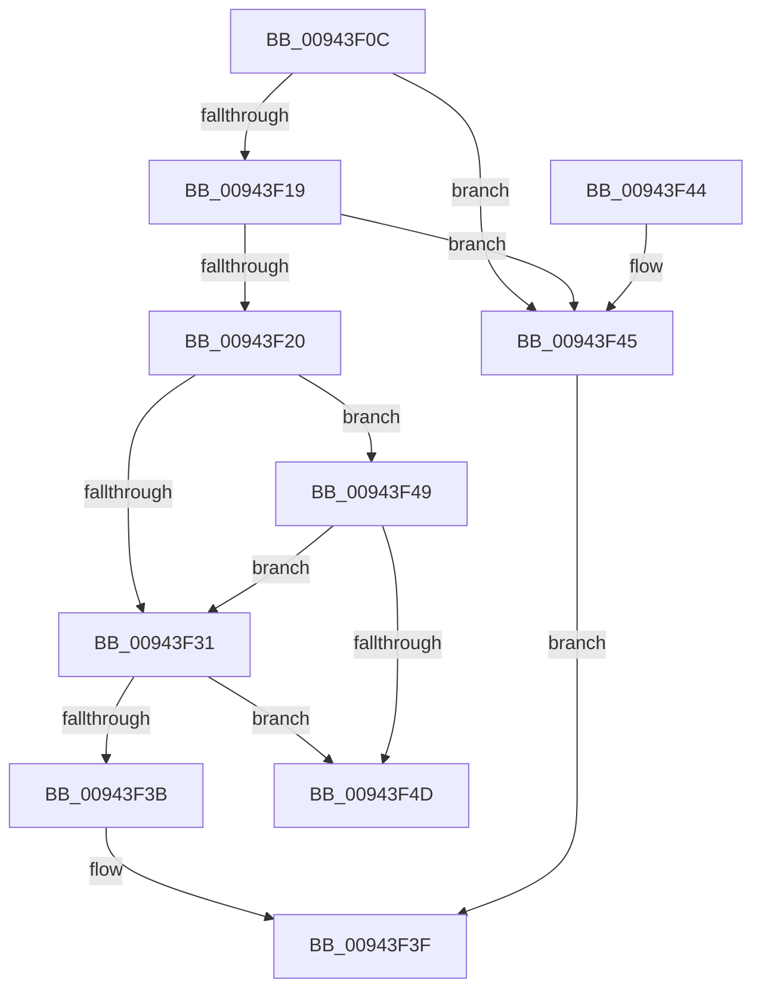

# RtlpGetFunctionOverrideIndex

- RVA: `0x00943F0C`–`0x00943F53` (길이 `71` bytes)
- VA: `0x0000000140943F0C`
- 실행 섹션: `PAGE`
- PDB 이름 있음: `예`; PDB Function 태그: `아니요`
- unwind 정보 RVA: `0x00064C74`
- 디코드: `27`개 명령, `71/71` bytes 표시
- 미해석 바이트: `0` (있으면 어셈블리에 `.byte`로 보존)

> 이 문서는 커널 이미지의 기계어와 PDB 기호를 분석해 생성했습니다. 4번과 5번은 함수 원형과 자료형을 바이너리 사용 방식에서 추정한 C 해석이며 원본 소스 복구 결과는 아닙니다.

## 1. Dependencies

- 직접 호출 지점: **1**; 고유 호출 대상: **1**
- 직접 호출자로 확인된 함수: **2**
- RIP 상대 이미지 참조: **0**

### Outgoing calls
- `0x00943F4D` → [gsl::details::terminate](../../text/4F/gsl_details_terminate_function_004F9AA0.md) (function, `0x004F9AA0`)

### Direct callers
- [RtlpSortAndValidateRelocations](RtlpSortAndValidateRelocations_function_009439BC.md) at `0x009439E0`
- [RtlpRecordFunctionOverrideRelocation](RtlpRecordFunctionOverrideRelocation_function_00943D84.md) at `0x00943E12`
- [RtlpRecordFunctionOverrideRelocation](RtlpRecordFunctionOverrideRelocation_function_00943D84.md) at `0x00943EB6`

### Static image references
- 디코드된 RIP-relative 메모리 참조가 없습니다.

## 2. Other-region calls and transfers

- 다른 실행 섹션으로 향하는 call: **1**
  - `0x00943F4D` → [gsl::details::terminate](../../text/4F/gsl_details_terminate_function_004F9AA0.md) (`PAGE` → `.text`)
- 별도 외부 분기/꼬리 이동을 확인하지 못했습니다.

## 3. Assembly (complete function range)

```asm
00943F0C  48 83 EC 28                     sub rsp, 0x28
00943F10  44 8B 41 20                     mov r8d, dword ptr [rcx + 0x20]
00943F14  41 3B D0                        cmp edx, r8d
00943F17  72 2C                           jb 0x140943f45
00943F19  8B 41 24                        mov eax, dword ptr [rcx + 0x24]
00943F1C  3B D0                           cmp edx, eax
00943F1E  77 25                           ja 0x140943f45
00943F20  4C 8B 51 18                     mov r10, qword ptr [rcx + 0x18]
00943F24  41 2B C0                        sub eax, r8d
00943F27  FF C0                           inc eax
00943F29  44 8B C8                        mov r9d, eax
00943F2C  4D 85 D2                        test r10, r10
00943F2F  74 18                           je 0x140943f49
00943F31  41 2B D0                        sub edx, r8d
00943F34  8B C2                           mov eax, edx
00943F36  49 3B C1                        cmp rax, r9
00943F39  73 12                           jae 0x140943f4d
00943F3B  49 8B 04 D2                     mov rax, qword ptr [r10 + rdx*8]
00943F3F  48 83 C4 28                     add rsp, 0x28
00943F43  C3                              ret
00943F44  CC                              int3
00943F45  33 C0                           xor eax, eax
00943F47  EB F6                           jmp 0x140943f3f
00943F49  85 C0                           test eax, eax
00943F4B  74 E4                           je 0x140943f31
00943F4D  E8 4E 5B BB FF                  call 0x1404f9aa0
00943F52  CC                              int3
```

## 4. C-style interpretation (structured pseudocode)

```c
__int64 __fastcall RtlpGetFunctionOverrideIndex(__int64 a1, int a2)
{
    __int64 result;
    __int64 v_rsp;

    v_rsp = (v_rsp) - (40);
    if (a2 < ((unsigned int)((unsigned int)(*(unsigned int *)(a1 + 32))))) goto loc_00943F45;
    if (a2 > ((unsigned int)((unsigned int)(*(unsigned int *)(a1 + 36))))) goto loc_00943F45;
    result = (unsigned int)(((unsigned int)(*(unsigned int *)(a1 + 36))) - ((unsigned int)((unsigned int)(*(unsigned int *)(a1 + 32)))));
    result = (unsigned int)((result) + 1);
    if (*(unsigned __int64 *)(a1 + 24) == 0) goto loc_00943F49;
loc_00943F31:
    a2 = (unsigned int)((a2) - ((unsigned int)((unsigned int)(*(unsigned int *)(a1 + 32)))));
    if (((unsigned int)(a2)) >= ((unsigned int)((unsigned int)(result)))) goto loc_00943F4D;
loc_00943F3F:
    v_rsp = (v_rsp) + (40);
    return *(unsigned __int64 *)(*(unsigned __int64 *)(a1 + 24) + a2 * 8);
loc_00943F45:
    result = 0;
    goto loc_00943F3F;
loc_00943F49:
    if (0 == 0) goto loc_00943F31;
loc_00943F4D:
    result = gsl__details__terminate(a1, a2, (unsigned int)(*(unsigned int *)(a1 + 32)), (unsigned int)((unsigned int)(result)));
    return result;
}
```

## 5. (Beta) C Style

```c
int64_t RtlpGetFunctionOverrideIndex(void *Arg1, int32_t Arg2)
{
    uint8_t *arg1 = (uint8_t *)Arg1;

    int64_t result;
    int64_t local_rsp;

    local_rsp = (local_rsp) - (40);
    if (Arg2 < ((uint32_t)((uint32_t)(*(uint32_t *)(arg1 + 0x20))))) goto loc_00943F45;
    if (Arg2 > ((uint32_t)((uint32_t)(*(uint32_t *)(arg1 + 0x24))))) goto loc_00943F45;
    result = (uint32_t)(((uint32_t)(*(uint32_t *)(arg1 + 0x24))) - ((uint32_t)((uint32_t)(*(uint32_t *)(arg1 + 0x20)))));
    result = (uint32_t)((result) + 1);
    if (*(uint64_t *)(arg1 + 0x18) == 0) goto loc_00943F49;
loc_00943F31:
    Arg2 = (uint32_t)((Arg2) - ((uint32_t)((uint32_t)(*(uint32_t *)(arg1 + 0x20)))));
    if (((uint32_t)(Arg2)) >= ((uint32_t)((uint32_t)(result)))) goto loc_00943F4D;
loc_00943F3F:
    local_rsp = (local_rsp) + (40);
    return *(uint64_t *)(*(uint64_t *)(arg1 + 0x18) + Arg2 * 8);
loc_00943F45:
    result = 0;
    goto loc_00943F3F;
loc_00943F49:
    if (0 == 0) goto loc_00943F31;
loc_00943F4D:
    result = gsl__details__terminate(Arg1, Arg2, (uint32_t)(*(uint32_t *)(arg1 + 0x20)), (uint32_t)((uint32_t)(result)));
    return result;
}
```

### 관측된 메모리 오프셋

구조체 형식이 확인되지 않은 접근은 인자 기준의 오프셋으로만 기록했습니다.

| 기준 인자 | 오프셋 표현 | 폭 (bit) | 접근 |
|---|---:|---:|---|
| `Arg1` | `+ 0x18` | `64` | `R` |
| `Arg1` | `+ 0x20` | `32` | `R` |
| `Arg1` | `+ 0x24` | `32` | `R` |

## 6. Execution-region graph

[열기: 2D/3D 그래프와 함수 탐색 컨트롤 패널](../../../control-panel.html?section=page&rva=0x00943F0C&view=graph)

- 2D 그래프는 위에서 아래로 흐르고, 3D 그래프는 빈 공간을 드래그해 회전합니다. Shift+드래그는 이동, 휠은 확대·축소, 함수 노드 선택은 대상 보고서 이동입니다.

### Static fallback


