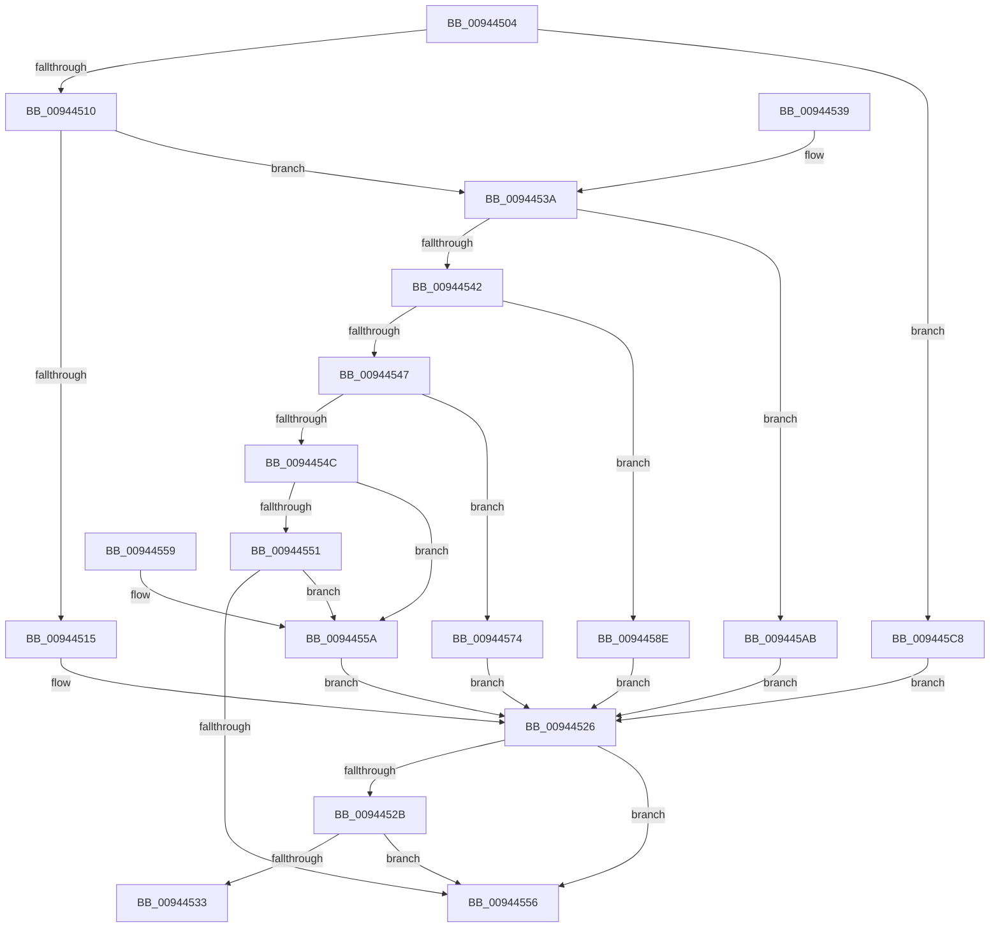

# RtlpGetSystemOverrideRva

- RVA: `0x00944504`–`0x009445E5` (길이 `225` bytes)
- VA: `0x0000000140944504`
- 실행 섹션: `PAGE`
- PDB 이름 있음: `예`; PDB Function 태그: `아니요`
- unwind 정보 RVA: `0x000DB714`
- 디코드: `83`개 명령, `225/225` bytes 표시
- 미해석 바이트: `0` (있으면 어셈블리에 `.byte`로 보존)

> 이 문서는 커널 이미지의 기계어와 PDB 기호를 분석해 생성했습니다. 4번과 5번은 함수 원형과 자료형을 바이너리 사용 방식에서 추정한 C 해석이며 원본 소스 복구 결과는 아닙니다.

## 1. Dependencies

- 직접 호출 지점: **0**; 고유 호출 대상: **0**
- 직접 호출자로 확인된 함수: **1**
- RIP 상대 이미지 참조: **0**

### Outgoing calls
- 직접 디코드된 call 명령이 없습니다.

### Direct callers
- [RtlpSelectFunctionFromBinaryDecisionDiagram](RtlpSelectFunctionFromBinaryDecisionDiagram_function_0094417C.md) at `0x00944235`

### Static image references
- 디코드된 RIP-relative 메모리 참조가 없습니다.

## 2. Other-region calls and transfers

- 다른 실행 섹션으로 향하는 call: **0**
- 별도 외부 분기/꼬리 이동을 확인하지 못했습니다.

## 3. Assembly (complete function range)

```asm
00944504  81 E9 41 01 00 00               sub ecx, 0x141
0094450A  0F 84 B8 00 00 00               je 0x1409445c8
00944510  83 E9 01                        sub ecx, 1
00944513  75 25                           jne 0x14094453a
00944515  8A C2                           mov al, dl
00944517  F6 D8                           neg al
00944519  1B C9                           sbb ecx, ecx
0094451B  83 E1 04                        and ecx, 4
0094451E  F6 DA                           neg dl
00944520  48 1B C0                        sbb rax, rax
00944523  83 E0 04                        and eax, 4
00944526  83 F9 0F                        cmp ecx, 0xf
00944529  74 2B                           je 0x140944556
0094452B  41 8B 0C 80                     mov ecx, dword ptr [r8 + rax*4]
0094452F  85 C9                           test ecx, ecx
00944531  74 23                           je 0x140944556
00944533  41 89 09                        mov dword ptr [r9], ecx
00944536  B0 01                           mov al, 1
00944538  C3                              ret
00944539  CC                              int3
0094453A  81 E9 D9 FE 00 00               sub ecx, 0xfed9
00944540  74 69                           je 0x1409445ab
00944542  83 E9 01                        sub ecx, 1
00944545  74 47                           je 0x14094458e
00944547  83 E9 01                        sub ecx, 1
0094454A  74 28                           je 0x140944574
0094454C  83 E9 01                        sub ecx, 1
0094454F  74 09                           je 0x14094455a
00944551  83 F9 01                        cmp ecx, 1
00944554  74 04                           je 0x14094455a
00944556  32 C0                           xor al, al
00944558  C3                              ret
00944559  CC                              int3
0094455A  8A C2                           mov al, dl
0094455C  F6 D8                           neg al
0094455E  1B C9                           sbb ecx, ecx
00944560  83 E1 03                        and ecx, 3
00944563  83 C1 0C                        add ecx, 0xc
00944566  F6 DA                           neg dl
00944568  48 1B C0                        sbb rax, rax
0094456B  83 E0 03                        and eax, 3
0094456E  48 83 C0 0C                     add rax, 0xc
00944572  EB B2                           jmp 0x140944526
00944574  8A C2                           mov al, dl
00944576  F6 D8                           neg al
00944578  1B C9                           sbb ecx, ecx
0094457A  83 E1 05                        and ecx, 5
0094457D  83 C1 0A                        add ecx, 0xa
00944580  F6 DA                           neg dl
00944582  48 1B C0                        sbb rax, rax
00944585  83 E0 05                        and eax, 5
00944588  48 83 C0 0A                     add rax, 0xa
0094458C  EB 98                           jmp 0x140944526
0094458E  8A C2                           mov al, dl
00944590  F6 D8                           neg al
00944592  1B C9                           sbb ecx, ecx
00944594  83 E1 07                        and ecx, 7
00944597  83 C1 06                        add ecx, 6
0094459A  F6 DA                           neg dl
0094459C  48 1B C0                        sbb rax, rax
0094459F  83 E0 07                        and eax, 7
009445A2  48 83 C0 06                     add rax, 6
009445A6  E9 7B FF FF FF                  jmp 0x140944526
009445AB  8A C2                           mov al, dl
009445AD  F6 D8                           neg al
009445AF  1B C9                           sbb ecx, ecx
009445B1  83 E1 06                        and ecx, 6
009445B4  83 C1 08                        add ecx, 8
009445B7  F6 DA                           neg dl
009445B9  48 1B C0                        sbb rax, rax
009445BC  83 E0 06                        and eax, 6
009445BF  48 83 C0 08                     add rax, 8
009445C3  E9 5E FF FF FF                  jmp 0x140944526
009445C8  8A C2                           mov al, dl
009445CA  F6 D8                           neg al
009445CC  1B C9                           sbb ecx, ecx
009445CE  83 E1 03                        and ecx, 3
009445D1  83 C1 02                        add ecx, 2
009445D4  F6 DA                           neg dl
009445D6  48 1B C0                        sbb rax, rax
009445D9  83 E0 03                        and eax, 3
009445DC  48 83 C0 02                     add rax, 2
009445E0  E9 41 FF FF FF                  jmp 0x140944526
```

## 4. C-style interpretation (structured pseudocode)

```c
__int64 __fastcall RtlpGetSystemOverrideRva(int a1, unsigned __int8 a2, __int64 a3, __int64 a4)
{
    __int64 result;

    a1 = (unsigned int)((a1) - (321));
    if (condition_is_equal) goto loc_009445C8;
    a1 = (unsigned int)((a1) - (1));
    if (condition_is_not_equal) goto loc_0094453A;
    result = (unsigned __int8)(-(a2));
    a1 = (unsigned int)((a1) & (4));
    a2 = (unsigned __int8)(-(a2));
    result = (unsigned int)((result) & (4));
loc_00944526:
    if (a1 == 15) goto loc_00944556;
    if ((unsigned int)((unsigned int)(*(unsigned int *)(a3 + result * 4))) == 0) goto loc_00944556;
    *(unsigned int *)(a4) = (unsigned int)((unsigned int)(*(unsigned int *)(a3 + result * 4)));
    return 1;
loc_0094453A:
    a1 = (unsigned int)(((unsigned int)(*(unsigned int *)(a3 + result * 4))) - (0xFED9ULL));
    if (condition_is_equal) goto loc_009445AB;
    a1 = (unsigned int)((a1) - (1));
    if (condition_is_equal) goto loc_0094458E;
    a1 = (unsigned int)((a1) - (1));
    if (condition_is_equal) goto loc_00944574;
    a1 = (unsigned int)((a1) - (1));
    if (condition_is_equal) goto loc_0094455A;
    if (a1 == 1) goto loc_0094455A;
loc_00944556:
    result = 0;
    return result;
loc_0094455A:
    result = (unsigned __int8)(-(a2));
    a1 = (unsigned int)((a1) & (3));
    a1 = (unsigned int)((a1) + (12));
    a2 = (unsigned __int8)(-(a2));
    result = (unsigned int)((result) & (3));
    result = (result) + (12);
    goto loc_00944526;
loc_00944574:
    result = (unsigned __int8)(-(a2));
    a1 = (unsigned int)((a1) & (5));
    a1 = (unsigned int)((a1) + (10));
    a2 = (unsigned __int8)(-(a2));
    result = (unsigned int)((result) & (5));
    result = (result) + (10);
    goto loc_00944526;
loc_0094458E:
    result = (unsigned __int8)(-(a2));
    a1 = (unsigned int)((a1) & (7));
    a1 = (unsigned int)((a1) + (6));
    a2 = (unsigned __int8)(-(a2));
    result = (unsigned int)((result) & (7));
    result = (result) + (6);
    goto loc_00944526;
loc_009445AB:
    result = (unsigned __int8)(-(a2));
    a1 = (unsigned int)((a1) & (6));
    a1 = (unsigned int)((a1) + (8));
    a2 = (unsigned __int8)(-(a2));
    result = (unsigned int)((result) & (6));
    result = (result) + (8);
    goto loc_00944526;
loc_009445C8:
    result = (unsigned __int8)(-(a2));
    a1 = (unsigned int)((a1) & (3));
    a1 = (unsigned int)((a1) + (2));
    a2 = (unsigned __int8)(-(a2));
    result = (unsigned int)((result) & (3));
    result = (result) + (2);
    goto loc_00944526;
}
```

## 5. (Beta) C Style

```c
int64_t RtlpGetSystemOverrideRva(int32_t Arg1, uint8_t Arg2, void *Arg3, void *Arg4)
{
    uint8_t *arg3 = (uint8_t *)Arg3;
    uint8_t *arg4 = (uint8_t *)Arg4;

    int64_t result;

    Arg1 = (uint32_t)((Arg1) - (321));
    if (condition_is_equal) goto loc_009445C8;
    Arg1 = (uint32_t)((Arg1) - (1));
    if (condition_is_not_equal) goto loc_0094453A;
    result = (uint8_t)(-(Arg2));
    Arg1 = (uint32_t)((Arg1) & (4));
    Arg2 = (uint8_t)(-(Arg2));
    result = (uint32_t)((result) & (4));
loc_00944526:
    if (Arg1 == 15) goto loc_00944556;
    if ((uint32_t)((uint32_t)(*(uint32_t *)(arg3 + result * 4))) == 0) goto loc_00944556;
    *(uint32_t *)(arg4) = (uint32_t)((uint32_t)(*(uint32_t *)(arg3 + result * 4)));
    return 1;
loc_0094453A:
    Arg1 = (uint32_t)(((uint32_t)(*(uint32_t *)(arg3 + result * 4))) - (0xFED9ULL));
    if (condition_is_equal) goto loc_009445AB;
    Arg1 = (uint32_t)((Arg1) - (1));
    if (condition_is_equal) goto loc_0094458E;
    Arg1 = (uint32_t)((Arg1) - (1));
    if (condition_is_equal) goto loc_00944574;
    Arg1 = (uint32_t)((Arg1) - (1));
    if (condition_is_equal) goto loc_0094455A;
    if (Arg1 == 1) goto loc_0094455A;
loc_00944556:
    result = 0;
    return result;
loc_0094455A:
    result = (uint8_t)(-(Arg2));
    Arg1 = (uint32_t)((Arg1) & (3));
    Arg1 = (uint32_t)((Arg1) + (12));
    Arg2 = (uint8_t)(-(Arg2));
    result = (uint32_t)((result) & (3));
    result = (result) + (12);
    goto loc_00944526;
loc_00944574:
    result = (uint8_t)(-(Arg2));
    Arg1 = (uint32_t)((Arg1) & (5));
    Arg1 = (uint32_t)((Arg1) + (10));
    Arg2 = (uint8_t)(-(Arg2));
    result = (uint32_t)((result) & (5));
    result = (result) + (10);
    goto loc_00944526;
loc_0094458E:
    result = (uint8_t)(-(Arg2));
    Arg1 = (uint32_t)((Arg1) & (7));
    Arg1 = (uint32_t)((Arg1) + (6));
    Arg2 = (uint8_t)(-(Arg2));
    result = (uint32_t)((result) & (7));
    result = (result) + (6);
    goto loc_00944526;
loc_009445AB:
    result = (uint8_t)(-(Arg2));
    Arg1 = (uint32_t)((Arg1) & (6));
    Arg1 = (uint32_t)((Arg1) + (8));
    Arg2 = (uint8_t)(-(Arg2));
    result = (uint32_t)((result) & (6));
    result = (result) + (8);
    goto loc_00944526;
loc_009445C8:
    result = (uint8_t)(-(Arg2));
    Arg1 = (uint32_t)((Arg1) & (3));
    Arg1 = (uint32_t)((Arg1) + (2));
    Arg2 = (uint8_t)(-(Arg2));
    result = (uint32_t)((result) & (3));
    result = (result) + (2);
    goto loc_00944526;
}
```

### 관측된 메모리 오프셋

구조체 형식이 확인되지 않은 접근은 인자 기준의 오프셋으로만 기록했습니다.

| 기준 인자 | 오프셋 표현 | 폭 (bit) | 접근 |
|---|---:|---:|---|
| `Arg3` | `+ 0x0 + rax*4` | `32` | `R` |
| `Arg4` | `+ 0x0` | `32` | `W` |

## 6. Execution-region graph

[열기: 2D/3D 그래프와 함수 탐색 컨트롤 패널](../../../control-panel.html?section=page&rva=0x00944504&view=graph)

- 2D 그래프는 위에서 아래로 흐르고, 3D 그래프는 빈 공간을 드래그해 회전합니다. Shift+드래그는 이동, 휠은 확대·축소, 함수 노드 선택은 대상 보고서 이동입니다.

### Static fallback


