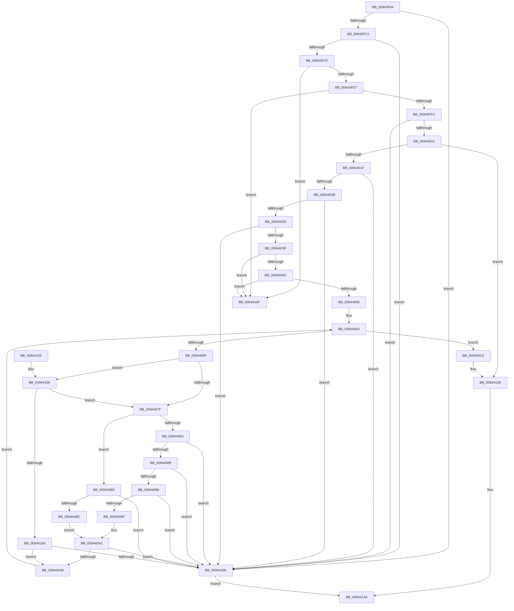

# RtlpParseBinaryDecisionDiagram

- RVA: `0x00943F94`–`0x00944175` (길이 `481` bytes)
- VA: `0x0000000140943F94`
- 실행 섹션: `PAGE`
- PDB 이름 있음: `예`; PDB Function 태그: `아니요`
- unwind 정보 RVA: `0x000905DC`
- 디코드: `118`개 명령, `481/481` bytes 표시
- 미해석 바이트: `0` (있으면 어셈블리에 `.byte`로 보존)

> 이 문서는 커널 이미지의 기계어와 PDB 기호를 분석해 생성했습니다. 4번과 5번은 함수 원형과 자료형을 바이너리 사용 방식에서 추정한 C 해석이며 원본 소스 복구 결과는 아닙니다.

## 1. Dependencies

- 직접 호출 지점: **3**; 고유 호출 대상: **2**
- 직접 호출자로 확인된 함수: **1**
- RIP 상대 이미지 참조: **0**

### Outgoing calls
- `0x00944100` → [RtlpSelectFunctionFromBinaryDecisionDiagram](RtlpSelectFunctionFromBinaryDecisionDiagram_function_0094417C.md) (function, `0x0094417C`)
- `0x00944133` → [RtlpSelectFunctionFromBinaryDecisionDiagram](RtlpSelectFunctionFromBinaryDecisionDiagram_function_0094417C.md) (function, `0x0094417C`)
- `0x0094416F` → [gsl::details::terminate](../../text/4F/gsl_details_terminate_function_004F9AA0.md) (function, `0x004F9AA0`)

### Direct callers
- [RtlpCreateFunctionOverrideFixupInfo](RtlpCreateFunctionOverrideFixupInfo_function_009433D8.md) at `0x0094390F`

### Static image references
- 디코드된 RIP-relative 메모리 참조가 없습니다.

## 2. Other-region calls and transfers

- 다른 실행 섹션으로 향하는 call: **1**
  - `0x0094416F` → [gsl::details::terminate](../../text/4F/gsl_details_terminate_function_004F9AA0.md) (`PAGE` → `.text`)
- 별도 외부 분기/꼬리 이동을 확인하지 못했습니다.

## 3. Assembly (complete function range)

```asm
00943F94  48 8B C4                        mov rax, rsp
00943F97  48 89 58 08                     mov qword ptr [rax + 8], rbx
00943F9B  48 89 68 10                     mov qword ptr [rax + 0x10], rbp
00943F9F  48 89 70 18                     mov qword ptr [rax + 0x18], rsi
00943FA3  57                              push rdi
00943FA4  48 83 EC 70                     sub rsp, 0x70
00943FA8  0F 29 70 E8                     movaps xmmword ptr [rax - 0x18], xmm6
00943FAC  49 8B F1                        mov rsi, r9
00943FAF  48 8B 01                        mov rax, qword ptr [rcx]
00943FB2  48 8B FA                        mov rdi, rdx
00943FB5  45 8B D0                        mov r10d, r8d
00943FB8  48 83 F8 08                     cmp rax, 8
00943FBC  0F 82 A6 01 00 00               jb 0x140944168
00943FC2  48 83 C0 F8                     add rax, -8
00943FC6  49 3B C2                        cmp rax, r10
00943FC9  0F 82 99 01 00 00               jb 0x140944168
00943FCF  48 8B 41 08                     mov rax, qword ptr [rcx + 8]
00943FD3  48 8B 11                        mov rdx, qword ptr [rcx]
00943FD6  4E 8D 04 10                     lea r8, [rax + r10]
00943FDA  49 83 C2 08                     add r10, 8
00943FDE  49 3B D2                        cmp rdx, r10
00943FE1  0F 82 88 01 00 00               jb 0x14094416f
00943FE7  49 2B D2                        sub rdx, r10
00943FEA  49 03 C2                        add rax, r10
00943FED  48 89 54 24 40                  mov qword ptr [rsp + 0x40], rdx
00943FF2  48 83 FA FF                     cmp rdx, -1
00943FF6  0F 84 73 01 00 00               je 0x14094416f
00943FFC  48 89 44 24 48                  mov qword ptr [rsp + 0x48], rax
00944001  33 ED                           xor ebp, ebp
00944003  0F 10 44 24 40                  movups xmm0, xmmword ptr [rsp + 0x40]
00944008  F3 0F 7F 01                     movdqu xmmword ptr [rcx], xmm0
0094400C  4D 85 C0                        test r8, r8
0094400F  0F 84 53 01 00 00               je 0x140944168
00944015  41 83 38 01                     cmp dword ptr [r8], 1
00944019  0F 85 19 01 00 00               jne 0x140944138
0094401F  41 8B 40 04                     mov eax, dword ptr [r8 + 4]
00944023  85 C0                           test eax, eax
00944025  0F 84 3D 01 00 00               je 0x140944168
0094402B  A8 07                           test al, 7
0094402D  0F 85 35 01 00 00               jne 0x140944168
00944033  44 8B C0                        mov r8d, eax
00944036  48 3B 01                        cmp rax, qword ptr [rcx]
00944039  0F 87 29 01 00 00               ja 0x140944168
0094403F  48 8B 49 08                     mov rcx, qword ptr [rcx + 8]
00944043  48 85 C9                        test rcx, rcx
00944046  0F 84 23 01 00 00               je 0x14094416f
0094404C  41 F6 C0 07                     test r8b, 7
00944050  0F 85 19 01 00 00               jne 0x14094416f
00944056  49 C1 E8 03                     shr r8, 3
0094405A  8B D5                           mov edx, ebp
0094405C  4C 89 44 24 40                  mov qword ptr [rsp + 0x40], r8
00944061  48 89 4C 24 48                  mov qword ptr [rsp + 0x48], rcx
00944066  4E 8D 1C C1                     lea r11, [rcx + r8*8]
0094406A  49 3B CB                        cmp rcx, r11
0094406D  74 56                           je 0x1409440c5
0094406F  0F B7 01                        movzx eax, word ptr [rcx]
00944072  4C 8D 49 02                     lea r9, [rcx + 2]
00944076  66 85 C0                        test ax, ax
00944079  0F 84 D7 00 00 00               je 0x140944156
0094407F  3B C2                           cmp eax, edx
00944081  74 2D                           je 0x1409440b0
00944083  0F 86 DF 00 00 00               jbe 0x140944168
00944089  45 0F B7 11                     movzx r10d, word ptr [r9]
0094408D  44 3B D2                        cmp r10d, edx
00944090  0F 86 D2 00 00 00               jbe 0x140944168
00944096  49 3B C0                        cmp rax, r8
00944099  0F 83 C9 00 00 00               jae 0x140944168
0094409F  4D 3B D0                        cmp r10, r8
009440A2  0F 83 C0 00 00 00               jae 0x140944168
009440A8  FF C2                           inc edx
009440AA  48 83 C1 08                     add rcx, 8
009440AE  EB BA                           jmp 0x14094406a
009440B0  41 0F B7 01                     movzx eax, word ptr [r9]
009440B4  3B C2                           cmp eax, edx
009440B6  0F 85 AC 00 00 00               jne 0x140944168
009440BC  41 8B 41 02                     mov eax, dword ptr [r9 + 2]
009440C0  48 3B 07                        cmp rax, qword ptr [rdi]
009440C3  EB DD                           jmp 0x1409440a2
009440C5  0F 28 07                        movaps xmm0, xmmword ptr [rdi]
009440C8  48 8D 54 24 50                  lea rdx, [rsp + 0x50]
009440CD  0F 28 74 24 40                  movaps xmm6, xmmword ptr [rsp + 0x40]
009440D2  48 8D 4C 24 40                  lea rcx, [rsp + 0x40]
009440D7  48 8B 9C 24 A8 00 00 00         mov rbx, qword ptr [rsp + 0xa8]
009440DF  4C 8B CE                        mov r9, rsi
009440E2  4C 8B 84 24 A0 00 00 00         mov r8, qword ptr [rsp + 0xa0]
009440EA  48 89 5C 24 28                  mov qword ptr [rsp + 0x28], rbx
009440EF  C6 44 24 20 01                  mov byte ptr [rsp + 0x20], 1
009440F4  66 0F 7F 44 24 50               movdqa xmmword ptr [rsp + 0x50], xmm0
009440FA  66 0F 7F 74 24 40               movdqa xmmword ptr [rsp + 0x40], xmm6
00944100  E8 77 00 00 00                  call 0x14094417c
00944105  0F 28 07                        movaps xmm0, xmmword ptr [rdi]
00944108  48 8D 54 24 50                  lea rdx, [rsp + 0x50]
0094410D  4C 8B 84 24 A0 00 00 00         mov r8, qword ptr [rsp + 0xa0]
00944115  48 8D 4C 24 40                  lea rcx, [rsp + 0x40]
0094411A  48 89 5C 24 28                  mov qword ptr [rsp + 0x28], rbx
0094411F  4C 8B CE                        mov r9, rsi
00944122  66 0F 7F 44 24 50               movdqa xmmword ptr [rsp + 0x50], xmm0
00944128  66 0F 7F 74 24 40               movdqa xmmword ptr [rsp + 0x40], xmm6
0094412E  40 88 6C 24 20                  mov byte ptr [rsp + 0x20], bpl
00944133  E8 44 00 00 00                  call 0x14094417c
00944138  33 C0                           xor eax, eax
0094413A  0F 28 74 24 60                  movaps xmm6, xmmword ptr [rsp + 0x60]
0094413F  4C 8D 5C 24 70                  lea r11, [rsp + 0x70]
00944144  49 8B 5B 10                     mov rbx, qword ptr [r11 + 0x10]
00944148  49 8B 6B 18                     mov rbp, qword ptr [r11 + 0x18]
0094414C  49 8B 73 20                     mov rsi, qword ptr [r11 + 0x20]
00944150  49 8B E3                        mov rsp, r11
00944153  5F                              pop rdi
00944154  C3                              ret
00944155  CC                              int3
00944156  66 41 39 29                     cmp word ptr [r9], bp
0094415A  0F 85 1F FF FF FF               jne 0x14094407f
00944160  85 D2                           test edx, edx
00944162  0F 85 40 FF FF FF               jne 0x1409440a8
00944168  B8 7B 00 00 C0                  mov eax, 0xc000007b
0094416D  EB CB                           jmp 0x14094413a
0094416F  E8 2C 59 BB FF                  call 0x1404f9aa0
00944174  CC                              int3
```

## 4. C-style interpretation (structured pseudocode)

```c
__int64 __fastcall RtlpParseBinaryDecisionDiagram(__int64 a1, __int64 a2, int a3, __int64 a4, __int64 a5, __int64 a6)
{
    __int64 result;
    __int64 v_r10;
    __int64 v_rbp;
    __int64 v_rsp;
    unsigned __int64 v_stack_m18;
    unsigned __int64 v_stack_m28;
    unsigned __int64 v_stack_m30;
    unsigned __int64 v_stack_m38;
    unsigned __int64 v_stack_m50;
    unsigned __int8 v_stack_m58;
    unsigned __int64 v_stack_m8;

    *(unsigned __int64 *)(v_rsp + 8) = v_rbx;
    *(unsigned __int64 *)(v_rsp + 16) = v_rbp;
    *(unsigned __int64 *)(v_rsp + 24) = v_rsi;
    v_rsp = (v_rsp) - (112);
    *(unsigned __int64 *)(v_rsp - 24) = v_xmm6;
    if ((*(unsigned __int64 *)(a1)) < 8) goto loc_00944168;
    result = (*(unsigned __int64 *)(a1)) + (-8);
    if (result < ((unsigned int)(a3))) goto loc_00944168;
    v_r10 = ((unsigned int)(a3)) + (8);
    if ((*(unsigned __int64 *)(a1)) < v_r10) goto loc_0094416F;
    a2 = (*(unsigned __int64 *)(a1)) - (v_r10);
    result = (*(unsigned __int64 *)(a1 + 8)) + (v_r10);
    v_stack_m38 = a2;
    if (a2 == -1) goto loc_0094416F;
    v_stack_m30 = result;
    v_rbp = 0;
    *(unsigned __int64 *)(a1) = v_xmm0;
    if (*(unsigned __int64 *)(a1 + 8) + (unsigned int)(a3) * 1 == 0) goto loc_00944168;
    if ((*(unsigned int *)(*(unsigned __int64 *)(a1 + 8) + (unsigned int)(a3) * 1)) != 1) goto loc_00944138;
    if ((unsigned int)((unsigned int)(*(unsigned int *)(*(unsigned __int64 *)(a1 + 8) + (unsigned int)(a3) * 1 + 4))) == 0) goto loc_00944168;
    if ((((unsigned __int8)((unsigned int)(*(unsigned int *)(*(unsigned __int64 *)(a1 + 8) + (unsigned int)(a3) * 1 + 4)))) & (7)) != 0) goto loc_00944168;
    if (((unsigned int)(*(unsigned int *)(*(unsigned __int64 *)(a1 + 8) + (unsigned int)(a3) * 1 + 4))) > (*(unsigned __int64 *)(a1))) goto loc_00944168;
    if (*(unsigned __int64 *)(a1 + 8) == 0) goto loc_0094416F;
    if ((((unsigned __int8)((unsigned int)((unsigned int)((unsigned int)(*(unsigned int *)(*(unsigned __int64 *)(a1 + 8) + (unsigned int)(a3) * 1 + 4)))))) & (7)) != 0) goto loc_0094416F;
    a3 = ((unsigned int)((unsigned int)((unsigned int)(*(unsigned int *)(*(unsigned __int64 *)(a1 + 8) + (unsigned int)(a3) * 1 + 4))))) >> (3);
    v_stack_m38 = a3;
    v_stack_m30 = *(unsigned __int64 *)(a1 + 8);
loc_0094406A:
    if ((*(unsigned __int64 *)(a1 + 8)) == (*(unsigned __int64 *)(a1 + 8) + a3 * 8)) goto loc_009440C5;
    if ((unsigned __int16)(*(unsigned __int16 *)(*(unsigned __int64 *)(a1 + 8))) == 0) goto loc_00944156;
loc_0094407F:
    if (((unsigned int)(*(unsigned __int16 *)(*(unsigned __int64 *)(a1 + 8)))) == 0) goto loc_009440B0;
    if (((unsigned int)(*(unsigned __int16 *)(*(unsigned __int64 *)(a1 + 8)))) <= 0) goto loc_00944168;
    if (((unsigned int)(*(unsigned __int16 *)(*(unsigned __int64 *)(a1 + 8) + 2))) <= 0) goto loc_00944168;
    if ((*(unsigned __int16 *)(*(unsigned __int64 *)(a1 + 8))) >= a3) goto loc_00944168;
loc_009440A2:
    if ((*(unsigned __int16 *)(*(unsigned __int64 *)(a1 + 8) + 2)) >= a3) goto loc_00944168;
loc_009440A8:
    a2 = (unsigned int)((0) + 1);
    a1 = (*(unsigned __int64 *)(a1 + 8)) + (8);
    goto loc_0094406A;
loc_009440B0:
    if (((unsigned int)(*(unsigned __int16 *)(*(unsigned __int64 *)(a1 + 8) + 2))) != ((unsigned int)(a2))) goto loc_00944168;
    goto loc_009440A2;
loc_009440C5:
    v_stack_m50 = a6;
    v_stack_m58 = 1;
    v_stack_m28 = v_xmm0;
    v_stack_m38 = v_xmm6;
    result = RtlpSelectFunctionFromBinaryDecisionDiagram(v_stack_m38, v_stack_m28, a5, a4);
    v_stack_m50 = a6;
    v_stack_m28 = v_xmm0;
    v_stack_m38 = v_xmm6;
    v_stack_m58 = 0;
    result = RtlpSelectFunctionFromBinaryDecisionDiagram(v_stack_m38, v_stack_m28, a5, a4);
loc_00944138:
    result = 0;
loc_0094413A:
    return result;
loc_00944156:
    if ((*(unsigned __int16 *)(a4)) != ((unsigned __int16)(*(unsigned __int64 *)(v_stack_m8 + 24)))) goto loc_0094407F;
    if ((unsigned int)(v_stack_m28) != 0) goto loc_009440A8;
loc_00944168:
    goto loc_0094413A;
loc_0094416F:
    result = gsl__details__terminate(v_stack_m38, v_stack_m28, a5, a4);
    return result;
}
```

## 5. (Beta) C Style

```c
int64_t RtlpParseBinaryDecisionDiagram(void *Arg1, void *Arg2, int32_t Arg3, int64_t Arg4, int64_t Arg5, int64_t Arg6)
{
    uint8_t *arg1 = (uint8_t *)Arg1;
    uint8_t *arg2 = (uint8_t *)Arg2;

    int64_t result;
    int64_t local_r10;
    int64_t local_rbp;
    int64_t local_rsp;
    uint64_t v_stack_m18;
    uint64_t v_stack_m28;
    uint64_t v_stack_m30;
    uint64_t v_stack_m38;
    uint64_t v_stack_m50;
    uint8_t v_stack_m58;
    uint64_t v_stack_m8;

    *(uint64_t *)(local_rsp + 0x8) = local_rbx;
    *(uint64_t *)(local_rsp + 0x10) = local_rbp;
    *(uint64_t *)(local_rsp + 0x18) = local_rsi;
    local_rsp = (local_rsp) - (112);
    *(uint64_t *)(local_rsp - 0x18) = v_xmm6;
    if ((*(uint64_t *)(arg1)) < 8) goto loc_00944168;
    result = (*(uint64_t *)(arg1)) + (-8);
    if (result < ((uint32_t)(Arg3))) goto loc_00944168;
    local_r10 = ((uint32_t)(Arg3)) + (8);
    if ((*(uint64_t *)(arg1)) < local_r10) goto loc_0094416F;
    Arg2 = (*(uint64_t *)(arg1)) - (local_r10);
    result = (*(uint64_t *)(arg1 + 0x8)) + (local_r10);
    v_stack_m38 = Arg2;
    if (Arg2 == -1) goto loc_0094416F;
    v_stack_m30 = result;
    local_rbp = 0;
    *(uint64_t *)(arg1) = v_xmm0;
    if (*(uint64_t *)(arg1 + 0x8) + (uint32_t)(Arg3) * 1 == 0) goto loc_00944168;
    if ((*(uint32_t *)(*(uint64_t *)(arg1 + 0x8) + (uint32_t)(Arg3) * 1)) != 1) goto loc_00944138;
    if ((uint32_t)((uint32_t)(*(uint32_t *)(*(uint64_t *)(arg1 + 0x8) + (uint32_t)(Arg3) * 1 + 0x4))) == 0) goto loc_00944168;
    if ((((uint8_t)((uint32_t)(*(uint32_t *)(*(uint64_t *)(arg1 + 0x8) + (uint32_t)(Arg3) * 1 + 0x4)))) & (7)) != 0) goto loc_00944168;
    if (((uint32_t)(*(uint32_t *)(*(uint64_t *)(arg1 + 0x8) + (uint32_t)(Arg3) * 1 + 0x4))) > (*(uint64_t *)(arg1))) goto loc_00944168;
    if (*(uint64_t *)(arg1 + 0x8) == 0) goto loc_0094416F;
    if ((((uint8_t)((uint32_t)((uint32_t)((uint32_t)(*(uint32_t *)(*(uint64_t *)(arg1 + 0x8) + (uint32_t)(Arg3) * 1 + 0x4)))))) & (7)) != 0) goto loc_0094416F;
    Arg3 = ((uint32_t)((uint32_t)((uint32_t)(*(uint32_t *)(*(uint64_t *)(arg1 + 0x8) + (uint32_t)(Arg3) * 1 + 0x4))))) >> (3);
    v_stack_m38 = Arg3;
    v_stack_m30 = *(uint64_t *)(arg1 + 0x8);
loc_0094406A:
    if ((*(uint64_t *)(arg1 + 0x8)) == (*(uint64_t *)(arg1 + 0x8) + Arg3 * 8)) goto loc_009440C5;
    if ((uint16_t)(*(uint16_t *)(*(uint64_t *)(arg1 + 0x8))) == 0) goto loc_00944156;
loc_0094407F:
    if (((uint32_t)(*(uint16_t *)(*(uint64_t *)(arg1 + 0x8)))) == 0) goto loc_009440B0;
    if (((uint32_t)(*(uint16_t *)(*(uint64_t *)(arg1 + 0x8)))) <= 0) goto loc_00944168;
    if (((uint32_t)(*(uint16_t *)(*(uint64_t *)(arg1 + 0x8) + 0x2))) <= 0) goto loc_00944168;
    if ((*(uint16_t *)(*(uint64_t *)(arg1 + 0x8))) >= Arg3) goto loc_00944168;
loc_009440A2:
    if ((*(uint16_t *)(*(uint64_t *)(arg1 + 0x8) + 0x2)) >= Arg3) goto loc_00944168;
loc_009440A8:
    Arg2 = (uint32_t)((0) + 1);
    Arg1 = (*(uint64_t *)(arg1 + 0x8)) + (8);
    goto loc_0094406A;
loc_009440B0:
    if (((uint32_t)(*(uint16_t *)(*(uint64_t *)(arg1 + 0x8) + 0x2))) != ((uint32_t)(Arg2))) goto loc_00944168;
    goto loc_009440A2;
loc_009440C5:
    v_stack_m50 = Arg6;
    v_stack_m58 = 1;
    v_stack_m28 = v_xmm0;
    v_stack_m38 = v_xmm6;
    result = RtlpSelectFunctionFromBinaryDecisionDiagram(v_stack_m38, v_stack_m28, Arg5, Arg4);
    v_stack_m50 = Arg6;
    v_stack_m28 = v_xmm0;
    v_stack_m38 = v_xmm6;
    v_stack_m58 = 0;
    result = RtlpSelectFunctionFromBinaryDecisionDiagram(v_stack_m38, v_stack_m28, Arg5, Arg4);
loc_00944138:
    result = 0;
loc_0094413A:
    return result;
loc_00944156:
    if ((*(uint16_t *)(Arg4)) != ((uint16_t)(*(uint64_t *)(v_stack_m8 + 0x18)))) goto loc_0094407F;
    if ((uint32_t)(v_stack_m28) != 0) goto loc_009440A8;
loc_00944168:
    goto loc_0094413A;
loc_0094416F:
    result = gsl__details__terminate(v_stack_m38, v_stack_m28, Arg5, Arg4);
    return result;
}
```

### 관측된 메모리 오프셋

구조체 형식이 확인되지 않은 접근은 인자 기준의 오프셋으로만 기록했습니다.

| 기준 인자 | 오프셋 표현 | 폭 (bit) | 접근 |
|---|---:|---:|---|
| `Arg1` | `+ 0x0` | `64` | `R` |
| `Arg1` | `+ 0x0` | `128` | `W` |
| `Arg1` | `+ 0x8` | `64` | `R` |
| `Arg2` | `+ 0x0` | `64` | `R` |
| `Arg2` | `+ 0x0` | `128` | `R` |

## 6. Execution-region graph

[열기: 2D/3D 그래프와 함수 탐색 컨트롤 패널](../../../control-panel.html?section=page&rva=0x00943F94&view=graph)

- 2D 그래프는 위에서 아래로 흐르고, 3D 그래프는 빈 공간을 드래그해 회전합니다. Shift+드래그는 이동, 휠은 확대·축소, 함수 노드 선택은 대상 보고서 이동입니다.

### Static fallback


