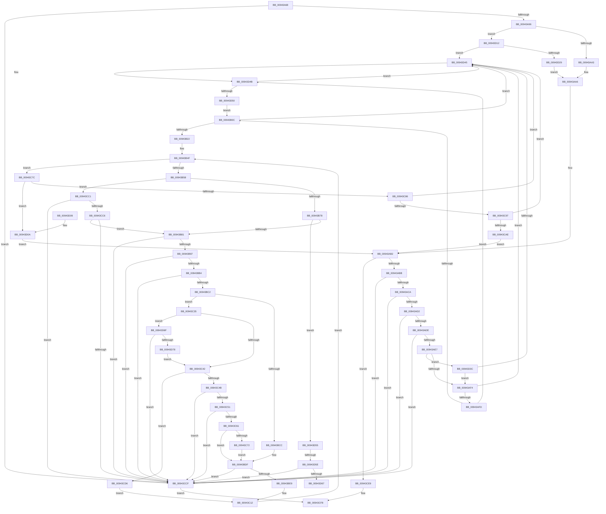

# RtlpParseFunctionOverrideRelocations

- RVA: `0x00943A68`–`0x00943D7D` (길이 `789` bytes)
- VA: `0x0000000140943A68`
- 실행 섹션: `PAGE`
- PDB 이름 있음: `예`; PDB Function 태그: `예`
- unwind 정보 RVA: `0x00090590`
- 디코드: `198`개 명령, `789/789` bytes 표시
- 미해석 바이트: `0` (있으면 어셈블리에 `.byte`로 보존)

> 이 문서는 커널 이미지의 기계어와 PDB 기호를 분석해 생성했습니다. 4번과 5번은 함수 원형과 자료형을 바이너리 사용 방식에서 추정한 C 해석이며 원본 소스 복구 결과는 아닙니다.

## 1. Dependencies

- 직접 호출 지점: **2**; 고유 호출 대상: **2**
- 직접 호출자로 확인된 함수: **1**
- RIP 상대 이미지 참조: **0**

### Outgoing calls
- `0x00943C07` → [RtlpRecordFunctionOverrideRelocation](RtlpRecordFunctionOverrideRelocation_function_00943D84.md) (function, `0x00943D84`)
- `0x00943D45` → [gsl::details::terminate](../../text/4F/gsl_details_terminate_function_004F9AA0.md) (function, `0x004F9AA0`)

### Direct callers
- [RtlpCreateFunctionOverrideFixupInfo](RtlpCreateFunctionOverrideFixupInfo_function_009433D8.md) at `0x009436EC`
- [RtlpCreateFunctionOverrideFixupInfo](RtlpCreateFunctionOverrideFixupInfo_function_009433D8.md) at `0x009438BE`

### Static image references
- 디코드된 RIP-relative 메모리 참조가 없습니다.

## 2. Other-region calls and transfers

- 다른 실행 섹션으로 향하는 call: **1**
  - `0x00943D45` → [gsl::details::terminate](../../text/4F/gsl_details_terminate_function_004F9AA0.md) (`PAGE` → `.text`)
- call이 아닌 외부 분기/꼬리 이동: **2**
  - `0x00943D58` → [sub_00B25526](../B2/Unknown_function_00B25526.md) (`tail-transfer`)
  - `0x00943D6A` → [sub_00B25526](../B2/Unknown_function_00B25526.md) (`tail-transfer`)

## 3. Assembly (complete function range)

```asm
00943A68  4C 89 4C 24 20                  mov qword ptr [rsp + 0x20], r9
00943A6D  44 89 44 24 18                  mov dword ptr [rsp + 0x18], r8d
00943A72  89 4C 24 08                     mov dword ptr [rsp + 8], ecx
00943A76  53                              push rbx
00943A77  55                              push rbp
00943A78  56                              push rsi
00943A79  57                              push rdi
00943A7A  41 54                           push r12
00943A7C  41 55                           push r13
00943A7E  41 56                           push r14
00943A80  41 57                           push r15
00943A82  48 83 EC 78                     sub rsp, 0x78
00943A86  48 8B 0A                        mov rcx, qword ptr [rdx]
00943A89  48 8B DA                        mov rbx, rdx
00943A8C  48 83 F9 0A                     cmp rcx, 0xa
00943A90  0F 82 39 02 00 00               jb 0x140943ccf
00943A96  45 33 C9                        xor r9d, r9d
00943A99  48 83 F9 08                     cmp rcx, 8
00943A9D  0F 83 6F 02 00 00               jae 0x140943d12
00943AA3  41 8B F9                        mov edi, r9d
00943AA6  41 BA FF 0F 00 00               mov r10d, 0xfff
00943AAC  41 B8 01 00 00 00               mov r8d, 1
00943AB2  48 85 FF                        test rdi, rdi
00943AB5  0F 84 2E 02 00 00               je 0x140943ce9
00943ABB  8B 47 04                        mov eax, dword ptr [rdi + 4]
00943ABE  8D 48 F8                        lea ecx, [rax - 8]
00943AC1  83 F8 08                        cmp eax, 8
00943AC4  0F 86 05 02 00 00               jbe 0x140943ccf
00943ACA  A8 03                           test al, 3
00943ACC  0F 85 FD 01 00 00               jne 0x140943ccf
00943AD2  4C 8B 33                        mov r14, qword ptr [rbx]
00943AD5  49 3B CE                        cmp rcx, r14
00943AD8  0F 87 F1 01 00 00               ja 0x140943ccf
00943ADE  44 85 17                        test dword ptr [rdi], r10d
00943AE1  0F 85 E8 01 00 00               jne 0x140943ccf
00943AE7  48 8B 73 08                     mov rsi, qword ptr [rbx + 8]
00943AEB  48 85 F6                        test rsi, rsi
00943AEE  0F 84 48 02 00 00               je 0x140943d3c
00943AF4  41 84 C8                        test r8b, cl
00943AF7  0F 85 48 02 00 00               jne 0x140943d45
00943AFD  48 8B D1                        mov rdx, rcx
00943B00  48 D1 EA                        shr rdx, 1
00943B03  48 85 F6                        test rsi, rsi
00943B06  0F 84 3F 02 00 00               je 0x140943d4b
00943B0C  4C 2B F1                        sub r14, rcx
00943B0F  48 8D 04 0E                     lea rax, [rsi + rcx]
00943B13  4C 89 74 24 48                  mov qword ptr [rsp + 0x48], r14
00943B18  49 83 FE FF                     cmp r14, -1
00943B1C  0F 84 23 02 00 00               je 0x140943d45
00943B22  48 89 44 24 50                  mov qword ptr [rsp + 0x50], rax
00943B27  45 8A D8                        mov r11b, r8b
00943B2A  0F 10 44 24 48                  movups xmm0, xmmword ptr [rsp + 0x48]
00943B2F  48 8D 04 56                     lea rax, [rsi + rdx*2]
00943B33  C6 44 24 30 FF                  mov byte ptr [rsp + 0x30], 0xff
00943B38  41 BD FF FF 00 00               mov r13d, 0xffff
00943B3E  44 88 8C 24 C8 00 00 00         mov byte ptr [rsp + 0xc8], r9b
00943B46  F3 0F 7F 03                     movdqu xmmword ptr [rbx], xmm0
00943B4A  48 89 44 24 38                  mov qword ptr [rsp + 0x38], rax
00943B4F  48 3B F0                        cmp rsi, rax
00943B52  0F 84 24 01 00 00               je 0x140943c7c
00943B58  44 0F B7 3E                     movzx r15d, word ptr [rsi]
00943B5C  41 B4 04                        mov r12b, 4
00943B5F  41 0F B7 EF                     movzx ebp, r15w
00943B63  66 41 C1 EF 0C                  shr r15w, 0xc
00943B68  41 0F B7 CF                     movzx ecx, r15w
00943B6C  66 41 23 EA                     and bp, r10w
00943B70  85 C9                           test ecx, ecx
00943B72  0F 84 49 01 00 00               je 0x140943cc1
00943B78  83 E9 01                        sub ecx, 1
00943B7B  0F 85 D4 01 00 00               jne 0x140943d55
00943B81  41 8B C8                        mov ecx, r8d
00943B84  33 D2                           xor edx, edx
00943B86  44 0F B7 C5                     movzx r8d, bp
00943B8A  41 8B C0                        mov eax, r8d
00943B8D  F7 F1                           div ecx
00943B8F  85 D2                           test edx, edx
00943B91  0F 85 38 01 00 00               jne 0x140943ccf
00943B97  44 8B 17                        mov r10d, dword ptr [rdi]
00943B9A  8B 84 24 C0 00 00 00            mov eax, dword ptr [rsp + 0xc0]
00943BA1  45 03 D0                        add r10d, r8d
00943BA4  45 0F B6 CC                     movzx r9d, r12b
00943BA8  41 2B C1                        sub eax, r9d
00943BAB  44 3B D0                        cmp r10d, eax
00943BAE  0F 83 1B 01 00 00               jae 0x140943ccf
00943BB4  44 3B 94 24 D0 00 00 00         cmp r10d, dword ptr [rsp + 0xd0]
00943BBC  0F 82 0D 01 00 00               jb 0x140943ccf
00943BC2  33 C0                           xor eax, eax
00943BC4  0F B6 D0                        movzx edx, al
00943BC7  45 84 DB                        test r11b, r11b
00943BCA  74 69                           je 0x140943c35
00943BCC  B8 00 10 00 00                  mov eax, 0x1000
00943BD1  41 2B C1                        sub eax, r9d
00943BD4  44 3B C0                        cmp r8d, eax
00943BD7  B8 01 00 00 00                  mov eax, 1
00943BDC  0F 4F D0                        cmovg edx, eax
00943BDF  66 45 85 FF                     test r15w, r15w
00943BE3  0F 84 E6 00 00 00               je 0x140943ccf
00943BE9  48 8B 8C 24 D8 00 00 00         mov rcx, qword ptr [rsp + 0xd8]
00943BF1  44 0F B7 CD                     movzx r9d, bp
00943BF5  41 C1 EA 0C                     shr r10d, 0xc
00943BF9  45 8B C2                        mov r8d, r10d
00943BFC  44 88 64 24 28                  mov byte ptr [rsp + 0x28], r12b
00943C01  66 44 89 7C 24 20               mov word ptr [rsp + 0x20], r15w
00943C07  E8 78 01 00 00                  call 0x140943d84
00943C0C  41 B8 01 00 00 00               mov r8d, 1
00943C12  48 8B 44 24 38                  mov rax, qword ptr [rsp + 0x38]
00943C17  45 33 C9                        xor r9d, r9d
00943C1A  45 8A D9                        mov r11b, r9b
00943C1D  44 88 64 24 30                  mov byte ptr [rsp + 0x30], r12b
00943C22  48 83 C6 02                     add rsi, 2
00943C26  44 0F B7 ED                     movzx r13d, bp
00943C2A  41 BA FF 0F 00 00               mov r10d, 0xfff
00943C30  E9 1A FF FF FF                  jmp 0x140943b4f
00943C35  38 84 24 C8 00 00 00            cmp byte ptr [rsp + 0xc8], al
00943C3C  0F 85 2D 01 00 00               jne 0x140943d6f
00943C42  66 85 ED                        test bp, bp
00943C45  0F 84 8B 00 00 00               je 0x140943cd6
00943C4B  66 41 3B ED                     cmp bp, r13w
00943C4F  76 7E                           jbe 0x140943ccf
00943C51  0F B6 4C 24 30                  movzx ecx, byte ptr [rsp + 0x30]
00943C56  41 0F B7 C5                     movzx eax, r13w
00943C5A  03 C8                           add ecx, eax
00943C5C  44 3B C1                        cmp r8d, ecx
00943C5F  72 6E                           jb 0x140943ccf
00943C61  B8 00 10 00 00                  mov eax, 0x1000
00943C66  41 2B C1                        sub eax, r9d
00943C69  44 3B C0                        cmp r8d, eax
00943C6C  0F 8E 6D FF FF FF               jle 0x140943bdf
00943C72  BA 01 00 00 00                  mov edx, 1
00943C77  E9 63 FF FF FF                  jmp 0x140943bdf
00943C7C  49 83 FE 08                     cmp r14, 8
00943C80  0F 82 84 00 00 00               jb 0x140943d0a
00943C86  48 8B 0B                        mov rcx, qword ptr [rbx]
00943C89  48 8B 7B 08                     mov rdi, qword ptr [rbx + 8]
00943C8D  48 83 F9 08                     cmp rcx, 8
00943C91  0F 82 AE 00 00 00               jb 0x140943d45
00943C97  48 83 C1 F8                     add rcx, -8
00943C9B  48 8D 47 08                     lea rax, [rdi + 8]
00943C9F  48 89 4C 24 58                  mov qword ptr [rsp + 0x58], rcx
00943CA4  48 83 F9 FF                     cmp rcx, -1
00943CA8  0F 84 97 00 00 00               je 0x140943d45
00943CAE  48 89 44 24 60                  mov qword ptr [rsp + 0x60], rax
00943CB3  0F 10 44 24 58                  movups xmm0, xmmword ptr [rsp + 0x58]
00943CB8  F3 0F 7F 03                     movdqu xmmword ptr [rbx], xmm0
00943CBC  E9 F1 FD FF FF                  jmp 0x140943ab2
00943CC1  45 84 DB                        test r11b, r11b
00943CC4  75 09                           jne 0x140943ccf
00943CC6  66 85 ED                        test bp, bp
00943CC9  0F 84 B2 FE FF FF               je 0x140943b81
00943CCF  B8 7B 00 00 C0                  mov eax, 0xc000007b
00943CD4  EB 22                           jmp 0x140943cf8
00943CD6  41 B8 01 00 00 00               mov r8d, 1
00943CDC  44 88 84 24 C8 00 00 00         mov byte ptr [rsp + 0xc8], r8b
00943CE4  E9 29 FF FF FF                  jmp 0x140943c12
00943CE9  48 8B 03                        mov rax, qword ptr [rbx]
00943CEC  48 F7 D8                        neg rax
00943CEF  B8 7B 00 00 C0                  mov eax, 0xc000007b
00943CF4  1B C9                           sbb ecx, ecx
00943CF6  23 C1                           and eax, ecx
00943CF8  48 83 C4 78                     add rsp, 0x78
00943CFC  41 5F                           pop r15
00943CFE  41 5E                           pop r14
00943D00  41 5D                           pop r13
00943D02  41 5C                           pop r12
00943D04  5F                              pop rdi
00943D05  5E                              pop rsi
00943D06  5D                              pop rbp
00943D07  5B                              pop rbx
00943D08  C3                              ret
00943D09  CC                              int3
00943D0A  49 8B F9                        mov rdi, r9
00943D0D  E9 A0 FD FF FF                  jmp 0x140943ab2
00943D12  48 8B 7A 08                     mov rdi, qword ptr [rdx + 8]
00943D16  48 83 C1 F8                     add rcx, -8
00943D1A  48 89 4C 24 38                  mov qword ptr [rsp + 0x38], rcx
00943D1F  48 8D 47 08                     lea rax, [rdi + 8]
00943D23  48 83 F9 FF                     cmp rcx, -1
00943D27  74 1C                           je 0x140943d45
00943D29  48 89 44 24 40                  mov qword ptr [rsp + 0x40], rax
00943D2E  0F 10 44 24 38                  movups xmm0, xmmword ptr [rsp + 0x38]
00943D33  F3 0F 7F 02                     movdqu xmmword ptr [rdx], xmm0
00943D37  E9 6A FD FF FF                  jmp 0x140943aa6
00943D3C  48 85 C9                        test rcx, rcx
00943D3F  0F 84 AF FD FF FF               je 0x140943af4
00943D45  E8 56 5D BB FF                  call 0x1404f9aa0
00943D4A  CC                              int3
00943D4B  48 85 D2                        test rdx, rdx
00943D4E  75 F5                           jne 0x140943d45
00943D50  E9 B7 FD FF FF                  jmp 0x140943b0c
00943D55  83 E9 01                        sub ecx, 1
00943D58  0F 84 C8 17 1E 00               je 0x140b25526
00943D5E  83 F9 01                        cmp ecx, 1
00943D61  0F 85 68 FF FF FF               jne 0x140943ccf
00943D67  41 B4 08                        mov r12b, 8
00943D6A  E9 B7 17 1E 00                  jmp 0x140b25526
00943D6F  66 85 ED                        test bp, bp
00943D72  0F 85 57 FF FF FF               jne 0x140943ccf
00943D78  E9 C5 FE FF FF                  jmp 0x140943c42
```

## 4. C-style interpretation (structured pseudocode)

```c
__int64 __fastcall RtlpParseFunctionOverrideRelocations(int a1, __int64 a2, int a3, __int64 a4)
{
    __int64 result;
    __int64 v_r10;
    __int64 v_r14;
    __int64 v_r15;
    __int64 v_rbp;
    __int64 v_rsi;
    __int64 v_rsp;
    unsigned __int64 v_stack_m58;
    unsigned __int64 v_stack_m60;
    unsigned __int64 v_stack_m68;
    unsigned __int64 v_stack_m70;
    unsigned __int64 v_stack_m80;
    unsigned __int8 v_stack_m88;
    unsigned __int8 v_stack_m90;
    unsigned __int16 v_stack_m98;
    unsigned __int8 v_stack_p10;
    unsigned int v_stack_p18;
    unsigned __int64 v_stack_p20;
    unsigned __int64 v_stack_p38;
    unsigned __int64 v_stack_p40;
    unsigned int v_stack_p8;

    v_stack_p20 = a4;
    v_stack_p18 = a3;
    v_stack_p8 = a1;
    v_rsp = (v_rsp) - (120);
    if ((*(unsigned __int64 *)(a2)) < 10) goto loc_00943CCF;
    a4 = 0;
    if ((*(unsigned __int64 *)(a2)) >= 8) goto loc_00943D12;
loc_00943AA6:
loc_00943AB2:
    if (0 == 0) goto loc_00943CE9;
    if (((unsigned int)((unsigned int)(*(unsigned int *)(0 + 4)))) <= 8) goto loc_00943CCF;
    if ((((unsigned __int8)((unsigned int)(*(unsigned int *)(0 + 4)))) & (3)) != 0) goto loc_00943CCF;
    if (((unsigned int)(*(unsigned int *)(0 + 4)) - 8) > (*(unsigned __int64 *)(a2))) goto loc_00943CCF;
    if (((*(unsigned int *)(0)) & ((unsigned int)((unsigned int)(0xFFFULL)))) != 0) goto loc_00943CCF;
    if (*(unsigned __int64 *)(a2 + 8) == 0) goto loc_00943D3C;
loc_00943AF4:
    if (((1) & ((unsigned __int8)((unsigned int)(*(unsigned int *)(0 + 4)) - 8))) != 0) goto loc_00943D45;
    a2 = ((unsigned int)(*(unsigned int *)(0 + 4)) - 8) >> (1);
    if (*(unsigned __int64 *)(a2 + 8) == 0) goto loc_00943D4B;
loc_00943B0C:
    v_r14 = (*(unsigned __int64 *)(a2)) - ((unsigned int)(*(unsigned int *)(0 + 4)) - 8);
    v_stack_m70 = v_r14;
    if (v_r14 == -1) goto loc_00943D45;
    v_stack_m68 = *(unsigned __int64 *)(a2 + 8) + (unsigned int)(*(unsigned int *)(0 + 4)) - 8 * 1;
    v_stack_m88 = 255;
    v_stack_p10 = 0;
    *(unsigned __int64 *)(a2) = v_xmm0;
    v_stack_m80 = *(unsigned __int64 *)(a2 + 8) + a2 * 2;
loc_00943B4F:
    if ((*(unsigned __int64 *)(a2 + 8)) == (*(unsigned __int64 *)(a2 + 8) + a2 * 2)) goto loc_00943C7C;
    v_r15 = (unsigned __int16)((*(unsigned __int16 *)(*(unsigned __int64 *)(a2 + 8))) >> (12));
    v_rbp = (unsigned __int16)(((unsigned __int16)(*(unsigned __int16 *)(*(unsigned __int64 *)(a2 + 8)))) & ((unsigned __int16)((unsigned int)(0xFFFULL))));
    if ((unsigned int)((unsigned __int16)(v_r15)) == 0) goto loc_00943CC1;
    a1 = (unsigned int)(((unsigned __int16)(v_r15)) - (1));
    if (condition_is_not_equal) goto loc_00943D55;
loc_00943B81:
    a2 = 0;
    if (0 != 0) goto loc_00943CCF;
    v_r10 = (unsigned int)(((unsigned int)(*(unsigned int *)(0))) + ((unsigned int)((unsigned __int16)(v_rbp))));
    result = (unsigned int)(((unsigned int)(v_stack_p8)) - (4));
    if (((unsigned int)(v_r10)) >= ((unsigned int)(result))) goto loc_00943CCF;
    if (((unsigned int)(v_r10)) < v_stack_p18) goto loc_00943CCF;
    result = 0;
    if (1 == 0) goto loc_00943C35;
    result = (unsigned int)(((unsigned int)(0x1000ULL)) - (4));
    a2 = 0;
    if (((unsigned int)((unsigned __int16)(v_rbp))) > ((unsigned int)(result))) { a2 = 1; }
loc_00943BDF:
    if ((unsigned __int16)(v_r15) == 0) goto loc_00943CCF;
    v_r10 = (unsigned int)((v_r10) >> (12));
    v_stack_m90 = 4;
    v_stack_m98 = (unsigned __int16)(v_r15);
    result = RtlpRecordFunctionOverrideRelocation(v_stack_p20, a2, (unsigned int)((unsigned int)(v_r10)), (unsigned __int16)(v_rbp));
loc_00943C12:
    a4 = 0;
    v_stack_m88 = 4;
    v_rsi = (*(unsigned __int64 *)(a2 + 8)) + (2);
    goto loc_00943B4F;
loc_00943C35:
    if (v_stack_p10 != ((unsigned __int8)(v_stack_m80))) goto loc_00943D6F;
loc_00943C42:
    if ((unsigned __int16)(v_rbp) == 0) goto loc_00943CD6;
    if (((unsigned __int16)(v_rbp)) <= ((unsigned __int16)((unsigned __int16)(v_rbp)))) goto loc_00943CCF;
    a1 = (unsigned int)((v_stack_m88) + ((unsigned int)((unsigned __int16)((unsigned __int16)(v_rbp)))));
    if (1 < a1) goto loc_00943CCF;
    result = (unsigned int)(((unsigned int)(0x1000ULL)) - (0));
    if (1 <= ((unsigned int)(result))) goto loc_00943BDF;
    goto loc_00943BDF;
loc_00943C7C:
    if (v_r14 < 8) goto loc_00943D0A;
    if ((*(unsigned __int64 *)(a2)) < 8) goto loc_00943D45;
    a1 = (*(unsigned __int64 *)(a2)) + (-8);
    v_stack_m60 = a1;
    if (a1 == -1) goto loc_00943D45;
    v_stack_m58 = *(unsigned __int64 *)(a2 + 8) + 8;
    *(unsigned __int64 *)(a2) = v_xmm0;
    goto loc_00943AB2;
loc_00943CC1:
    if (0 != 0) goto loc_00943CCF;
    if ((unsigned __int16)(v_rbp) == 0) goto loc_00943B81;
loc_00943CCF:
    goto loc_00943CF8;
loc_00943CD6:
    v_stack_p10 = 1;
    goto loc_00943C12;
loc_00943CE9:
    result = -(*(unsigned __int64 *)(a2));
    result = (unsigned int)(((unsigned int)(0xC000007BULL)) & (a1));
loc_00943CF8:
    v_rsp = (v_rsp) + (120);
    return result;
loc_00943D0A:
    goto loc_00943AB2;
loc_00943D12:
    a1 = (a1) + (-8);
    v_stack_p38 = a1;
    if (a1 == -1) goto loc_00943D45;
    v_stack_p40 = *(unsigned __int64 *)(1 + 8) + 8;
    *(unsigned __int64 *)(1) = v_xmm0;
    goto loc_00943AA6;
loc_00943D3C:
    if (a1 == 0) goto loc_00943AF4;
loc_00943D45:
    result = gsl__details__terminate(a1, 1, 1, a4);
loc_00943D4B:
    if (1 != 0) goto loc_00943D45;
    goto loc_00943B0C;
loc_00943D55:
    a1 = (unsigned int)((a1) - (1));
    if (a1 != 1) goto loc_00943CCF;
loc_00943D6F:
    if ((unsigned __int16)(v_rbp) != 0) goto loc_00943CCF;
    goto loc_00943C42;
}
```

## 5. (Beta) C Style

```c
int64_t RtlpParseFunctionOverrideRelocations(int32_t Arg1, void *Arg2, int32_t Arg3, int64_t Arg4)
{
    uint8_t *arg2 = (uint8_t *)Arg2;

    int64_t result;
    int64_t local_r10;
    int64_t local_r14;
    int64_t local_r15;
    int64_t local_rbp;
    int64_t local_rsi;
    int64_t local_rsp;
    uint64_t v_stack_m58;
    uint64_t v_stack_m60;
    uint64_t v_stack_m68;
    uint64_t v_stack_m70;
    uint64_t v_stack_m80;
    uint8_t v_stack_m88;
    uint8_t v_stack_m90;
    uint16_t v_stack_m98;
    uint8_t v_stack_p10;
    uint32_t v_stack_p18;
    uint64_t v_stack_p20;
    uint64_t v_stack_p38;
    uint64_t v_stack_p40;
    uint32_t v_stack_p8;

    v_stack_p20 = Arg4;
    v_stack_p18 = Arg3;
    v_stack_p8 = Arg1;
    local_rsp = (local_rsp) - (120);
    if ((*(uint64_t *)(arg2)) < 10) goto loc_00943CCF;
    Arg4 = 0;
    if ((*(uint64_t *)(arg2)) >= 8) goto loc_00943D12;
loc_00943AA6:
loc_00943AB2:
    if (0 == 0) goto loc_00943CE9;
    if (((uint32_t)((uint32_t)(*(uint32_t *)(0 + 0x4)))) <= 8) goto loc_00943CCF;
    if ((((uint8_t)((uint32_t)(*(uint32_t *)(0 + 0x4)))) & (3)) != 0) goto loc_00943CCF;
    if (((uint32_t)(*(uint32_t *)(0 + 0x4)) - 8) > (*(uint64_t *)(arg2))) goto loc_00943CCF;
    if (((*(uint32_t *)(0)) & ((uint32_t)((uint32_t)(0xFFFULL)))) != 0) goto loc_00943CCF;
    if (*(uint64_t *)(arg2 + 0x8) == 0) goto loc_00943D3C;
loc_00943AF4:
    if (((1) & ((uint8_t)((uint32_t)(*(uint32_t *)(0 + 0x4)) - 8))) != 0) goto loc_00943D45;
    Arg2 = ((uint32_t)(*(uint32_t *)(0 + 0x4)) - 8) >> (1);
    if (*(uint64_t *)(arg2 + 0x8) == 0) goto loc_00943D4B;
loc_00943B0C:
    local_r14 = (*(uint64_t *)(arg2)) - ((uint32_t)(*(uint32_t *)(0 + 0x4)) - 8);
    v_stack_m70 = local_r14;
    if (local_r14 == -1) goto loc_00943D45;
    v_stack_m68 = *(uint64_t *)(arg2 + 0x8) + (uint32_t)(*(uint32_t *)(0 + 0x4)) - 8 * 1;
    v_stack_m88 = 255;
    v_stack_p10 = 0;
    *(uint64_t *)(arg2) = v_xmm0;
    v_stack_m80 = *(uint64_t *)(arg2 + 0x8) + Arg2 * 2;
loc_00943B4F:
    if ((*(uint64_t *)(arg2 + 0x8)) == (*(uint64_t *)(arg2 + 0x8) + Arg2 * 2)) goto loc_00943C7C;
    local_r15 = (uint16_t)((*(uint16_t *)(*(uint64_t *)(arg2 + 0x8))) >> (12));
    local_rbp = (uint16_t)(((uint16_t)(*(uint16_t *)(*(uint64_t *)(arg2 + 0x8)))) & ((uint16_t)((uint32_t)(0xFFFULL))));
    if ((uint32_t)((uint16_t)(local_r15)) == 0) goto loc_00943CC1;
    Arg1 = (uint32_t)(((uint16_t)(local_r15)) - (1));
    if (condition_is_not_equal) goto loc_00943D55;
loc_00943B81:
    Arg2 = 0;
    if (0 != 0) goto loc_00943CCF;
    local_r10 = (uint32_t)(((uint32_t)(*(uint32_t *)(0))) + ((uint32_t)((uint16_t)(local_rbp))));
    result = (uint32_t)(((uint32_t)(v_stack_p8)) - (4));
    if (((uint32_t)(local_r10)) >= ((uint32_t)(result))) goto loc_00943CCF;
    if (((uint32_t)(local_r10)) < v_stack_p18) goto loc_00943CCF;
    result = 0;
    if (1 == 0) goto loc_00943C35;
    result = (uint32_t)(((uint32_t)(0x1000ULL)) - (4));
    Arg2 = 0;
    if (((uint32_t)((uint16_t)(local_rbp))) > ((uint32_t)(result))) { Arg2 = 1; }
loc_00943BDF:
    if ((uint16_t)(local_r15) == 0) goto loc_00943CCF;
    local_r10 = (uint32_t)((local_r10) >> (12));
    v_stack_m90 = 4;
    v_stack_m98 = (uint16_t)(local_r15);
    result = RtlpRecordFunctionOverrideRelocation(v_stack_p20, Arg2, (uint32_t)((uint32_t)(local_r10)), (uint16_t)(local_rbp));
loc_00943C12:
    Arg4 = 0;
    v_stack_m88 = 4;
    local_rsi = (*(uint64_t *)(arg2 + 0x8)) + (2);
    goto loc_00943B4F;
loc_00943C35:
    if (v_stack_p10 != ((uint8_t)(v_stack_m80))) goto loc_00943D6F;
loc_00943C42:
    if ((uint16_t)(local_rbp) == 0) goto loc_00943CD6;
    if (((uint16_t)(local_rbp)) <= ((uint16_t)((uint16_t)(local_rbp)))) goto loc_00943CCF;
    Arg1 = (uint32_t)((v_stack_m88) + ((uint32_t)((uint16_t)((uint16_t)(local_rbp)))));
    if (1 < Arg1) goto loc_00943CCF;
    result = (uint32_t)(((uint32_t)(0x1000ULL)) - (0));
    if (1 <= ((uint32_t)(result))) goto loc_00943BDF;
    goto loc_00943BDF;
loc_00943C7C:
    if (local_r14 < 8) goto loc_00943D0A;
    if ((*(uint64_t *)(arg2)) < 8) goto loc_00943D45;
    Arg1 = (*(uint64_t *)(arg2)) + (-8);
    v_stack_m60 = Arg1;
    if (Arg1 == -1) goto loc_00943D45;
    v_stack_m58 = *(uint64_t *)(arg2 + 0x8) + 8;
    *(uint64_t *)(arg2) = v_xmm0;
    goto loc_00943AB2;
loc_00943CC1:
    if (0 != 0) goto loc_00943CCF;
    if ((uint16_t)(local_rbp) == 0) goto loc_00943B81;
loc_00943CCF:
    goto loc_00943CF8;
loc_00943CD6:
    v_stack_p10 = 1;
    goto loc_00943C12;
loc_00943CE9:
    result = -(*(uint64_t *)(arg2));
    result = (uint32_t)(((uint32_t)(0xC000007BULL)) & (Arg1));
loc_00943CF8:
    local_rsp = (local_rsp) + (120);
    return result;
loc_00943D0A:
    goto loc_00943AB2;
loc_00943D12:
    Arg1 = (Arg1) + (-8);
    v_stack_p38 = Arg1;
    if (Arg1 == -1) goto loc_00943D45;
    v_stack_p40 = *(uint64_t *)(1 + 0x8) + 8;
    *(uint64_t *)(1) = v_xmm0;
    goto loc_00943AA6;
loc_00943D3C:
    if (Arg1 == 0) goto loc_00943AF4;
loc_00943D45:
    result = gsl__details__terminate(Arg1, 1, 1, Arg4);
loc_00943D4B:
    if (1 != 0) goto loc_00943D45;
    goto loc_00943B0C;
loc_00943D55:
    Arg1 = (uint32_t)((Arg1) - (1));
    if (Arg1 != 1) goto loc_00943CCF;
loc_00943D6F:
    if ((uint16_t)(local_rbp) != 0) goto loc_00943CCF;
    goto loc_00943C42;
}
```

### 관측된 메모리 오프셋

구조체 형식이 확인되지 않은 접근은 인자 기준의 오프셋으로만 기록했습니다.

| 기준 인자 | 오프셋 표현 | 폭 (bit) | 접근 |
|---|---:|---:|---|
| `Arg2` | `+ 0x0` | `64` | `R` |
| `Arg2` | `+ 0x0` | `128` | `W` |
| `Arg2` | `+ 0x8` | `64` | `R` |

## 6. Execution-region graph

[열기: 2D/3D 그래프와 함수 탐색 컨트롤 패널](../../../control-panel.html?section=page&rva=0x00943A68&view=graph)

- 2D 그래프는 위에서 아래로 흐르고, 3D 그래프는 빈 공간을 드래그해 회전합니다. Shift+드래그는 이동, 휠은 확대·축소, 함수 노드 선택은 대상 보고서 이동입니다.

### Static fallback


