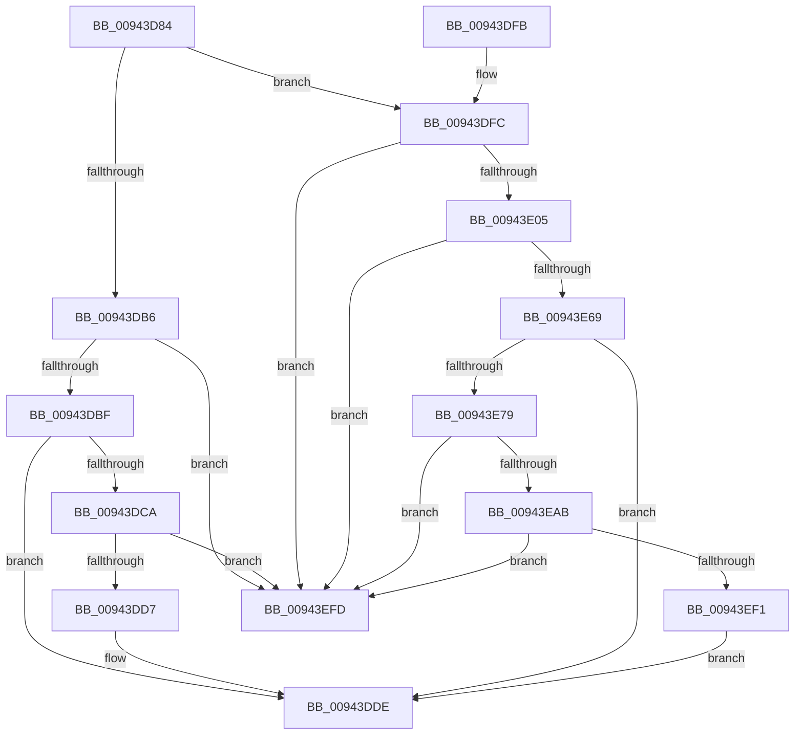

# RtlpRecordFunctionOverrideRelocation

- RVA: `0x00943D84`–`0x00943F03` (길이 `383` bytes)
- VA: `0x0000000140943D84`
- 실행 섹션: `PAGE`
- PDB 이름 있음: `예`; PDB Function 태그: `아니요`
- unwind 정보 RVA: `0x000905BC`
- 디코드: `102`개 명령, `383/383` bytes 표시
- 미해석 바이트: `0` (있으면 어셈블리에 `.byte`로 보존)

> 이 문서는 커널 이미지의 기계어와 PDB 기호를 분석해 생성했습니다. 4번과 5번은 함수 원형과 자료형을 바이너리 사용 방식에서 추정한 C 해석이며 원본 소스 복구 결과는 아닙니다.

## 1. Dependencies

- 직접 호출 지점: **3**; 고유 호출 대상: **2**
- 직접 호출자로 확인된 함수: **1**
- RIP 상대 이미지 참조: **0**

### Outgoing calls
- `0x00943E12` → [RtlpGetFunctionOverrideIndex](RtlpGetFunctionOverrideIndex_function_00943F0C.md) (function, `0x00943F0C`)
- `0x00943EB6` → [RtlpGetFunctionOverrideIndex](RtlpGetFunctionOverrideIndex_function_00943F0C.md) (function, `0x00943F0C`)
- `0x00943EFD` → [gsl::details::terminate](../../text/4F/gsl_details_terminate_function_004F9AA0.md) (function, `0x004F9AA0`)

### Direct callers
- [RtlpParseFunctionOverrideRelocations](RtlpParseFunctionOverrideRelocations_function_00943A68.md) at `0x00943C07`

### Static image references
- 디코드된 RIP-relative 메모리 참조가 없습니다.

## 2. Other-region calls and transfers

- 다른 실행 섹션으로 향하는 call: **1**
  - `0x00943EFD` → [gsl::details::terminate](../../text/4F/gsl_details_terminate_function_004F9AA0.md) (`PAGE` → `.text`)
- 별도 외부 분기/꼬리 이동을 확인하지 못했습니다.

## 3. Assembly (complete function range)

```asm
00943D84  48 89 5C 24 08                  mov qword ptr [rsp + 8], rbx
00943D89  48 89 6C 24 10                  mov qword ptr [rsp + 0x10], rbp
00943D8E  48 89 74 24 18                  mov qword ptr [rsp + 0x18], rsi
00943D93  57                              push rdi
00943D94  41 54                           push r12
00943D96  41 55                           push r13
00943D98  41 56                           push r14
00943D9A  41 57                           push r15
00943D9C  48 83 EC 20                     sub rsp, 0x20
00943DA0  83 39 00                        cmp dword ptr [rcx], 0
00943DA3  44 8A F2                        mov r14b, dl
00943DA6  48 8B 41 08                     mov rax, qword ptr [rcx + 8]
00943DAA  48 8B F9                        mov rdi, rcx
00943DAD  45 0F B7 F9                     movzx r15d, r9w
00943DB1  41 8B E8                        mov ebp, r8d
00943DB4  75 46                           jne 0x140943dfc
00943DB6  48 3B E8                        cmp rbp, rax
00943DB9  0F 83 3E 01 00 00               jae 0x140943efd
00943DBF  48 8B 41 10                     mov rax, qword ptr [rcx + 0x10]
00943DC3  FF 04 A8                        inc dword ptr [rax + rbp*4]
00943DC6  84 D2                           test dl, dl
00943DC8  74 14                           je 0x140943dde
00943DCA  8D 4D 01                        lea ecx, [rbp + 1]
00943DCD  48 3B 4F 08                     cmp rcx, qword ptr [rdi + 8]
00943DD1  0F 83 26 01 00 00               jae 0x140943efd
00943DD7  48 8B 47 10                     mov rax, qword ptr [rdi + 0x10]
00943DDB  FF 04 88                        inc dword ptr [rax + rcx*4]
00943DDE  48 8B 5C 24 50                  mov rbx, qword ptr [rsp + 0x50]
00943DE3  48 8B 6C 24 58                  mov rbp, qword ptr [rsp + 0x58]
00943DE8  48 8B 74 24 60                  mov rsi, qword ptr [rsp + 0x60]
00943DED  48 83 C4 20                     add rsp, 0x20
00943DF1  41 5F                           pop r15
00943DF3  41 5E                           pop r14
00943DF5  41 5D                           pop r13
00943DF7  41 5C                           pop r12
00943DF9  5F                              pop rdi
00943DFA  C3                              ret
00943DFB  CC                              int3
00943DFC  48 3B E8                        cmp rbp, rax
00943DFF  0F 83 F8 00 00 00               jae 0x140943efd
00943E05  48 8B 41 10                     mov rax, qword ptr [rcx + 0x10]
00943E09  8B D5                           mov edx, ebp
00943E0B  48 8B 49 18                     mov rcx, qword ptr [rcx + 0x18]
00943E0F  8B 1C A8                        mov ebx, dword ptr [rax + rbp*4]
00943E12  E8 F5 00 00 00                  call 0x140943f0c
00943E17  41 0F B7 D7                     movzx edx, r15w
00943E1B  4C 8B C0                        mov r8, rax
00943E1E  45 8B E7                        mov r12d, r15d
00943E21  41 BA FF 0F 00 00               mov r10d, 0xfff
00943E27  44 0F B7 7C 24 70               movzx r15d, word ptr [rsp + 0x70]
00943E2D  66 41 23 D2                     and dx, r10w
00943E31  0F B7 4C D8 04                  movzx ecx, word ptr [rax + rbx*8 + 4]
00943E36  41 BD 00 F0 00 00               mov r13d, 0xf000
00943E3C  66 41 23 CD                     and cx, r13w
00943E40  66 41 C1 E7 0C                  shl r15w, 0xc
00943E45  66 0B CA                        or cx, dx
00943E48  66 41 0B D7                     or dx, r15w
00943E4C  66 89 4C D8 04                  mov word ptr [rax + rbx*8 + 4], cx
00943E51  8B 47 20                        mov eax, dword ptr [rdi + 0x20]
00943E54  41 89 44 D8 08                  mov dword ptr [r8 + rbx*8 + 8], eax
00943E59  66 41 89 54 D8 04               mov word ptr [r8 + rbx*8 + 4], dx
00943E5F  48 3B 6F 08                     cmp rbp, qword ptr [rdi + 8]
00943E63  0F 83 94 00 00 00               jae 0x140943efd
00943E69  48 8B 47 10                     mov rax, qword ptr [rdi + 0x10]
00943E6D  FF 04 A8                        inc dword ptr [rax + rbp*4]
00943E70  45 84 F6                        test r14b, r14b
00943E73  0F 84 65 FF FF FF               je 0x140943dde
00943E79  41 0F B7 44 D8 06               movzx eax, word ptr [r8 + rbx*8 + 6]
00943E7F  8D 55 01                        lea edx, [rbp + 1]
00943E82  41 0F B7 4C D8 04               movzx ecx, word ptr [r8 + rbx*8 + 4]
00943E88  66 41 23 CA                     and cx, r10w
00943E8C  8B F2                           mov esi, edx
00943E8E  66 F7 D9                        neg cx
00943E91  66 C1 E1 03                     shl cx, 3
00943E95  66 33 C8                        xor cx, ax
00943E98  66 83 E1 38                     and cx, 0x38
00943E9C  66 33 C8                        xor cx, ax
00943E9F  66 41 89 4C D8 06               mov word ptr [r8 + rbx*8 + 6], cx
00943EA5  48 3B 77 08                     cmp rsi, qword ptr [rdi + 8]
00943EA9  73 52                           jae 0x140943efd
00943EAB  48 8B 47 10                     mov rax, qword ptr [rdi + 0x10]
00943EAF  48 8B 4F 18                     mov rcx, qword ptr [rdi + 0x18]
00943EB3  8B 1C 90                        mov ebx, dword ptr [rax + rdx*4]
00943EB6  E8 51 00 00 00                  call 0x140943f0c
00943EBB  0F B6 54 24 78                  movzx edx, byte ptr [rsp + 0x78]
00943EC0  66 41 03 D4                     add dx, r12w
00943EC4  66 44 21 6C D8 04               and word ptr [rax + rbx*8 + 4], r13w
00943ECA  8B 4F 20                        mov ecx, dword ptr [rdi + 0x20]
00943ECD  89 4C D8 08                     mov dword ptr [rax + rbx*8 + 8], ecx
00943ED1  0F B7 4C D8 06                  movzx ecx, word ptr [rax + rbx*8 + 6]
00943ED6  66 33 D1                        xor dx, cx
00943ED9  66 44 89 7C D8 04               mov word ptr [rax + rbx*8 + 4], r15w
00943EDF  66 83 E2 07                     and dx, 7
00943EE3  66 33 D1                        xor dx, cx
00943EE6  66 89 54 D8 06                  mov word ptr [rax + rbx*8 + 6], dx
00943EEB  48 3B 77 08                     cmp rsi, qword ptr [rdi + 8]
00943EEF  73 0C                           jae 0x140943efd
00943EF1  48 8B 47 10                     mov rax, qword ptr [rdi + 0x10]
00943EF5  FF 04 B0                        inc dword ptr [rax + rsi*4]
00943EF8  E9 E1 FE FF FF                  jmp 0x140943dde
00943EFD  E8 9E 5B BB FF                  call 0x1404f9aa0
00943F02  CC                              int3
```

## 4. C-style interpretation (structured pseudocode)

```c
__int64 __fastcall RtlpRecordFunctionOverrideRelocation(__int64 a1, unsigned __int8 a2, int a3, unsigned __int16 a4, unsigned __int16 a5, unsigned __int8 a6)
{
    __int64 result;
    __int64 v_r15;
    __int64 v_rsp;
    unsigned __int64 v_stack_p10;
    unsigned __int64 v_stack_p18;
    unsigned __int64 v_stack_p8;

    v_stack_p8 = v_rbx;
    v_stack_p10 = v_rbp;
    v_stack_p18 = v_rsi;
    v_rsp = (v_rsp) - (32);
    if ((*(unsigned int *)(a1)) != 0) goto loc_00943DFC;
    if (((unsigned int)(a3)) >= (*(unsigned __int64 *)(a1 + 8))) goto loc_00943EFD;
    if (a2 == 0) goto loc_00943DDE;
    if (((unsigned int)(a3) + 1) >= (*(unsigned __int64 *)(a1 + 8))) goto loc_00943EFD;
loc_00943DDE:
    v_rsp = (v_rsp) + (32);
    return *(unsigned __int64 *)(a1 + 16);
loc_00943DFC:
    if (v_stack_p10 >= (*(unsigned __int64 *)(a1 + 16))) goto loc_00943EFD;
    result = RtlpGetFunctionOverrideIndex(*(unsigned __int64 *)((unsigned int)(a3) + 1 + 24), (unsigned int)((unsigned int)(v_stack_p10)), a3, a4);
    a2 = (unsigned __int16)((a4) & ((unsigned __int16)((unsigned int)(0xFFFULL))));
    a1 = (unsigned __int16)((*(unsigned __int16 *)(result + (unsigned int)(*(unsigned int *)(*(unsigned __int64 *)((unsigned int)(a3) + 1 + 16) + v_stack_p10 * 4)) * 8 + 4)) & ((unsigned __int16)((unsigned int)(0xF000ULL))));
    v_r15 = (unsigned __int16)((a5) << (12));
    a1 = (unsigned __int16)((a1) | (a2));
    a2 = (unsigned __int16)((a2) | ((unsigned __int16)(v_r15)));
    *(unsigned __int16 *)(result + (unsigned int)(*(unsigned int *)(*(unsigned __int64 *)((unsigned int)(a3) + 1 + 16) + v_stack_p10 * 4)) * 8 + 4) = (unsigned __int16)(a1);
    *(unsigned int *)(result + (unsigned int)(*(unsigned int *)(*(unsigned __int64 *)((unsigned int)(a3) + 1 + 16) + v_stack_p10 * 4)) * 8 + 8) = (unsigned int)((unsigned int)(*(unsigned int *)(a1 + 32)));
    *(unsigned __int16 *)(result + (unsigned int)(*(unsigned int *)(*(unsigned __int64 *)((unsigned int)(a3) + 1 + 16) + v_stack_p10 * 4)) * 8 + 4) = a2;
    if (v_stack_p10 >= (*(unsigned __int64 *)(a1 + 8))) goto loc_00943EFD;
    if (a2 == 0) goto loc_00943DDE;
    a1 = (unsigned __int16)((*(unsigned __int16 *)(result + (unsigned int)(*(unsigned int *)(*(unsigned __int64 *)((unsigned int)(a3) + 1 + 16) + v_stack_p10 * 4)) * 8 + 4)) & ((unsigned __int16)((unsigned int)(0xFFFULL))));
    a1 = (unsigned __int16)(-(a1));
    a1 = (unsigned __int16)((a1) << (3));
    a1 = (unsigned __int16)((a1) ^ ((unsigned __int16)(*(unsigned __int16 *)(result + (unsigned int)(*(unsigned int *)(*(unsigned __int64 *)((unsigned int)(a3) + 1 + 16) + v_stack_p10 * 4)) * 8 + 6))));
    a1 = (unsigned __int16)((a1) & (56));
    a1 = (unsigned __int16)((a1) ^ ((unsigned __int16)(*(unsigned __int16 *)(result + (unsigned int)(*(unsigned int *)(*(unsigned __int64 *)((unsigned int)(a3) + 1 + 16) + v_stack_p10 * 4)) * 8 + 6))));
    *(unsigned __int16 *)(result + (unsigned int)(*(unsigned int *)(*(unsigned __int64 *)((unsigned int)(a3) + 1 + 16) + v_stack_p10 * 4)) * 8 + 6) = (unsigned __int16)(a1);
    if (((unsigned int)((unsigned int)(v_stack_p10 + 1))) >= (*(unsigned __int64 *)(a1 + 8))) goto loc_00943EFD;
    result = RtlpGetFunctionOverrideIndex(*(unsigned __int64 *)(a1 + 24), v_stack_p10 + 1, result, a4);
    a2 = (unsigned __int16)((a6) + ((unsigned __int16)((unsigned int)(a4))));
    *(unsigned int *)(result + (unsigned int)(*(unsigned int *)(*(unsigned __int64 *)(a1 + 16) + v_stack_p10 + 1 * 4)) * 8 + 8) = (unsigned int)((unsigned int)(*(unsigned int *)(a1 + 32)));
    a2 = (unsigned __int16)((a2) ^ ((unsigned __int16)(*(unsigned __int16 *)(result + (unsigned int)(*(unsigned int *)(*(unsigned __int64 *)(a1 + 16) + v_stack_p10 + 1 * 4)) * 8 + 6))));
    *(unsigned __int16 *)(result + (unsigned int)(*(unsigned int *)(*(unsigned __int64 *)(a1 + 16) + v_stack_p10 + 1 * 4)) * 8 + 4) = (unsigned __int16)(v_r15);
    a2 = (unsigned __int16)((a2) & (7));
    a2 = (unsigned __int16)((a2) ^ ((unsigned __int16)(*(unsigned __int16 *)(result + (unsigned int)(*(unsigned int *)(*(unsigned __int64 *)(a1 + 16) + v_stack_p10 + 1 * 4)) * 8 + 6))));
    *(unsigned __int16 *)(result + (unsigned int)(*(unsigned int *)(*(unsigned __int64 *)(a1 + 16) + v_stack_p10 + 1 * 4)) * 8 + 6) = a2;
    if (((unsigned int)((unsigned int)(v_stack_p10 + 1))) >= (*(unsigned __int64 *)(a1 + 8))) goto loc_00943EFD;
    goto loc_00943DDE;
loc_00943EFD:
    result = gsl__details__terminate(*(unsigned __int16 *)(result + (unsigned int)(*(unsigned int *)(*(unsigned __int64 *)(a1 + 16) + v_stack_p10 + 1 * 4)) * 8 + 6), a2, result, a4);
    return result;
}
```

## 5. (Beta) C Style

```c
int64_t RtlpRecordFunctionOverrideRelocation(void *Arg1, uint8_t Arg2, int32_t Arg3, uint16_t Arg4, uint16_t Arg5, uint8_t Arg6)
{
    uint8_t *arg1 = (uint8_t *)Arg1;

    int64_t result;
    int64_t local_r15;
    int64_t local_rsp;
    uint64_t v_stack_p10;
    uint64_t v_stack_p18;
    uint64_t v_stack_p8;

    v_stack_p8 = local_rbx;
    v_stack_p10 = local_rbp;
    v_stack_p18 = local_rsi;
    local_rsp = (local_rsp) - (32);
    if ((*(uint32_t *)(arg1)) != 0) goto loc_00943DFC;
    if (((uint32_t)(Arg3)) >= (*(uint64_t *)(arg1 + 0x8))) goto loc_00943EFD;
    if (Arg2 == 0) goto loc_00943DDE;
    if (((uint32_t)(Arg3) + 1) >= (*(uint64_t *)(arg1 + 0x8))) goto loc_00943EFD;
loc_00943DDE:
    local_rsp = (local_rsp) + (32);
    return *(uint64_t *)(arg1 + 0x10);
loc_00943DFC:
    if (v_stack_p10 >= (*(uint64_t *)(arg1 + 0x10))) goto loc_00943EFD;
    result = RtlpGetFunctionOverrideIndex(*(uint64_t *)((uint32_t)(Arg3) + 0x1 + 0x18), (uint32_t)((uint32_t)(v_stack_p10)), Arg3, Arg4);
    Arg2 = (uint16_t)((Arg4) & ((uint16_t)((uint32_t)(0xFFFULL))));
    Arg1 = (uint16_t)((*(uint16_t *)(result + (uint32_t)(*(uint32_t *)(*(uint64_t *)((uint32_t)(Arg3) + 0x1 + 0x10) + v_stack_p10 * 4)) * 8 + 0x4)) & ((uint16_t)((uint32_t)(0xF000ULL))));
    local_r15 = (uint16_t)((Arg5) << (12));
    Arg1 = (uint16_t)((Arg1) | (Arg2));
    Arg2 = (uint16_t)((Arg2) | ((uint16_t)(local_r15)));
    *(uint16_t *)(result + (uint32_t)(*(uint32_t *)(*(uint64_t *)((uint32_t)(Arg3) + 0x1 + 0x10) + v_stack_p10 * 4)) * 8 + 0x4) = (uint16_t)(Arg1);
    *(uint32_t *)(result + (uint32_t)(*(uint32_t *)(*(uint64_t *)((uint32_t)(Arg3) + 0x1 + 0x10) + v_stack_p10 * 4)) * 8 + 0x8) = (uint32_t)((uint32_t)(*(uint32_t *)(arg1 + 0x20)));
    *(uint16_t *)(result + (uint32_t)(*(uint32_t *)(*(uint64_t *)((uint32_t)(Arg3) + 0x1 + 0x10) + v_stack_p10 * 4)) * 8 + 0x4) = Arg2;
    if (v_stack_p10 >= (*(uint64_t *)(arg1 + 0x8))) goto loc_00943EFD;
    if (Arg2 == 0) goto loc_00943DDE;
    Arg1 = (uint16_t)((*(uint16_t *)(result + (uint32_t)(*(uint32_t *)(*(uint64_t *)((uint32_t)(Arg3) + 0x1 + 0x10) + v_stack_p10 * 4)) * 8 + 0x4)) & ((uint16_t)((uint32_t)(0xFFFULL))));
    Arg1 = (uint16_t)(-(Arg1));
    Arg1 = (uint16_t)((Arg1) << (3));
    Arg1 = (uint16_t)((Arg1) ^ ((uint16_t)(*(uint16_t *)(result + (uint32_t)(*(uint32_t *)(*(uint64_t *)((uint32_t)(Arg3) + 0x1 + 0x10) + v_stack_p10 * 4)) * 8 + 0x6))));
    Arg1 = (uint16_t)((Arg1) & (56));
    Arg1 = (uint16_t)((Arg1) ^ ((uint16_t)(*(uint16_t *)(result + (uint32_t)(*(uint32_t *)(*(uint64_t *)((uint32_t)(Arg3) + 0x1 + 0x10) + v_stack_p10 * 4)) * 8 + 0x6))));
    *(uint16_t *)(result + (uint32_t)(*(uint32_t *)(*(uint64_t *)((uint32_t)(Arg3) + 0x1 + 0x10) + v_stack_p10 * 4)) * 8 + 0x6) = (uint16_t)(Arg1);
    if (((uint32_t)((uint32_t)(v_stack_p10 + 1))) >= (*(uint64_t *)(arg1 + 0x8))) goto loc_00943EFD;
    result = RtlpGetFunctionOverrideIndex(*(uint64_t *)(arg1 + 0x18), v_stack_p10 + 1, result, Arg4);
    Arg2 = (uint16_t)((Arg6) + ((uint16_t)((uint32_t)(Arg4))));
    *(uint32_t *)(result + (uint32_t)(*(uint32_t *)(*(uint64_t *)(arg1 + 0x10) + v_stack_p10 + 0x1 * 4)) * 8 + 0x8) = (uint32_t)((uint32_t)(*(uint32_t *)(arg1 + 0x20)));
    Arg2 = (uint16_t)((Arg2) ^ ((uint16_t)(*(uint16_t *)(result + (uint32_t)(*(uint32_t *)(*(uint64_t *)(arg1 + 0x10) + v_stack_p10 + 0x1 * 4)) * 8 + 0x6))));
    *(uint16_t *)(result + (uint32_t)(*(uint32_t *)(*(uint64_t *)(arg1 + 0x10) + v_stack_p10 + 0x1 * 4)) * 8 + 0x4) = (uint16_t)(local_r15);
    Arg2 = (uint16_t)((Arg2) & (7));
    Arg2 = (uint16_t)((Arg2) ^ ((uint16_t)(*(uint16_t *)(result + (uint32_t)(*(uint32_t *)(*(uint64_t *)(arg1 + 0x10) + v_stack_p10 + 0x1 * 4)) * 8 + 0x6))));
    *(uint16_t *)(result + (uint32_t)(*(uint32_t *)(*(uint64_t *)(arg1 + 0x10) + v_stack_p10 + 0x1 * 4)) * 8 + 0x6) = Arg2;
    if (((uint32_t)((uint32_t)(v_stack_p10 + 1))) >= (*(uint64_t *)(arg1 + 0x8))) goto loc_00943EFD;
    goto loc_00943DDE;
loc_00943EFD:
    result = gsl__details__terminate(*(uint16_t *)(result + (uint32_t)(*(uint32_t *)(*(uint64_t *)(arg1 + 0x10) + v_stack_p10 + 0x1 * 4)) * 8 + 0x6), Arg2, result, Arg4);
    return result;
}
```

### 관측된 메모리 오프셋

구조체 형식이 확인되지 않은 접근은 인자 기준의 오프셋으로만 기록했습니다.

| 기준 인자 | 오프셋 표현 | 폭 (bit) | 접근 |
|---|---:|---:|---|
| `Arg1` | `+ 0x0` | `32` | `R` |
| `Arg1` | `+ 0x8` | `64` | `R` |
| `Arg1` | `+ 0x10` | `64` | `R` |
| `Arg1` | `+ 0x18` | `64` | `R` |
| `Arg1` | `+ 0x20` | `32` | `R` |

## 6. Execution-region graph

[열기: 2D/3D 그래프와 함수 탐색 컨트롤 패널](../../../control-panel.html?section=page&rva=0x00943D84&view=graph)

- 2D 그래프는 위에서 아래로 흐르고, 3D 그래프는 빈 공간을 드래그해 회전합니다. Shift+드래그는 이동, 휠은 확대·축소, 함수 노드 선택은 대상 보고서 이동입니다.

### Static fallback


