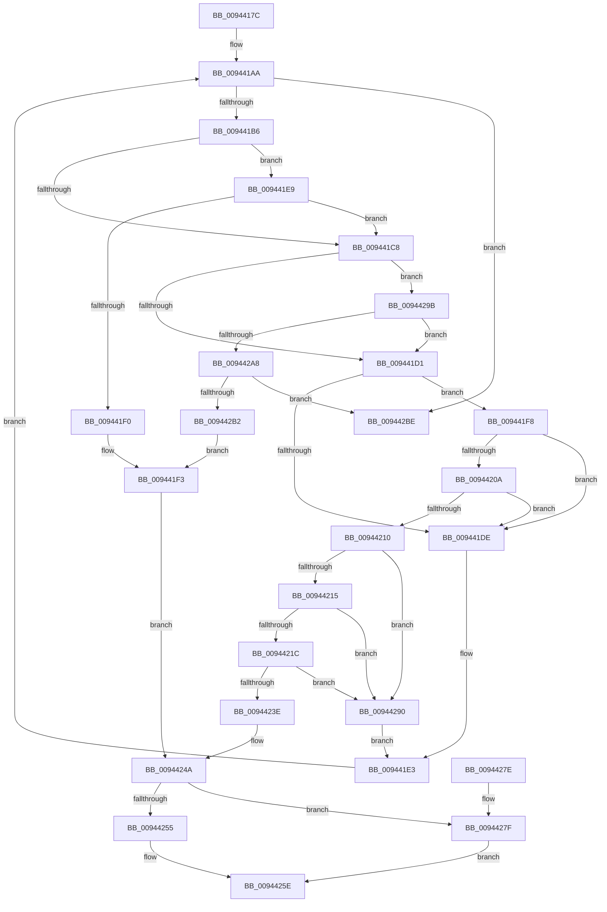

# RtlpSelectFunctionFromBinaryDecisionDiagram

- RVA: `0x0094417C`–`0x009442C4` (길이 `328` bytes)
- VA: `0x000000014094417C`
- 실행 섹션: `PAGE`
- PDB 이름 있음: `예`; PDB Function 태그: `아니요`
- unwind 정보 RVA: `0x000905F8`
- 디코드: `91`개 명령, `328/328` bytes 표시
- 미해석 바이트: `0` (있으면 어셈블리에 `.byte`로 보존)

> 이 문서는 커널 이미지의 기계어와 PDB 기호를 분석해 생성했습니다. 4번과 5번은 함수 원형과 자료형을 바이너리 사용 방식에서 추정한 C 해석이며 원본 소스 복구 결과는 아닙니다.

## 1. Dependencies

- 직접 호출 지점: **2**; 고유 호출 대상: **2**
- 직접 호출자로 확인된 함수: **1**
- RIP 상대 이미지 참조: **0**

### Outgoing calls
- `0x00944235` → [RtlpGetSystemOverrideRva](RtlpGetSystemOverrideRva_function_00944504.md) (function, `0x00944504`)
- `0x009442BE` → [gsl::details::terminate](../../text/4F/gsl_details_terminate_function_004F9AA0.md) (function, `0x004F9AA0`)

### Direct callers
- [RtlpParseBinaryDecisionDiagram](RtlpParseBinaryDecisionDiagram_function_00943F94.md) at `0x00944100`
- [RtlpParseBinaryDecisionDiagram](RtlpParseBinaryDecisionDiagram_function_00943F94.md) at `0x00944133`

### Static image references
- 디코드된 RIP-relative 메모리 참조가 없습니다.

## 2. Other-region calls and transfers

- 다른 실행 섹션으로 향하는 call: **1**
  - `0x009442BE` → [gsl::details::terminate](../../text/4F/gsl_details_terminate_function_004F9AA0.md) (`PAGE` → `.text`)
- 별도 외부 분기/꼬리 이동을 확인하지 못했습니다.

## 3. Assembly (complete function range)

```asm
0094417C  48 89 5C 24 08                  mov qword ptr [rsp + 8], rbx
00944181  48 89 7C 24 10                  mov qword ptr [rsp + 0x10], rdi
00944186  4C 89 64 24 18                  mov qword ptr [rsp + 0x18], r12
0094418B  41 55                           push r13
0094418D  41 56                           push r14
0094418F  41 57                           push r15
00944191  48 83 EC 30                     sub rsp, 0x30
00944195  4C 8B 21                        mov r12, qword ptr [rcx]
00944198  45 33 ED                        xor r13d, r13d
0094419B  4D 8B D8                        mov r11, r8
0094419E  4D 8B F9                        mov r15, r9
009441A1  45 8B C5                        mov r8d, r13d
009441A4  48 8B FA                        mov rdi, rdx
009441A7  4C 8B F1                        mov r14, rcx
009441AA  45 8B D0                        mov r10d, r8d
009441AD  4D 3B D4                        cmp r10, r12
009441B0  0F 83 08 01 00 00               jae 0x1409442be
009441B6  49 8B 5E 08                     mov rbx, qword ptr [r14 + 8]
009441BA  42 0F B7 04 D3                  movzx eax, word ptr [rbx + r10*8]
009441BF  4A 8D 0C D3                     lea rcx, [rbx + r10*8]
009441C3  66 85 C0                        test ax, ax
009441C6  74 21                           je 0x1409441e9
009441C8  41 3B C0                        cmp eax, r8d
009441CB  0F 84 CA 00 00 00               je 0x14094429b
009441D1  42 8B 4C D3 04                  mov ecx, dword ptr [rbx + r10*8 + 4]
009441D6  81 F9 61 01 00 00               cmp ecx, 0x161
009441DC  72 1A                           jb 0x1409441f8
009441DE  42 0F B7 04 D3                  movzx eax, word ptr [rbx + r10*8]
009441E3  44 0F B7 C0                     movzx r8d, ax
009441E7  EB C1                           jmp 0x1409441aa
009441E9  66 44 39 69 02                  cmp word ptr [rcx + 2], r13w
009441EE  75 D8                           jne 0x1409441c8
009441F0  41 8B 13                        mov edx, dword ptr [r11]
009441F3  41 8B C5                        mov eax, r13d
009441F6  EB 52                           jmp 0x14094424a
009441F8  44 38 6C 24 70                  cmp byte ptr [rsp + 0x70], r13b
009441FD  49 8D 57 2D                     lea rdx, [r15 + 0x2d]
00944201  49 0F 44 D7                     cmove rdx, r15
00944205  48 85 D2                        test rdx, rdx
00944208  74 D4                           je 0x1409441de
0094420A  48 0F A3 0A                     bt qword ptr [rdx], rcx
0094420E  73 CE                           jae 0x1409441de
00944210  45 85 C0                        test r8d, r8d
00944213  75 7B                           jne 0x140944290
00944215  4C 39 6C 24 78                  cmp qword ptr [rsp + 0x78], r13
0094421A  74 74                           je 0x140944290
0094421C  4C 8B 44 24 78                  mov r8, qword ptr [rsp + 0x78]
00944221  4C 8D 8C 24 80 00 00 00         lea r9, [rsp + 0x80]
00944229  8A 54 24 70                     mov dl, byte ptr [rsp + 0x70]
0094422D  44 89 AC 24 80 00 00 00         mov dword ptr [rsp + 0x80], r13d
00944235  E8 CA 02 00 00                  call 0x140944504
0094423A  84 C0                           test al, al
0094423C  74 52                           je 0x140944290
0094423E  8B 94 24 80 00 00 00            mov edx, dword ptr [rsp + 0x80]
00944245  B8 01 00 00 00                  mov eax, 1
0094424A  41 8B 4B 0C                     mov ecx, dword ptr [r11 + 0xc]
0094424E  44 38 6C 24 70                  cmp byte ptr [rsp + 0x70], r13b
00944253  74 2A                           je 0x14094427f
00944255  83 E1 FD                        and ecx, 0xfffffffd
00944258  41 89 53 08                     mov dword ptr [r11 + 8], edx
0094425C  03 C0                           add eax, eax
0094425E  48 8B 5C 24 50                  mov rbx, qword ptr [rsp + 0x50]
00944263  0B C8                           or ecx, eax
00944265  48 8B 7C 24 58                  mov rdi, qword ptr [rsp + 0x58]
0094426A  4C 8B 64 24 60                  mov r12, qword ptr [rsp + 0x60]
0094426F  41 89 4B 0C                     mov dword ptr [r11 + 0xc], ecx
00944273  48 83 C4 30                     add rsp, 0x30
00944277  41 5F                           pop r15
00944279  41 5E                           pop r14
0094427B  41 5D                           pop r13
0094427D  C3                              ret
0094427E  CC                              int3
0094427F  83 E1 FE                        and ecx, 0xfffffffe
00944282  41 89 53 04                     mov dword ptr [r11 + 4], edx
00944286  0B C8                           or ecx, eax
00944288  83 E1 FB                        and ecx, 0xfffffffb
0094428B  C1 E0 02                        shl eax, 2
0094428E  EB CE                           jmp 0x14094425e
00944290  42 0F B7 44 D3 02               movzx eax, word ptr [rbx + r10*8 + 2]
00944296  E9 48 FF FF FF                  jmp 0x1409441e3
0094429B  0F B7 41 02                     movzx eax, word ptr [rcx + 2]
0094429F  41 3B C0                        cmp eax, r8d
009442A2  0F 85 29 FF FF FF               jne 0x1409441d1
009442A8  42 8B 54 D3 04                  mov edx, dword ptr [rbx + r10*8 + 4]
009442AD  48 3B 17                        cmp rdx, qword ptr [rdi]
009442B0  73 0C                           jae 0x1409442be
009442B2  48 8B 47 08                     mov rax, qword ptr [rdi + 8]
009442B6  8B 14 90                        mov edx, dword ptr [rax + rdx*4]
009442B9  E9 35 FF FF FF                  jmp 0x1409441f3
009442BE  E8 DD 57 BB FF                  call 0x1404f9aa0
009442C3  CC                              int3
```

## 4. C-style interpretation (structured pseudocode)

```c
__int64 __fastcall RtlpSelectFunctionFromBinaryDecisionDiagram(__int64 a1, __int64 a2, __int64 a3, __int64 a4, unsigned __int8 a5, __int64 a6, unsigned int a7)
{
    __int64 result;
    __int64 v_r13;
    __int64 v_rsp;
    unsigned __int64 v_stack_p10;
    unsigned __int64 v_stack_p18;
    unsigned int v_stack_p38;
    unsigned __int64 v_stack_p8;

    v_stack_p8 = v_rbx;
    v_stack_p10 = v_rdi;
    v_stack_p18 = v_r12;
    v_rsp = (v_rsp) - (48);
    v_r13 = 0;
loc_009441AA:
    if (0 >= (*(unsigned __int64 *)(a1))) goto loc_009442BE;
    if ((unsigned __int16)(*(unsigned __int16 *)(*(unsigned __int64 *)(a1 + 8) + 0 * 8)) == 0) goto loc_009441E9;
loc_009441C8:
    if (((unsigned int)(*(unsigned __int16 *)(*(unsigned __int64 *)(a1 + 8) + 0 * 8))) == 0) goto loc_0094429B;
loc_009441D1:
    if (((unsigned int)((unsigned int)(*(unsigned int *)(*(unsigned __int64 *)(a1 + 8) + 0 * 8 + 4)))) < 353) goto loc_009441F8;
loc_009441DE:
loc_009441E3:
    goto loc_009441AA;
loc_009441E9:
    if ((*(unsigned __int16 *)((unsigned int)(*(unsigned int *)(*(unsigned __int64 *)(a1 + 8) + 0 * 8 + 4)) + 2)) != 0) goto loc_009441C8;
loc_009441F3:
    goto loc_0094424A;
loc_009441F8:
    a2 = a4 + 45;
    if (a5 == 0) { a2 = a4; }
    if (a2 == 0) goto loc_009441DE;
    if (condition_is_above_or_equal) goto loc_009441DE;
    if ((unsigned int)((unsigned __int16)(*(unsigned __int16 *)(*(unsigned __int64 *)(a1 + 8) + 0 * 8))) != 0) goto loc_00944290;
    if (a6 == 0) goto loc_00944290;
    v_stack_p38 = 0;
    result = RtlpGetSystemOverrideRva((unsigned int)(*(unsigned int *)(*(unsigned __int64 *)(a1 + 8) + 0 * 8 + 4)), a5, a6, a7);
    if ((unsigned __int8)(result) == 0) goto loc_00944290;
loc_0094424A:
    if (a5 == 0) goto loc_0094427F;
    a1 = (unsigned int)(((unsigned int)(*(unsigned int *)(a3 + 12))) & (0xFFFFFFFDULL));
    *(unsigned int *)(a3 + 8) = (unsigned int)((unsigned int)(a7));
    result = (unsigned int)((1) + (1));
loc_0094425E:
    a1 = (unsigned int)((a1) | ((unsigned int)(result)));
    *(unsigned int *)(a3 + 12) = (unsigned int)(a1);
    v_rsp = (v_rsp) + (48);
    return result;
loc_0094427F:
    a1 = (unsigned int)((a1) & (0xFFFFFFFEULL));
    *(unsigned int *)(a3 + 4) = (unsigned int)((unsigned int)(a7));
    a1 = (unsigned int)((a1) | ((unsigned int)(result)));
    a1 = (unsigned int)((a1) & (0xFFFFFFFBULL));
    result = (unsigned int)((result) << (2));
    goto loc_0094425E;
loc_00944290:
    goto loc_009441E3;
loc_0094429B:
    if (((unsigned int)(*(unsigned __int16 *)(a1 + 2))) != ((unsigned int)(a6))) goto loc_009441D1;
    if (((unsigned int)(*(unsigned int *)(v_stack_p8 + 0 * 8 + 4))) >= (*(unsigned __int64 *)(v_stack_p10))) goto loc_009442BE;
    goto loc_009441F3;
loc_009442BE:
    result = gsl__details__terminate(a1, (unsigned int)(*(unsigned int *)(*(unsigned __int64 *)(v_stack_p10 + 8) + (unsigned int)(*(unsigned int *)(v_stack_p8 + 0 * 8 + 4)) * 4)), a6, a7);
    return result;
}
```

## 5. (Beta) C Style

```c
int64_t RtlpSelectFunctionFromBinaryDecisionDiagram(void *Arg1, void *Arg2, int64_t Arg3, void *Arg4, uint8_t Arg5, int64_t Arg6, uint32_t Arg7)
{
    uint8_t *arg1 = (uint8_t *)Arg1;
    uint8_t *arg2 = (uint8_t *)Arg2;
    uint8_t *arg4 = (uint8_t *)Arg4;

    int64_t result;
    int64_t local_r13;
    int64_t local_rsp;
    uint64_t v_stack_p10;
    uint64_t v_stack_p18;
    uint32_t v_stack_p38;
    uint64_t v_stack_p8;

    v_stack_p8 = local_rbx;
    v_stack_p10 = local_rdi;
    v_stack_p18 = local_r12;
    local_rsp = (local_rsp) - (48);
    local_r13 = 0;
loc_009441AA:
    if (0 >= (*(uint64_t *)(arg1))) goto loc_009442BE;
    if ((uint16_t)(*(uint16_t *)(*(uint64_t *)(arg1 + 0x8) + 0x0 * 8)) == 0) goto loc_009441E9;
loc_009441C8:
    if (((uint32_t)(*(uint16_t *)(*(uint64_t *)(arg1 + 0x8) + 0x0 * 8))) == 0) goto loc_0094429B;
loc_009441D1:
    if (((uint32_t)((uint32_t)(*(uint32_t *)(*(uint64_t *)(arg1 + 0x8) + 0x0 * 8 + 0x4)))) < 353) goto loc_009441F8;
loc_009441DE:
loc_009441E3:
    goto loc_009441AA;
loc_009441E9:
    if ((*(uint16_t *)((uint32_t)(*(uint32_t *)(*(uint64_t *)(arg1 + 0x8) + 0x0 * 8 + 0x4)) + 0x2)) != 0) goto loc_009441C8;
loc_009441F3:
    goto loc_0094424A;
loc_009441F8:
    Arg2 = Arg4 + 45;
    if (Arg5 == 0) { Arg2 = Arg4; }
    if (Arg2 == NULL) goto loc_009441DE;
    if (condition_is_above_or_equal) goto loc_009441DE;
    if ((uint32_t)((uint16_t)(*(uint16_t *)(*(uint64_t *)(arg1 + 0x8) + 0x0 * 8))) != 0) goto loc_00944290;
    if (Arg6 == 0) goto loc_00944290;
    v_stack_p38 = 0;
    result = RtlpGetSystemOverrideRva((uint32_t)(*(uint32_t *)(*(uint64_t *)(arg1 + 0x8) + 0x0 * 8 + 0x4)), Arg5, Arg6, Arg7);
    if ((uint8_t)(result) == 0) goto loc_00944290;
loc_0094424A:
    if (Arg5 == 0) goto loc_0094427F;
    Arg1 = (uint32_t)(((uint32_t)(*(uint32_t *)(Arg3 + 0xC))) & (0xFFFFFFFDULL));
    *(uint32_t *)(Arg3 + 0x8) = (uint32_t)((uint32_t)(Arg7));
    result = (uint32_t)((1) + (1));
loc_0094425E:
    Arg1 = (uint32_t)((Arg1) | ((uint32_t)(result)));
    *(uint32_t *)(Arg3 + 0xC) = (uint32_t)(Arg1);
    local_rsp = (local_rsp) + (48);
    return result;
loc_0094427F:
    Arg1 = (uint32_t)((Arg1) & (0xFFFFFFFEULL));
    *(uint32_t *)(Arg3 + 0x4) = (uint32_t)((uint32_t)(Arg7));
    Arg1 = (uint32_t)((Arg1) | ((uint32_t)(result)));
    Arg1 = (uint32_t)((Arg1) & (0xFFFFFFFBULL));
    result = (uint32_t)((result) << (2));
    goto loc_0094425E;
loc_00944290:
    goto loc_009441E3;
loc_0094429B:
    if (((uint32_t)(*(uint16_t *)(arg1 + 0x2))) != ((uint32_t)(Arg6))) goto loc_009441D1;
    if (((uint32_t)(*(uint32_t *)(v_stack_p8 + 0x0 * 8 + 0x4))) >= (*(uint64_t *)(v_stack_p10))) goto loc_009442BE;
    goto loc_009441F3;
loc_009442BE:
    result = gsl__details__terminate(Arg1, (uint32_t)(*(uint32_t *)(*(uint64_t *)(v_stack_p10 + 0x8) + (uint32_t)(*(uint32_t *)(v_stack_p8 + 0x0 * 8 + 0x4)) * 4)), Arg6, Arg7);
    return result;
}
```

### 관측된 메모리 오프셋

구조체 형식이 확인되지 않은 접근은 인자 기준의 오프셋으로만 기록했습니다.

| 기준 인자 | 오프셋 표현 | 폭 (bit) | 접근 |
|---|---:|---:|---|
| `Arg1` | `+ 0x0` | `64` | `R` |
| `Arg1` | `+ 0x8` | `64` | `R` |
| `Arg2` | `+ 0x0` | `64` | `R` |
| `Arg2` | `+ 0x8` | `64` | `R` |
| `Arg4` | `+ 0x2D` | `64` | `R` |

## 6. Execution-region graph

[열기: 2D/3D 그래프와 함수 탐색 컨트롤 패널](../../../control-panel.html?section=page&rva=0x0094417C&view=graph)

- 2D 그래프는 위에서 아래로 흐르고, 3D 그래프는 빈 공간을 드래그해 회전합니다. Shift+드래그는 이동, 휠은 확대·축소, 함수 노드 선택은 대상 보고서 이동입니다.

### Static fallback


