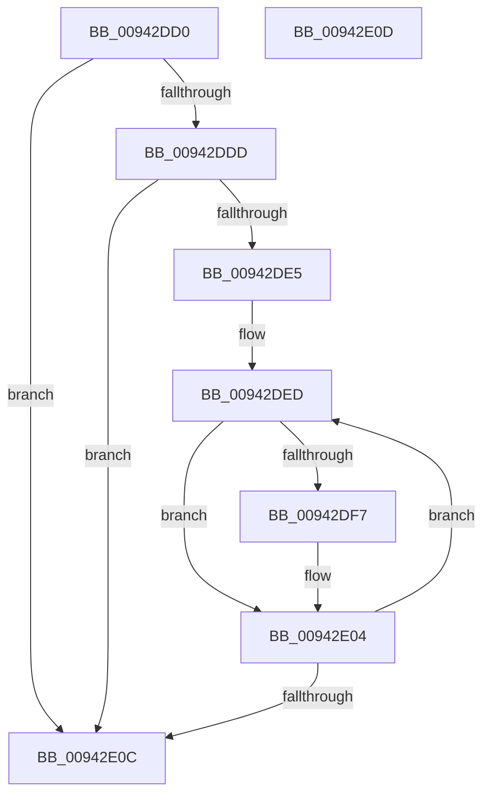

# RtlpSetRvaListRvaStateBits

- RVA: `0x00942DD0`–`0x00942E0E` (길이 `62` bytes)
- VA: `0x0000000140942DD0`
- 실행 섹션: `PAGE`
- PDB 이름 있음: `예`; PDB Function 태그: `아니요`
- unwind 정보 RVA: `0x000DB714`
- 디코드: `22`개 명령, `62/62` bytes 표시
- 미해석 바이트: `0` (있으면 어셈블리에 `.byte`로 보존)

> 이 문서는 커널 이미지의 기계어와 PDB 기호를 분석해 생성했습니다. 4번과 5번은 함수 원형과 자료형을 바이너리 사용 방식에서 추정한 C 해석이며 원본 소스 복구 결과는 아닙니다.

## 1. Dependencies

- 직접 호출 지점: **0**; 고유 호출 대상: **0**
- 직접 호출자로 확인된 함수: **1**
- RIP 상대 이미지 참조: **0**

### Outgoing calls
- 직접 디코드된 call 명령이 없습니다.

### Direct callers
- [RtlpCompressRvaList](RtlpCompressRvaList_function_00942650.md) at `0x009426D3`

### Static image references
- 디코드된 RIP-relative 메모리 참조가 없습니다.

## 2. Other-region calls and transfers

- 다른 실행 섹션으로 향하는 call: **0**
- 별도 외부 분기/꼬리 이동을 확인하지 못했습니다.

## 3. Assembly (complete function range)

```asm
00942DD0  44 89 44 24 18                  mov dword ptr [rsp + 0x18], r8d
00942DD5  4C 8B C9                        mov r9, rcx
00942DD8  45 85 C0                        test r8d, r8d
00942DDB  74 2F                           je 0x140942e0c
00942DDD  8B 41 08                        mov eax, dword ptr [rcx + 8]
00942DE0  83 F8 01                        cmp eax, 1
00942DE3  76 27                           jbe 0x140942e0c
00942DE5  0F AF C2                        imul eax, edx
00942DE8  44 8B C0                        mov r8d, eax
00942DEB  33 C0                           xor eax, eax
00942DED  48 8D 4C 24 18                  lea rcx, [rsp + 0x18]
00942DF2  0F A3 01                        bt dword ptr [rcx], eax
00942DF5  73 0D                           jae 0x140942e04
00942DF7  49 8B 49 28                     mov rcx, qword ptr [r9 + 0x28]
00942DFB  8B D0                           mov edx, eax
00942DFD  49 03 D0                        add rdx, r8
00942E00  48 0F AB 11                     bts qword ptr [rcx], rdx
00942E04  FF C0                           inc eax
00942E06  41 3B 41 08                     cmp eax, dword ptr [r9 + 8]
00942E0A  72 E1                           jb 0x140942ded
00942E0C  C3                              ret
00942E0D  CC                              int3
```

## 4. C-style interpretation (structured pseudocode)

```c
__int64 __fastcall RtlpSetRvaListRvaStateBits(__int64 a1, int a2, int a3)
{
    __int64 result;
    unsigned int v_stack_p18;

    v_stack_p18 = a3;
    if (a3 == 0) goto loc_00942E0C;
    if (((unsigned int)((unsigned int)(*(unsigned int *)(a1 + 8)))) <= 1) goto loc_00942E0C;
    result = (unsigned int)(((unsigned int)(*(unsigned int *)(a1 + 8))) * (a2));
    result = 0;
loc_00942DED:
    if (!(condition_is_above_or_equal)) {
        a1 = *(unsigned __int64 *)(a1 + 40);
        a2 = 0;
        a2 = (a2) + ((unsigned int)((unsigned int)(result)));
    }
    result = (unsigned int)((result) + 1);
    if (((unsigned int)(result)) < (*(unsigned int *)(a1 + 8))) goto loc_00942DED;
loc_00942E0C:
    return result;
}
```

## 5. (Beta) C Style

```c
int64_t RtlpSetRvaListRvaStateBits(void *Arg1, int32_t Arg2, int32_t Arg3)
{
    uint8_t *arg1 = (uint8_t *)Arg1;

    int64_t result;
    uint32_t v_stack_p18;

    v_stack_p18 = Arg3;
    if (Arg3 == 0) goto loc_00942E0C;
    if (((uint32_t)((uint32_t)(*(uint32_t *)(arg1 + 0x8)))) <= 1) goto loc_00942E0C;
    result = (uint32_t)(((uint32_t)(*(uint32_t *)(arg1 + 0x8))) * (Arg2));
    result = 0;
loc_00942DED:
    if (!(condition_is_above_or_equal)) {
        Arg1 = *(uint64_t *)(arg1 + 0x28);
        Arg2 = 0;
        Arg2 = (Arg2) + ((uint32_t)((uint32_t)(result)));
    }
    result = (uint32_t)((result) + 1);
    if (((uint32_t)(result)) < (*(uint32_t *)(arg1 + 0x8))) goto loc_00942DED;
loc_00942E0C:
    return result;
}
```

### 관측된 메모리 오프셋

구조체 형식이 확인되지 않은 접근은 인자 기준의 오프셋으로만 기록했습니다.

| 기준 인자 | 오프셋 표현 | 폭 (bit) | 접근 |
|---|---:|---:|---|
| `Arg1` | `+ 0x8` | `32` | `R` |
| `Arg1` | `+ 0x28` | `64` | `R` |

## 6. Execution-region graph

[열기: 2D/3D 그래프와 함수 탐색 컨트롤 패널](../../../control-panel.html?section=page&rva=0x00942DD0&view=graph)

- 2D 그래프는 위에서 아래로 흐르고, 3D 그래프는 빈 공간을 드래그해 회전합니다. Shift+드래그는 이동, 휠은 확대·축소, 함수 노드 선택은 대상 보고서 이동입니다.

### Static fallback


