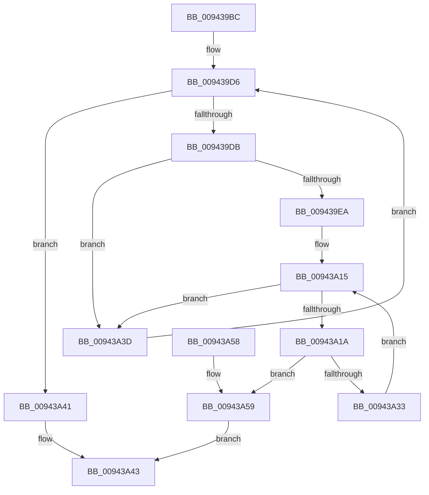

# RtlpSortAndValidateRelocations

- RVA: `0x009439BC`–`0x00943A60` (길이 `164` bytes)
- VA: `0x00000001409439BC`
- 실행 섹션: `PAGE`
- PDB 이름 있음: `예`; PDB Function 태그: `아니요`
- unwind 정보 RVA: `0x00069AD0`
- 디코드: `48`개 명령, `164/164` bytes 표시
- 미해석 바이트: `0` (있으면 어셈블리에 `.byte`로 보존)

> 이 문서는 커널 이미지의 기계어와 PDB 기호를 분석해 생성했습니다. 4번과 5번은 함수 원형과 자료형을 바이너리 사용 방식에서 추정한 C 해석이며 원본 소스 복구 결과는 아닙니다.

## 1. Dependencies

- 직접 호출 지점: **4**; 고유 호출 대상: **3**
- 직접 호출자로 확인된 함수: **1**
- RIP 상대 이미지 참조: **1**

### Outgoing calls
- `0x009439E0` → [RtlpGetFunctionOverrideIndex](RtlpGetFunctionOverrideIndex_function_00943F0C.md) (function, `0x00943F0C`)
- `0x00943A02` → [qsort](../../text/50/qsort_function_005009F0.md) (function, `0x005009F0`)
- `0x00943A0A` → [RtlpGetRelocationLastByteRva](RtlpGetRelocationLastByteRva_function_00943F5C.md) (function, `0x00943F5C`)
- `0x00943A33` → [RtlpGetRelocationLastByteRva](RtlpGetRelocationLastByteRva_function_00943F5C.md) (function, `0x00943F5C`)

### Direct callers
- [RtlpCreateFunctionOverrideFixupInfo](RtlpCreateFunctionOverrideFixupInfo_function_009433D8.md) at `0x00943803`

### Static image references
- `0x009439F2` → RVA `0x00A41E80` (`RtlpCompareRelocation`; read)

## 2. Other-region calls and transfers

- 다른 실행 섹션으로 향하는 call: **1**
  - `0x00943A02` → [qsort](../../text/50/qsort_function_005009F0.md) (`PAGE` → `.text`)
- 별도 외부 분기/꼬리 이동을 확인하지 못했습니다.

## 3. Assembly (complete function range)

```asm
009439BC  48 89 5C 24 08                  mov qword ptr [rsp + 8], rbx
009439C1  48 89 6C 24 10                  mov qword ptr [rsp + 0x10], rbp
009439C6  48 89 74 24 18                  mov qword ptr [rsp + 0x18], rsi
009439CB  57                              push rdi
009439CC  48 83 EC 20                     sub rsp, 0x20
009439D0  8B 59 20                        mov ebx, dword ptr [rcx + 0x20]
009439D3  48 8B F9                        mov rdi, rcx
009439D6  3B 5F 24                        cmp ebx, dword ptr [rdi + 0x24]
009439D9  77 66                           ja 0x140943a41
009439DB  8B D3                           mov edx, ebx
009439DD  48 8B CF                        mov rcx, rdi
009439E0  E8 27 05 00 00                  call 0x140943f0c
009439E5  48 85 C0                        test rax, rax
009439E8  74 53                           je 0x140943a3d
009439EA  8B 28                           mov ebp, dword ptr [rax]
009439EC  48 8D 70 04                     lea rsi, [rax + 4]
009439F0  8B D5                           mov edx, ebp
009439F2  4C 8D 0D 87 E4 0F 00            lea r9, [rip + 0xfe487]
009439F9  48 8B CE                        mov rcx, rsi
009439FC  41 B8 08 00 00 00               mov r8d, 8
00943A02  E8 E9 CF BB FF                  call 0x1405009f0
00943A07  48 8B CE                        mov rcx, rsi
00943A0A  E8 4D 05 00 00                  call 0x140943f5c
00943A0F  41 B8 01 00 00 00               mov r8d, 1
00943A15  44 3B C5                        cmp r8d, ebp
00943A18  73 23                           jae 0x140943a3d
00943A1A  41 8B C8                        mov ecx, r8d
00943A1D  41 B9 FF 0F 00 00               mov r9d, 0xfff
00943A23  48 8D 0C CE                     lea rcx, [rsi + rcx*8]
00943A27  0F B7 11                        movzx edx, word ptr [rcx]
00943A2A  66 41 23 D1                     and dx, r9w
00943A2E  66 3B D0                        cmp dx, ax
00943A31  76 26                           jbe 0x140943a59
00943A33  E8 24 05 00 00                  call 0x140943f5c
00943A38  41 FF C0                        inc r8d
00943A3B  EB D8                           jmp 0x140943a15
00943A3D  FF C3                           inc ebx
00943A3F  EB 95                           jmp 0x1409439d6
00943A41  33 C0                           xor eax, eax
00943A43  48 8B 5C 24 30                  mov rbx, qword ptr [rsp + 0x30]
00943A48  48 8B 6C 24 38                  mov rbp, qword ptr [rsp + 0x38]
00943A4D  48 8B 74 24 40                  mov rsi, qword ptr [rsp + 0x40]
00943A52  48 83 C4 20                     add rsp, 0x20
00943A56  5F                              pop rdi
00943A57  C3                              ret
00943A58  CC                              int3
00943A59  B8 7B 00 00 C0                  mov eax, 0xc000007b
00943A5E  EB E3                           jmp 0x140943a43
```

## 4. C-style interpretation (structured pseudocode)

```c
__int64 __fastcall RtlpSortAndValidateRelocations(__int64 a1)
{
    __int64 result;
    __int64 v_rbx;
    __int64 v_rsp;
    unsigned __int64 v_stack_p10;
    unsigned __int64 v_stack_p18;
    unsigned __int64 v_stack_p8;

    v_stack_p8 = v_rbx;
    v_stack_p10 = v_rbp;
    v_stack_p18 = v_rsi;
    v_rsp = (v_rsp) - (32);
loc_009439D6:
    if (((unsigned int)((unsigned int)(*(unsigned int *)(a1 + 32)))) > (*(unsigned int *)(a1 + 36))) goto loc_00943A41;
    result = RtlpGetFunctionOverrideIndex(a1, (unsigned int)((unsigned int)((unsigned int)(*(unsigned int *)(a1 + 32)))), a3, a4);
    if (result == 0) goto loc_00943A3D;
    result = qsort(result + 4, (unsigned int)((unsigned int)((unsigned int)(*(unsigned int *)(result)))), 8, v_rip + 1041543);
    result = RtlpGetRelocationLastByteRva(result + 4, (unsigned int)((unsigned int)((unsigned int)(*(unsigned int *)(result)))), 8, v_rip + 1041543);
loc_00943A15:
    if (1 >= ((unsigned int)((unsigned int)(*(unsigned int *)(result))))) goto loc_00943A3D;
    a2 = (unsigned __int16)((*(unsigned __int16 *)(result + 4 + 1 * 8)) & ((unsigned __int16)((unsigned int)(0xFFFULL))));
    if (((unsigned __int16)(a2)) <= ((unsigned __int16)(result))) goto loc_00943A59;
    result = RtlpGetRelocationLastByteRva(result + 4 + 1 * 8, a2, 1, (unsigned int)(0xFFFULL));
    a3 = (unsigned int)((1) + 1);
    goto loc_00943A15;
loc_00943A3D:
    v_rbx = (unsigned int)(((unsigned int)(*(unsigned int *)(a1 + 32))) + 1);
    goto loc_009439D6;
loc_00943A41:
    result = 0;
loc_00943A43:
    v_rsp = (v_rsp) + (32);
    return result;
loc_00943A59:
    goto loc_00943A43;
}
```

## 5. (Beta) C Style

```c
int64_t RtlpSortAndValidateRelocations(void *Arg1)
{
    uint8_t *arg1 = (uint8_t *)Arg1;

    int64_t result;
    int64_t local_rbx;
    int64_t local_rsp;
    uint64_t v_stack_p10;
    uint64_t v_stack_p18;
    uint64_t v_stack_p8;

    v_stack_p8 = local_rbx;
    v_stack_p10 = local_rbp;
    v_stack_p18 = local_rsi;
    local_rsp = (local_rsp) - (32);
loc_009439D6:
    if (((uint32_t)((uint32_t)(*(uint32_t *)(arg1 + 0x20)))) > (*(uint32_t *)(arg1 + 0x24))) goto loc_00943A41;
    result = RtlpGetFunctionOverrideIndex(Arg1, (uint32_t)((uint32_t)((uint32_t)(*(uint32_t *)(arg1 + 0x20)))), a3, a4);
    if (result == 0) goto loc_00943A3D;
    result = qsort(result + 4, (uint32_t)((uint32_t)((uint32_t)(*(uint32_t *)(result)))), 8, v_rip + 1041543);
    result = RtlpGetRelocationLastByteRva(result + 4, (uint32_t)((uint32_t)((uint32_t)(*(uint32_t *)(result)))), 8, v_rip + 1041543);
loc_00943A15:
    if (1 >= ((uint32_t)((uint32_t)(*(uint32_t *)(result))))) goto loc_00943A3D;
    a2 = (uint16_t)((*(uint16_t *)(result + 0x4 + 0x1 * 8)) & ((uint16_t)((uint32_t)(0xFFFULL))));
    if (((uint16_t)(a2)) <= ((uint16_t)(result))) goto loc_00943A59;
    result = RtlpGetRelocationLastByteRva(result + 4 + 1 * 8, a2, 1, (uint32_t)(0xFFFULL));
    a3 = (uint32_t)((1) + 1);
    goto loc_00943A15;
loc_00943A3D:
    local_rbx = (uint32_t)(((uint32_t)(*(uint32_t *)(arg1 + 0x20))) + 1);
    goto loc_009439D6;
loc_00943A41:
    result = 0;
loc_00943A43:
    local_rsp = (local_rsp) + (32);
    return result;
loc_00943A59:
    goto loc_00943A43;
}
```

### 관측된 메모리 오프셋

구조체 형식이 확인되지 않은 접근은 인자 기준의 오프셋으로만 기록했습니다.

| 기준 인자 | 오프셋 표현 | 폭 (bit) | 접근 |
|---|---:|---:|---|
| `Arg1` | `+ 0x20` | `32` | `R` |
| `Arg1` | `+ 0x24` | `32` | `R` |

## 6. Execution-region graph

[열기: 2D/3D 그래프와 함수 탐색 컨트롤 패널](../../../control-panel.html?section=page&rva=0x009439BC&view=graph)

- 2D 그래프는 위에서 아래로 흐르고, 3D 그래프는 빈 공간을 드래그해 회전합니다. Shift+드래그는 이동, 휠은 확대·축소, 함수 노드 선택은 대상 보고서 이동입니다.

### Static fallback


