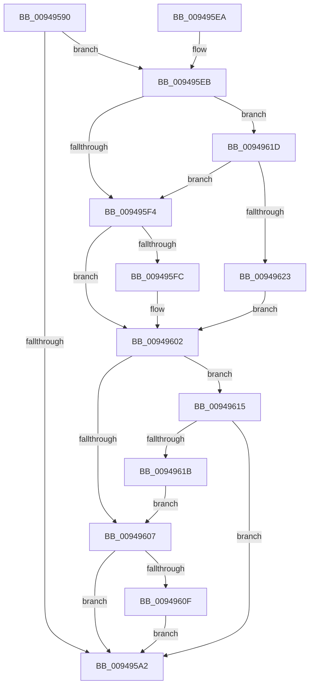

# SeAssignSecurity

- RVA: `0x00949590`–`0x00949625` (길이 `149` bytes)
- VA: `0x0000000140949590`
- 실행 섹션: `PAGE`
- PDB 이름 있음: `예`; PDB Function 태그: `아니요`
- unwind 정보 RVA: `0x00079FE8`
- 디코드: `40`개 명령, `149/149` bytes 표시
- 미해석 바이트: `0` (있으면 어셈블리에 `.byte`로 보존)

> 이 문서는 커널 이미지의 기계어와 PDB 기호를 분석해 생성했습니다. 4번과 5번은 함수 원형과 자료형을 바이너리 사용 방식에서 추정한 C 해석이며 원본 소스 복구 결과는 아닙니다.

## 1. Dependencies

- 직접 호출 지점: **1**; 고유 호출 대상: **1**
- 직접 호출자로 확인된 함수: **3**
- RIP 상대 이미지 참조: **0**

### Outgoing calls
- `0x009495DA` → [RtlpNewSecurityObject](../92/RtlpNewSecurityObject_function_0092AB50.md) (function, `0x0092AB50`)

### Direct callers
- [CmpCreateChild](CmpCreateChild_function_0094817C.md) at `0x00948976`
- [CmpCreateHiveRootCell](../AB/CmpCreateHiveRootCell_function_00ABF568.md) at `0x00ABF6D5`
- [CmFcInitSystem2](../../init/C5/CmFcInitSystem2_function_00C5AD0C.md) at `0x00C5AD7E`

### Static image references
- 디코드된 RIP-relative 메모리 참조가 없습니다.

## 2. Other-region calls and transfers

- 다른 실행 섹션으로 향하는 call: **0**
- 별도 외부 분기/꼬리 이동을 확인하지 못했습니다.

## 3. Assembly (complete function range)

```asm
00949590  48 89 5C 24 08                  mov qword ptr [rsp + 8], rbx
00949595  57                              push rdi
00949596  48 83 EC 60                     sub rsp, 0x60
0094959A  45 33 DB                        xor r11d, r11d
0094959D  48 85 C9                        test rcx, rcx
009495A0  75 49                           jne 0x1409495eb
009495A2  48 83 64 24 50 00               and qword ptr [rsp + 0x50], 0
009495A8  48 83 64 24 48 00               and qword ptr [rsp + 0x48], 0
009495AE  48 8B 84 24 98 00 00 00         mov rax, qword ptr [rsp + 0x98]
009495B6  48 89 44 24 40                  mov qword ptr [rsp + 0x40], rax
009495BB  48 8B 84 24 90 00 00 00         mov rax, qword ptr [rsp + 0x90]
009495C3  48 89 44 24 38                  mov qword ptr [rsp + 0x38], rax
009495C8  44 89 5C 24 30                  mov dword ptr [rsp + 0x30], r11d
009495CD  44 88 4C 24 28                  mov byte ptr [rsp + 0x28], r9b
009495D2  45 33 C9                        xor r9d, r9d
009495D5  83 64 24 20 00                  and dword ptr [rsp + 0x20], 0
009495DA  E8 71 15 FE FF                  call 0x14092ab50
009495DF  48 8B 5C 24 70                  mov rbx, qword ptr [rsp + 0x70]
009495E4  48 83 C4 60                     add rsp, 0x60
009495E8  5F                              pop rdi
009495E9  C3                              ret
009495EA  CC                              int3
009495EB  4C 8D 52 02                     lea r10, [rdx + 2]
009495EF  48 85 D2                        test rdx, rdx
009495F2  75 29                           jne 0x14094961d
009495F4  66 0F BA 61 02 0A               bt word ptr [rcx + 2], 0xa
009495FA  73 06                           jae 0x140949602
009495FC  41 BB 01 00 00 00               mov r11d, 1
00949602  48 85 D2                        test rdx, rdx
00949605  75 0E                           jne 0x140949615
00949607  66 0F BA 61 02 0B               bt word ptr [rcx + 2], 0xb
0094960D  73 93                           jae 0x1409495a2
0094960F  41 83 CB 02                     or r11d, 2
00949613  EB 8D                           jmp 0x1409495a2
00949615  41 F6 02 10                     test byte ptr [r10], 0x10
00949619  75 87                           jne 0x1409495a2
0094961B  EB EA                           jmp 0x140949607
0094961D  41 F6 02 04                     test byte ptr [r10], 4
00949621  74 D1                           je 0x1409495f4
00949623  EB DD                           jmp 0x140949602
```

## 4. C-style interpretation (structured pseudocode)

```c
__int64 __fastcall SeAssignSecurity(__int64 a1, __int64 a2, __int64 a3, int a4, __int64 a5, __int64 a6)
{
    __int64 result;
    __int64 v_r11;
    __int64 v_rsp;
    unsigned __int64 v_stack_m18;
    unsigned __int64 v_stack_m20;
    unsigned __int64 v_stack_m28;
    unsigned __int64 v_stack_m30;
    unsigned int v_stack_m38;
    unsigned __int8 v_stack_m40;
    unsigned int v_stack_m48;
    unsigned __int64 v_stack_p8;

    v_stack_p8 = v_rbx;
    v_rsp = (v_rsp) - (96);
    v_r11 = 0;
    if (a1 != 0) goto loc_009495EB;
loc_009495A2:
    v_stack_m28 = a6;
    v_stack_m30 = a5;
    v_stack_m38 = 0;
    v_stack_m40 = (unsigned __int8)(a4);
    a4 = 0;
    result = RtlpNewSecurityObject(a1, a2, a3, a4);
    v_rsp = (v_rsp) + (96);
    return result;
loc_009495EB:
    if (a2 != 0) goto loc_0094961D;
loc_009495F4:
    if (!(condition_is_above_or_equal)) {
        v_r11 = 1;
    }
    if (a2 != 0) goto loc_00949615;
loc_00949607:
    if (condition_is_above_or_equal) goto loc_009495A2;
    v_r11 = (unsigned int)((v_r11) | (2));
    goto loc_009495A2;
loc_00949615:
    if (((*(unsigned __int8 *)(a2 + 2)) & (16)) != 0) goto loc_009495A2;
    goto loc_00949607;
loc_0094961D:
    if (((*(unsigned __int8 *)(a2 + 2)) & (4)) == 0) goto loc_009495F4;
    goto loc_00949602;
}
```

## 5. (Beta) C Style

```c
int64_t SeAssignSecurity(int64_t Arg1, void *Arg2, int64_t Arg3, int32_t Arg4, int64_t Arg5, int64_t Arg6)
{
    uint8_t *arg2 = (uint8_t *)Arg2;

    int64_t result;
    int64_t local_r11;
    int64_t local_rsp;
    uint64_t v_stack_m18;
    uint64_t v_stack_m20;
    uint64_t v_stack_m28;
    uint64_t v_stack_m30;
    uint32_t v_stack_m38;
    uint8_t v_stack_m40;
    uint32_t v_stack_m48;
    uint64_t v_stack_p8;

    v_stack_p8 = local_rbx;
    local_rsp = (local_rsp) - (96);
    local_r11 = 0;
    if (Arg1 != 0) goto loc_009495EB;
loc_009495A2:
    v_stack_m28 = Arg6;
    v_stack_m30 = Arg5;
    v_stack_m38 = 0;
    v_stack_m40 = (uint8_t)(Arg4);
    Arg4 = 0;
    result = RtlpNewSecurityObject(Arg1, Arg2, Arg3, Arg4);
    local_rsp = (local_rsp) + (96);
    return result;
loc_009495EB:
    if (Arg2 != NULL) goto loc_0094961D;
loc_009495F4:
    if (!(condition_is_above_or_equal)) {
        local_r11 = 1;
    }
    if (Arg2 != NULL) goto loc_00949615;
loc_00949607:
    if (condition_is_above_or_equal) goto loc_009495A2;
    local_r11 = (uint32_t)((local_r11) | (2));
    goto loc_009495A2;
loc_00949615:
    if (((*(uint8_t *)(arg2 + 0x2)) & (16)) != 0) goto loc_009495A2;
    goto loc_00949607;
loc_0094961D:
    if (((*(uint8_t *)(arg2 + 0x2)) & (4)) == 0) goto loc_009495F4;
    goto loc_00949602;
}
```

### 관측된 메모리 오프셋

구조체 형식이 확인되지 않은 접근은 인자 기준의 오프셋으로만 기록했습니다.

| 기준 인자 | 오프셋 표현 | 폭 (bit) | 접근 |
|---|---:|---:|---|
| `Arg2` | `+ 0x0` | `8` | `R` |
| `Arg2` | `+ 0x2` | `64` | `R` |

## 6. Execution-region graph

[열기: 2D/3D 그래프와 함수 탐색 컨트롤 패널](../../../control-panel.html?section=page&rva=0x00949590&view=graph)

- 2D 그래프는 위에서 아래로 흐르고, 3D 그래프는 빈 공간을 드래그해 회전합니다. Shift+드래그는 이동, 휠은 확대·축소, 함수 노드 선택은 대상 보고서 이동입니다.

### Static fallback


