# SeAuditProcessCreation

- RVA: `0x00947624`–`0x00947A6E` (길이 `1,098` bytes)
- VA: `0x0000000140947624`
- 실행 섹션: `PAGE`
- PDB 이름 있음: `예`; PDB Function 태그: `예`
- unwind 정보 RVA: `0x00090ABC`
- 디코드: `239`개 명령, `1,098/1,098` bytes 표시
- 미해석 바이트: `0` (있으면 어셈블리에 `.byte`로 보존)

> 이 문서는 커널 이미지의 기계어와 PDB 기호를 분석해 생성했습니다. 4번과 5번은 함수 원형과 자료형을 바이너리 사용 방식에서 추정한 C 해석이며 원본 소스 복구 결과는 아닙니다.

## 1. Dependencies

- 직접 호출 지점: **18**; 고유 호출 대상: **14**
- 직접 호출자로 확인된 함수: **1**
- RIP 상대 이미지 참조: **5**

### Outgoing calls
- `0x009476C1` → [PsGetAllocatedFullProcessImageNameEx](../91/PsGetAllocatedFullProcessImageNameEx_function_0091D6F0.md) (function, `0x0091D6F0`)
- `0x009476D9` → [PsLookupProcessByProcessId](../8A/PsLookupProcessByProcessId_function_008A2AA0.md) (function, `0x008A2AA0`)
- `0x009476F6` → [PsReferencePrimaryTokenWithTag](../../text/20/PsReferencePrimaryTokenWithTag_function_0020FF80.md) (function, `0x0020FF80`)
- `0x00947752` → [RtlCopySid](../9A/RtlCopySid_function_009A9A50.md) (function, `0x009A9A50`)
- `0x00947765` → [ObfDereferenceObject](../../text/2F/ObfDereferenceObject_function_002F9350.md) (function, `0x002F9350`)
- `0x00947770` → [SepAuditFailed](../86/SepAuditFailed_function_0086EE20.md) (function, `0x0086EE20`)
- `0x0094778F` → [ExFreePoolWithTag](../../poolcode/B8/ExFreePoolWithTag_function_00B82870.md) (function, `0x00B82870`)
- `0x009477A7` → [_security_check_cookie](../../text/6A/_security_check_cookie_function_006AC640.md) (function, `0x006AC640`)
- `0x009477D2` → [ObfDereferenceObject](../../text/2F/ObfDereferenceObject_function_002F9350.md) (function, `0x002F9350`)
- `0x00947800` → [SeCaptureSubjectContext](../86/SeCaptureSubjectContext_function_0086B820.md) (function, `0x0086B820`)
- `0x00947811` → [memset](../../text/6C/memset_function_006C6C40.md) (function, `0x006C6C40`)
- `0x00947976` → [SepAdtLogAuditRecord](../../text/22/SepAdtLogAuditRecord_function_00224B6C.md) (function, `0x00224B6C`)
- `0x00947980` → [SeReleaseSubjectContext](../86/SeReleaseSubjectContext_function_0086B710.md) (function, `0x0086B710`)
- `0x009479A4` → [PsGetAllocatedFullProcessImageNameEx](../91/PsGetAllocatedFullProcessImageNameEx_function_0091D6F0.md) (function, `0x0091D6F0`)
- `0x009479AE` → [ObfDereferenceObjectWithTag](../../text/2F/ObfDereferenceObjectWithTag_function_002F78E0.md) (function, `0x002F78E0`)
- `0x00947A1D` → [RtlInitUnicodeString](../../text/42/RtlInitUnicodeString_function_0042A780.md) (function, `0x0042A780`)
- `0x00947A4C` → [ExFreePoolWithTag](../../poolcode/B8/ExFreePoolWithTag_function_00B82870.md) (function, `0x00B82870`)
- `0x00947A64` → [ExFreePoolWithTag](../../poolcode/B8/ExFreePoolWithTag_function_00B82870.md) (function, `0x00B82870`)

### Direct callers
- [PspInsertProcess](PspInsertProcess_function_009472CC.md) at `0x0094733F`

### Static image references
- `0x00947643` → RVA `0x00E0A740` (`.data`; read)
- `0x009477C8` → RVA `0x00FD9B78` (`PAGEDATA`; read)
- `0x009477D7` → RVA `0x00F04AC4` (`.data`; read)
- `0x0094788B` → RVA `0x000013A8` (`.rdata`; read)
- `0x00947A11` → RVA `0x00AFCAD0` (` ?? ::NNGAKEGL::`string'`; read)

## 2. Other-region calls and transfers

- 다른 실행 섹션으로 향하는 call: **11**
  - `0x009476F6` → [PsReferencePrimaryTokenWithTag](../../text/20/PsReferencePrimaryTokenWithTag_function_0020FF80.md) (`PAGE` → `.text`)
  - `0x00947765` → [ObfDereferenceObject](../../text/2F/ObfDereferenceObject_function_002F9350.md) (`PAGE` → `.text`)
  - `0x0094778F` → [ExFreePoolWithTag](../../poolcode/B8/ExFreePoolWithTag_function_00B82870.md) (`PAGE` → `POOLCODE`)
  - `0x009477A7` → [_security_check_cookie](../../text/6A/_security_check_cookie_function_006AC640.md) (`PAGE` → `.text`)
  - `0x009477D2` → [ObfDereferenceObject](../../text/2F/ObfDereferenceObject_function_002F9350.md) (`PAGE` → `.text`)
  - `0x00947811` → [memset](../../text/6C/memset_function_006C6C40.md) (`PAGE` → `.text`)
  - `0x00947976` → [SepAdtLogAuditRecord](../../text/22/SepAdtLogAuditRecord_function_00224B6C.md) (`PAGE` → `.text`)
  - `0x009479AE` → [ObfDereferenceObjectWithTag](../../text/2F/ObfDereferenceObjectWithTag_function_002F78E0.md) (`PAGE` → `.text`)
  - `0x00947A1D` → [RtlInitUnicodeString](../../text/42/RtlInitUnicodeString_function_0042A780.md) (`PAGE` → `.text`)
  - `0x00947A4C` → [ExFreePoolWithTag](../../poolcode/B8/ExFreePoolWithTag_function_00B82870.md) (`PAGE` → `POOLCODE`)
  - `0x00947A64` → [ExFreePoolWithTag](../../poolcode/B8/ExFreePoolWithTag_function_00B82870.md) (`PAGE` → `POOLCODE`)
- call이 아닌 외부 분기/꼬리 이동: **1**
  - `0x009477ED` → [sub_00B25678](../B2/Unknown_function_00B25678.md) (`tail-transfer`)

## 3. Assembly (complete function range)

```asm
00947624  48 89 5C 24 18                  mov qword ptr [rsp + 0x18], rbx
00947629  55                              push rbp
0094762A  56                              push rsi
0094762B  57                              push rdi
0094762C  41 54                           push r12
0094762E  41 55                           push r13
00947630  41 56                           push r14
00947632  41 57                           push r15
00947634  48 8D AC 24 E0 FB FF FF         lea rbp, [rsp - 0x420]
0094763C  48 81 EC 20 05 00 00            sub rsp, 0x520
00947643  48 8B 05 F6 30 4C 00            mov rax, qword ptr [rip + 0x4c30f6]
0094764A  48 33 C4                        xor rax, rsp
0094764D  48 89 85 10 04 00 00            mov qword ptr [rbp + 0x410], rax
00947654  45 33 E4                        xor r12d, r12d
00947657  48 89 54 24 60                  mov qword ptr [rsp + 0x60], rdx
0094765C  0F 57 C0                        xorps xmm0, xmm0
0094765F  4C 8B F9                        mov r15, rcx
00947662  41 8A F4                        mov sil, r12b
00947665  44 89 64 24 34                  mov dword ptr [rsp + 0x34], r12d
0094766A  41 8B FC                        mov edi, r12d
0094766D  4C 89 64 24 38                  mov qword ptr [rsp + 0x38], r12
00947672  45 8B EC                        mov r13d, r12d
00947675  4C 89 64 24 40                  mov qword ptr [rsp + 0x40], r12
0094767A  0F 11 44 24 78                  movups xmmword ptr [rsp + 0x78], xmm0
0094767F  4C 89 64 24 48                  mov qword ptr [rsp + 0x48], r12
00947684  0F 11 45 88                     movups xmmword ptr [rbp - 0x78], xmm0
00947688  44 88 64 24 30                  mov byte ptr [rsp + 0x30], r12b
0094768D  0F 11 44 24 50                  movups xmmword ptr [rsp + 0x50], xmm0
00947692  44 88 64 24 31                  mov byte ptr [rsp + 0x31], r12b
00947697  4C 39 A1 50 03 00 00            cmp qword ptr [rcx + 0x350], r12
0094769E  0F 84 F9 00 00 00               je 0x14094779d
009476A4  48 8B 81 D0 01 00 00            mov rax, qword ptr [rcx + 0x1d0]
009476AB  48 8D 54 24 40                  lea rdx, [rsp + 0x40]
009476B0  48 8B 99 D0 02 00 00            mov rbx, qword ptr [rcx + 0x2d0]
009476B7  48 89 44 24 68                  mov qword ptr [rsp + 0x68], rax
009476BC  48 89 5C 24 70                  mov qword ptr [rsp + 0x70], rbx
009476C1  E8 2A 60 FD FF                  call 0x14091d6f0
009476C6  44 8B F0                        mov r14d, eax
009476C9  85 C0                           test eax, eax
009476CB  0F 88 9C 00 00 00               js 0x14094776d
009476D1  48 8D 54 24 38                  lea rdx, [rsp + 0x38]
009476D6  48 8B CB                        mov rcx, rbx
009476D9  E8 C2 B3 F5 FF                  call 0x1408a2aa0
009476DE  BE 44 66 6C 74                  mov esi, 0x746c6644
009476E3  85 C0                           test eax, eax
009476E5  0F 89 9F 02 00 00               jns 0x14094798a
009476EB  41 BD 35 07 00 00               mov r13d, 0x735
009476F1  8B D6                           mov edx, esi
009476F3  49 8B CF                        mov rcx, r15
009476F6  E8 85 88 8C FF                  call 0x14020ff80
009476FB  48 8B F0                        mov rsi, rax
009476FE  48 85 C0                        test rax, rax
00947701  0F 84 30 03 00 00               je 0x140947a37
00947707  48 8B 80 D8 00 00 00            mov rax, qword ptr [rax + 0xd8]
0094770E  8B 48 28                        mov ecx, dword ptr [rax + 0x28]
00947711  F6 C1 04                        test cl, 4
00947714  0F 84 AA 02 00 00               je 0x1409479c4
0094771A  41 BC 92 07 00 00               mov r12d, 0x792
00947720  8B 86 D0 00 00 00               mov eax, dword ptr [rsi + 0xd0]
00947726  48 8B 5E 18                     mov rbx, qword ptr [rsi + 0x18]
0094772A  48 89 5C 24 38                  mov qword ptr [rsp + 0x38], rbx
0094772F  3B 46 7C                        cmp eax, dword ptr [rsi + 0x7c]
00947732  0F 83 90 00 00 00               jae 0x1409477c8
00947738  4C 8B 86 98 00 00 00            mov r8, qword ptr [rsi + 0x98]
0094773F  48 8D 95 C0 03 00 00            lea rdx, [rbp + 0x3c0]
00947746  48 03 C0                        add rax, rax
00947749  B9 44 00 00 00                  mov ecx, 0x44
0094774E  4D 8B 04 C0                     mov r8, qword ptr [r8 + rax*8]
00947752  E8 F9 22 06 00                  call 0x1409a9a50
00947757  44 8B F0                        mov r14d, eax
0094775A  85 C0                           test eax, eax
0094775C  0F 89 56 02 00 00               jns 0x1409479b8
00947762  48 8B CE                        mov rcx, rsi
00947765  E8 E6 1B 9B FF                  call 0x1402f9350
0094776A  40 8A F7                        mov sil, dil
0094776D  41 8B CE                        mov ecx, r14d
00947770  E8 AB 76 F2 FF                  call 0x14086ee20
00947775  48 8B 4C 24 40                  mov rcx, qword ptr [rsp + 0x40]
0094777A  48 85 C9                        test rcx, rcx
0094777D  0F 85 C7 02 00 00               jne 0x140947a4a
00947783  48 8B 4C 24 48                  mov rcx, qword ptr [rsp + 0x48]
00947788  48 85 C9                        test rcx, rcx
0094778B  74 07                           je 0x140947794
0094778D  33 D2                           xor edx, edx
0094778F  E8 DC B0 23 00                  call 0x140b82870
00947794  40 84 F6                        test sil, sil
00947797  0F 85 B9 02 00 00               jne 0x140947a56
0094779D  48 8B 8D 10 04 00 00            mov rcx, qword ptr [rbp + 0x410]
009477A4  48 33 CC                        xor rcx, rsp
009477A7  E8 94 4E D6 FF                  call 0x1406ac640
009477AC  48 8B 9C 24 70 05 00 00         mov rbx, qword ptr [rsp + 0x570]
009477B4  48 81 C4 20 05 00 00            add rsp, 0x520
009477BB  41 5F                           pop r15
009477BD  41 5E                           pop r14
009477BF  41 5D                           pop r13
009477C1  41 5C                           pop r12
009477C3  5F                              pop rdi
009477C4  5E                              pop rsi
009477C5  5D                              pop rbp
009477C6  C3                              ret
009477C7  CC                              int3
009477C8  4C 8B 35 A9 23 69 00            mov r14, qword ptr [rip + 0x6923a9]
009477CF  48 8B CE                        mov rcx, rsi
009477D2  E8 79 1B 9B FF                  call 0x1402f9350
009477D7  8A 05 E7 D2 5B 00               mov al, byte ptr [rip + 0x5bd2e7]
009477DD  84 C0                           test al, al
009477DF  0F 84 2C 02 00 00               je 0x140947a11
009477E5  48 8B 44 24 60                  mov rax, qword ptr [rsp + 0x60]
009477EA  48 85 C0                        test rax, rax
009477ED  0F 84 85 DE 1D 00               je 0x140b25678
009477F3  48 8B F8                        mov rdi, rax
009477F6  40 8A 74 24 30                  mov sil, byte ptr [rsp + 0x30]
009477FB  48 8D 4C 24 78                  lea rcx, [rsp + 0x78]
00947800  E8 1B 40 F2 FF                  call 0x14086b820
00947805  33 D2                           xor edx, edx
00947807  48 8D 4D A0                     lea rcx, [rbp - 0x60]
0094780B  41 B8 18 04 00 00               mov r8d, 0x418
00947811  E8 2A F4 D7 FF                  call 0x1406c6c40
00947816  48 8B 4D 88                     mov rcx, qword ptr [rbp - 0x78]
0094781A  41 BB 05 00 00 00               mov r11d, 5
00947820  44 89 5D A0                     mov dword ptr [rbp - 0x60], r11d
00947824  C7 45 B0 86 00 08 00            mov dword ptr [rbp - 0x50], 0x80086
0094782B  C7 45 A4 50 12 00 00            mov dword ptr [rbp - 0x5c], 0x1250
00947832  48 8B 81 98 00 00 00            mov rax, qword ptr [rcx + 0x98]
00947839  45 8D 53 03                     lea r10d, [r11 + 3]
0094783D  48 8B 10                        mov rdx, qword ptr [rax]
00947840  48 8B 41 18                     mov rax, qword ptr [rcx + 0x18]
00947844  3B C3                           cmp eax, ebx
00947846  0F 85 F6 01 00 00               jne 0x140947a42
0094784C  48 8B C8                        mov rcx, rax
0094784F  48 C1 E9 20                     shr rcx, 0x20
00947853  3B 4C 24 3C                     cmp ecx, dword ptr [rsp + 0x3c]
00947857  0F 85 E5 01 00 00               jne 0x140947a42
0094785D  44 8A 44 24 31                  mov r8b, byte ptr [rsp + 0x31]
00947862  0F B6 4A 01                     movzx ecx, byte ptr [rdx + 1]
00947866  41 B9 04 00 00 00               mov r9d, 4
0094786C  48 89 45 00                     mov qword ptr [rbp], rax
00947870  48 8B 44 24 68                  mov rax, qword ptr [rsp + 0x68]
00947875  48 89 45 20                     mov qword ptr [rbp + 0x20], rax
00947879  8D 0C 8D 08 00 00 00            lea ecx, [rcx*4 + 8]
00947880  48 89 55 D0                     mov qword ptr [rbp - 0x30], rdx
00947884  89 4D BC                        mov dword ptr [rbp - 0x44], ecx
00947887  41 8D 51 07                     lea edx, [r9 + 7]
0094788B  48 8D 0D 16 9B 6B FF            lea rcx, [rip - 0x9464ea]
00947892  44 89 4D B8                     mov dword ptr [rbp - 0x48], r9d
00947896  48 89 4D F0                     mov qword ptr [rbp - 0x10], rcx
0094789A  48 8B 4C 24 40                  mov rcx, qword ptr [rsp + 0x40]
0094789F  48 89 4D 50                     mov qword ptr [rbp + 0x50], rcx
009478A3  C7 45 D8 01 00 00 00            mov dword ptr [rbp - 0x28], 1
009478AA  C7 45 DC 20 00 00 00            mov dword ptr [rbp - 0x24], 0x20
009478B1  0F B7 01                        movzx eax, word ptr [rcx]
009478B4  8D 4A 0A                        lea ecx, [rdx + 0xa]
009478B7  83 C0 10                        add eax, 0x10
009478BA  44 89 5D F8                     mov dword ptr [rbp - 8], r11d
009478BE  89 45 3C                        mov dword ptr [rbp + 0x3c], eax
009478C1  48 8B 44 24 70                  mov rax, qword ptr [rsp + 0x70]
009478C6  48 89 85 80 00 00 00            mov qword ptr [rbp + 0x80], rax
009478CD  0F B7 07                        movzx eax, word ptr [rdi]
009478D0  83 C0 10                        add eax, 0x10
009478D3  44 89 55 FC                     mov dword ptr [rbp - 4], r10d
009478D7  89 55 18                        mov dword ptr [rbp + 0x18], edx
009478DA  44 89 55 1C                     mov dword ptr [rbp + 0x1c], r10d
009478DE  C7 45 38 02 00 00 00            mov dword ptr [rbp + 0x38], 2
009478E5  89 4D 58                        mov dword ptr [rbp + 0x58], ecx
009478E8  44 89 4D 5C                     mov dword ptr [rbp + 0x5c], r9d
009478EC  4C 89 65 60                     mov qword ptr [rbp + 0x60], r12
009478F0  89 55 78                        mov dword ptr [rbp + 0x78], edx
009478F3  44 89 55 7C                     mov dword ptr [rbp + 0x7c], r10d
009478F7  C7 85 98 00 00 00 22 00 00 00   mov dword ptr [rbp + 0x98], 0x22
00947901  89 85 9C 00 00 00               mov dword ptr [rbp + 0x9c], eax
00947907  48 89 BD B0 00 00 00            mov qword ptr [rbp + 0xb0], rdi
0094790E  45 84 C0                        test r8b, r8b
00947911  0F 84 C4 00 00 00               je 0x1409479db
00947917  C7 85 B8 00 00 00 23 00 00 00   mov dword ptr [rbp + 0xb8], 0x23
00947921  44 89 95 BC 00 00 00            mov dword ptr [rbp + 0xbc], r10d
00947928  48 89 9D C0 00 00 00            mov qword ptr [rbp + 0xc0], rbx
0094792F  45 85 ED                        test r13d, r13d
00947932  0F 84 B2 00 00 00               je 0x1409479ea
00947938  41 8B C5                        mov eax, r13d
0094793B  48 89 85 E0 00 00 00            mov qword ptr [rbp + 0xe0], rax
00947942  89 8D D8 00 00 00               mov dword ptr [rbp + 0xd8], ecx
00947948  44 89 8D DC 00 00 00            mov dword ptr [rbp + 0xdc], r9d
0094794F  41 0F B6 46 01                  movzx eax, byte ptr [r14 + 1]
00947954  48 8D 4D A0                     lea rcx, [rbp - 0x60]
00947958  44 89 8D F8 00 00 00            mov dword ptr [rbp + 0xf8], r9d
0094795F  4C 89 B5 10 01 00 00            mov qword ptr [rbp + 0x110], r14
00947966  89 55 A8                        mov dword ptr [rbp - 0x58], edx
00947969  8D 04 85 08 00 00 00            lea eax, [rax*4 + 8]
00947970  89 85 FC 00 00 00               mov dword ptr [rbp + 0xfc], eax
00947976  E8 F1 D1 8D FF                  call 0x140224b6c
0094797B  48 8D 4C 24 78                  lea rcx, [rsp + 0x78]
00947980  E8 8B 3D F2 FF                  call 0x14086b710
00947985  E9 EB FD FF FF                  jmp 0x140947775
0094798A  48 8B 5C 24 38                  mov rbx, qword ptr [rsp + 0x38]
0094798F  4C 39 A3 50 03 00 00            cmp qword ptr [rbx + 0x350], r12
00947996  0F 84 90 00 00 00               je 0x140947a2c
0094799C  48 8D 54 24 48                  lea rdx, [rsp + 0x48]
009479A1  48 8B CB                        mov rcx, rbx
009479A4  E8 47 5D FD FF                  call 0x14091d6f0
009479A9  8B D6                           mov edx, esi
009479AB  48 8B CB                        mov rcx, rbx
009479AE  E8 2D FF 9A FF                  call 0x1402f78e0
009479B3  E9 39 FD FF FF                  jmp 0x1409476f1
009479B8  4C 8D B5 C0 03 00 00            lea r14, [rbp + 0x3c0]
009479BF  E9 0B FE FF FF                  jmp 0x1409477cf
009479C4  44 0F B6 E1                     movzx r12d, cl
009479C8  41 83 E4 02                     and r12d, 2
009479CC  49 81 CC 20 0F 00 00            or r12, 0xf20
009479D3  49 D1 EC                        shr r12, 1
009479D6  E9 45 FD FF FF                  jmp 0x140947720
009479DB  C7 85 B8 00 00 00 06 00 00 00   mov dword ptr [rbp + 0xb8], 6
009479E5  E9 45 FF FF FF                  jmp 0x14094792f
009479EA  48 8B 4C 24 48                  mov rcx, qword ptr [rsp + 0x48]
009479EF  C7 85 D8 00 00 00 02 00 00 00   mov dword ptr [rbp + 0xd8], 2
009479F9  48 89 8D F0 00 00 00            mov qword ptr [rbp + 0xf0], rcx
00947A00  0F B7 01                        movzx eax, word ptr [rcx]
00947A03  83 C0 10                        add eax, 0x10
00947A06  89 85 DC 00 00 00               mov dword ptr [rbp + 0xdc], eax
00947A0C  E9 3E FF FF FF                  jmp 0x14094794f
00947A11  48 8D 15 B8 50 1B 00            lea rdx, [rip + 0x1b50b8]
00947A18  48 8D 4C 24 50                  lea rcx, [rsp + 0x50]
00947A1D  E8 5E 2D AE FF                  call 0x14042a780
00947A22  48 8D 7C 24 50                  lea rdi, [rsp + 0x50]
00947A27  E9 CA FD FF FF                  jmp 0x1409477f6
00947A2C  41 BD 34 07 00 00               mov r13d, 0x734
00947A32  E9 72 FF FF FF                  jmp 0x1409479a9
00947A37  41 BE 7C 00 00 C0               mov r14d, 0xc000007c
00947A3D  E9 28 FD FF FF                  jmp 0x14094776a
00947A42  41 B0 01                        mov r8b, 1
00947A45  E9 18 FE FF FF                  jmp 0x140947862
00947A4A  33 D2                           xor edx, edx
00947A4C  E8 1F AE 23 00                  call 0x140b82870
00947A51  E9 2D FD FF FF                  jmp 0x140947783
00947A56  48 85 FF                        test rdi, rdi
00947A59  0F 84 3E FD FF FF               je 0x14094779d
00947A5F  33 D2                           xor edx, edx
00947A61  48 8B CF                        mov rcx, rdi
00947A64  E8 07 AE 23 00                  call 0x140b82870
00947A69  E9 2F FD FF FF                  jmp 0x14094779d
```

## 4. C-style interpretation (structured pseudocode)

```c
__int64 __fastcall SeAuditProcessCreation(__int64 a1, __int64 a2)
{
    __int64 result;
    __int64 v_r12;
    __int64 v_rsp;
    unsigned __int64 v_stack_m348;
    unsigned int v_stack_m35C;
    unsigned int v_stack_m360;
    unsigned __int64 v_stack_m368;
    unsigned __int64 v_stack_m378;
    unsigned int v_stack_m37C;
    unsigned int v_stack_m380;
    unsigned __int64 v_stack_m398;
    unsigned int v_stack_m39C;
    unsigned int v_stack_m3A0;
    unsigned __int64 v_stack_m3A8;
    unsigned int v_stack_m3BC;
    unsigned int v_stack_m3C0;
    unsigned __int64 v_stack_m3D8;
    unsigned int v_stack_m3DC;
    unsigned int v_stack_m3E0;
    unsigned __int64 v_stack_m3F8;
    unsigned int v_stack_m3FC;
    unsigned int v_stack_m400;
    unsigned __int64 v_stack_m408;
    unsigned int v_stack_m41C;
    unsigned int v_stack_m420;
    unsigned __int64 v_stack_m438;
    unsigned int v_stack_m43C;
    unsigned int v_stack_m440;
    unsigned __int64 v_stack_m458;
    unsigned int v_stack_m45C;
    unsigned int v_stack_m460;
    unsigned __int64 v_stack_m468;
    unsigned int v_stack_m47C;
    unsigned __int64 v_stack_m48;
    unsigned int v_stack_m480;
    unsigned __int64 v_stack_m488;
    unsigned int v_stack_m49C;
    unsigned int v_stack_m4A0;
    unsigned int v_stack_m4A8;
    unsigned int v_stack_m4B0;
    unsigned int v_stack_m4B4;
    unsigned __int64 v_stack_m4B8;
    unsigned __int64 v_stack_m4D0;
    unsigned __int64 v_stack_m4E0;
    unsigned __int64 v_stack_m4E8;
    unsigned __int64 v_stack_m4F0;
    unsigned __int64 v_stack_m4F8;
    unsigned __int64 v_stack_m508;
    unsigned __int64 v_stack_m510;
    unsigned __int64 v_stack_m518;
    unsigned __int64 v_stack_m520;
    unsigned int v_stack_m524;
    unsigned __int8 v_stack_m527;
    unsigned __int8 v_stack_m528;
    unsigned __int64 v_stack_m98;
    unsigned __int64 v_stack_p18;
    unsigned __int8 v_stack_p30;
    unsigned __int8 v_stack_p31;
    unsigned __int64 v_stack_p38;
    unsigned int v_stack_p3C;
    unsigned __int64 v_stack_p40;
    unsigned __int64 v_stack_p48;
    unsigned __int64 v_stack_p50;
    unsigned __int64 v_stack_p60;
    unsigned __int64 v_stack_p68;
    unsigned __int64 v_stack_p70;
    unsigned __int64 v_stack_p78;

    v_stack_p18 = v_rbx;
    v_rsp = (v_rsp) - (0x520ULL);
    result = (*(unsigned __int64 *)(v_rip + 4993270)) ^ (v_rsp);
    v_stack_m48 = result;
    v_r12 = 0;
    v_stack_m4F8 = a2;
    v_stack_m524 = 0;
    v_stack_m520 = 0;
    v_stack_m518 = 0;
    v_stack_m4E0 = v_xmm0;
    v_stack_m510 = 0;
    v_stack_m4D0 = v_xmm0;
    v_stack_m528 = 0;
    v_stack_m508 = v_xmm0;
    v_stack_m527 = 0;
    if ((*(unsigned __int64 *)(a1 + 848)) == 0) goto loc_0094779D;
    v_stack_m4F0 = *(unsigned __int64 *)(a1 + 464);
    v_stack_m4E8 = *(unsigned __int64 *)(a1 + 720);
    result = PsGetAllocatedFullProcessImageNameEx(a1, v_stack_m518, a3, a4);
    if (sign_flag) goto loc_0094776D;
    result = PsLookupProcessByProcessId(*(unsigned __int64 *)(a1 + 720), v_stack_m520, a3, a4);
    if (!sign_flag) goto loc_0094798A;
loc_009476F1:
    result = PsReferencePrimaryTokenWithTag(a1, (unsigned int)((unsigned int)((unsigned int)(0x746C6644ULL))), a3, a4);
    if (result == 0) goto loc_00947A37;
    if ((((unsigned __int8)((unsigned int)(*(unsigned int *)(*(unsigned __int64 *)(result + 216) + 40)))) & (4)) == 0) goto loc_009479C4;
loc_00947720:
    v_stack_m520 = *(unsigned __int64 *)(result + 24);
    if (((unsigned int)((unsigned int)(*(unsigned int *)(result + 208)))) >= (*(unsigned int *)(result + 124))) goto loc_009477C8;
    result = ((unsigned int)(*(unsigned int *)(result + 208))) + ((unsigned int)(*(unsigned int *)(result + 208)));
    result = RtlCopySid(68, v_stack_m98, *(unsigned __int64 *)(*(unsigned __int64 *)(result + 152) + result * 8), a4);
    if (!sign_flag) goto loc_009479B8;
    result = ObfDereferenceObject(result, v_stack_m98, *(unsigned __int64 *)(*(unsigned __int64 *)(result + 152) + result * 8), a4);
loc_0094776A:
loc_0094776D:
    result = SepAuditFailed((unsigned int)((unsigned int)((unsigned int)((unsigned int)(result)))), v_stack_m98, *(unsigned __int64 *)(*(unsigned __int64 *)(result + 152) + result * 8), a4);
loc_00947775:
    if (v_stack_m518 != 0) goto loc_00947A4A;
loc_00947783:
    if (v_stack_m510 != 0) {
        a2 = 0;
        result = ExFreePoolWithTag(v_stack_m510, a2, *(unsigned __int64 *)(*(unsigned __int64 *)(result + 152) + result * 8), a4);
    }
    if (0 != 0) goto loc_00947A56;
loc_0094779D:
    a1 = (v_stack_m48) ^ (v_rsp);
    result = _security_check_cookie(a1, a2, *(unsigned __int64 *)(*(unsigned __int64 *)(result + 152) + result * 8), a4);
    v_rsp = (v_rsp) + (0x520ULL);
    return result;
loc_009477C8:
loc_009477CF:
    result = ObfDereferenceObject(0, a2, *(unsigned __int64 *)(*(unsigned __int64 *)(result + 152) + result * 8), a4);
    if ((unsigned __int8)(*(unsigned __int8 *)(v_rip + 6017767)) == 0) goto loc_00947A11;
loc_009477F6:
    result = SeCaptureSubjectContext(v_stack_p78, a2, *(unsigned __int64 *)(*(unsigned __int64 *)(result + 152) + result * 8), a4);
    a2 = 0;
    result = memset(v_stack_m4B8, a2, (unsigned int)(0x418ULL), a4);
    v_stack_m4B8 = 5;
    v_stack_m4A8 = 0x80086ULL;
    v_stack_m4B4 = 0x1250ULL;
    if (((unsigned int)(*(unsigned __int64 *)(v_stack_m4D0 + 24))) != ((unsigned int)(v_stack_p18))) goto loc_00947A42;
    a1 = (*(unsigned __int64 *)(v_stack_m4D0 + 24)) >> (32);
    if (((unsigned int)(a1)) != v_stack_p3C) goto loc_00947A42;
loc_00947862:
    v_stack_m458 = *(unsigned __int64 *)(v_stack_m4D0 + 24);
    v_stack_m438 = v_stack_p68;
    v_stack_m488 = *(unsigned __int64 *)(*(unsigned __int64 *)(v_stack_m4D0 + 152));
    v_stack_m49C = (unsigned int)(*(unsigned __int8 *)(*(unsigned __int64 *)(*(unsigned __int64 *)(v_stack_m4D0 + 152)) + 1) * 4 + 8);
    v_stack_m4A0 = 4;
    v_stack_m468 = v_rip - 9725162;
    v_stack_m408 = v_stack_p40;
    v_stack_m480 = 1;
    v_stack_m47C = 32;
    result = (unsigned int)((*(unsigned __int16 *)(v_stack_p40)) + (16));
    v_stack_m460 = 5;
    v_stack_m41C = (unsigned int)(result);
    v_stack_m3D8 = v_stack_p70;
    result = (unsigned int)((*(unsigned __int16 *)(v_stack_p60)) + (16));
    v_stack_m45C = (unsigned int)(5 + 3);
    v_stack_m440 = (unsigned int)(4 + 7);
    v_stack_m43C = (unsigned int)(5 + 3);
    v_stack_m420 = 2;
    v_stack_m400 = (unsigned int)(4 + 7 + 10);
    v_stack_m3FC = 4;
    v_stack_m3F8 = (unsigned int)(0x792ULL);
    v_stack_m3E0 = (unsigned int)(4 + 7);
    v_stack_m3DC = (unsigned int)(5 + 3);
    v_stack_m3C0 = 34;
    v_stack_m3BC = (unsigned int)(result);
    v_stack_m3A8 = v_stack_p60;
    if ((unsigned __int8)(v_stack_p31) == 0) goto loc_009479DB;
    v_stack_m3A0 = 35;
    v_stack_m39C = (unsigned int)(5 + 3);
    v_stack_m398 = v_stack_p18;
loc_0094792F:
    if ((unsigned int)((unsigned int)(0x735ULL)) == 0) goto loc_009479EA;
    v_stack_m378 = (unsigned int)((unsigned int)((unsigned int)(0x735ULL)));
    v_stack_m380 = (unsigned int)(4 + 7 + 10);
    v_stack_m37C = 4;
loc_0094794F:
    v_stack_m360 = 4;
    v_stack_m348 = *(unsigned __int64 *)(v_rip + 6890409);
    v_stack_m4B0 = (unsigned int)(4 + 7);
    v_stack_m35C = (unsigned int)(*(unsigned __int8 *)(*(unsigned __int64 *)(v_rip + 6890409) + 1) * 4 + 8);
    result = SepAdtLogAuditRecord(v_stack_m4B8, 4 + 7, v_stack_p31, 4);
    result = SeReleaseSubjectContext(v_stack_p78, 4 + 7, v_stack_p31, 4);
    goto loc_00947775;
loc_0094798A:
    if ((*(unsigned __int64 *)(v_stack_p38 + 848)) == ((unsigned int)(0x792ULL))) goto loc_00947A2C;
    result = PsGetAllocatedFullProcessImageNameEx(v_stack_p38, v_stack_p48, v_stack_p31, 4);
loc_009479A9:
    result = ObfDereferenceObjectWithTag(v_stack_p38, (unsigned int)((unsigned int)(v_stack_p30)), v_stack_p31, 4);
    goto loc_009476F1;
loc_009479B8:
    goto loc_009477CF;
loc_009479C4:
    v_r12 = (unsigned int)(((unsigned __int8)(v_stack_p38)) & (2));
    v_r12 = (v_r12) | (0xF20ULL);
    v_r12 = (v_r12) >> (1);
    goto loc_00947720;
loc_009479DB:
    v_stack_m3A0 = 6;
    goto loc_0094792F;
loc_009479EA:
    v_stack_m380 = 2;
    v_stack_m368 = v_stack_p48;
    result = (unsigned int)((*(unsigned __int16 *)(v_stack_p48)) + (16));
    v_stack_m37C = (unsigned int)(result);
    goto loc_0094794F;
loc_00947A11:
    result = RtlInitUnicodeString(v_stack_p50, v_rip + 1790136, v_stack_p31, 4);
    goto loc_009477F6;
loc_00947A2C:
    goto loc_009479A9;
loc_00947A37:
    goto loc_0094776A;
loc_00947A42:
    goto loc_00947862;
loc_00947A4A:
    a2 = 0;
    result = ExFreePoolWithTag(v_stack_p50, a2, 1, 4);
    goto loc_00947783;
loc_00947A56:
    if (v_stack_p50 == 0) goto loc_0094779D;
    a2 = 0;
    result = ExFreePoolWithTag(v_stack_p50, a2, 1, 4);
    goto loc_0094779D;
}
```

## 5. (Beta) C Style

```c
int64_t SeAuditProcessCreation(void *Arg1, int64_t Arg2)
{
    uint8_t *arg1 = (uint8_t *)Arg1;

    int64_t result;
    int64_t local_r12;
    int64_t local_rsp;
    uint64_t v_stack_m348;
    uint32_t v_stack_m35C;
    uint32_t v_stack_m360;
    uint64_t v_stack_m368;
    uint64_t v_stack_m378;
    uint32_t v_stack_m37C;
    uint32_t v_stack_m380;
    uint64_t v_stack_m398;
    uint32_t v_stack_m39C;
    uint32_t v_stack_m3A0;
    uint64_t v_stack_m3A8;
    uint32_t v_stack_m3BC;
    uint32_t v_stack_m3C0;
    uint64_t v_stack_m3D8;
    uint32_t v_stack_m3DC;
    uint32_t v_stack_m3E0;
    uint64_t v_stack_m3F8;
    uint32_t v_stack_m3FC;
    uint32_t v_stack_m400;
    uint64_t v_stack_m408;
    uint32_t v_stack_m41C;
    uint32_t v_stack_m420;
    uint64_t v_stack_m438;
    uint32_t v_stack_m43C;
    uint32_t v_stack_m440;
    uint64_t v_stack_m458;
    uint32_t v_stack_m45C;
    uint32_t v_stack_m460;
    uint64_t v_stack_m468;
    uint32_t v_stack_m47C;
    uint64_t v_stack_m48;
    uint32_t v_stack_m480;
    uint64_t v_stack_m488;
    uint32_t v_stack_m49C;
    uint32_t v_stack_m4A0;
    uint32_t v_stack_m4A8;
    uint32_t v_stack_m4B0;
    uint32_t v_stack_m4B4;
    uint64_t v_stack_m4B8;
    uint64_t v_stack_m4D0;
    uint64_t v_stack_m4E0;
    uint64_t v_stack_m4E8;
    uint64_t v_stack_m4F0;
    uint64_t v_stack_m4F8;
    uint64_t v_stack_m508;
    uint64_t v_stack_m510;
    uint64_t v_stack_m518;
    uint64_t v_stack_m520;
    uint32_t v_stack_m524;
    uint8_t v_stack_m527;
    uint8_t v_stack_m528;
    uint64_t v_stack_m98;
    uint64_t v_stack_p18;
    uint8_t v_stack_p30;
    uint8_t v_stack_p31;
    uint64_t v_stack_p38;
    uint32_t v_stack_p3C;
    uint64_t v_stack_p40;
    uint64_t v_stack_p48;
    uint64_t v_stack_p50;
    uint64_t v_stack_p60;
    uint64_t v_stack_p68;
    uint64_t v_stack_p70;
    uint64_t v_stack_p78;

    v_stack_p18 = local_rbx;
    local_rsp = (local_rsp) - (0x520ULL);
    result = (*(uint64_t *)(v_rip + 0x4C30F6)) ^ (local_rsp);
    v_stack_m48 = result;
    local_r12 = 0;
    v_stack_m4F8 = Arg2;
    v_stack_m524 = 0;
    v_stack_m520 = 0;
    v_stack_m518 = 0;
    v_stack_m4E0 = v_xmm0;
    v_stack_m510 = 0;
    v_stack_m4D0 = v_xmm0;
    v_stack_m528 = 0;
    v_stack_m508 = v_xmm0;
    v_stack_m527 = 0;
    if ((*(uint64_t *)(arg1 + 0x350)) == 0) goto loc_0094779D;
    v_stack_m4F0 = *(uint64_t *)(arg1 + 0x1D0);
    v_stack_m4E8 = *(uint64_t *)(arg1 + 0x2D0);
    result = PsGetAllocatedFullProcessImageNameEx(Arg1, v_stack_m518, a3, a4);
    if (sign_flag) goto loc_0094776D;
    result = PsLookupProcessByProcessId(*(uint64_t *)(arg1 + 0x2D0), v_stack_m520, a3, a4);
    if (!sign_flag) goto loc_0094798A;
loc_009476F1:
    result = PsReferencePrimaryTokenWithTag(Arg1, (uint32_t)((uint32_t)((uint32_t)(0x746C6644ULL))), a3, a4);
    if (result == 0) goto loc_00947A37;
    if ((((uint8_t)((uint32_t)(*(uint32_t *)(*(uint64_t *)(result + 0xD8) + 0x28)))) & (4)) == 0) goto loc_009479C4;
loc_00947720:
    v_stack_m520 = *(uint64_t *)(result + 0x18);
    if (((uint32_t)((uint32_t)(*(uint32_t *)(result + 0xD0)))) >= (*(uint32_t *)(result + 0x7C))) goto loc_009477C8;
    result = ((uint32_t)(*(uint32_t *)(result + 0xD0))) + ((uint32_t)(*(uint32_t *)(result + 0xD0)));
    result = RtlCopySid(68, v_stack_m98, *(uint64_t *)(*(uint64_t *)(result + 0x98) + result * 8), a4);
    if (!sign_flag) goto loc_009479B8;
    result = ObfDereferenceObject(result, v_stack_m98, *(uint64_t *)(*(uint64_t *)(result + 0x98) + result * 8), a4);
loc_0094776A:
loc_0094776D:
    result = SepAuditFailed((uint32_t)((uint32_t)((uint32_t)((uint32_t)(result)))), v_stack_m98, *(uint64_t *)(*(uint64_t *)(result + 0x98) + result * 8), a4);
loc_00947775:
    if (v_stack_m518 != 0) goto loc_00947A4A;
loc_00947783:
    if (v_stack_m510 != 0) {
        Arg2 = 0;
        result = ExFreePoolWithTag(v_stack_m510, Arg2, *(uint64_t *)(*(uint64_t *)(result + 0x98) + result * 8), a4);
    }
    if (0 != 0) goto loc_00947A56;
loc_0094779D:
    Arg1 = (v_stack_m48) ^ (local_rsp);
    result = _security_check_cookie(Arg1, Arg2, *(uint64_t *)(*(uint64_t *)(result + 0x98) + result * 8), a4);
    local_rsp = (local_rsp) + (0x520ULL);
    return result;
loc_009477C8:
loc_009477CF:
    result = ObfDereferenceObject(0, Arg2, *(uint64_t *)(*(uint64_t *)(result + 0x98) + result * 8), a4);
    if ((uint8_t)(*(uint8_t *)(v_rip + 0x5BD2E7)) == 0) goto loc_00947A11;
loc_009477F6:
    result = SeCaptureSubjectContext(v_stack_p78, Arg2, *(uint64_t *)(*(uint64_t *)(result + 0x98) + result * 8), a4);
    Arg2 = 0;
    result = memset(v_stack_m4B8, Arg2, (uint32_t)(0x418ULL), a4);
    v_stack_m4B8 = 5;
    v_stack_m4A8 = 0x80086ULL;
    v_stack_m4B4 = 0x1250ULL;
    if (((uint32_t)(*(uint64_t *)(v_stack_m4D0 + 0x18))) != ((uint32_t)(v_stack_p18))) goto loc_00947A42;
    Arg1 = (*(uint64_t *)(v_stack_m4D0 + 0x18)) >> (32);
    if (((uint32_t)(Arg1)) != v_stack_p3C) goto loc_00947A42;
loc_00947862:
    v_stack_m458 = *(uint64_t *)(v_stack_m4D0 + 0x18);
    v_stack_m438 = v_stack_p68;
    v_stack_m488 = *(uint64_t *)(*(uint64_t *)(v_stack_m4D0 + 0x98));
    v_stack_m49C = (uint32_t)(*(uint8_t *)(*(uint64_t *)(*(uint64_t *)(v_stack_m4D0 + 0x98)) + 0x1) * 4 + 8);
    v_stack_m4A0 = 4;
    v_stack_m468 = v_rip - 9725162;
    v_stack_m408 = v_stack_p40;
    v_stack_m480 = 1;
    v_stack_m47C = 32;
    result = (uint32_t)((*(uint16_t *)(v_stack_p40)) + (16));
    v_stack_m460 = 5;
    v_stack_m41C = (uint32_t)(result);
    v_stack_m3D8 = v_stack_p70;
    result = (uint32_t)((*(uint16_t *)(v_stack_p60)) + (16));
    v_stack_m45C = (uint32_t)(5 + 3);
    v_stack_m440 = (uint32_t)(4 + 7);
    v_stack_m43C = (uint32_t)(5 + 3);
    v_stack_m420 = 2;
    v_stack_m400 = (uint32_t)(4 + 7 + 10);
    v_stack_m3FC = 4;
    v_stack_m3F8 = (uint32_t)(0x792ULL);
    v_stack_m3E0 = (uint32_t)(4 + 7);
    v_stack_m3DC = (uint32_t)(5 + 3);
    v_stack_m3C0 = 34;
    v_stack_m3BC = (uint32_t)(result);
    v_stack_m3A8 = v_stack_p60;
    if ((uint8_t)(v_stack_p31) == 0) goto loc_009479DB;
    v_stack_m3A0 = 35;
    v_stack_m39C = (uint32_t)(5 + 3);
    v_stack_m398 = v_stack_p18;
loc_0094792F:
    if ((uint32_t)((uint32_t)(0x735ULL)) == 0) goto loc_009479EA;
    v_stack_m378 = (uint32_t)((uint32_t)((uint32_t)(0x735ULL)));
    v_stack_m380 = (uint32_t)(4 + 7 + 10);
    v_stack_m37C = 4;
loc_0094794F:
    v_stack_m360 = 4;
    v_stack_m348 = *(uint64_t *)(v_rip + 0x6923A9);
    v_stack_m4B0 = (uint32_t)(4 + 7);
    v_stack_m35C = (uint32_t)(*(uint8_t *)(*(uint64_t *)(v_rip + 0x6923A9) + 0x1) * 4 + 8);
    result = SepAdtLogAuditRecord(v_stack_m4B8, 4 + 7, v_stack_p31, 4);
    result = SeReleaseSubjectContext(v_stack_p78, 4 + 7, v_stack_p31, 4);
    goto loc_00947775;
loc_0094798A:
    if ((*(uint64_t *)(v_stack_p38 + 0x350)) == ((uint32_t)(0x792ULL))) goto loc_00947A2C;
    result = PsGetAllocatedFullProcessImageNameEx(v_stack_p38, v_stack_p48, v_stack_p31, 4);
loc_009479A9:
    result = ObfDereferenceObjectWithTag(v_stack_p38, (uint32_t)((uint32_t)(v_stack_p30)), v_stack_p31, 4);
    goto loc_009476F1;
loc_009479B8:
    goto loc_009477CF;
loc_009479C4:
    local_r12 = (uint32_t)(((uint8_t)(v_stack_p38)) & (2));
    local_r12 = (local_r12) | (0xF20ULL);
    local_r12 = (local_r12) >> (1);
    goto loc_00947720;
loc_009479DB:
    v_stack_m3A0 = 6;
    goto loc_0094792F;
loc_009479EA:
    v_stack_m380 = 2;
    v_stack_m368 = v_stack_p48;
    result = (uint32_t)((*(uint16_t *)(v_stack_p48)) + (16));
    v_stack_m37C = (uint32_t)(result);
    goto loc_0094794F;
loc_00947A11:
    result = RtlInitUnicodeString(v_stack_p50, v_rip + 1790136, v_stack_p31, 4);
    goto loc_009477F6;
loc_00947A2C:
    goto loc_009479A9;
loc_00947A37:
    goto loc_0094776A;
loc_00947A42:
    goto loc_00947862;
loc_00947A4A:
    Arg2 = 0;
    result = ExFreePoolWithTag(v_stack_p50, Arg2, 1, 4);
    goto loc_00947783;
loc_00947A56:
    if (v_stack_p50 == 0) goto loc_0094779D;
    Arg2 = 0;
    result = ExFreePoolWithTag(v_stack_p50, Arg2, 1, 4);
    goto loc_0094779D;
}
```

### 관측된 메모리 오프셋

구조체 형식이 확인되지 않은 접근은 인자 기준의 오프셋으로만 기록했습니다.

| 기준 인자 | 오프셋 표현 | 폭 (bit) | 접근 |
|---|---:|---:|---|
| `Arg1` | `+ 0x1D0` | `64` | `R` |
| `Arg1` | `+ 0x2D0` | `64` | `R` |
| `Arg1` | `+ 0x350` | `64` | `R` |

## 6. Execution-region graph

[열기: 2D/3D 그래프와 함수 탐색 컨트롤 패널](../../../control-panel.html?section=page&rva=0x00947624&view=graph)

- 2D 그래프는 위에서 아래로 흐르고, 3D 그래프는 빈 공간을 드래그해 회전합니다. Shift+드래그는 이동, 휠은 확대·축소, 함수 노드 선택은 대상 보고서 이동입니다.

### Static fallback

```mermaid
flowchart TD
  bb_00947624[BB_00947624]
  bb_009476A4[BB_009476A4]
  bb_009476D1[BB_009476D1]
  bb_009476EB[BB_009476EB]
  bb_009476F1[BB_009476F1]
  bb_00947707[BB_00947707]
  bb_0094771A[BB_0094771A]
  bb_00947720[BB_00947720]
  bb_00947738[BB_00947738]
  bb_00947762[BB_00947762]
  bb_0094776A[BB_0094776A]
  bb_0094776D[BB_0094776D]
  bb_00947775[BB_00947775]
  bb_00947783[BB_00947783]
  bb_0094778D[BB_0094778D]
  bb_00947794[BB_00947794]
  bb_0094779D[BB_0094779D]
  bb_009477C7[BB_009477C7]
  bb_009477C8[BB_009477C8]
  bb_009477CF[BB_009477CF]
  bb_009477E5[BB_009477E5]
  bb_009477F3[BB_009477F3]
  bb_009477F6[BB_009477F6]
  bb_0094784C[BB_0094784C]
  bb_0094785D[BB_0094785D]
  bb_00947862[BB_00947862]
  bb_00947917[BB_00947917]
  bb_0094792F[BB_0094792F]
  bb_00947938[BB_00947938]
  bb_0094794F[BB_0094794F]
  bb_0094798A[BB_0094798A]
  bb_0094799C[BB_0094799C]
  bb_009479A9[BB_009479A9]
  bb_009479B8[BB_009479B8]
  bb_009479C4[BB_009479C4]
  bb_009479DB[BB_009479DB]
  bb_009479EA[BB_009479EA]
  bb_00947A11[BB_00947A11]
  bb_00947A2C[BB_00947A2C]
  bb_00947A37[BB_00947A37]
  bb_00947A42[BB_00947A42]
  bb_00947A4A[BB_00947A4A]
  bb_00947A56[BB_00947A56]
  bb_00947A5F[BB_00947A5F]
  bb_00947624 -->|branch| bb_0094779D
  bb_00947624 -->|fallthrough| bb_009476A4
  bb_009476A4 -->|branch| bb_0094776D
  bb_009476A4 -->|fallthrough| bb_009476D1
  bb_009476D1 -->|branch| bb_0094798A
  bb_009476D1 -->|fallthrough| bb_009476EB
  bb_009476EB -->|flow| bb_009476F1
  bb_009476F1 -->|branch| bb_00947A37
  bb_009476F1 -->|fallthrough| bb_00947707
  bb_00947707 -->|branch| bb_009479C4
  bb_00947707 -->|fallthrough| bb_0094771A
  bb_0094771A -->|flow| bb_00947720
  bb_00947720 -->|branch| bb_009477C8
  bb_00947720 -->|fallthrough| bb_00947738
  bb_00947738 -->|branch| bb_009479B8
  bb_00947738 -->|fallthrough| bb_00947762
  bb_00947762 -->|flow| bb_0094776A
  bb_0094776A -->|flow| bb_0094776D
  bb_0094776D -->|flow| bb_00947775
  bb_00947775 -->|branch| bb_00947A4A
  bb_00947775 -->|fallthrough| bb_00947783
  bb_00947783 -->|branch| bb_00947794
  bb_00947783 -->|fallthrough| bb_0094778D
  bb_0094778D -->|flow| bb_00947794
  bb_00947794 -->|branch| bb_00947A56
  bb_00947794 -->|fallthrough| bb_0094779D
  bb_009477C7 -->|flow| bb_009477C8
  bb_009477C8 -->|flow| bb_009477CF
  bb_009477CF -->|branch| bb_00947A11
  bb_009477CF -->|fallthrough| bb_009477E5
  bb_009477E5 -->|fallthrough| bb_009477F3
  bb_009477F3 -->|flow| bb_009477F6
  bb_009477F6 -->|branch| bb_00947A42
  bb_009477F6 -->|fallthrough| bb_0094784C
  bb_0094784C -->|branch| bb_00947A42
  bb_0094784C -->|fallthrough| bb_0094785D
  bb_0094785D -->|flow| bb_00947862
  bb_00947862 -->|branch| bb_009479DB
  bb_00947862 -->|fallthrough| bb_00947917
  bb_00947917 -->|flow| bb_0094792F
  bb_0094792F -->|branch| bb_009479EA
  bb_0094792F -->|fallthrough| bb_00947938
  bb_00947938 -->|flow| bb_0094794F
  bb_0094794F -->|branch| bb_00947775
  bb_0094798A -->|branch| bb_00947A2C
  bb_0094798A -->|fallthrough| bb_0094799C
  bb_0094799C -->|flow| bb_009479A9
  bb_009479A9 -->|branch| bb_009476F1
  bb_009479B8 -->|branch| bb_009477CF
  bb_009479C4 -->|branch| bb_00947720
  bb_009479DB -->|branch| bb_0094792F
  bb_009479EA -->|branch| bb_0094794F
  bb_00947A11 -->|branch| bb_009477F6
  bb_00947A2C -->|branch| bb_009479A9
  bb_00947A37 -->|branch| bb_0094776A
  bb_00947A42 -->|branch| bb_00947862
  bb_00947A4A -->|branch| bb_00947783
  bb_00947A56 -->|branch| bb_0094779D
  bb_00947A56 -->|fallthrough| bb_00947A5F
  bb_00947A5F -->|branch| bb_0094779D
```


