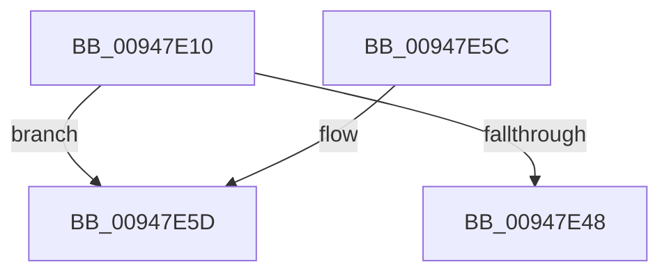

# SepAdjustAccessStateForConstraints

- RVA: `0x00947E10`–`0x00947E60` (길이 `80` bytes)
- VA: `0x0000000140947E10`
- 실행 섹션: `PAGE`
- PDB 이름 있음: `예`; PDB Function 태그: `아니요`
- unwind 정보 RVA: `0x00090BE4`
- 디코드: `28`개 명령, `80/80` bytes 표시
- 미해석 바이트: `0` (있으면 어셈블리에 `.byte`로 보존)

> 이 문서는 커널 이미지의 기계어와 PDB 기호를 분석해 생성했습니다. 4번과 5번은 함수 원형과 자료형을 바이너리 사용 방식에서 추정한 C 해석이며 원본 소스 복구 결과는 아닙니다.

## 1. Dependencies

- 직접 호출 지점: **0**; 고유 호출 대상: **0**
- 직접 호출자로 확인된 함수: **3**
- RIP 상대 이미지 참조: **0**

### Outgoing calls
- 직접 디코드된 call 명령이 없습니다.

### Direct callers
- [SeAdjustAccessStateForTrustLabel](../79/SeAdjustAccessStateForTrustLabel_function_0079D390.md) at `0x0079D39A`
- [CmpCheckOpenAccessOnKeyBody](../87/CmpCheckOpenAccessOnKeyBody_function_00870000.md) at `0x008706B6`
- [CmpSetAccessStateForBackupRestore](CmpSetAccessStateForBackupRestore_function_00947D2C.md) at `0x00947DC5`

### Static image references
- 디코드된 RIP-relative 메모리 참조가 없습니다.

## 2. Other-region calls and transfers

- 다른 실행 섹션으로 향하는 call: **0**
- 별도 외부 분기/꼬리 이동을 확인하지 못했습니다.

## 3. Assembly (complete function range)

```asm
00947E10  48 89 5C 24 18                  mov qword ptr [rsp + 0x18], rbx
00947E15  55                              push rbp
00947E16  56                              push rsi
00947E17  57                              push rdi
00947E18  41 55                           push r13
00947E1A  41 56                           push r14
00947E1C  48 83 EC 40                     sub rsp, 0x40
00947E20  41 8B 41 0C                     mov eax, dword ptr [r9 + 0xc]
00947E24  33 DB                           xor ebx, ebx
00947E26  C6 84 24 88 00 00 00 00         mov byte ptr [rsp + 0x88], 0
00947E2E  BE FF FF FF FF                  mov esi, 0xffffffff
00947E33  48 89 5C 24 30                  mov qword ptr [rsp + 0x30], rbx
00947E38  49 8B F9                        mov rdi, r9
00947E3B  45 0F B6 E8                     movzx r13d, r8b
00947E3F  4C 8B F2                        mov r14, rdx
00947E42  8B EE                           mov ebp, esi
00947E44  A8 06                           test al, 6
00947E46  75 15                           jne 0x140947e5d
00947E48  48 8B 9C 24 80 00 00 00         mov rbx, qword ptr [rsp + 0x80]
00947E50  48 83 C4 40                     add rsp, 0x40
00947E54  41 5E                           pop r14
00947E56  41 5D                           pop r13
00947E58  5F                              pop rdi
00947E59  5E                              pop rsi
00947E5A  5D                              pop rbp
00947E5B  C3                              ret
00947E5C  CC                              int3
00947E5D  8B 41 44                        mov eax, dword ptr [rcx + 0x44]
```

## 4. C-style interpretation (structured pseudocode)

```c
__int64 __fastcall SepAdjustAccessStateForConstraints(__int64 a1, __int64 a2, unsigned __int8 a3, __int64 a4)
{
    __int64 v_rbx;
    __int64 v_rsp;
    unsigned __int64 v_stack_m38;
    unsigned __int64 v_stack_p18;
    unsigned __int8 v_stack_p20;

    v_stack_p18 = v_rbx;
    v_rsp = (v_rsp) - (64);
    v_rbx = 0;
    v_stack_p20 = 0;
    v_stack_m38 = 0;
    if ((((unsigned __int8)((unsigned int)(*(unsigned int *)(a4 + 12)))) & (6)) != 0) goto loc_00947E5D;
    v_rsp = (v_rsp) + (64);
    return (unsigned int)(*(unsigned int *)(a4 + 12));
loc_00947E5D:
    return (unsigned int)(*(unsigned int *)(a1 + 68));
}
```

## 5. (Beta) C Style

```c
int64_t SepAdjustAccessStateForConstraints(void *Arg1, int64_t Arg2, uint8_t Arg3, void *Arg4)
{
    uint8_t *arg1 = (uint8_t *)Arg1;
    uint8_t *arg4 = (uint8_t *)Arg4;

    int64_t local_rbx;
    int64_t local_rsp;
    uint64_t v_stack_m38;
    uint64_t v_stack_p18;
    uint8_t v_stack_p20;

    v_stack_p18 = local_rbx;
    local_rsp = (local_rsp) - (64);
    local_rbx = 0;
    v_stack_p20 = 0;
    v_stack_m38 = 0;
    if ((((uint8_t)((uint32_t)(*(uint32_t *)(arg4 + 0xC)))) & (6)) != 0) goto loc_00947E5D;
    local_rsp = (local_rsp) + (64);
    return (uint32_t)(*(uint32_t *)(arg4 + 0xC));
loc_00947E5D:
    return (uint32_t)(*(uint32_t *)(arg1 + 0x44));
}
```

### 관측된 메모리 오프셋

구조체 형식이 확인되지 않은 접근은 인자 기준의 오프셋으로만 기록했습니다.

| 기준 인자 | 오프셋 표현 | 폭 (bit) | 접근 |
|---|---:|---:|---|
| `Arg1` | `+ 0x44` | `32` | `R` |
| `Arg4` | `+ 0xC` | `32` | `R` |

## 6. Execution-region graph

[열기: 2D/3D 그래프와 함수 탐색 컨트롤 패널](../../../control-panel.html?section=page&rva=0x00947E10&view=graph)

- 2D 그래프는 위에서 아래로 흐르고, 3D 그래프는 빈 공간을 드래그해 회전합니다. Shift+드래그는 이동, 휠은 확대·축소, 함수 노드 선택은 대상 보고서 이동입니다.

### Static fallback


