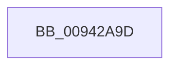

# sub_00942A9D

- RVA: `0x00942A9D`–`0x00942ABF` (길이 `34` bytes)
- VA: `0x0000000140942A9D`
- 실행 섹션: `PAGE`
- PDB 이름 있음: `아니요`; PDB Function 태그: `아니요`
- unwind 정보 RVA: `0x00090400`
- 디코드: `10`개 명령, `34/34` bytes 표시
- 미해석 바이트: `0` (있으면 어셈블리에 `.byte`로 보존)

> 이 문서는 커널 이미지의 기계어와 PDB 기호를 분석해 생성했습니다. 4번과 5번은 함수 원형과 자료형을 바이너리 사용 방식에서 추정한 C 해석이며 원본 소스 복구 결과는 아닙니다.

## 1. Dependencies

- 직접 호출 지점: **0**; 고유 호출 대상: **0**
- 직접 호출자로 확인된 함수: **0**
- RIP 상대 이미지 참조: **0**

### Outgoing calls
- 직접 디코드된 call 명령이 없습니다.

### Direct callers
- 이 함수 시작 RVA로 연결되는 직접 call은 확인되지 않았습니다. 간접 호출은 완전히 역산할 수 없습니다.

### Static image references
- 디코드된 RIP-relative 메모리 참조가 없습니다.

## 2. Other-region calls and transfers

- 다른 실행 섹션으로 향하는 call: **0**
- call이 아닌 외부 분기/꼬리 이동: **1**
  - `0x00942AB9` → [sub_00942BF1](Unknown_function_00942BF1.md) (`tail-transfer`)

## 3. Assembly (complete function range)

```asm
00942A9D  49 89 6B 10                     mov qword ptr [r11 + 0x10], rbp
00942AA1  49 89 73 E8                     mov qword ptr [r11 - 0x18], rsi
00942AA5  33 F6                           xor esi, esi
00942AA7  4D 89 73 D0                     mov qword ptr [r11 - 0x30], r14
00942AAB  8B EE                           mov ebp, esi
00942AAD  4D 89 7B C8                     mov qword ptr [r11 - 0x38], r15
00942AB1  44 8B FE                        mov r15d, esi
00942AB4  4C 8B F0                        mov r14, rax
00942AB7  85 D2                           test edx, edx
00942AB9  0F 84 32 01 00 00               je 0x140942bf1
```

## 4. C-style interpretation (structured pseudocode)

```c
void __fastcall sub_00942A9D(__int64 a1, int a2)
{
    __int64 v_rsi;

    *(unsigned __int64 *)(v_r11 + 16) = v_rbp;
    *(unsigned __int64 *)(v_r11 - 24) = v_rsi;
    v_rsi = 0;
    *(unsigned __int64 *)(v_r11 - 48) = v_r14;
    *(unsigned __int64 *)(v_r11 - 56) = v_r15;
}
```

## 5. (Beta) C Style

```c
void sub_00942A9D(int64_t Arg1, int32_t Arg2)
{
    int64_t local_rsi;

    *(uint64_t *)(local_r11 + 0x10) = local_rbp;
    *(uint64_t *)(local_r11 - 0x18) = local_rsi;
    local_rsi = 0;
    *(uint64_t *)(local_r11 - 0x30) = local_r14;
    *(uint64_t *)(local_r11 - 0x38) = local_r15;
}
```

## 6. Execution-region graph

[열기: 2D/3D 그래프와 함수 탐색 컨트롤 패널](../../../control-panel.html?section=page&rva=0x00942A9D&view=graph)

- 2D 그래프는 위에서 아래로 흐르고, 3D 그래프는 빈 공간을 드래그해 회전합니다. Shift+드래그는 이동, 휠은 확대·축소, 함수 노드 선택은 대상 보고서 이동입니다.

### Static fallback


