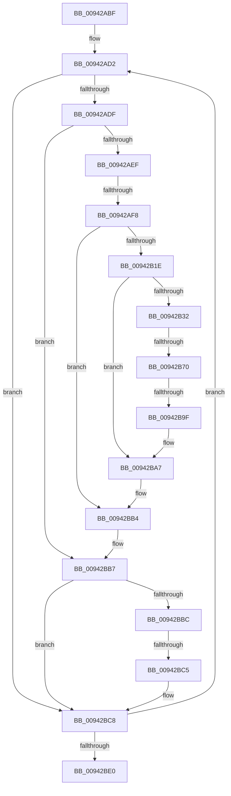

# sub_00942ABF

- RVA: `0x00942ABF`–`0x00942BF1` (길이 `306` bytes)
- VA: `0x0000000140942ABF`
- 실행 섹션: `PAGE`
- PDB 이름 있음: `아니요`; PDB Function 태그: `아니요`
- unwind 정보 RVA: `0x00090420`
- 디코드: `67`개 명령, `306/306` bytes 표시
- 미해석 바이트: `0` (있으면 어셈블리에 `.byte`로 보존)

> 이 문서는 커널 이미지의 기계어와 PDB 기호를 분석해 생성했습니다. 4번과 5번은 함수 원형과 자료형을 바이너리 사용 방식에서 추정한 C 해석이며 원본 소스 복구 결과는 아닙니다.

## 1. Dependencies

- 직접 호출 지점: **1**; 고유 호출 대상: **1**
- 직접 호출자로 확인된 함수: **0**
- RIP 상대 이미지 참조: **1**

### Outgoing calls
- `0x00942B63` → [MiQueryFlagsForRvaEntry](MiQueryFlagsForRvaEntry_function_00942CC0.md) (function, `0x00942CC0`)

### Direct callers
- 이 함수 시작 RVA로 연결되는 직접 call은 확인되지 않았습니다. 간접 호출은 완전히 역산할 수 없습니다.

### Static image references
- `0x00942AC3` → RVA `0x0099FB70` (`MiImageCfgRvaIteratorNext`; read)

## 2. Other-region calls and transfers

- 다른 실행 섹션으로 향하는 call: **0**
- call이 아닌 외부 분기/꼬리 이동: **4**
  - `0x00942AF2` → [sub_00942C7A + 0x1C](Unknown_function_00942C7A.md) (`tail-transfer`)
  - `0x00942B6A` → [sub_00942C7A](Unknown_function_00942C7A.md) (`tail-transfer`)
  - `0x00942B99` → [sub_00942C7A + 0xF](Unknown_function_00942C7A.md) (`tail-transfer`)
  - `0x00942BBF` → [sub_00942C7A + 0x34](Unknown_function_00942C7A.md) (`tail-transfer`)

## 3. Assembly (complete function range)

```asm
00942ABF  49 89 7B E0                     mov qword ptr [r11 - 0x20], rdi
00942AC3  48 8D 0D A6 D0 05 00            lea rcx, [rip + 0x5d0a6]
00942ACA  48 8D 78 20                     lea rdi, [rax + 0x20]
00942ACE  4D 89 63 D8                     mov qword ptr [r11 - 0x28], r12
00942AD2  48 8B 47 F0                     mov rax, qword ptr [rdi - 0x10]
00942AD6  48 85 C0                        test rax, rax
00942AD9  0F 84 E9 00 00 00               je 0x140942bc8
00942ADF  45 8B 26                        mov r12d, dword ptr [r14]
00942AE2  44 3B A3 38 01 00 00            cmp r12d, dword ptr [rbx + 0x138]
00942AE9  0F 85 C8 00 00 00               jne 0x140942bb7
00942AEF  48 3B C1                        cmp rax, rcx
00942AF2  0F 85 9E 01 00 00               jne 0x140942c96
00942AF8  8B 07                           mov eax, dword ptr [rdi]
00942AFA  44 8B E6                        mov r12d, esi
00942AFD  40 88 B4 24 A0 00 00 00         mov byte ptr [rsp + 0xa0], sil
00942B05  44 8B CE                        mov r9d, esi
00942B08  89 B4 24 B0 00 00 00            mov dword ptr [rsp + 0xb0], esi
00942B0F  89 84 24 B8 00 00 00            mov dword ptr [rsp + 0xb8], eax
00942B16  85 C0                           test eax, eax
00942B18  0F 84 96 00 00 00               je 0x140942bb4
00942B1E  48 8B 4F F8                     mov rcx, qword ptr [rdi - 8]
00942B22  8B 53 54                        mov edx, dword ptr [rbx + 0x54]
00942B25  48 89 4C 24 58                  mov qword ptr [rsp + 0x58], rcx
00942B2A  89 54 24 50                     mov dword ptr [rsp + 0x50], edx
00942B2E  85 C0                           test eax, eax
00942B30  74 75                           je 0x140942ba7
00942B32  48 8D 47 E4                     lea rax, [rdi - 0x1c]
00942B36  4C 8D 84 24 A0 00 00 00         lea r8, [rsp + 0xa0]
00942B3E  4C 89 44 24 40                  mov qword ptr [rsp + 0x40], r8
00942B43  4C 8D 84 24 B0 00 00 00         lea r8, [rsp + 0xb0]
00942B4B  48 89 44 24 38                  mov qword ptr [rsp + 0x38], rax
00942B50  8B 43 24                        mov eax, dword ptr [rbx + 0x24]
00942B53  48 89 74 24 30                  mov qword ptr [rsp + 0x30], rsi
00942B58  89 44 24 28                     mov dword ptr [rsp + 0x28], eax
00942B5C  8B 43 20                        mov eax, dword ptr [rbx + 0x20]
00942B5F  89 44 24 20                     mov dword ptr [rsp + 0x20], eax
00942B63  E8 58 01 00 00                  call 0x140942cc0
00942B68  85 C0                           test eax, eax
00942B6A  0F 88 0A 01 00 00               js 0x140942c7a
00942B70  48 8B 4C 24 58                  mov rcx, qword ptr [rsp + 0x58]
00942B75  8B 84 24 B8 00 00 00            mov eax, dword ptr [rsp + 0xb8]
00942B7C  8B 54 24 50                     mov edx, dword ptr [rsp + 0x50]
00942B80  FF C8                           dec eax
00942B82  48 03 CA                        add rcx, rdx
00942B85  89 84 24 B8 00 00 00            mov dword ptr [rsp + 0xb8], eax
00942B8C  48 89 4C 24 58                  mov qword ptr [rsp + 0x58], rcx
00942B91  40 38 B4 24 A0 00 00 00         cmp byte ptr [rsp + 0xa0], sil
00942B99  0F 85 EA 00 00 00               jne 0x140942c89
00942B9F  44 8B A4 24 B0 00 00 00         mov r12d, dword ptr [rsp + 0xb0]
00942BA7  89 07                           mov dword ptr [rdi], eax
00942BA9  48 89 4F F8                     mov qword ptr [rdi - 8], rcx
00942BAD  48 8D 0D BC CF 05 00            lea rcx, [rip + 0x5cfbc]
00942BB4  45 89 26                        mov dword ptr [r14], r12d
00942BB7  45 85 E4                        test r12d, r12d
00942BBA  74 0C                           je 0x140942bc8
00942BBC  45 85 FF                        test r15d, r15d
00942BBF  0F 85 E9 00 00 00               jne 0x140942cae
00942BC5  45 8B FC                        mov r15d, r12d
00942BC8  8B 93 90 00 00 00               mov edx, dword ptr [rbx + 0x90]
00942BCE  FF C5                           inc ebp
00942BD0  49 83 C6 28                     add r14, 0x28
00942BD4  48 83 C7 28                     add rdi, 0x28
00942BD8  3B EA                           cmp ebp, edx
00942BDA  0F 82 F2 FE FF FF               jb 0x140942ad2
00942BE0  4C 8B 64 24 70                  mov r12, qword ptr [rsp + 0x70]
00942BE5  48 8D 83 98 00 00 00            lea rax, [rbx + 0x98]
00942BEC  48 8B 7C 24 78                  mov rdi, qword ptr [rsp + 0x78]
```

## 4. C-style interpretation (structured pseudocode)

```c
__int64 __fastcall sub_00942ABF(__int64 a1, __int64 a2, __int64 a3, __int64 a4, __int64 a5, __int64 a6, __int64 a7, __int64 a8, __int64 a9, unsigned int a10, __int64 a11, __int64 a12, __int64 a13, __int64 a14, __int64 a15, __int64 a16, __int64 a17, __int64 a18, __int64 a19, unsigned __int8 a20, __int64 a21, unsigned int a22, unsigned int a23)
{
    __int64 result;
    __int64 v_r14;
    __int64 v_rbp;
    __int64 v_rdi;
    unsigned int v_stack_p20;
    unsigned int v_stack_p28;
    unsigned __int64 v_stack_p30;
    unsigned __int64 v_stack_p38;
    unsigned __int64 v_stack_p40;
    unsigned int v_stack_p50;
    unsigned __int64 v_stack_p58;
    unsigned __int8 v_stack_pA0;
    unsigned int v_stack_pB0;
    unsigned int v_stack_pB8;

    *(unsigned __int64 *)(v_r11 - 32) = v_rdi;
    *(unsigned __int64 *)(v_r11 - 40) = v_r12;
loc_00942AD2:
    if (*(unsigned __int64 *)(result + 32 - 16) == 0) goto loc_00942BC8;
    if (((unsigned int)((unsigned int)(*(unsigned int *)(v_r14)))) != (*(unsigned int *)(v_rbx + 312))) goto loc_00942BB7;
    v_stack_pA0 = (unsigned __int8)(v_rsi);
    v_stack_pB0 = (unsigned int)(v_rsi);
    v_stack_pB8 = (unsigned int)((unsigned int)(*(unsigned int *)(result + 32)));
    if ((unsigned int)((unsigned int)(*(unsigned int *)(result + 32))) == 0) goto loc_00942BB4;
    v_stack_p58 = *(unsigned __int64 *)(result + 32 - 8);
    v_stack_p50 = (unsigned int)((unsigned int)(*(unsigned int *)(v_rbx + 84)));
    if ((unsigned int)((unsigned int)(*(unsigned int *)(result + 32))) == 0) goto loc_00942BA7;
    v_stack_p40 = a20;
    v_stack_p38 = result + 32 - 28;
    v_stack_p30 = v_rsi;
    v_stack_p28 = (unsigned int)((unsigned int)(*(unsigned int *)(v_rbx + 36)));
    v_stack_p20 = (unsigned int)((unsigned int)(*(unsigned int *)(v_rbx + 32)));
    result = MiQueryFlagsForRvaEntry(*(unsigned __int64 *)(result + 32 - 8), (unsigned int)(*(unsigned int *)(v_rbx + 84)), a22, (unsigned int)((unsigned int)(v_rsi)));
    result = (unsigned int)(((unsigned int)(a23)) - 1);
    a1 = (a11) + ((unsigned int)(a10));
    v_stack_pB8 = (unsigned int)(result);
    v_stack_p58 = a1;
loc_00942BA7:
    *(unsigned int *)(result + 32) = (unsigned int)(result);
    *(unsigned __int64 *)(result + 32 - 8) = a1;
loc_00942BB4:
    *(unsigned int *)(v_r14) = (unsigned int)((unsigned int)(a22));
loc_00942BB7:
    if ((unsigned int)((unsigned int)(a22)) == 0) goto loc_00942BC8;
loc_00942BC8:
    v_rbp = (unsigned int)((v_rbp) + 1);
    v_r14 = (v_r14) + (40);
    v_rdi = (result + 32) + (40);
    if (((unsigned int)(v_rbp)) < ((unsigned int)((unsigned int)(*(unsigned int *)(v_rbx + 144))))) goto loc_00942AD2;
    return v_rbx + 152;
}
```

## 5. (Beta) C Style

```c
int64_t sub_00942ABF(int64_t Arg1, int64_t Arg2, int64_t Arg3, int64_t Arg4, uint64_t Arg5, uint64_t Arg6, uint64_t Arg7, uint64_t Arg8, uint64_t Arg9, uint32_t Arg10, int64_t Arg11, uint64_t Arg12, uint64_t Arg13, int64_t Arg14, int64_t Arg15, uint64_t Arg16, uint64_t Arg17, uint64_t Arg18, uint64_t Arg19, uint8_t Arg20, uint64_t Arg21, uint32_t Arg22, uint32_t Arg23)
{
    int64_t result;
    int64_t local_r14;
    int64_t local_rbp;
    int64_t local_rdi;
    uint32_t v_stack_p20;
    uint32_t v_stack_p28;
    uint64_t v_stack_p30;
    uint64_t v_stack_p38;
    uint64_t v_stack_p40;
    uint32_t v_stack_p50;
    uint64_t v_stack_p58;
    uint8_t v_stack_pA0;
    uint32_t v_stack_pB0;
    uint32_t v_stack_pB8;

    *(uint64_t *)(local_r11 - 0x20) = local_rdi;
    *(uint64_t *)(local_r11 - 0x28) = local_r12;
loc_00942AD2:
    if (*(uint64_t *)(result + 0x20 - 0x10) == 0) goto loc_00942BC8;
    if (((uint32_t)((uint32_t)(*(uint32_t *)(local_r14)))) != (*(uint32_t *)(local_rbx + 0x138))) goto loc_00942BB7;
    v_stack_pA0 = (uint8_t)(local_rsi);
    v_stack_pB0 = (uint32_t)(local_rsi);
    v_stack_pB8 = (uint32_t)((uint32_t)(*(uint32_t *)(result + 0x20)));
    if ((uint32_t)((uint32_t)(*(uint32_t *)(result + 0x20))) == 0) goto loc_00942BB4;
    v_stack_p58 = *(uint64_t *)(result + 0x20 - 0x8);
    v_stack_p50 = (uint32_t)((uint32_t)(*(uint32_t *)(local_rbx + 0x54)));
    if ((uint32_t)((uint32_t)(*(uint32_t *)(result + 0x20))) == 0) goto loc_00942BA7;
    v_stack_p40 = Arg20;
    v_stack_p38 = result + 32 - 28;
    v_stack_p30 = local_rsi;
    v_stack_p28 = (uint32_t)((uint32_t)(*(uint32_t *)(local_rbx + 0x24)));
    v_stack_p20 = (uint32_t)((uint32_t)(*(uint32_t *)(local_rbx + 0x20)));
    result = MiQueryFlagsForRvaEntry(*(uint64_t *)(result + 0x20 - 0x8), (uint32_t)(*(uint32_t *)(local_rbx + 0x54)), Arg22, (uint32_t)((uint32_t)(local_rsi)));
    result = (uint32_t)(((uint32_t)(Arg23)) - 1);
    Arg1 = (Arg11) + ((uint32_t)(Arg10));
    v_stack_pB8 = (uint32_t)(result);
    v_stack_p58 = Arg1;
loc_00942BA7:
    *(uint32_t *)(result + 0x20) = (uint32_t)(result);
    *(uint64_t *)(result + 0x20 - 0x8) = Arg1;
loc_00942BB4:
    *(uint32_t *)(local_r14) = (uint32_t)((uint32_t)(Arg22));
loc_00942BB7:
    if ((uint32_t)((uint32_t)(Arg22)) == 0) goto loc_00942BC8;
loc_00942BC8:
    local_rbp = (uint32_t)((local_rbp) + 1);
    local_r14 = (local_r14) + (40);
    local_rdi = (result + 32) + (40);
    if (((uint32_t)(local_rbp)) < ((uint32_t)((uint32_t)(*(uint32_t *)(local_rbx + 0x90))))) goto loc_00942AD2;
    return local_rbx + 152;
}
```

## 6. Execution-region graph

[열기: 2D/3D 그래프와 함수 탐색 컨트롤 패널](../../../control-panel.html?section=page&rva=0x00942ABF&view=graph)

- 2D 그래프는 위에서 아래로 흐르고, 3D 그래프는 빈 공간을 드래그해 회전합니다. Shift+드래그는 이동, 휠은 확대·축소, 함수 노드 선택은 대상 보고서 이동입니다.

### Static fallback


