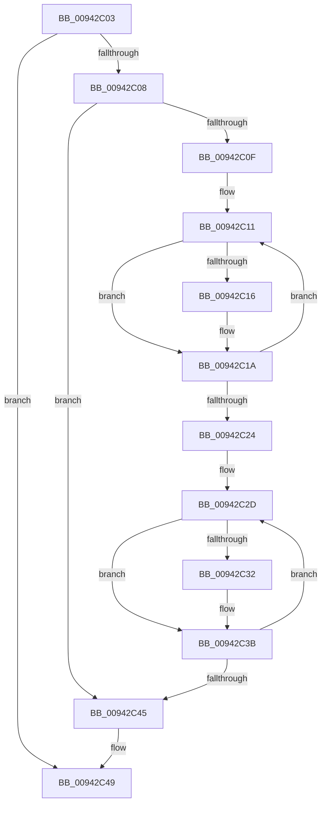

# sub_00942C03

- RVA: `0x00942C03`–`0x00942C6B` (길이 `104` bytes)
- VA: `0x0000000140942C03`
- 실행 섹션: `PAGE`
- PDB 이름 있음: `아니요`; PDB Function 태그: `아니요`
- unwind 정보 RVA: `0x00090448`
- 디코드: `32`개 명령, `104/104` bytes 표시
- 미해석 바이트: `0` (있으면 어셈블리에 `.byte`로 보존)

> 이 문서는 커널 이미지의 기계어와 PDB 기호를 분석해 생성했습니다. 4번과 5번은 함수 원형과 자료형을 바이너리 사용 방식에서 추정한 C 해석이며 원본 소스 복구 결과는 아닙니다.

## 1. Dependencies

- 직접 호출 지점: **0**; 고유 호출 대상: **0**
- 직접 호출자로 확인된 함수: **0**
- RIP 상대 이미지 참조: **0**

### Outgoing calls
- 직접 디코드된 call 명령이 없습니다.

### Direct callers
- 이 함수 시작 RVA로 연결되는 직접 call은 확인되지 않았습니다. 간접 호출은 완전히 역산할 수 없습니다.

### Static image references
- 디코드된 RIP-relative 메모리 참조가 없습니다.

## 2. Other-region calls and transfers

- 다른 실행 섹션으로 향하는 call: **0**
- 별도 외부 분기/꼬리 이동을 확인하지 못했습니다.

## 3. Assembly (complete function range)

```asm
00942C03  45 85 FF                        test r15d, r15d
00942C06  74 41                           je 0x140942c49
00942C08  44 8B CE                        mov r9d, esi
00942C0B  85 D2                           test edx, edx
00942C0D  74 36                           je 0x140942c45
00942C0F  8B CA                           mov ecx, edx
00942C11  44 39 38                        cmp dword ptr [rax], r15d
00942C14  75 04                           jne 0x140942c1a
00942C16  44 0B 48 04                     or r9d, dword ptr [rax + 4]
00942C1A  48 83 C0 28                     add rax, 0x28
00942C1E  48 83 E9 01                     sub rcx, 1
00942C22  75 ED                           jne 0x140942c11
00942C24  8B CE                           mov ecx, esi
00942C26  4C 8D 83 80 00 00 00            lea r8, [rbx + 0x80]
00942C2D  45 85 08                        test dword ptr [r8], r9d
00942C30  74 09                           je 0x140942c3b
00942C32  B8 01 00 00 00                  mov eax, 1
00942C37  D3 E0                           shl eax, cl
00942C39  0B F0                           or esi, eax
00942C3B  FF C1                           inc ecx
00942C3D  49 83 C0 04                     add r8, 4
00942C41  3B CA                           cmp ecx, edx
00942C43  72 E8                           jb 0x140942c2d
00942C45  41 89 75 00                     mov dword ptr [r13], esi
00942C49  48 8B B4 24 80 00 00 00         mov rsi, qword ptr [rsp + 0x80]
00942C51  41 8B C7                        mov eax, r15d
00942C54  44 89 BB 38 01 00 00            mov dword ptr [rbx + 0x138], r15d
00942C5B  4C 8B 7C 24 60                  mov r15, qword ptr [rsp + 0x60]
00942C60  48 81 C4 88 00 00 00            add rsp, 0x88
00942C67  41 5D                           pop r13
00942C69  5B                              pop rbx
00942C6A  C3                              ret
```

## 4. C-style interpretation (structured pseudocode)

```c
__int64 __fastcall sub_00942C03(__int64 a1, int a2, __int64 a3, __int64 a4, __int64 a5, __int64 a6, __int64 a7, __int64 a8, __int64 a9, __int64 a10, __int64 a11, __int64 a12, __int64 a13, __int64 a14, __int64 a15, __int64 a16)
{
    __int64 result;
    __int64 v_rsi;
    __int64 v_rsp;

    if ((unsigned int)(v_r15) == 0) goto loc_00942C49;
    if (a2 == 0) goto loc_00942C45;
loc_00942C11:
    if ((*(unsigned int *)(result)) == ((unsigned int)(v_r15))) {
        a4 = (unsigned int)(((unsigned int)((unsigned int)(v_rsi))) | (*(unsigned int *)(result + 4)));
    }
    result = (result) + (40);
    a1 = ((unsigned int)(a2)) - (1);
    if (condition_is_not_equal) goto loc_00942C11;
loc_00942C2D:
    if (((*(unsigned int *)(v_rbx + 128)) & ((unsigned int)(a4))) != 0) {
        result = 1;
        result = (unsigned int)((result) << ((unsigned __int8)((unsigned int)((unsigned int)(v_rsi)))));
        v_rsi = (unsigned int)((v_rsi) | ((unsigned int)(result)));
    }
    a1 = (unsigned int)(((unsigned int)((unsigned int)(v_rsi))) + 1);
    a3 = (v_rbx + 128) + (4);
    if (((unsigned int)(a1)) < a2) goto loc_00942C2D;
loc_00942C45:
    *(unsigned int *)(v_r13) = (unsigned int)(v_rsi);
loc_00942C49:
    *(unsigned int *)(v_rbx + 312) = (unsigned int)(v_r15);
    v_rsp = (v_rsp) + (136);
    return (unsigned int)((unsigned int)(v_r15));
}
```

## 5. (Beta) C Style

```c
int64_t sub_00942C03(int64_t Arg1, int32_t Arg2, int64_t Arg3, int64_t Arg4, uint64_t Arg5, uint64_t Arg6, uint64_t Arg7, uint64_t Arg8, uint64_t Arg9, uint64_t Arg10, uint64_t Arg11, int64_t Arg12, uint64_t Arg13, uint64_t Arg14, uint64_t Arg15, int64_t Arg16)
{
    int64_t result;
    int64_t local_rsi;
    int64_t local_rsp;

    if ((uint32_t)(local_r15) == 0) goto loc_00942C49;
    if (Arg2 == 0) goto loc_00942C45;
loc_00942C11:
    if ((*(uint32_t *)(result)) == ((uint32_t)(local_r15))) {
        Arg4 = (uint32_t)(((uint32_t)((uint32_t)(local_rsi))) | (*(uint32_t *)(result + 0x4)));
    }
    result = (result) + (40);
    Arg1 = ((uint32_t)(Arg2)) - (1);
    if (condition_is_not_equal) goto loc_00942C11;
loc_00942C2D:
    if (((*(uint32_t *)(local_rbx + 0x80)) & ((uint32_t)(Arg4))) != 0) {
        result = 1;
        result = (uint32_t)((result) << ((uint8_t)((uint32_t)((uint32_t)(local_rsi)))));
        local_rsi = (uint32_t)((local_rsi) | ((uint32_t)(result)));
    }
    Arg1 = (uint32_t)(((uint32_t)((uint32_t)(local_rsi))) + 1);
    Arg3 = (local_rbx + 128) + (4);
    if (((uint32_t)(Arg1)) < Arg2) goto loc_00942C2D;
loc_00942C45:
    *(uint32_t *)(local_r13) = (uint32_t)(local_rsi);
loc_00942C49:
    *(uint32_t *)(local_rbx + 0x138) = (uint32_t)(local_r15);
    local_rsp = (local_rsp) + (136);
    return (uint32_t)((uint32_t)(local_r15));
}
```

## 6. Execution-region graph

[열기: 2D/3D 그래프와 함수 탐색 컨트롤 패널](../../../control-panel.html?section=page&rva=0x00942C03&view=graph)

- 2D 그래프는 위에서 아래로 흐르고, 3D 그래프는 빈 공간을 드래그해 회전합니다. Shift+드래그는 이동, 휠은 확대·축소, 함수 노드 선택은 대상 보고서 이동입니다.

### Static fallback


