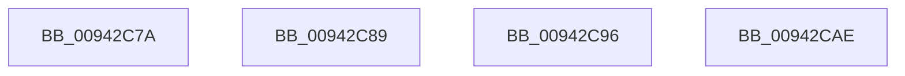

# sub_00942C7A

- RVA: `0x00942C7A`–`0x00942CBA` (길이 `64` bytes)
- VA: `0x0000000140942C7A`
- 실행 섹션: `PAGE`
- PDB 이름 있음: `아니요`; PDB Function 태그: `아니요`
- unwind 정보 RVA: `0x00090478`
- 디코드: `13`개 명령, `64/64` bytes 표시
- 미해석 바이트: `0` (있으면 어셈블리에 `.byte`로 보존)

> 이 문서는 커널 이미지의 기계어와 PDB 기호를 분석해 생성했습니다. 4번과 5번은 함수 원형과 자료형을 바이너리 사용 방식에서 추정한 C 해석이며 원본 소스 복구 결과는 아닙니다.

## 1. Dependencies

- 직접 호출 지점: **1**; 고유 호출 대상: **1**
- 직접 호출자로 확인된 함수: **0**
- RIP 상대 이미지 참조: **1**

### Outgoing calls
- `0x00942CA1` → [guard_dispatch_icall](../../text/6B/guard_dispatch_icall_function_006BAAD0.md) (function, `0x006BAAD0`)

### Direct callers
- 이 함수 시작 RVA로 연결되는 직접 call은 확인되지 않았습니다. 간접 호출은 완전히 역산할 수 없습니다.

### Static image references
- `0x00942C7A` → RVA `0x00E2D828` (`.data`; write)

## 2. Other-region calls and transfers

- 다른 실행 섹션으로 향하는 call: **1**
  - `0x00942CA1` → [guard_dispatch_icall](../../text/6B/guard_dispatch_icall_function_006BAAD0.md) (`PAGE` → `.text`)
- call이 아닌 외부 분기/꼬리 이동: **4**
  - `0x00942C84` → [sub_00942ABF + 0xEE](Unknown_function_00942ABF.md) (`tail-transfer`)
  - `0x00942C91` → [sub_00942ABF + 0x6F](Unknown_function_00942ABF.md) (`tail-transfer`)
  - `0x00942CA9` → [sub_00942ABF + 0xEE](Unknown_function_00942ABF.md) (`tail-transfer`)
  - `0x00942CB5` → [sub_00942ABF + 0x109](Unknown_function_00942ABF.md) (`tail-transfer`)

## 3. Assembly (complete function range)

```asm
00942C7A  C7 05 A4 AB 4E 00 0E 00 00 00   mov dword ptr [rip + 0x4eaba4], 0xe
00942C84  E9 24 FF FF FF                  jmp 0x140942bad
00942C89  44 8B 8C 24 B0 00 00 00         mov r9d, dword ptr [rsp + 0xb0]
00942C91  E9 98 FE FF FF                  jmp 0x140942b2e
00942C96  4C 8D 47 E4                     lea r8, [rdi - 0x1c]
00942C9A  48 8B CB                        mov rcx, rbx
00942C9D  48 8D 57 F8                     lea rdx, [rdi - 8]
00942CA1  E8 2A 7E D7 FF                  call 0x1406baad0
00942CA6  44 8B E0                        mov r12d, eax
00942CA9  E9 FF FE FF FF                  jmp 0x140942bad
00942CAE  45 3B FC                        cmp r15d, r12d
00942CB1  45 0F 43 FC                     cmovae r15d, r12d
00942CB5  E9 0E FF FF FF                  jmp 0x140942bc8
```

## 4. C-style interpretation (structured pseudocode)

```c
__int64 __fastcall sub_00942C7A(void)
{
    unsigned int v_stack_pB0;

    *(unsigned int *)(v_rip + 5155748) = 14;
}
```

## 5. (Beta) C Style

```c
void sub_00942C7A(void)
{
    uint32_t v_stack_pB0;

    *(uint32_t *)(v_rip + 0x4EABA4) = 14;
}
```

## 6. Execution-region graph

[열기: 2D/3D 그래프와 함수 탐색 컨트롤 패널](../../../control-panel.html?section=page&rva=0x00942C7A&view=graph)

- 2D 그래프는 위에서 아래로 흐르고, 3D 그래프는 빈 공간을 드래그해 회전합니다. Shift+드래그는 이동, 휠은 확대·축소, 함수 노드 선택은 대상 보고서 이동입니다.

### Static fallback


