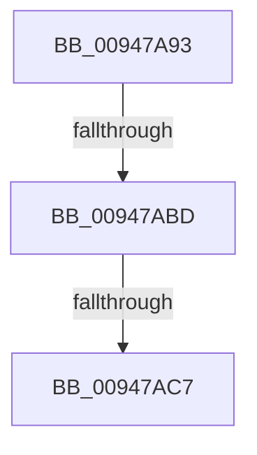

# sub_00947A93

- RVA: `0x00947A93`–`0x00947AF7` (길이 `100` bytes)
- VA: `0x0000000140947A93`
- 실행 섹션: `PAGE`
- PDB 이름 있음: `아니요`; PDB Function 태그: `아니요`
- unwind 정보 RVA: `0x00090B00`
- 디코드: `23`개 명령, `100/100` bytes 표시
- 미해석 바이트: `0` (있으면 어셈블리에 `.byte`로 보존)

> 이 문서는 커널 이미지의 기계어와 PDB 기호를 분석해 생성했습니다. 4번과 5번은 함수 원형과 자료형을 바이너리 사용 방식에서 추정한 C 해석이며 원본 소스 복구 결과는 아닙니다.

## 1. Dependencies

- 직접 호출 지점: **1**; 고유 호출 대상: **1**
- 직접 호출자로 확인된 함수: **0**
- RIP 상대 이미지 참조: **1**

### Outgoing calls
- `0x00947AD6` → [PsReferencePrimaryTokenWithTag](../../text/20/PsReferencePrimaryTokenWithTag_function_0020FF80.md) (function, `0x0020FF80`)

### Direct callers
- 이 함수 시작 RVA로 연결되는 직접 call은 확인되지 않았습니다. 간접 호출은 완전히 역산할 수 없습니다.

### Static image references
- `0x00947ADB` → RVA `0x00FD8010` (`PAGEDATA`; read)

## 2. Other-region calls and transfers

- 다른 실행 섹션으로 향하는 call: **1**
  - `0x00947AD6` → [PsReferencePrimaryTokenWithTag](../../text/20/PsReferencePrimaryTokenWithTag_function_0020FF80.md) (`PAGE` → `.text`)
- call이 아닌 외부 분기/꼬리 이동: **3**
  - `0x00947AB7` → [sub_00947B86](Unknown_function_00947B86.md) (`tail-transfer`)
  - `0x00947AC5` → [sub_00947B26](Unknown_function_00947B26.md) (`tail-transfer`)
  - `0x00947AF1` → [sub_00947B91](Unknown_function_00947B91.md) (`tail-transfer`)

## 3. Assembly (complete function range)

```asm
00947A93  48 89 5C 24 70                  mov qword ptr [rsp + 0x70], rbx
00947A98  49 8B E9                        mov rbp, r9
00947A9B  48 89 74 24 78                  mov qword ptr [rsp + 0x78], rsi
00947AA0  48 8B F2                        mov rsi, rdx
00947AA3  48 89 44 24 48                  mov qword ptr [rsp + 0x48], rax
00947AA8  4D 8B F0                        mov r14, r8
00947AAB  48 8B D9                        mov rbx, rcx
00947AAE  F3 0F 7F 44 24 38               movdqu xmmword ptr [rsp + 0x38], xmm0
00947AB4  48 85 C9                        test rcx, rcx
00947AB7  0F 84 C9 00 00 00               je 0x140947b86
00947ABD  8B 81 A0 05 00 00               mov eax, dword ptr [rcx + 0x5a0]
00947AC3  A8 08                           test al, 8
00947AC5  75 5F                           jne 0x140947b26
00947AC7  33 FF                           xor edi, edi
00947AC9  BA 53 65 53 75                  mov edx, 0x75536553
00947ACE  48 89 7C 24 30                  mov qword ptr [rsp + 0x30], rdi
00947AD3  48 8B CE                        mov rcx, rsi
00947AD6  E8 A5 84 8C FF                  call 0x14020ff80
00947ADB  83 3D 2E 05 69 00 00            cmp dword ptr [rip + 0x69052e], 0
00947AE2  48 8B 74 24 78                  mov rsi, qword ptr [rsp + 0x78]
00947AE7  48 8B 5C 24 70                  mov rbx, qword ptr [rsp + 0x70]
00947AEC  48 89 44 24 40                  mov qword ptr [rsp + 0x40], rax
00947AF1  0F 85 9A 00 00 00               jne 0x140947b91
```

## 4. C-style interpretation (structured pseudocode)

```c
__int64 __fastcall sub_00947A93(__int64 a1, __int64 a2, __int64 a3, __int64 a4, __int64 a5, __int64 a6, __int64 a7, __int64 a8, __int64 a9, __int64 a10, __int64 a11, __int64 a12, __int64 a13, __int64 a14, __int64 a15)
{
    __int64 result;
    __int64 v_rdi;
    unsigned __int64 v_stack_p30;
    unsigned __int64 v_stack_p38;
    unsigned __int64 v_stack_p40;
    unsigned __int64 v_stack_p48;
    unsigned __int64 v_stack_p70;
    unsigned __int64 v_stack_p78;

    v_stack_p70 = v_rbx;
    v_stack_p78 = v_rsi;
    v_stack_p48 = result;
    v_stack_p38 = v_xmm0;
    v_rdi = 0;
    v_stack_p30 = 0;
    result = PsReferencePrimaryTokenWithTag(a2, (unsigned int)(0x75536553ULL), a3, a4);
    v_stack_p40 = result;
}
```

## 5. (Beta) C Style

```c
int64_t sub_00947A93(int64_t Arg1, int64_t Arg2, int64_t Arg3, int64_t Arg4, uint64_t Arg5, uint64_t Arg6, uint64_t Arg7, uint64_t Arg8, uint64_t Arg9, uint64_t Arg10, uint64_t Arg11, uint64_t Arg12, uint64_t Arg13, int64_t Arg14, int64_t Arg15)
{
    int64_t result;
    int64_t local_rdi;
    uint64_t v_stack_p30;
    uint64_t v_stack_p38;
    uint64_t v_stack_p40;
    uint64_t v_stack_p48;
    uint64_t v_stack_p70;
    uint64_t v_stack_p78;

    v_stack_p70 = local_rbx;
    v_stack_p78 = local_rsi;
    v_stack_p48 = result;
    v_stack_p38 = v_xmm0;
    local_rdi = 0;
    v_stack_p30 = 0;
    result = PsReferencePrimaryTokenWithTag(Arg2, (uint32_t)(0x75536553ULL), Arg3, Arg4);
    v_stack_p40 = result;
}
```

## 6. Execution-region graph

[열기: 2D/3D 그래프와 함수 탐색 컨트롤 패널](../../../control-panel.html?section=page&rva=0x00947A93&view=graph)

- 2D 그래프는 위에서 아래로 흐르고, 3D 그래프는 빈 공간을 드래그해 회전합니다. Shift+드래그는 이동, 휠은 확대·축소, 함수 노드 선택은 대상 보고서 이동입니다.

### Static fallback


