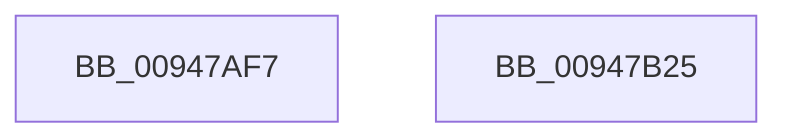

# sub_00947AF7

- RVA: `0x00947AF7`–`0x00947B26` (길이 `47` bytes)
- VA: `0x0000000140947AF7`
- 실행 섹션: `PAGE`
- PDB 이름 있음: `아니요`; PDB Function 태그: `아니요`
- unwind 정보 RVA: `0x00090B18`
- 디코드: `13`개 명령, `47/47` bytes 표시
- 미해석 바이트: `0` (있으면 어셈블리에 `.byte`로 보존)

> 이 문서는 커널 이미지의 기계어와 PDB 기호를 분석해 생성했습니다. 4번과 5번은 함수 원형과 자료형을 바이너리 사용 방식에서 추정한 C 해석이며 원본 소스 복구 결과는 아닙니다.

## 1. Dependencies

- 직접 호출 지점: **1**; 고유 호출 대상: **1**
- 직접 호출자로 확인된 함수: **0**
- RIP 상대 이미지 참조: **0**

### Outgoing calls
- `0x00947B17` → [SepCreateAccessStateFromSubjectContext](../../text/3E/SepCreateAccessStateFromSubjectContext_function_003EBF40.md) (function, `0x003EBF40`)

### Direct callers
- 이 함수 시작 RVA로 연결되는 직접 call은 확인되지 않았습니다. 간접 호출은 완전히 역산할 수 없습니다.

### Static image references
- 디코드된 RIP-relative 메모리 참조가 없습니다.

## 2. Other-region calls and transfers

- 다른 실행 섹션으로 향하는 call: **1**
  - `0x00947B17` → [SepCreateAccessStateFromSubjectContext](../../text/3E/SepCreateAccessStateFromSubjectContext_function_003EBF40.md) (`PAGE` → `.text`)
- 별도 외부 분기/꼬리 이동을 확인하지 못했습니다.

## 3. Assembly (complete function range)

```asm
00947AF7  48 8B 84 24 98 00 00 00         mov rax, qword ptr [rsp + 0x98]
00947AFF  48 8D 4C 24 30                  lea rcx, [rsp + 0x30]
00947B04  44 8B 8C 24 90 00 00 00         mov r9d, dword ptr [rsp + 0x90]
00947B0C  4C 8B C5                        mov r8, rbp
00947B0F  49 8B D6                        mov rdx, r14
00947B12  48 89 44 24 20                  mov qword ptr [rsp + 0x20], rax
00947B17  E8 24 44 AA FF                  call 0x1403ebf40
00947B1C  48 83 C4 50                     add rsp, 0x50
00947B20  41 5E                           pop r14
00947B22  5F                              pop rdi
00947B23  5D                              pop rbp
00947B24  C3                              ret
00947B25  CC                              int3
```

## 4. C-style interpretation (structured pseudocode)

```c
__int64 __fastcall sub_00947AF7(__int64 a1, __int64 a2, __int64 a3, __int64 a4, __int64 a5, __int64 a6, __int64 a7, __int64 a8, __int64 a9, __int64 a10, __int64 a11, __int64 a12, __int64 a13, __int64 a14, __int64 a15, __int64 a16, __int64 a17, unsigned int a18, __int64 a19)
{
    __int64 result;
    __int64 v_rsp;
    unsigned __int64 v_stack_p20;

    v_stack_p20 = a19;
    result = SepCreateAccessStateFromSubjectContext(a6, v_r14, v_rbp, (unsigned int)(a18));
    v_rsp = (v_rsp) + (80);
    return result;
}
```

## 5. (Beta) C Style

```c
int64_t sub_00947AF7(int64_t Arg1, int64_t Arg2, int64_t Arg3, int64_t Arg4, uint64_t Arg5, int64_t Arg6, uint64_t Arg7, uint64_t Arg8, uint64_t Arg9, uint64_t Arg10, uint64_t Arg11, uint64_t Arg12, uint64_t Arg13, uint64_t Arg14, uint64_t Arg15, uint64_t Arg16, uint64_t Arg17, uint32_t Arg18, int64_t Arg19)
{
    int64_t result;
    int64_t local_rsp;
    uint64_t v_stack_p20;

    v_stack_p20 = Arg19;
    result = SepCreateAccessStateFromSubjectContext(Arg6, local_r14, local_rbp, (uint32_t)(Arg18));
    local_rsp = (local_rsp) + (80);
    return result;
}
```

## 6. Execution-region graph

[열기: 2D/3D 그래프와 함수 탐색 컨트롤 패널](../../../control-panel.html?section=page&rva=0x00947AF7&view=graph)

- 2D 그래프는 위에서 아래로 흐르고, 3D 그래프는 빈 공간을 드래그해 회전합니다. Shift+드래그는 이동, 휠은 확대·축소, 함수 노드 선택은 대상 보고서 이동입니다.

### Static fallback


