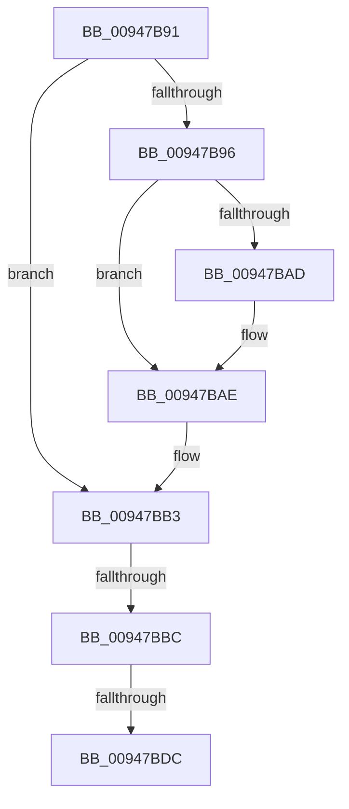

# sub_00947B91

- RVA: `0x00947B91`–`0x00947BE2` (길이 `81` bytes)
- VA: `0x0000000140947B91`
- 실행 섹션: `PAGE`
- PDB 이름 있음: `아니요`; PDB Function 태그: `아니요`
- unwind 정보 RVA: `0x00090B74`
- 디코드: `17`개 명령, `81/81` bytes 표시
- 미해석 바이트: `0` (있으면 어셈블리에 `.byte`로 보존)

> 이 문서는 커널 이미지의 기계어와 PDB 기호를 분석해 생성했습니다. 4번과 5번은 함수 원형과 자료형을 바이너리 사용 방식에서 추정한 C 해석이며 원본 소스 복구 결과는 아닙니다.

## 1. Dependencies

- 직접 호출 지점: **0**; 고유 호출 대상: **0**
- 직접 호출자로 확인된 함수: **0**
- RIP 상대 이미지 참조: **1**

### Outgoing calls
- 직접 디코드된 call 명령이 없습니다.

### Direct callers
- 이 함수 시작 RVA로 연결되는 직접 call은 확인되지 않았습니다. 간접 호출은 완전히 역산할 수 없습니다.

### Static image references
- `0x00947BA4` → RVA `0x00E67B90` (`.data`; read)

## 2. Other-region calls and transfers

- 다른 실행 섹션으로 향하는 call: **0**
- call이 아닌 외부 분기/꼬리 이동: **3**
  - `0x00947BB6` → [sub_00947AF7](Unknown_function_00947AF7.md) (`tail-transfer`)
  - `0x00947BD6` → [sub_00947AF7](Unknown_function_00947AF7.md) (`tail-transfer`)
  - `0x00947BDD` → [sub_00947AF7](Unknown_function_00947AF7.md) (`tail-transfer`)

## 3. Assembly (complete function range)

```asm
00947B91  48 85 C0                        test rax, rax
00947B94  74 1D                           je 0x140947bb3
00947B96  48 8B 88 78 04 00 00            mov rcx, qword ptr [rax + 0x478]
00947B9D  F0 FF 81 1C 01 00 00            lock inc dword ptr [rcx + 0x11c]
00947BA4  48 3B 05 E5 FF 51 00            cmp rax, qword ptr [rip + 0x51ffe5]
00947BAB  75 01                           jne 0x140947bae
00947BAD  CC                              int3
00947BAE  48 8B 7C 24 30                  mov rdi, qword ptr [rsp + 0x30]
00947BB3  48 85 FF                        test rdi, rdi
00947BB6  0F 84 3B FF FF FF               je 0x140947af7
00947BBC  48 8B 87 78 04 00 00            mov rax, qword ptr [rdi + 0x478]
00947BC3  F0 FF 80 1C 01 00 00            lock inc dword ptr [rax + 0x11c]
00947BCA  48 8B 05 BF FF 51 00            mov rax, qword ptr [rip + 0x51ffbf]
00947BD1  48 39 44 24 30                  cmp qword ptr [rsp + 0x30], rax
00947BD6  0F 85 1B FF FF FF               jne 0x140947af7
00947BDC  CC                              int3
00947BDD  E9 15 FF FF FF                  jmp 0x140947af7
```

## 4. C-style interpretation (structured pseudocode)

```c
__int64 __fastcall sub_00947B91(__int64 a1, __int64 a2, __int64 a3, __int64 a4, __int64 a5, __int64 a6)
{
    if (result == 0) goto loc_00947BB3;
    if (result == (*(unsigned __int64 *)(v_rip + 5373925))) {
    }
loc_00947BB3:
}
```

## 5. (Beta) C Style

```c
int64_t sub_00947B91(int64_t Arg1, int64_t Arg2, int64_t Arg3, int64_t Arg4, uint64_t Arg5, int64_t Arg6)
{
    if (result == 0) goto loc_00947BB3;
    if (result == (*(uint64_t *)(v_rip + 0x51FFE5))) {
    }
loc_00947BB3:
}
```

## 6. Execution-region graph

[열기: 2D/3D 그래프와 함수 탐색 컨트롤 패널](../../../control-panel.html?section=page&rva=0x00947B91&view=graph)

- 2D 그래프는 위에서 아래로 흐르고, 3D 그래프는 빈 공간을 드래그해 회전합니다. Shift+드래그는 이동, 휠은 확대·축소, 함수 노드 선택은 대상 보고서 이동입니다.

### Static fallback


