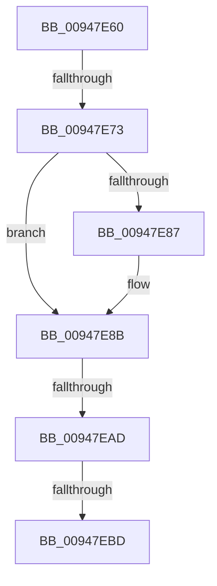

# sub_00947E60

- RVA: `0x00947E60`–`0x00947ED2` (길이 `114` bytes)
- VA: `0x0000000140947E60`
- 실행 섹션: `PAGE`
- PDB 이름 있음: `아니요`; PDB Function 태그: `아니요`
- unwind 정보 RVA: `0x00090BFC`
- 디코드: `31`개 명령, `114/114` bytes 표시
- 미해석 바이트: `0` (있으면 어셈블리에 `.byte`로 보존)

> 이 문서는 커널 이미지의 기계어와 PDB 기호를 분석해 생성했습니다. 4번과 5번은 함수 원형과 자료형을 바이너리 사용 방식에서 추정한 C 해석이며 원본 소스 복구 결과는 아닙니다.

## 1. Dependencies

- 직접 호출 지점: **2**; 고유 호출 대상: **2**
- 직접 호출자로 확인된 함수: **0**
- RIP 상대 이미지 참조: **0**

### Outgoing calls
- `0x00947E9D` → [SepFilterCheck](../../text/30/SepFilterCheck_function_00301B60.md) (function, `0x00301B60`)
- `0x00947EB0` → [SeGetTrustLabelAce](../../text/3F/SeGetTrustLabelAce_function_003FDB20.md) (function, `0x003FDB20`)

### Direct callers
- 이 함수 시작 RVA로 연결되는 직접 call은 확인되지 않았습니다. 간접 호출은 완전히 역산할 수 없습니다.

### Static image references
- 디코드된 RIP-relative 메모리 참조가 없습니다.

## 2. Other-region calls and transfers

- 다른 실행 섹션으로 향하는 call: **2**
  - `0x00947E9D` → [SepFilterCheck](../../text/30/SepFilterCheck_function_00301B60.md) (`PAGE` → `.text`)
  - `0x00947EB0` → [SeGetTrustLabelAce](../../text/3F/SeGetTrustLabelAce_function_003FDB20.md) (`PAGE` → `.text`)
- call이 아닌 외부 분기/꼬리 이동: **4**
  - `0x00947E6D` → [sub_00947EF9 + 0x35](Unknown_function_00947EF9.md) (`tail-transfer`)
  - `0x00947EA7` → [sub_00947EF9 + 0x54](Unknown_function_00947EF9.md) (`tail-transfer`)
  - `0x00947EBB` → [sub_00947EF9](Unknown_function_00947EF9.md) (`tail-transfer`)
  - `0x00947ED0` → [sub_00947EE0](Unknown_function_00947EE0.md) (`tail-transfer`)

## 3. Assembly (complete function range)

```asm
00947E60  4C 89 64 24 70                  mov qword ptr [rsp + 0x70], r12
00947E65  4C 89 7C 24 78                  mov qword ptr [rsp + 0x78], r15
00947E6A  83 F8 01                        cmp eax, 1
00947E6D  0F 85 BB 00 00 00               jne 0x140947f2e
00947E73  BB 89 00 12 01                  mov ebx, 0x1120089
00947E78  41 BF 16 01 1F 01               mov r15d, 0x11f0116
00947E7E  4D 8B 41 20                     mov r8, qword ptr [r9 + 0x20]
00947E82  4D 85 C0                        test r8, r8
00947E85  75 04                           jne 0x140947e8b
00947E87  4D 8B 41 30                     mov r8, qword ptr [r9 + 0x30]
00947E8B  48 8D 44 24 30                  lea rax, [rsp + 0x30]
00947E90  41 B1 01                        mov r9b, 1
00947E93  33 D2                           xor edx, edx
00947E95  48 89 44 24 20                  mov qword ptr [rsp + 0x20], rax
00947E9A  49 8B CE                        mov rcx, r14
00947E9D  E8 BE 9C 9B FF                  call 0x140301b60
00947EA2  80 7C 24 34 00                  cmp byte ptr [rsp + 0x34], 0
00947EA7  0F 85 A0 00 00 00               jne 0x140947f4d
00947EAD  49 8B CE                        mov rcx, r14
00947EB0  E8 6B 5C AB FF                  call 0x1403fdb20
00947EB5  4C 8B F0                        mov r14, rax
00947EB8  48 85 C0                        test rax, rax
00947EBB  75 3C                           jne 0x140947ef9
00947EBD  4C 8B 64 24 70                  mov r12, qword ptr [rsp + 0x70]
00947EC2  8B C5                           mov eax, ebp
00947EC4  23 C6                           and eax, esi
00947EC6  F7 D0                           not eax
00947EC8  23 D8                           and ebx, eax
00947ECA  44 23 F8                        and r15d, eax
00947ECD  83 FE FF                        cmp esi, -1
00947ED0  75 0E                           jne 0x140947ee0
```

## 4. C-style interpretation (structured pseudocode)

```c
__int64 __fastcall sub_00947E60(__int64 a1, int a2, __int64 a3, __int64 a4, __int64 a5, __int64 a6, __int64 a7, __int64 a8, __int64 a9, __int64 a10, __int64 a11, __int64 a12, __int64 a13, __int64 a14)
{
    __int64 result;
    __int64 v_r15;
    __int64 v_rbx;
    unsigned __int64 v_stack_p20;
    unsigned __int8 v_stack_p34;
    unsigned __int64 v_stack_p70;
    unsigned __int64 v_stack_p78;

    v_stack_p70 = v_r12;
    v_stack_p78 = v_r15;
    if (*(unsigned __int64 *)(a4 + 32) == 0) {
        a3 = *(unsigned __int64 *)(a4 + 48);
    }
    a2 = 0;
    v_stack_p20 = a6;
    result = SepFilterCheck(v_r14, a2, a3, 1);
    result = SeGetTrustLabelAce(v_r14, a2, a3, 1);
    result = (unsigned int)(((unsigned int)((unsigned int)(v_rbp))) & ((unsigned int)(v_rsi)));
    result = (unsigned int)(~(result));
    v_rbx = (unsigned int)(((unsigned int)(0x1120089ULL)) & ((unsigned int)(result)));
    v_r15 = (unsigned int)(((unsigned int)(0x11F0116ULL)) & ((unsigned int)(result)));
}
```

## 5. (Beta) C Style

```c
int64_t sub_00947E60(int64_t Arg1, int32_t Arg2, int64_t Arg3, void *Arg4, uint64_t Arg5, int64_t Arg6, uint64_t Arg7, uint64_t Arg8, uint64_t Arg9, uint64_t Arg10, uint64_t Arg11, uint64_t Arg12, uint64_t Arg13, int64_t Arg14)
{
    uint8_t *arg4 = (uint8_t *)Arg4;

    int64_t result;
    int64_t local_r15;
    int64_t local_rbx;
    uint64_t v_stack_p20;
    uint8_t v_stack_p34;
    uint64_t v_stack_p70;
    uint64_t v_stack_p78;

    v_stack_p70 = local_r12;
    v_stack_p78 = local_r15;
    if (*(uint64_t *)(arg4 + 0x20) == 0) {
        Arg3 = *(uint64_t *)(arg4 + 0x30);
    }
    Arg2 = 0;
    v_stack_p20 = Arg6;
    result = SepFilterCheck(local_r14, Arg2, Arg3, 1);
    result = SeGetTrustLabelAce(local_r14, Arg2, Arg3, 1);
    result = (uint32_t)(((uint32_t)((uint32_t)(local_rbp))) & ((uint32_t)(local_rsi)));
    result = (uint32_t)(~(result));
    local_rbx = (uint32_t)(((uint32_t)(0x1120089ULL)) & ((uint32_t)(result)));
    local_r15 = (uint32_t)(((uint32_t)(0x11F0116ULL)) & ((uint32_t)(result)));
}
```

### 관측된 메모리 오프셋

구조체 형식이 확인되지 않은 접근은 인자 기준의 오프셋으로만 기록했습니다.

| 기준 인자 | 오프셋 표현 | 폭 (bit) | 접근 |
|---|---:|---:|---|
| `Arg4` | `+ 0x20` | `64` | `R` |
| `Arg4` | `+ 0x30` | `64` | `R` |

## 6. Execution-region graph

[열기: 2D/3D 그래프와 함수 탐색 컨트롤 패널](../../../control-panel.html?section=page&rva=0x00947E60&view=graph)

- 2D 그래프는 위에서 아래로 흐르고, 3D 그래프는 빈 공간을 드래그해 회전합니다. Shift+드래그는 이동, 휠은 확대·축소, 함수 노드 선택은 대상 보고서 이동입니다.

### Static fallback


