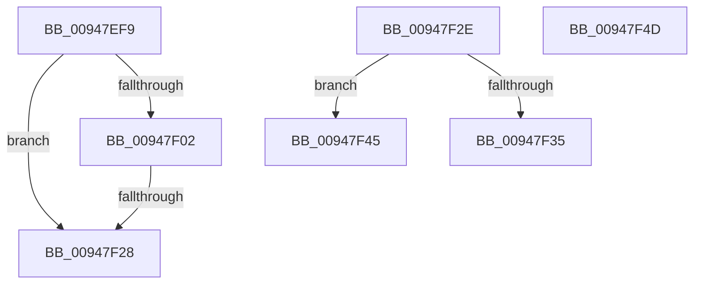

# sub_00947EF9

- RVA: `0x00947EF9`–`0x00947F5A` (길이 `97` bytes)
- VA: `0x0000000140947EF9`
- 실행 섹션: `PAGE`
- PDB 이름 있음: `아니요`; PDB Function 태그: `아니요`
- unwind 정보 RVA: `0x00090C3C`
- 디코드: `23`개 명령, `97/97` bytes 표시
- 미해석 바이트: `0` (있으면 어셈블리에 `.byte`로 보존)

> 이 문서는 커널 이미지의 기계어와 PDB 기호를 분석해 생성했습니다. 4번과 5번은 함수 원형과 자료형을 바이너리 사용 방식에서 추정한 C 해석이며 원본 소스 복구 결과는 아닙니다.

## 1. Dependencies

- 직접 호출 지점: **2**; 고유 호출 대상: **2**
- 직접 호출자로 확인된 함수: **0**
- RIP 상대 이미지 참조: **0**

### Outgoing calls
- `0x00947F06` → [SepLocateTokenTrustLevel](../../text/3E/SepLocateTokenTrustLevel_function_003EDA40.md) (function, `0x003EDA40`)
- `0x00947F19` → [RtlSidDominatesForTrust](../../text/3E/RtlSidDominatesForTrust_function_003EDFE0.md) (function, `0x003EDFE0`)

### Direct callers
- 이 함수 시작 RVA로 연결되는 직접 call은 확인되지 않았습니다. 간접 호출은 완전히 역산할 수 없습니다.

### Static image references
- 디코드된 RIP-relative 메모리 참조가 없습니다.

## 2. Other-region calls and transfers

- 다른 실행 섹션으로 향하는 call: **2**
  - `0x00947F06` → [SepLocateTokenTrustLevel](../../text/3E/SepLocateTokenTrustLevel_function_003EDA40.md) (`PAGE` → `.text`)
  - `0x00947F19` → [RtlSidDominatesForTrust](../../text/3E/RtlSidDominatesForTrust_function_003EDFE0.md) (`PAGE` → `.text`)
- call이 아닌 외부 분기/꼬리 이동: **5**
  - `0x00947F26` → [sub_00947E60 + 0x5D](Unknown_function_00947E60.md) (`tail-transfer`)
  - `0x00947F2C` → [sub_00947E60 + 0x5D](Unknown_function_00947E60.md) (`tail-transfer`)
  - `0x00947F40` → [sub_00947E60 + 0x1E](Unknown_function_00947E60.md) (`tail-transfer`)
  - `0x00947F48` → [sub_00947E60 + 0x1E](Unknown_function_00947E60.md) (`tail-transfer`)
  - `0x00947F55` → [sub_00947E60 + 0x4D](Unknown_function_00947E60.md) (`tail-transfer`)

## 3. Assembly (complete function range)

```asm
00947EF9  4C 8D 68 08                     lea r13, [rax + 8]
00947EFD  4D 85 ED                        test r13, r13
00947F00  74 26                           je 0x140947f28
00947F02  48 8D 4F 20                     lea rcx, [rdi + 0x20]
00947F06  E8 35 5B AA FF                  call 0x1403eda40
00947F0B  4C 8D 84 24 88 00 00 00         lea r8, [rsp + 0x88]
00947F13  49 8B D5                        mov rdx, r13
00947F16  48 8B C8                        mov rcx, rax
00947F19  E8 C2 60 AA FF                  call 0x1403edfe0
00947F1E  80 BC 24 88 00 00 00 00         cmp byte ptr [rsp + 0x88], 0
00947F26  75 95                           jne 0x140947ebd
00947F28  41 8B 6E 04                     mov ebp, dword ptr [r14 + 4]
00947F2C  EB 8F                           jmp 0x140947ebd
00947F2E  3D 00 01 00 00                  cmp eax, 0x100
00947F33  75 10                           jne 0x140947f45
00947F35  BB 19 00 02 01                  mov ebx, 0x1020019
00947F3A  41 BF 06 00 0F 01               mov r15d, 0x10f0006
00947F40  E9 39 FF FF FF                  jmp 0x140947e7e
00947F45  44 8B FB                        mov r15d, ebx
00947F48  E9 31 FF FF FF                  jmp 0x140947e7e
00947F4D  45 84 ED                        test r13b, r13b
00947F50  0F 45 74 24 30                  cmovne esi, dword ptr [rsp + 0x30]
00947F55  E9 53 FF FF FF                  jmp 0x140947ead
```

## 4. C-style interpretation (structured pseudocode)

```c
__int64 __fastcall sub_00947EF9(__int64 a1, __int64 a2, __int64 a3, __int64 a4, __int64 a5, __int64 a6, __int64 a7, __int64 a8, __int64 a9, __int64 a10, __int64 a11, __int64 a12, __int64 a13, __int64 a14, __int64 a15, __int64 a16, unsigned __int8 a17)
{
    __int64 result;
    unsigned int v_stack_p30;

    if (result + 8 == 0) goto loc_00947F28;
    result = SepLocateTokenTrustLevel(v_rdi + 32, a2, a3, a4);
    result = RtlSidDominatesForTrust(result, result + 8, a17, a4);
loc_00947F28:
}
```

## 5. (Beta) C Style

```c
int64_t sub_00947EF9(int64_t Arg1, int64_t Arg2, int64_t Arg3, int64_t Arg4, uint64_t Arg5, uint64_t Arg6, uint64_t Arg7, uint64_t Arg8, uint64_t Arg9, uint64_t Arg10, uint64_t Arg11, uint64_t Arg12, uint64_t Arg13, uint64_t Arg14, uint64_t Arg15, uint64_t Arg16, uint8_t Arg17)
{
    int64_t result;
    uint32_t v_stack_p30;

    if (result + 8 == 0) goto loc_00947F28;
    result = SepLocateTokenTrustLevel(local_rdi + 32, Arg2, Arg3, Arg4);
    result = RtlSidDominatesForTrust(result, result + 8, Arg17, Arg4);
loc_00947F28:
}
```

## 6. Execution-region graph

[열기: 2D/3D 그래프와 함수 탐색 컨트롤 패널](../../../control-panel.html?section=page&rva=0x00947EF9&view=graph)

- 2D 그래프는 위에서 아래로 흐르고, 3D 그래프는 빈 공간을 드래그해 회전합니다. Shift+드래그는 이동, 휠은 확대·축소, 함수 노드 선택은 대상 보고서 이동입니다.

### Static fallback


