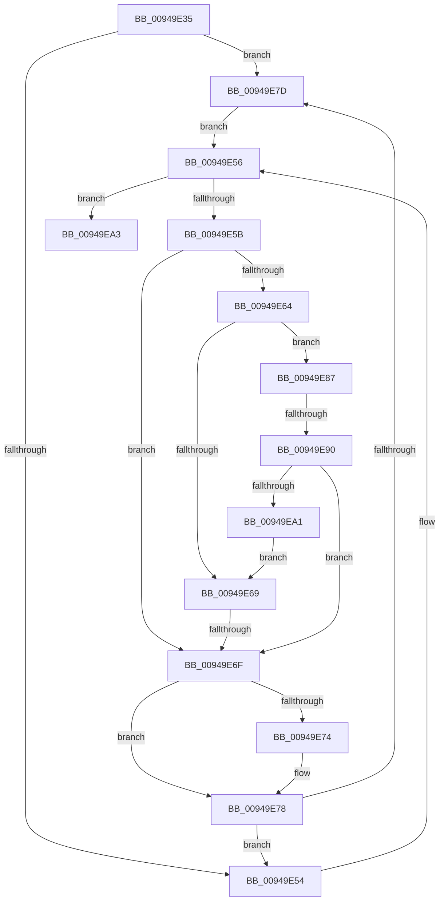

# sub_00949E35

- RVA: `0x00949E35`–`0x00949EBA` (길이 `133` bytes)
- VA: `0x0000000140949E35`
- 실행 섹션: `PAGE`
- PDB 이름 있음: `아니요`; PDB Function 태그: `아니요`
- unwind 정보 RVA: `0x00090D64`
- 디코드: `39`개 명령, `133/133` bytes 표시
- 미해석 바이트: `0` (있으면 어셈블리에 `.byte`로 보존)

> 이 문서는 커널 이미지의 기계어와 PDB 기호를 분석해 생성했습니다. 4번과 5번은 함수 원형과 자료형을 바이너리 사용 방식에서 추정한 C 해석이며 원본 소스 복구 결과는 아닙니다.

## 1. Dependencies

- 직접 호출 지점: **1**; 고유 호출 대상: **1**
- 직접 호출자로 확인된 함수: **0**
- RIP 상대 이미지 참조: **0**

### Outgoing calls
- `0x00949E98` → [CmpTransUowIsEqual](../70/CmpTransUowIsEqual_function_007049CC.md) (function, `0x007049CC`)

### Direct callers
- 이 함수 시작 RVA로 연결되는 직접 call은 확인되지 않았습니다. 간접 호출은 완전히 역산할 수 없습니다.

### Static image references
- 디코드된 RIP-relative 메모리 참조가 없습니다.

## 2. Other-region calls and transfers

- 다른 실행 섹션으로 향하는 call: **0**
- call이 아닌 외부 분기/꼬리 이동: **3**
  - `0x00949E6D` → [sub_00949EBA](Unknown_function_00949EBA.md) (`tail-transfer`)
  - `0x00949E8E` → [sub_00949ED2](Unknown_function_00949ED2.md) (`tail-transfer`)
  - `0x00949EB5` → [CmGetKCBCacheSecurity + 0x19](CmGetKCBCacheSecurity_function_00949E10.md) (`tail-transfer`)

## 3. Assembly (complete function range)

```asm
00949E35  48 89 6C 24 30                  mov qword ptr [rsp + 0x30], rbp
00949E3A  48 89 74 24 38                  mov qword ptr [rsp + 0x38], rsi
00949E3F  4C 89 74 24 40                  mov qword ptr [rsp + 0x40], r14
00949E44  4C 8D B1 D0 00 00 00            lea r14, [rcx + 0xd0]
00949E4B  49 8B 76 08                     mov rsi, qword ptr [r14 + 8]
00949E4F  4C 3B F6                        cmp r14, rsi
00949E52  75 29                           jne 0x140949e7d
00949E54  33 ED                           xor ebp, ebp
00949E56  48 85 ED                        test rbp, rbp
00949E59  74 48                           je 0x140949ea3
00949E5B  48 8B 4D 38                     mov rcx, qword ptr [rbp + 0x38]
00949E5F  48 85 C9                        test rcx, rcx
00949E62  74 0B                           je 0x140949e6f
00949E64  48 3B CF                        cmp rcx, rdi
00949E67  75 1E                           jne 0x140949e87
00949E69  83 7D 44 09                     cmp dword ptr [rbp + 0x44], 9
00949E6D  74 4B                           je 0x140949eba
00949E6F  48 85 F6                        test rsi, rsi
00949E72  75 04                           jne 0x140949e78
00949E74  49 8B 76 08                     mov rsi, qword ptr [r14 + 8]
00949E78  4C 3B F6                        cmp r14, rsi
00949E7B  74 D7                           je 0x140949e54
00949E7D  48 8D 6E E0                     lea rbp, [rsi - 0x20]
00949E81  48 8B 76 08                     mov rsi, qword ptr [rsi + 8]
00949E85  EB CF                           jmp 0x140949e56
00949E87  48 8B 41 38                     mov rax, qword ptr [rcx + 0x38]
00949E8B  48 85 C0                        test rax, rax
00949E8E  75 42                           jne 0x140949ed2
00949E90  48 8D 57 58                     lea rdx, [rdi + 0x58]
00949E94  48 83 C1 58                     add rcx, 0x58
00949E98  E8 2F AB DB FF                  call 0x1407049cc
00949E9D  84 C0                           test al, al
00949E9F  74 CE                           je 0x140949e6f
00949EA1  EB C6                           jmp 0x140949e69
00949EA3  48 8B 74 24 38                  mov rsi, qword ptr [rsp + 0x38]
00949EA8  48 8B C3                        mov rax, rbx
00949EAB  48 8B 6C 24 30                  mov rbp, qword ptr [rsp + 0x30]
00949EB0  4C 8B 74 24 40                  mov r14, qword ptr [rsp + 0x40]
00949EB5  E9 6F FF FF FF                  jmp 0x140949e29
```

## 4. C-style interpretation (structured pseudocode)

```c
__int64 __fastcall sub_00949E35(__int64 a1, __int64 a2, __int64 a3, __int64 a4, __int64 a5, __int64 a6, __int64 a7, __int64 a8)
{
    __int64 result;
    __int64 v_rbp;
    __int64 v_rsi;
    unsigned __int64 v_stack_p30;
    unsigned __int64 v_stack_p38;
    unsigned __int64 v_stack_p40;

    v_stack_p30 = v_rbp;
    v_stack_p38 = v_rsi;
    v_stack_p40 = v_r14;
    if ((a1 + 208) != (*(unsigned __int64 *)(a1 + 208 + 8))) goto loc_00949E7D;
loc_00949E54:
    v_rbp = 0;
loc_00949E56:
    if (0 == 0) goto loc_00949EA3;
    if (*(unsigned __int64 *)(v_rbp + 56) == 0) goto loc_00949E6F;
    if ((*(unsigned __int64 *)(v_rbp + 56)) != v_rdi) goto loc_00949E87;
loc_00949E69:
loc_00949E6F:
    v_rsi = *(unsigned __int64 *)(a1 + 208 + 8);
    if (*(unsigned __int64 *)(a1 + 208 + 8) == 0) {
        v_rsi = *(unsigned __int64 *)(a1 + 208 + 8);
    }
    if ((a1 + 208) == v_rsi) goto loc_00949E54;
loc_00949E7D:
    goto loc_00949E56;
loc_00949E87:
    a1 = (*(unsigned __int64 *)(v_rbp + 56)) + (88);
    result = CmpTransUowIsEqual(a1, v_rdi + 88, a3, a4);
    if ((unsigned __int8)(result) == 0) goto loc_00949E6F;
    goto loc_00949E69;
loc_00949EA3:
}
```

## 5. (Beta) C Style

```c
int64_t sub_00949E35(void *Arg1, int64_t Arg2, int64_t Arg3, int64_t Arg4, uint64_t Arg5, int64_t Arg6, int64_t Arg7, int64_t Arg8)
{
    uint8_t *arg1 = (uint8_t *)Arg1;

    int64_t result;
    int64_t local_rbp;
    int64_t local_rsi;
    uint64_t v_stack_p30;
    uint64_t v_stack_p38;
    uint64_t v_stack_p40;

    v_stack_p30 = local_rbp;
    v_stack_p38 = local_rsi;
    v_stack_p40 = local_r14;
    if ((Arg1 + 208) != (*(uint64_t *)(arg1 + 0xD0 + 0x8))) goto loc_00949E7D;
loc_00949E54:
    local_rbp = 0;
loc_00949E56:
    if (0 == 0) goto loc_00949EA3;
    if (*(uint64_t *)(local_rbp + 0x38) == 0) goto loc_00949E6F;
    if ((*(uint64_t *)(local_rbp + 0x38)) != local_rdi) goto loc_00949E87;
loc_00949E69:
loc_00949E6F:
    local_rsi = *(uint64_t *)(arg1 + 0xD0 + 0x8);
    if (*(uint64_t *)(arg1 + 0xD0 + 0x8) == 0) {
        local_rsi = *(uint64_t *)(arg1 + 0xD0 + 0x8);
    }
    if ((Arg1 + 208) == local_rsi) goto loc_00949E54;
loc_00949E7D:
    goto loc_00949E56;
loc_00949E87:
    Arg1 = (*(uint64_t *)(local_rbp + 0x38)) + (88);
    result = CmpTransUowIsEqual(Arg1, local_rdi + 88, Arg3, Arg4);
    if ((uint8_t)(result) == 0) goto loc_00949E6F;
    goto loc_00949E69;
loc_00949EA3:
}
```

### 관측된 메모리 오프셋

구조체 형식이 확인되지 않은 접근은 인자 기준의 오프셋으로만 기록했습니다.

| 기준 인자 | 오프셋 표현 | 폭 (bit) | 접근 |
|---|---:|---:|---|
| `Arg1` | `+ 0x8` | `64` | `R` |
| `Arg1` | `+ 0xD0` | `64` | `R` |

## 6. Execution-region graph

[열기: 2D/3D 그래프와 함수 탐색 컨트롤 패널](../../../control-panel.html?section=page&rva=0x00949E35&view=graph)

- 2D 그래프는 위에서 아래로 흐르고, 3D 그래프는 빈 공간을 드래그해 회전합니다. Shift+드래그는 이동, 휠은 확대·축소, 함수 노드 선택은 대상 보고서 이동입니다.

### Static fallback


