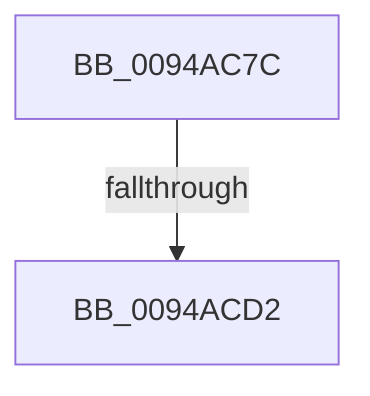

# sub_0094AC7C

- RVA: `0x0094AC7C`–`0x0094AD01` (길이 `133` bytes)
- VA: `0x000000014094AC7C`
- 실행 섹션: `PAGE`
- PDB 이름 있음: `아니요`; PDB Function 태그: `아니요`
- unwind 정보 RVA: `0x00090E78`
- 디코드: `32`개 명령, `133/133` bytes 표시
- 미해석 바이트: `0` (있으면 어셈블리에 `.byte`로 보존)

> 이 문서는 커널 이미지의 기계어와 PDB 기호를 분석해 생성했습니다. 4번과 5번은 함수 원형과 자료형을 바이너리 사용 방식에서 추정한 C 해석이며 원본 소스 복구 결과는 아닙니다.

## 1. Dependencies

- 직접 호출 지점: **1**; 고유 호출 대상: **1**
- 직접 호출자로 확인된 함수: **0**
- RIP 상대 이미지 참조: **0**

### Outgoing calls
- `0x0094ACAA` → [RtlInitUnicodeString](../../text/42/RtlInitUnicodeString_function_0042A780.md) (function, `0x0042A780`)

### Direct callers
- 이 함수 시작 RVA로 연결되는 직접 call은 확인되지 않았습니다. 간접 호출은 완전히 역산할 수 없습니다.

### Static image references
- 디코드된 RIP-relative 메모리 참조가 없습니다.

## 2. Other-region calls and transfers

- 다른 실행 섹션으로 향하는 call: **1**
  - `0x0094ACAA` → [RtlInitUnicodeString](../../text/42/RtlInitUnicodeString_function_0042A780.md) (`PAGE` → `.text`)
- call이 아닌 외부 분기/꼬리 이동: **2**
  - `0x0094ACD0` → [sub_0094AD2B](Unknown_function_0094AD2B.md) (`tail-transfer`)
  - `0x0094ACFB` → [sub_0094B023](Unknown_function_0094B023.md) (`tail-transfer`)

## 3. Assembly (complete function range)

```asm
0094AC7C  48 89 58 10                     mov qword ptr [rax + 0x10], rbx
0094AC80  0F 57 C0                        xorps xmm0, xmm0
0094AC83  48 89 70 18                     mov qword ptr [rax + 0x18], rsi
0094AC87  49 8B F8                        mov rdi, r8
0094AC8A  4C 89 60 20                     mov qword ptr [rax + 0x20], r12
0094AC8E  48 8B F1                        mov rsi, rcx
0094AC91  4C 89 70 E0                     mov qword ptr [rax - 0x20], r14
0094AC95  48 8D 4D B8                     lea rcx, [rbp - 0x48]
0094AC99  4C 89 78 D8                     mov qword ptr [rax - 0x28], r15
0094AC9D  45 0F B6 E1                     movzx r12d, r9b
0094ACA1  4C 8B FA                        mov r15, rdx
0094ACA4  33 D2                           xor edx, edx
0094ACA6  0F 11 45 B8                     movups xmmword ptr [rbp - 0x48], xmm0
0094ACAA  E8 D1 FA AD FF                  call 0x14042a780
0094ACAF  33 DB                           xor ebx, ebx
0094ACB1  0F 57 C0                        xorps xmm0, xmm0
0094ACB4  83 7E 28 FF                     cmp dword ptr [rsi + 0x28], -1
0094ACB8  B8 FF FF FF FF                  mov eax, 0xffffffff
0094ACBD  0F 11 45 C8                     movups xmmword ptr [rbp - 0x38], xmm0
0094ACC1  66 89 45 CA                     mov word ptr [rbp - 0x36], ax
0094ACC5  44 8B F3                        mov r14d, ebx
0094ACC8  48 89 5D 18                     mov qword ptr [rbp + 0x18], rbx
0094ACCC  0F 11 45 D8                     movups xmmword ptr [rbp - 0x28], xmm0
0094ACD0  74 59                           je 0x14094ad2b
0094ACD2  BF 71 02 00 C0                  mov edi, 0xc0000271
0094ACD7  48 8B 4D C0                     mov rcx, qword ptr [rbp - 0x40]
0094ACDB  4C 8B 7C 24 50                  mov r15, qword ptr [rsp + 0x50]
0094ACE0  4C 8B A4 24 98 00 00 00         mov r12, qword ptr [rsp + 0x98]
0094ACE8  48 8B B4 24 90 00 00 00         mov rsi, qword ptr [rsp + 0x90]
0094ACF0  48 8B 9C 24 88 00 00 00         mov rbx, qword ptr [rsp + 0x88]
0094ACF8  48 85 C9                        test rcx, rcx
0094ACFB  0F 85 22 03 00 00               jne 0x14094b023
```

## 4. C-style interpretation (structured pseudocode)

```c
__int64 __fastcall sub_0094AC7C(__int64 a1, __int64 a2, __int64 a3, unsigned __int8 a4, __int64 a5, __int64 a6, __int64 a7, __int64 a8, __int64 a9, __int64 a10, __int64 a11, __int64 a12, __int64 a13, __int64 a14, __int64 a15, __int64 a16, __int64 a17, __int64 a18, __int64 a19)
{
    __int64 result;
    __int64 v_rbx;

    *(unsigned __int64 *)(result + 16) = v_rbx;
    *(unsigned __int64 *)(result + 24) = v_rsi;
    *(unsigned __int64 *)(result + 32) = v_r12;
    *(unsigned __int64 *)(result - 32) = v_r14;
    *(unsigned __int64 *)(result - 40) = v_r15;
    a2 = 0;
    *(unsigned __int64 *)(v_rbp - 72) = v_xmm0;
    result = RtlInitUnicodeString(v_rbp - 72, a2, a3, a4);
    v_rbx = 0;
    *(unsigned __int64 *)(v_rbp - 56) = v_xmm0;
    *(unsigned __int16 *)(v_rbp - 54) = (unsigned __int16)((unsigned int)(0xFFFFFFFFULL));
    *(unsigned __int64 *)(v_rbp + 24) = 0;
    *(unsigned __int64 *)(v_rbp - 40) = v_xmm0;
}
```

## 5. (Beta) C Style

```c
int64_t sub_0094AC7C(void *Arg1, int64_t Arg2, int64_t Arg3, uint8_t Arg4, uint64_t Arg5, uint64_t Arg6, uint64_t Arg7, uint64_t Arg8, uint64_t Arg9, int64_t Arg10, uint64_t Arg11, uint64_t Arg12, uint64_t Arg13, uint64_t Arg14, uint64_t Arg15, uint64_t Arg16, int64_t Arg17, int64_t Arg18, int64_t Arg19)
{
    uint8_t *arg1 = (uint8_t *)Arg1;

    int64_t result;
    int64_t local_rbx;

    *(uint64_t *)(result + 0x10) = local_rbx;
    *(uint64_t *)(result + 0x18) = local_rsi;
    *(uint64_t *)(result + 0x20) = local_r12;
    *(uint64_t *)(result - 0x20) = local_r14;
    *(uint64_t *)(result - 0x28) = local_r15;
    Arg2 = 0;
    *(uint64_t *)(local_rbp - 0x48) = v_xmm0;
    result = RtlInitUnicodeString(local_rbp - 72, Arg2, Arg3, Arg4);
    local_rbx = 0;
    *(uint64_t *)(local_rbp - 0x38) = v_xmm0;
    *(uint16_t *)(local_rbp - 0x36) = (uint16_t)((uint32_t)(0xFFFFFFFFULL));
    *(uint64_t *)(local_rbp + 0x18) = 0;
    *(uint64_t *)(local_rbp - 0x28) = v_xmm0;
}
```

### 관측된 메모리 오프셋

구조체 형식이 확인되지 않은 접근은 인자 기준의 오프셋으로만 기록했습니다.

| 기준 인자 | 오프셋 표현 | 폭 (bit) | 접근 |
|---|---:|---:|---|
| `Arg1` | `+ 0x28` | `32` | `R` |

## 6. Execution-region graph

[열기: 2D/3D 그래프와 함수 탐색 컨트롤 패널](../../../control-panel.html?section=page&rva=0x0094AC7C&view=graph)

- 2D 그래프는 위에서 아래로 흐르고, 3D 그래프는 빈 공간을 드래그해 회전합니다. Shift+드래그는 이동, 휠은 확대·축소, 함수 노드 선택은 대상 보고서 이동입니다.

### Static fallback


