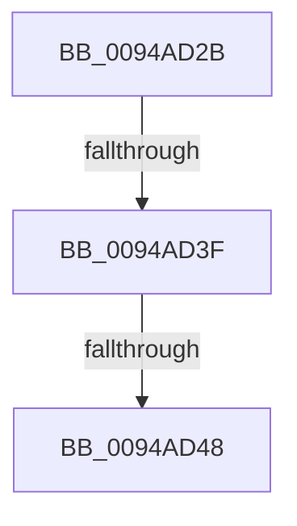

# sub_0094AD2B

- RVA: `0x0094AD2B`–`0x0094AD50` (길이 `37` bytes)
- VA: `0x000000014094AD2B`
- 실행 섹션: `PAGE`
- PDB 이름 있음: `아니요`; PDB Function 태그: `아니요`
- unwind 정보 RVA: `0x00090EC4`
- 디코드: `7`개 명령, `37/37` bytes 표시
- 미해석 바이트: `0` (있으면 어셈블리에 `.byte`로 보존)

> 이 문서는 커널 이미지의 기계어와 PDB 기호를 분석해 생성했습니다. 4번과 5번은 함수 원형과 자료형을 바이너리 사용 방식에서 추정한 C 해석이며 원본 소스 복구 결과는 아닙니다.

## 1. Dependencies

- 직접 호출 지점: **0**; 고유 호출 대상: **0**
- 직접 호출자로 확인된 함수: **0**
- RIP 상대 이미지 참조: **0**

### Outgoing calls
- 직접 디코드된 call 명령이 없습니다.

### Direct callers
- 이 함수 시작 RVA로 연결되는 직접 call은 확인되지 않았습니다. 간접 호출은 완전히 역산할 수 없습니다.

### Static image references
- 디코드된 RIP-relative 메모리 참조가 없습니다.

## 2. Other-region calls and transfers

- 다른 실행 섹션으로 향하는 call: **0**
- call이 아닌 외부 분기/꼬리 이동: **2**
  - `0x0094AD39` → [sub_0094AEF4](Unknown_function_0094AEF4.md) (`tail-transfer`)
  - `0x0094AD42` → [sub_0094AF2A](Unknown_function_0094AF2A.md) (`tail-transfer`)

## 3. Assembly (complete function range)

```asm
0094AD2B  48 8B 46 20                     mov rax, qword ptr [rsi + 0x20]
0094AD2F  F7 80 10 10 00 00 00 20 00 00   test dword ptr [rax + 0x1010], 0x2000
0094AD39  0F 84 B5 01 00 00               je 0x14094aef4
0094AD3F  45 84 E4                        test r12b, r12b
0094AD42  0F 85 E2 01 00 00               jne 0x14094af2a
0094AD48  48 0F BF 46 42                  movsx rax, word ptr [rsi + 0x42]
0094AD4D  48 8B F8                        mov rdi, rax
```

## 4. C-style interpretation (structured pseudocode)

```c
__int64 __fastcall sub_0094AD2B(void)
{
    return (__int16)(*(unsigned __int16 *)(v_rsi + 66));
}
```

## 5. (Beta) C Style

```c
void sub_0094AD2B(void)
{
    return (int16_t)(*(uint16_t *)(local_rsi + 0x42));
}
```

## 6. Execution-region graph

[열기: 2D/3D 그래프와 함수 탐색 컨트롤 패널](../../../control-panel.html?section=page&rva=0x0094AD2B&view=graph)

- 2D 그래프는 위에서 아래로 흐르고, 3D 그래프는 빈 공간을 드래그해 회전합니다. Shift+드래그는 이동, 휠은 확대·축소, 함수 노드 선택은 대상 보고서 이동입니다.

### Static fallback


