# sub_0094AD50

- RVA: `0x0094AD50`–`0x0094AEF4` (길이 `420` bytes)
- VA: `0x000000014094AD50`
- 실행 섹션: `PAGE`
- PDB 이름 있음: `아니요`; PDB Function 태그: `아니요`
- unwind 정보 RVA: `0x00090EE8`
- 디코드: `106`개 명령, `420/420` bytes 표시
- 미해석 바이트: `0` (있으면 어셈블리에 `.byte`로 보존)

> 이 문서는 커널 이미지의 기계어와 PDB 기호를 분석해 생성했습니다. 4번과 5번은 함수 원형과 자료형을 바이너리 사용 방식에서 추정한 C 해석이며 원본 소스 복구 결과는 아닙니다.

## 1. Dependencies

- 직접 호출 지점: **9**; 고유 호출 대상: **8**
- 직접 호출자로 확인된 함수: **0**
- RIP 상대 이미지 참조: **0**

### Outgoing calls
- `0x0094AD68` → [CmpKeyFullNameLength](CmpKeyFullNameLength_function_0094B040.md) (function, `0x0094B040`)
- `0x0094AD91` → [CmpAttachToRegistryProcess](../../pagecmrc/BC/CmpAttachToRegistryProcess_function_00BC98E0.md) (function, `0x00BC98E0`)
- `0x0094ADAE` → [CmpConstructNameWithStatus](../85/CmpConstructNameWithStatus_function_008562A0.md) (function, `0x008562A0`)
- `0x0094ADCB` → [ExAllocatePool2](../../poolcode/B8/ExAllocatePool2_function_00B820F0.md) (function, `0x00B820F0`)
- `0x0094ADED` → [RtlUnicodeStringValidateWorker](../../text/3D/RtlUnicodeStringValidateWorker_function_003D41F8.md) (function, `0x003D41F8`)
- `0x0094AE0A` → [RtlUnicodeStringValidateWorker](../../text/3D/RtlUnicodeStringValidateWorker_function_003D41F8.md) (function, `0x003D41F8`)
- `0x0094AE8B` → [RtlUnicodeStringCat](../../text/3E/RtlUnicodeStringCat_function_003E6030.md) (function, `0x003E6030`)
- `0x0094AE9A` → [ExFreePoolWithTag](../../poolcode/B8/ExFreePoolWithTag_function_00B82870.md) (function, `0x00B82870`)
- `0x0094AEAC` → [RtlInitUnicodeString](../../text/42/RtlInitUnicodeString_function_0042A780.md) (function, `0x0042A780`)

### Direct callers
- 이 함수 시작 RVA로 연결되는 직접 call은 확인되지 않았습니다. 간접 호출은 완전히 역산할 수 없습니다.

### Static image references
- 디코드된 RIP-relative 메모리 참조가 없습니다.

## 2. Other-region calls and transfers

- 다른 실행 섹션으로 향하는 call: **7**
  - `0x0094AD91` → [CmpAttachToRegistryProcess](../../pagecmrc/BC/CmpAttachToRegistryProcess_function_00BC98E0.md) (`PAGE` → `PAGECMRC`)
  - `0x0094ADCB` → [ExAllocatePool2](../../poolcode/B8/ExAllocatePool2_function_00B820F0.md) (`PAGE` → `POOLCODE`)
  - `0x0094ADED` → [RtlUnicodeStringValidateWorker](../../text/3D/RtlUnicodeStringValidateWorker_function_003D41F8.md) (`PAGE` → `.text`)
  - `0x0094AE0A` → [RtlUnicodeStringValidateWorker](../../text/3D/RtlUnicodeStringValidateWorker_function_003D41F8.md) (`PAGE` → `.text`)
  - `0x0094AE8B` → [RtlUnicodeStringCat](../../text/3E/RtlUnicodeStringCat_function_003E6030.md) (`PAGE` → `.text`)
  - `0x0094AE9A` → [ExFreePoolWithTag](../../poolcode/B8/ExFreePoolWithTag_function_00B82870.md) (`PAGE` → `POOLCODE`)
  - `0x0094AEAC` → [RtlInitUnicodeString](../../text/42/RtlInitUnicodeString_function_0042A780.md) (`PAGE` → `.text`)
- call이 아닌 외부 분기/꼬리 이동: **6**
  - `0x0094AD5B` → [sub_0094AF1C](Unknown_function_0094AF1C.md) (`tail-transfer`)
  - `0x0094AD75` → [sub_0094AFBA](Unknown_function_0094AFBA.md) (`tail-transfer`)
  - `0x0094ADA5` → [sub_0094AFBA + 0x1F](Unknown_function_0094AFBA.md) (`tail-transfer`)
  - `0x0094ADB7` → [sub_0094AEFE](Unknown_function_0094AEFE.md) (`tail-transfer`)
  - `0x0094ADDA` → [sub_0094AFBA + 0x4B](Unknown_function_0094AFBA.md) (`tail-transfer`)
  - `0x0094AEEF` → [sub_0094AC7C + 0x5B](Unknown_function_0094AC7C.md) (`tail-transfer`)

## 3. Assembly (complete function range)

```asm
0094AD50  4C 89 6C 24 60                  mov qword ptr [rsp + 0x60], r13
0094AD55  0F AE E8                        lfence
0094AD58  83 F8 02                        cmp eax, 2
0094AD5B  0F 8F BB 01 00 00               jg 0x14094af1c
0094AD61  49 8B 3C C7                     mov rdi, qword ptr [r15 + rax*8]
0094AD65  48 8B CF                        mov rcx, rdi
0094AD68  E8 D3 02 00 00                  call 0x14094b040
0094AD6D  44 8B E8                        mov r13d, eax
0094AD70  3D FF FF 00 00                  cmp eax, 0xffff
0094AD75  0F 87 3F 02 00 00               ja 0x14094afba
0094AD7B  4C 8B 7D 40                     mov r15, qword ptr [rbp + 0x40]
0094AD7F  41 8B 87 A0 00 00 00            mov eax, dword ptr [r15 + 0xa0]
0094AD86  A8 01                           test al, 1
0094AD88  75 14                           jne 0x14094ad9e
0094AD8A  49 8D 8F A8 00 00 00            lea rcx, [r15 + 0xa8]
0094AD91  E8 4A EB 27 00                  call 0x140bc98e0
0094AD96  41 83 8F A0 00 00 00 01         or dword ptr [r15 + 0xa0], 1
0094AD9E  48 8D 55 18                     lea rdx, [rbp + 0x18]
0094ADA2  45 84 E4                        test r12b, r12b
0094ADA5  0F 85 2E 02 00 00               jne 0x14094afd9
0094ADAB  48 8B CF                        mov rcx, rdi
0094ADAE  E8 ED B4 F0 FF                  call 0x1408562a0
0094ADB3  8B F8                           mov edi, eax
0094ADB5  85 C0                           test eax, eax
0094ADB7  0F 88 41 01 00 00               js 0x14094aefe
0094ADBD  49 8B D5                        mov rdx, r13
0094ADC0  B9 00 01 00 00                  mov ecx, 0x100
0094ADC5  41 B8 43 4D 36 36               mov r8d, 0x36364d43
0094ADCB  E8 20 73 23 00                  call 0x140b820f0
0094ADD0  48 89 45 C0                     mov qword ptr [rbp - 0x40], rax
0094ADD4  48 8B F8                        mov rdi, rax
0094ADD7  48 85 C0                        test rax, rax
0094ADDA  0F 84 25 02 00 00               je 0x14094b005
0094ADE0  48 8D 4D B8                     lea rcx, [rbp - 0x48]
0094ADE4  66 89 5D B8                     mov word ptr [rbp - 0x48], bx
0094ADE8  66 44 89 6D BA                  mov word ptr [rbp - 0x46], r13w
0094ADED  E8 06 94 A8 FF                  call 0x1403d41f8
0094ADF2  4C 8B 75 18                     mov r14, qword ptr [rbp + 0x18]
0094ADF6  85 C0                           test eax, eax
0094ADF8  78 5E                           js 0x14094ae58
0094ADFA  41 0F B7 F5                     movzx esi, r13w
0094ADFE  49 8B CE                        mov rcx, r14
0094AE01  48 D1 EE                        shr rsi, 1
0094AE04  4C 8B DB                        mov r11, rbx
0094AE07  4C 8B D3                        mov r10, rbx
0094AE0A  E8 E9 93 A8 FF                  call 0x1403d41f8
0094AE0F  85 C0                           test eax, eax
0094AE11  78 3E                           js 0x14094ae51
0094AE13  4D 85 F6                        test r14, r14
0094AE16  74 0B                           je 0x14094ae23
0094AE18  45 0F B7 16                     movzx r10d, word ptr [r14]
0094AE1C  4D 8B 5E 08                     mov r11, qword ptr [r14 + 8]
0094AE20  49 D1 EA                        shr r10, 1
0094AE23  48 85 F6                        test rsi, rsi
0094AE26  74 29                           je 0x14094ae51
0094AE28  49 2B FB                        sub rdi, r11
0094AE2B  49 2B F2                        sub rsi, r10
0094AE2E  66 90                           nop
0094AE30  4D 85 D2                        test r10, r10
0094AE33  74 1C                           je 0x14094ae51
0094AE35  41 0F B7 03                     movzx eax, word ptr [r11]
0094AE39  49 FF CA                        dec r10
0094AE3C  66 42 89 04 1F                  mov word ptr [rdi + r11], ax
0094AE41  48 FF C3                        inc rbx
0094AE44  49 83 C3 02                     add r11, 2
0094AE48  4A 8D 04 16                     lea rax, [rsi + r10]
0094AE4C  48 85 C0                        test rax, rax
0094AE4F  75 DF                           jne 0x14094ae30
0094AE51  66 03 DB                        add bx, bx
0094AE54  66 89 5D B8                     mov word ptr [rbp - 0x48], bx
0094AE58  45 84 E4                        test r12b, r12b
0094AE5B  74 33                           je 0x14094ae90
0094AE5D  0F B7 CB                        movzx ecx, bx
0094AE60  83 C1 02                        add ecx, 2
0094AE63  41 0F B7 C5                     movzx eax, r13w
0094AE67  3B C8                           cmp ecx, eax
0094AE69  77 18                           ja 0x14094ae83
0094AE6B  48 8B 45 C0                     mov rax, qword ptr [rbp - 0x40]
0094AE6F  0F B7 CB                        movzx ecx, bx
0094AE72  48 D1 E9                        shr rcx, 1
0094AE75  66 83 C3 02                     add bx, 2
0094AE79  66 89 5D B8                     mov word ptr [rbp - 0x48], bx
0094AE7D  66 C7 04 48 5C 00               mov word ptr [rax + rcx*2], 0x5c
0094AE83  48 8B 55 38                     mov rdx, qword ptr [rbp + 0x38]
0094AE87  48 8D 4D B8                     lea rcx, [rbp - 0x48]
0094AE8B  E8 A0 B1 A9 FF                  call 0x1403e6030
0094AE90  48 8B 5D 48                     mov rbx, qword ptr [rbp + 0x48]
0094AE94  33 D2                           xor edx, edx
0094AE96  48 8B 4B 08                     mov rcx, qword ptr [rbx + 8]
0094AE9A  E8 D1 79 23 00                  call 0x140b82870
0094AE9F  0F 10 45 B8                     movups xmm0, xmmword ptr [rbp - 0x48]
0094AEA3  33 D2                           xor edx, edx
0094AEA5  48 8D 4D B8                     lea rcx, [rbp - 0x48]
0094AEA9  0F 11 03                        movups xmmword ptr [rbx], xmm0
0094AEAC  E8 CF F8 AD FF                  call 0x14042a780
0094AEB1  41 83 4F 18 10                  or dword ptr [r15 + 0x18], 0x10
0094AEB6  BF 68 03 00 00                  mov edi, 0x368
0094AEBB  41 0F B6 87 AA 01 00 00         movzx eax, byte ptr [r15 + 0x1aa]
0094AEC3  3C 04                           cmp al, 4
0094AEC5  73 23                           jae 0x14094aeea
0094AEC7  41 89 BC C7 AC 01 00 00         mov dword ptr [r15 + rax*8 + 0x1ac], edi
0094AECF  41 0F B6 87 AA 01 00 00         movzx eax, byte ptr [r15 + 0x1aa]
0094AED7  41 C7 84 C7 B0 01 00 00 00 05 01 00  mov dword ptr [r15 + rax*8 + 0x1b0], 0x10500
0094AEE3  41 FE 87 AA 01 00 00            inc byte ptr [r15 + 0x1aa]
0094AEEA  4C 8B 6C 24 60                  mov r13, qword ptr [rsp + 0x60]
0094AEEF  E9 E3 FD FF FF                  jmp 0x14094acd7
```

## 4. C-style interpretation (structured pseudocode)

```c
__int64 __fastcall sub_0094AD50(__int64 a1, __int64 a2, __int64 a3, __int64 a4, __int64 a5, __int64 a6, __int64 a7, __int64 a8, __int64 a9, __int64 a10, __int64 a11, __int64 a12)
{
    __int64 result;
    __int64 v_r10;
    __int64 v_r11;
    __int64 v_rbx;
    __int64 v_rdi;
    __int64 v_rsi;
    unsigned __int64 v_stack_p60;

    v_stack_p60 = v_r13;
    result = CmpKeyFullNameLength(*(unsigned __int64 *)(v_r15 + result * 8), a2, a3, a4);
    result = (unsigned int)(*(unsigned int *)(*(unsigned __int64 *)(v_rbp + 64) + 160));
    if ((((unsigned __int8)((unsigned int)(*(unsigned int *)(*(unsigned __int64 *)(v_rbp + 64) + 160)))) & (1)) == 0) {
        a1 = *(unsigned __int64 *)(v_rbp + 64) + 168;
        result = CmpAttachToRegistryProcess(a1, a2, a3, a4);
    }
    result = CmpConstructNameWithStatus(*(unsigned __int64 *)(v_r15 + result * 8), v_rbp + 24, a3, a4);
    result = ExAllocatePool2(256, (unsigned int)((unsigned int)(result)), (unsigned int)(0x36364D43ULL), a4);
    *(unsigned __int64 *)(v_rbp - 64) = result;
    *(unsigned __int16 *)(v_rbp - 72) = (unsigned __int16)(v_rbx);
    *(unsigned __int16 *)(v_rbp - 70) = (unsigned __int16)((unsigned int)((unsigned int)(result)));
    result = RtlUnicodeStringValidateWorker(v_rbp - 72, (unsigned int)((unsigned int)(result)), (unsigned int)(0x36364D43ULL), a4);
    if (sign_flag) goto loc_0094AE58;
    v_rsi = ((unsigned __int16)((unsigned int)((unsigned int)(result)))) >> (1);
    result = RtlUnicodeStringValidateWorker(*(unsigned __int64 *)(v_rbp + 24), (unsigned int)((unsigned int)(result)), (unsigned int)(0x36364D43ULL), a4);
    if (sign_flag) goto loc_0094AE51;
    v_r10 = v_rbx;
    v_r11 = v_rbx;
    if (*(unsigned __int64 *)(v_rbp + 24) != 0) {
        v_r10 = *(unsigned __int16 *)(*(unsigned __int64 *)(v_rbp + 24));
        v_r11 = *(unsigned __int64 *)(*(unsigned __int64 *)(v_rbp + 24) + 8);
        v_r10 = (v_r10) >> (1);
    }
    if (v_rsi == 0) goto loc_0094AE51;
    v_rdi = (result) - (v_r11);
    v_rsi = (v_rsi) - (v_r10);
loc_0094AE30:
    if (v_r10 == 0) goto loc_0094AE51;
    v_r10 = (v_r10) - 1;
    *(unsigned __int16 *)(v_rdi + v_r11 * 1) = (unsigned __int16)(*(unsigned __int16 *)(v_r11));
    v_rbx = (v_rbx) + 1;
    v_r11 = (v_r11) + (2);
    if (v_rsi + v_r10 * 1 != 0) goto loc_0094AE30;
loc_0094AE51:
    v_rbx = (unsigned __int16)((v_rbx) + ((unsigned __int16)(v_rbx)));
    *(unsigned __int16 *)(v_rbp - 72) = (unsigned __int16)(v_rbx);
loc_0094AE58:
    if ((unsigned __int8)(v_r12) == 0) goto loc_0094AE90;
    a1 = (unsigned int)(((unsigned __int16)(v_rbx)) + (2));
    result = (unsigned __int16)((unsigned int)((unsigned int)(result)));
    if (((unsigned int)(a1)) <= ((unsigned int)((unsigned __int16)((unsigned int)((unsigned int)(result)))))) {
        result = *(unsigned __int64 *)(v_rbp - 64);
        a1 = (unsigned __int16)(v_rbx);
        a1 = (a1) >> (1);
        v_rbx = (unsigned __int16)((v_rbx) + (2));
        *(unsigned __int16 *)(v_rbp - 72) = (unsigned __int16)(v_rbx);
        *(unsigned __int16 *)(result + a1 * 2) = 92;
    }
    result = RtlUnicodeStringCat(v_rbp - 72, *(unsigned __int64 *)(v_rbp + 56), (unsigned int)(0x36364D43ULL), a4);
loc_0094AE90:
    a2 = 0;
    result = ExFreePoolWithTag(*(unsigned __int64 *)(*(unsigned __int64 *)(v_rbp + 72) + 8), a2, (unsigned int)(0x36364D43ULL), a4);
    a2 = 0;
    *(unsigned __int64 *)(*(unsigned __int64 *)(v_rbp + 72)) = v_xmm0;
    result = RtlInitUnicodeString(v_rbp - 72, a2, (unsigned int)(0x36364D43ULL), a4);
    result = *(unsigned __int8 *)(*(unsigned __int64 *)(v_rbp + 64) + 426);
    if (((unsigned __int8)(*(unsigned __int8 *)(*(unsigned __int64 *)(v_rbp + 64) + 426))) < 4) {
        *(unsigned int *)(*(unsigned __int64 *)(v_rbp + 64) + *(unsigned __int8 *)(*(unsigned __int64 *)(v_rbp + 64) + 426) * 8 + 428) = 872;
        result = *(unsigned __int8 *)(*(unsigned __int64 *)(v_rbp + 64) + 426);
        *(unsigned int *)(*(unsigned __int64 *)(v_rbp + 64) + result * 8 + 432) = 0x10500ULL;
    }
}
```

## 5. (Beta) C Style

```c
int64_t sub_0094AD50(int64_t Arg1, int64_t Arg2, int64_t Arg3, int64_t Arg4, uint64_t Arg5, uint64_t Arg6, uint64_t Arg7, uint64_t Arg8, uint64_t Arg9, uint64_t Arg10, uint64_t Arg11, int64_t Arg12)
{
    int64_t result;
    int64_t local_r10;
    int64_t local_r11;
    int64_t local_rbx;
    int64_t local_rdi;
    int64_t local_rsi;
    uint64_t v_stack_p60;

    v_stack_p60 = local_r13;
    result = CmpKeyFullNameLength(*(uint64_t *)(local_r15 + result * 8), Arg2, Arg3, Arg4);
    result = (uint32_t)(*(uint32_t *)(*(uint64_t *)(local_rbp + 0x40) + 0xA0));
    if ((((uint8_t)((uint32_t)(*(uint32_t *)(*(uint64_t *)(local_rbp + 0x40) + 0xA0)))) & (1)) == 0) {
        Arg1 = *(uint64_t *)(local_rbp + 0x40) + 168;
        result = CmpAttachToRegistryProcess(Arg1, Arg2, Arg3, Arg4);
    }
    result = CmpConstructNameWithStatus(*(uint64_t *)(local_r15 + result * 8), local_rbp + 24, Arg3, Arg4);
    result = ExAllocatePool2(256, (uint32_t)((uint32_t)(result)), (uint32_t)(0x36364D43ULL), Arg4);
    *(uint64_t *)(local_rbp - 0x40) = result;
    *(uint16_t *)(local_rbp - 0x48) = (uint16_t)(local_rbx);
    *(uint16_t *)(local_rbp - 0x46) = (uint16_t)((uint32_t)((uint32_t)(result)));
    result = RtlUnicodeStringValidateWorker(local_rbp - 72, (uint32_t)((uint32_t)(result)), (uint32_t)(0x36364D43ULL), Arg4);
    if (sign_flag) goto loc_0094AE58;
    local_rsi = ((uint16_t)((uint32_t)((uint32_t)(result)))) >> (1);
    result = RtlUnicodeStringValidateWorker(*(uint64_t *)(local_rbp + 0x18), (uint32_t)((uint32_t)(result)), (uint32_t)(0x36364D43ULL), Arg4);
    if (sign_flag) goto loc_0094AE51;
    local_r10 = local_rbx;
    local_r11 = local_rbx;
    if (*(uint64_t *)(local_rbp + 0x18) != 0) {
        local_r10 = *(uint16_t *)(*(uint64_t *)(local_rbp + 0x18));
        local_r11 = *(uint64_t *)(*(uint64_t *)(local_rbp + 0x18) + 0x8);
        local_r10 = (local_r10) >> (1);
    }
    if (local_rsi == 0) goto loc_0094AE51;
    local_rdi = (result) - (local_r11);
    local_rsi = (local_rsi) - (local_r10);
loc_0094AE30:
    if (local_r10 == 0) goto loc_0094AE51;
    local_r10 = (local_r10) - 1;
    *(uint16_t *)(local_rdi + local_r11 * 1) = (uint16_t)(*(uint16_t *)(local_r11));
    local_rbx = (local_rbx) + 1;
    local_r11 = (local_r11) + (2);
    if (local_rsi + local_r10 * 1 != 0) goto loc_0094AE30;
loc_0094AE51:
    local_rbx = (uint16_t)((local_rbx) + ((uint16_t)(local_rbx)));
    *(uint16_t *)(local_rbp - 0x48) = (uint16_t)(local_rbx);
loc_0094AE58:
    if ((uint8_t)(local_r12) == 0) goto loc_0094AE90;
    Arg1 = (uint32_t)(((uint16_t)(local_rbx)) + (2));
    result = (uint16_t)((uint32_t)((uint32_t)(result)));
    if (((uint32_t)(Arg1)) <= ((uint32_t)((uint16_t)((uint32_t)((uint32_t)(result)))))) {
        result = *(uint64_t *)(local_rbp - 0x40);
        Arg1 = (uint16_t)(local_rbx);
        Arg1 = (Arg1) >> (1);
        local_rbx = (uint16_t)((local_rbx) + (2));
        *(uint16_t *)(local_rbp - 0x48) = (uint16_t)(local_rbx);
        *(uint16_t *)(result + Arg1 * 2) = 92;
    }
    result = RtlUnicodeStringCat(local_rbp - 72, *(uint64_t *)(local_rbp + 0x38), (uint32_t)(0x36364D43ULL), Arg4);
loc_0094AE90:
    Arg2 = 0;
    result = ExFreePoolWithTag(*(uint64_t *)(*(uint64_t *)(local_rbp + 0x48) + 0x8), Arg2, (uint32_t)(0x36364D43ULL), Arg4);
    Arg2 = 0;
    *(uint64_t *)(*(uint64_t *)(local_rbp + 0x48)) = v_xmm0;
    result = RtlInitUnicodeString(local_rbp - 72, Arg2, (uint32_t)(0x36364D43ULL), Arg4);
    result = *(uint8_t *)(*(uint64_t *)(local_rbp + 0x40) + 0x1AA);
    if (((uint8_t)(*(uint8_t *)(*(uint64_t *)(local_rbp + 0x40) + 0x1AA))) < 4) {
        *(uint32_t *)(*(uint64_t *)(local_rbp + 0x40) + *(uint8_t *)(*(uint64_t *)(local_rbp + 0x40) + 0x1AA) * 8 + 0x1AC) = 872;
        result = *(uint8_t *)(*(uint64_t *)(local_rbp + 0x40) + 0x1AA);
        *(uint32_t *)(*(uint64_t *)(local_rbp + 0x40) + result * 8 + 0x1B0) = 0x10500ULL;
    }
}
```

## 6. Execution-region graph

[열기: 2D/3D 그래프와 함수 탐색 컨트롤 패널](../../../control-panel.html?section=page&rva=0x0094AD50&view=graph)

- 2D 그래프는 위에서 아래로 흐르고, 3D 그래프는 빈 공간을 드래그해 회전합니다. Shift+드래그는 이동, 휠은 확대·축소, 함수 노드 선택은 대상 보고서 이동입니다.

### Static fallback

```mermaid
flowchart TD
  bb_0094AD50[BB_0094AD50]
  bb_0094AD61[BB_0094AD61]
  bb_0094AD7B[BB_0094AD7B]
  bb_0094AD8A[BB_0094AD8A]
  bb_0094AD9E[BB_0094AD9E]
  bb_0094ADAB[BB_0094ADAB]
  bb_0094ADBD[BB_0094ADBD]
  bb_0094ADE0[BB_0094ADE0]
  bb_0094ADFA[BB_0094ADFA]
  bb_0094AE13[BB_0094AE13]
  bb_0094AE18[BB_0094AE18]
  bb_0094AE23[BB_0094AE23]
  bb_0094AE28[BB_0094AE28]
  bb_0094AE30[BB_0094AE30]
  bb_0094AE35[BB_0094AE35]
  bb_0094AE51[BB_0094AE51]
  bb_0094AE58[BB_0094AE58]
  bb_0094AE5D[BB_0094AE5D]
  bb_0094AE6B[BB_0094AE6B]
  bb_0094AE83[BB_0094AE83]
  bb_0094AE90[BB_0094AE90]
  bb_0094AEC7[BB_0094AEC7]
  bb_0094AEEA[BB_0094AEEA]
  bb_0094AD50 -->|fallthrough| bb_0094AD61
  bb_0094AD61 -->|fallthrough| bb_0094AD7B
  bb_0094AD7B -->|branch| bb_0094AD9E
  bb_0094AD7B -->|fallthrough| bb_0094AD8A
  bb_0094AD8A -->|flow| bb_0094AD9E
  bb_0094AD9E -->|fallthrough| bb_0094ADAB
  bb_0094ADAB -->|fallthrough| bb_0094ADBD
  bb_0094ADBD -->|fallthrough| bb_0094ADE0
  bb_0094ADE0 -->|branch| bb_0094AE58
  bb_0094ADE0 -->|fallthrough| bb_0094ADFA
  bb_0094ADFA -->|branch| bb_0094AE51
  bb_0094ADFA -->|fallthrough| bb_0094AE13
  bb_0094AE13 -->|branch| bb_0094AE23
  bb_0094AE13 -->|fallthrough| bb_0094AE18
  bb_0094AE18 -->|flow| bb_0094AE23
  bb_0094AE23 -->|branch| bb_0094AE51
  bb_0094AE23 -->|fallthrough| bb_0094AE28
  bb_0094AE28 -->|flow| bb_0094AE30
  bb_0094AE30 -->|branch| bb_0094AE51
  bb_0094AE30 -->|fallthrough| bb_0094AE35
  bb_0094AE35 -->|branch| bb_0094AE30
  bb_0094AE35 -->|fallthrough| bb_0094AE51
  bb_0094AE51 -->|flow| bb_0094AE58
  bb_0094AE58 -->|branch| bb_0094AE90
  bb_0094AE58 -->|fallthrough| bb_0094AE5D
  bb_0094AE5D -->|branch| bb_0094AE83
  bb_0094AE5D -->|fallthrough| bb_0094AE6B
  bb_0094AE6B -->|flow| bb_0094AE83
  bb_0094AE83 -->|flow| bb_0094AE90
  bb_0094AE90 -->|branch| bb_0094AEEA
  bb_0094AE90 -->|fallthrough| bb_0094AEC7
  bb_0094AEC7 -->|flow| bb_0094AEEA
```


