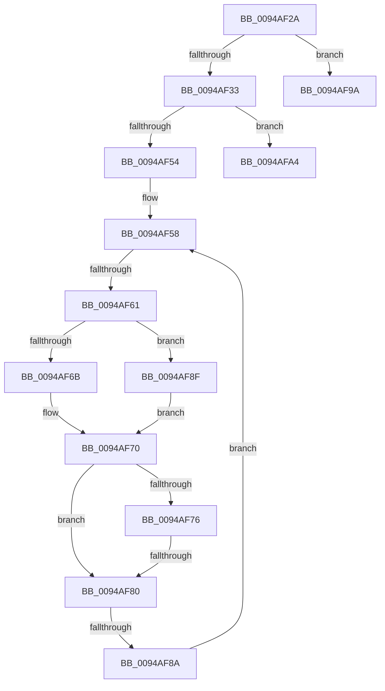

# sub_0094AF2A

- RVA: `0x0094AF2A`–`0x0094AFBA` (길이 `144` bytes)
- VA: `0x000000014094AF2A`
- 실행 섹션: `PAGE`
- PDB 이름 있음: `아니요`; PDB Function 태그: `아니요`
- unwind 정보 RVA: `0x00090F34`
- 디코드: `38`개 명령, `144/144` bytes 표시
- 미해석 바이트: `0` (있으면 어셈블리에 `.byte`로 보존)

> 이 문서는 커널 이미지의 기계어와 PDB 기호를 분석해 생성했습니다. 4번과 5번은 함수 원형과 자료형을 바이너리 사용 방식에서 추정한 C 해석이며 원본 소스 복구 결과는 아닙니다.

## 1. Dependencies

- 직접 호출 지점: **3**; 고유 호출 대상: **3**
- 직접 호출자로 확인된 함수: **0**
- RIP 상대 이미지 참조: **0**

### Outgoing calls
- `0x0094AF3D` → [CmpGetKcbAtLayerHeight](CmpGetKcbAtLayerHeight_function_00949210.md) (function, `0x00949210`)
- `0x0094AF49` → [CmpStartKcbStackForTopLayerKcb](../84/CmpStartKcbStackForTopLayerKcb_function_00848390.md) (function, `0x00848390`)
- `0x0094AFB0` → [CmpRecordParseFailure](../85/CmpRecordParseFailure_function_00851280.md) (function, `0x00851280`)

### Direct callers
- 이 함수 시작 RVA로 연결되는 직접 call은 확인되지 않았습니다. 간접 호출은 완전히 역산할 수 없습니다.

### Static image references
- 디코드된 RIP-relative 메모리 참조가 없습니다.

## 2. Other-region calls and transfers

- 다른 실행 섹션으로 향하는 call: **0**
- call이 아닌 외부 분기/꼬리 이동: **5**
  - `0x0094AF5B` → [sub_0094AC7C + 0x56](Unknown_function_0094AC7C.md) (`tail-transfer`)
  - `0x0094AF7A` → [sub_0094AC7C + 0x56](Unknown_function_0094AC7C.md) (`tail-transfer`)
  - `0x0094AF84` → [sub_0094AD2B + 0x1D](Unknown_function_0094AD2B.md) (`tail-transfer`)
  - `0x0094AF9F` → [sub_0094AC7C + 0x5B](Unknown_function_0094AC7C.md) (`tail-transfer`)
  - `0x0094AFB5` → [sub_0094AC7C + 0x5B](Unknown_function_0094AC7C.md) (`tail-transfer`)

## 3. Assembly (complete function range)

```asm
0094AF2A  48 8B 46 48                     mov rax, qword ptr [rsi + 0x48]
0094AF2E  38 58 41                        cmp byte ptr [rax + 0x41], bl
0094AF31  75 67                           jne 0x14094af9a
0094AF33  0F B7 56 42                     movzx edx, word ptr [rsi + 0x42]
0094AF37  48 8B CF                        mov rcx, rdi
0094AF3A  66 FF CA                        dec dx
0094AF3D  E8 CE E2 FF FF                  call 0x140949210
0094AF42  48 8B D0                        mov rdx, rax
0094AF45  48 8D 4D C8                     lea rcx, [rbp - 0x38]
0094AF49  E8 42 D4 EF FF                  call 0x140848390
0094AF4E  8B F8                           mov edi, eax
0094AF50  85 C0                           test eax, eax
0094AF52  78 50                           js 0x14094afa4
0094AF54  0F B7 4D CA                     movzx ecx, word ptr [rbp - 0x36]
0094AF58  66 85 C9                        test cx, cx
0094AF5B  0F 88 71 FD FF FF               js 0x14094acd2
0094AF61  48 0F BF D1                     movsx rdx, cx
0094AF65  66 83 F9 02                     cmp cx, 2
0094AF69  7D 24                           jge 0x14094af8f
0094AF6B  48 8B 54 D5 D0                  mov rdx, qword ptr [rbp + rdx*8 - 0x30]
0094AF70  66 39 5A 42                     cmp word ptr [rdx + 0x42], bx
0094AF74  74 0A                           je 0x14094af80
0094AF76  80 7A 41 01                     cmp byte ptr [rdx + 0x41], 1
0094AF7A  0F 84 52 FD FF FF               je 0x14094acd2
0094AF80  83 7A 28 FF                     cmp dword ptr [rdx + 0x28], -1
0094AF84  0F 85 BE FD FF FF               jne 0x14094ad48
0094AF8A  66 FF C9                        dec cx
0094AF8D  EB C9                           jmp 0x14094af58
0094AF8F  48 8B 45 E0                     mov rax, qword ptr [rbp - 0x20]
0094AF93  48 8B 54 D0 F0                  mov rdx, qword ptr [rax + rdx*8 - 0x10]
0094AF98  EB D6                           jmp 0x14094af70
0094AF9A  BF 71 02 00 C0                  mov edi, 0xc0000271
0094AF9F  E9 33 FD FF FF                  jmp 0x14094acd7
0094AFA4  48 8B 4D 40                     mov rcx, qword ptr [rbp + 0x40]
0094AFA8  44 8B C0                        mov r8d, eax
0094AFAB  BA 00 01 01 00                  mov edx, 0x10100
0094AFB0  E8 CB 62 F0 FF                  call 0x140851280
0094AFB5  E9 1D FD FF FF                  jmp 0x14094acd7
```

## 4. C-style interpretation (structured pseudocode)

```c
__int64 __fastcall sub_0094AF2A(void)
{
    __int64 result;

    if ((*(unsigned __int8 *)(*(unsigned __int64 *)(v_rsi + 72) + 65)) != ((unsigned __int8)(v_rbx))) goto loc_0094AF9A;
    a2 = (unsigned __int16)((*(unsigned __int16 *)(v_rsi + 66)) - 1);
    result = CmpGetKcbAtLayerHeight(v_rdi, a2, a3, a4);
    result = CmpStartKcbStackForTopLayerKcb(v_rbp - 56, result, a3, a4);
    if (sign_flag) goto loc_0094AFA4;
loc_0094AF58:
    if (((unsigned __int16)(*(unsigned __int16 *)(v_rbp - 54))) >= 2) goto loc_0094AF8F;
loc_0094AF70:
    if ((*(unsigned __int16 *)(*(unsigned __int64 *)(v_rbp + (__int16)((unsigned __int16)(*(unsigned __int16 *)(v_rbp - 54))) * 8 - 48) + 66)) == ((unsigned __int16)(v_rbx))) goto loc_0094AF80;
loc_0094AF80:
    a1 = (unsigned __int16)((*(unsigned __int16 *)(v_rbp - 54)) - 1);
    goto loc_0094AF58;
loc_0094AF8F:
    goto loc_0094AF70;
loc_0094AF9A:
loc_0094AFA4:
    result = CmpRecordParseFailure(*(unsigned __int64 *)(v_rbp + 64), (unsigned int)(0x10100ULL), (unsigned int)((unsigned int)(*(unsigned __int64 *)(v_rbp - 32))), a4);
}
```

## 5. (Beta) C Style

```c
void sub_0094AF2A(void)
{
    int64_t result;

    if ((*(uint8_t *)(*(uint64_t *)(local_rsi + 0x48) + 0x41)) != ((uint8_t)(local_rbx))) goto loc_0094AF9A;
    a2 = (uint16_t)((*(uint16_t *)(local_rsi + 0x42)) - 1);
    result = CmpGetKcbAtLayerHeight(local_rdi, a2, a3, a4);
    result = CmpStartKcbStackForTopLayerKcb(local_rbp - 56, result, a3, a4);
    if (sign_flag) goto loc_0094AFA4;
loc_0094AF58:
    if (((uint16_t)(*(uint16_t *)(local_rbp - 0x36))) >= 2) goto loc_0094AF8F;
loc_0094AF70:
    if ((*(uint16_t *)(*(uint64_t *)(local_rbp + (int16_t)((uint16_t)(*(uint16_t *)(local_rbp - 0x36))) * 8 - 0x30) + 0x42)) == ((uint16_t)(local_rbx))) goto loc_0094AF80;
loc_0094AF80:
    a1 = (uint16_t)((*(uint16_t *)(local_rbp - 0x36)) - 1);
    goto loc_0094AF58;
loc_0094AF8F:
    goto loc_0094AF70;
loc_0094AF9A:
loc_0094AFA4:
    result = CmpRecordParseFailure(*(uint64_t *)(local_rbp + 0x40), (uint32_t)(0x10100ULL), (uint32_t)((uint32_t)(*(uint64_t *)(local_rbp - 0x20))), a4);
}
```

## 6. Execution-region graph

[열기: 2D/3D 그래프와 함수 탐색 컨트롤 패널](../../../control-panel.html?section=page&rva=0x0094AF2A&view=graph)

- 2D 그래프는 위에서 아래로 흐르고, 3D 그래프는 빈 공간을 드래그해 회전합니다. Shift+드래그는 이동, 휠은 확대·축소, 함수 노드 선택은 대상 보고서 이동입니다.

### Static fallback


