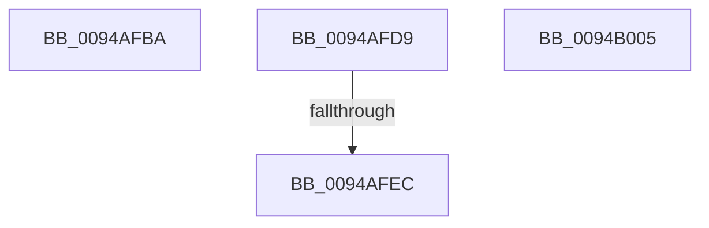

# sub_0094AFBA

- RVA: `0x0094AFBA`–`0x0094B023` (길이 `105` bytes)
- VA: `0x000000014094AFBA`
- 실행 섹션: `PAGE`
- PDB 이름 있음: `아니요`; PDB Function 태그: `아니요`
- unwind 정보 RVA: `0x00090F44`
- 디코드: `25`개 명령, `105/105` bytes 표시
- 미해석 바이트: `0` (있으면 어셈블리에 `.byte`로 보존)

> 이 문서는 커널 이미지의 기계어와 PDB 기호를 분석해 생성했습니다. 4번과 5번은 함수 원형과 자료형을 바이너리 사용 방식에서 추정한 C 해석이며 원본 소스 복구 결과는 아닙니다.

## 1. Dependencies

- 직접 호출 지점: **4**; 고유 호출 대상: **2**
- 직접 호출자로 확인된 함수: **0**
- RIP 상대 이미지 참조: **0**

### Outgoing calls
- `0x0094AFCB` → [CmpRecordParseFailure](../85/CmpRecordParseFailure_function_00851280.md) (function, `0x00851280`)
- `0x0094AFDD` → [CmpConstructNameWithStatus](../85/CmpConstructNameWithStatus_function_008562A0.md) (function, `0x008562A0`)
- `0x0094AFF7` → [CmpRecordParseFailure](../85/CmpRecordParseFailure_function_00851280.md) (function, `0x00851280`)
- `0x0094B015` → [CmpRecordParseFailure](../85/CmpRecordParseFailure_function_00851280.md) (function, `0x00851280`)

### Direct callers
- 이 함수 시작 RVA로 연결되는 직접 call은 확인되지 않았습니다. 간접 호출은 완전히 역산할 수 없습니다.

### Static image references
- 디코드된 RIP-relative 메모리 참조가 없습니다.

## 2. Other-region calls and transfers

- 다른 실행 섹션으로 향하는 call: **0**
- call이 아닌 외부 분기/꼬리 이동: **4**
  - `0x0094AFD4` → [sub_0094AD50 + 0x19A](Unknown_function_0094AD50.md) (`tail-transfer`)
  - `0x0094AFE6` → [sub_0094AD50 + 0x6D](Unknown_function_0094AD50.md) (`tail-transfer`)
  - `0x0094B000` → [sub_0094AD50 + 0x19A](Unknown_function_0094AD50.md) (`tail-transfer`)
  - `0x0094B01E` → [sub_0094AD50 + 0x19A](Unknown_function_0094AD50.md) (`tail-transfer`)

## 3. Assembly (complete function range)

```asm
0094AFBA  48 8B 4D 40                     mov rcx, qword ptr [rbp + 0x40]
0094AFBE  BF 0D 00 00 C0                  mov edi, 0xc000000d
0094AFC3  44 8B C7                        mov r8d, edi
0094AFC6  BA 50 01 01 00                  mov edx, 0x10150
0094AFCB  E8 B0 62 F0 FF                  call 0x140851280
0094AFD0  4C 8B 75 18                     mov r14, qword ptr [rbp + 0x18]
0094AFD4  E9 11 FF FF FF                  jmp 0x14094aeea
0094AFD9  48 8B 4F 48                     mov rcx, qword ptr [rdi + 0x48]
0094AFDD  E8 BE B2 F0 FF                  call 0x1408562a0
0094AFE2  8B F8                           mov edi, eax
0094AFE4  85 C0                           test eax, eax
0094AFE6  0F 89 D1 FD FF FF               jns 0x14094adbd
0094AFEC  44 8B C0                        mov r8d, eax
0094AFEF  BA 00 02 01 00                  mov edx, 0x10200
0094AFF4  49 8B CF                        mov rcx, r15
0094AFF7  E8 84 62 F0 FF                  call 0x140851280
0094AFFC  4C 8B 75 18                     mov r14, qword ptr [rbp + 0x18]
0094B000  E9 E5 FE FF FF                  jmp 0x14094aeea
0094B005  BF 9A 00 00 C0                  mov edi, 0xc000009a
0094B00A  BA 00 04 01 00                  mov edx, 0x10400
0094B00F  44 8B C7                        mov r8d, edi
0094B012  49 8B CF                        mov rcx, r15
0094B015  E8 66 62 F0 FF                  call 0x140851280
0094B01A  4C 8B 75 18                     mov r14, qword ptr [rbp + 0x18]
0094B01E  E9 C7 FE FF FF                  jmp 0x14094aeea
```

## 4. C-style interpretation (structured pseudocode)

```c
__int64 __fastcall sub_0094AFBA(void)
{
    __int64 result;

    result = CmpRecordParseFailure(*(unsigned __int64 *)(v_rbp + 64), (unsigned int)(0x10150ULL), (unsigned int)((unsigned int)((unsigned int)(0xC000000DULL))), a4);
}
```

## 5. (Beta) C Style

```c
void sub_0094AFBA(void)
{
    int64_t result;

    result = CmpRecordParseFailure(*(uint64_t *)(local_rbp + 0x40), (uint32_t)(0x10150ULL), (uint32_t)((uint32_t)((uint32_t)(0xC000000DULL))), a4);
}
```

## 6. Execution-region graph

[열기: 2D/3D 그래프와 함수 탐색 컨트롤 패널](../../../control-panel.html?section=page&rva=0x0094AFBA&view=graph)

- 2D 그래프는 위에서 아래로 흐르고, 3D 그래프는 빈 공간을 드래그해 회전합니다. Shift+드래그는 이동, 휠은 확대·축소, 함수 노드 선택은 대상 보고서 이동입니다.

### Static fallback


