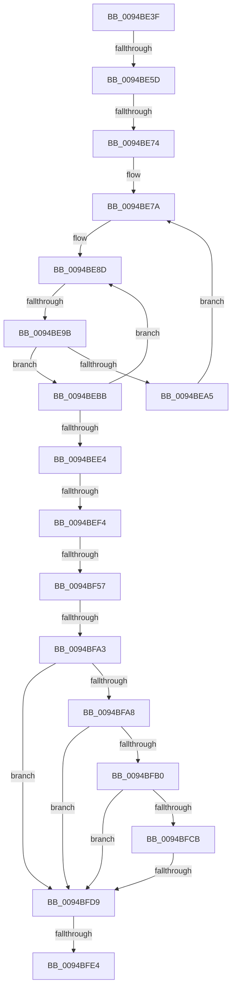

# sub_0094BE3F

- RVA: `0x0094BE3F`–`0x0094C010` (길이 `465` bytes)
- VA: `0x000000014094BE3F`
- 실행 섹션: `PAGE`
- PDB 이름 있음: `아니요`; PDB Function 태그: `아니요`
- unwind 정보 RVA: `0x00091450`
- 디코드: `118`개 명령, `465/465` bytes 표시
- 미해석 바이트: `0` (있으면 어셈블리에 `.byte`로 보존)

> 이 문서는 커널 이미지의 기계어와 PDB 기호를 분석해 생성했습니다. 4번과 5번은 함수 원형과 자료형을 바이너리 사용 방식에서 추정한 C 해석이며 원본 소스 복구 결과는 아닙니다.

## 1. Dependencies

- 직접 호출 지점: **5**; 고유 호출 대상: **5**
- 직접 호출자로 확인된 함수: **0**
- RIP 상대 이미지 참조: **3**

### Outgoing calls
- `0x0094BE63` → [ExpLookupHandleTableEntry](../86/ExpLookupHandleTableEntry_function_00869DB0.md) (function, `0x00869DB0`)
- `0x0094BEAE` → [ExpBlockOnLockedHandleEntry](../86/ExpBlockOnLockedHandleEntry_function_00868838.md) (function, `0x00868838`)
- `0x0094BEF9` → [ExGetHandlePointer](../../text/43/ExGetHandlePointer_function_00430C90.md) (function, `0x00430C90`)
- `0x0094BF04` → [KeLeaveCriticalRegionThread](../../text/25/KeLeaveCriticalRegionThread_function_0025EFF0.md) (function, `0x0025EFF0`)
- `0x0094BF17` → [ObpTraceObjectReferenceIfActive](../../text/21/ObpTraceObjectReferenceIfActive_function_00210780.md) (function, `0x00210780`)

### Direct callers
- 이 함수 시작 RVA로 연결되는 직접 call은 확인되지 않았습니다. 간접 호출은 완전히 역산할 수 없습니다.

### Static image references
- `0x0094BF1F` → RVA `0x00000000` (`image boundary/outside`; read)
- `0x0094BF38` → RVA `0x00FC6E4C` (`ALMOSTRO`; read)
- `0x0094BF42` → RVA `0x00FC6AE0` (`ALMOSTRO`; read)

## 2. Other-region calls and transfers

- 다른 실행 섹션으로 향하는 call: **3**
  - `0x0094BEF9` → [ExGetHandlePointer](../../text/43/ExGetHandlePointer_function_00430C90.md) (`PAGE` → `.text`)
  - `0x0094BF04` → [KeLeaveCriticalRegionThread](../../text/25/KeLeaveCriticalRegionThread_function_0025EFF0.md) (`PAGE` → `.text`)
  - `0x0094BF17` → [ObpTraceObjectReferenceIfActive](../../text/21/ObpTraceObjectReferenceIfActive_function_00210780.md) (`PAGE` → `.text`)
- call이 아닌 외부 분기/꼬리 이동: **8**
  - `0x0094BE57` → [sub_0094C011 + 0xAC](Unknown_function_0094C011.md) (`tail-transfer`)
  - `0x0094BE6E` → [sub_0094C011 + 0xAC](Unknown_function_0094C011.md) (`tail-transfer`)
  - `0x0094BE95` → [sub_0094C011](Unknown_function_0094C011.md) (`tail-transfer`)
  - `0x0094BEEE` → [sub_0094C011 + 0xFE](Unknown_function_0094C011.md) (`tail-transfer`)
  - `0x0094BF51` → [sub_0094C011 + 0xDC](Unknown_function_0094C011.md) (`tail-transfer`)
  - `0x0094BF9D` → [sub_0094C011 + 0x89](Unknown_function_0094C011.md) (`tail-transfer`)
  - `0x0094BFD3` → [sub_0094C011 + 0x163](Unknown_function_0094C011.md) (`tail-transfer`)
  - `0x0094BFDE` → [sub_0094C011 + 0x16D](Unknown_function_0094C011.md) (`tail-transfer`)

## 3. Assembly (complete function range)

```asm
0094BE3F  48 89 B4 24 80 00 00 00         mov qword ptr [rsp + 0x80], rsi
0094BE47  48 89 7C 24 48                  mov qword ptr [rsp + 0x48], rdi
0094BE4C  4C 89 74 24 40                  mov qword ptr [rsp + 0x40], r14
0094BE51  F7 C5 FC 03 00 00               test ebp, 0x3fc
0094BE57  0F 84 60 02 00 00               je 0x14094c0bd
0094BE5D  48 8B D5                        mov rdx, rbp
0094BE60  49 8B CD                        mov rcx, r13
0094BE63  E8 48 DF F1 FF                  call 0x140869db0
0094BE68  48 8B F8                        mov rdi, rax
0094BE6B  48 85 C0                        test rax, rax
0094BE6E  0F 84 49 02 00 00               je 0x14094c0bd
0094BE74  0F 0D 08                        prefetchw byte ptr [rax]
0094BE77  48 8B 00                        mov rax, qword ptr [rax]
0094BE7A  4C 8B 77 08                     mov r14, qword ptr [rdi + 8]
0094BE7E  48 89 44 24 30                  mov qword ptr [rsp + 0x30], rax
0094BE83  48 8B 74 24 30                  mov rsi, qword ptr [rsp + 0x30]
0094BE88  4C 89 74 24 38                  mov qword ptr [rsp + 0x38], r14
0094BE8D  90                              nop
0094BE8E  48 F7 C6 FE FF 01 00            test rsi, 0x1fffe
0094BE95  0F 84 76 01 00 00               je 0x14094c011
0094BE9B  40 0F B6 C6                     movzx eax, sil
0094BE9F  F6 D0                           not al
0094BEA1  A8 01                           test al, 1
0094BEA3  74 16                           je 0x14094bebb
0094BEA5  4C 8B C6                        mov r8, rsi
0094BEA8  48 8B D7                        mov rdx, rdi
0094BEAB  49 8B CD                        mov rcx, r13
0094BEAE  E8 85 C9 F1 FF                  call 0x140868838
0094BEB3  0F 0D 0F                        prefetchw byte ptr [rdi]
0094BEB6  48 8B 07                        mov rax, qword ptr [rdi]
0094BEB9  EB BF                           jmp 0x14094be7a
0094BEBB  48 8D 5E FE                     lea rbx, [rsi - 2]
0094BEBF  49 8B CE                        mov rcx, r14
0094BEC2  48 8B C6                        mov rax, rsi
0094BEC5  49 8B D6                        mov rdx, r14
0094BEC8  F0 48 0F C7 0F                  lock cmpxchg16b xmmword ptr [rdi]
0094BECD  48 8B F0                        mov rsi, rax
0094BED0  48 89 44 24 30                  mov qword ptr [rsp + 0x30], rax
0094BED5  0F 94 C0                        sete al
0094BED8  48 89 54 24 38                  mov qword ptr [rsp + 0x38], rdx
0094BEDD  4C 8B F2                        mov r14, rdx
0094BEE0  84 C0                           test al, al
0094BEE2  74 A9                           je 0x14094be8d
0094BEE4  48 8B CE                        mov rcx, rsi
0094BEE7  48 D1 E9                        shr rcx, 1
0094BEEA  66 83 F9 10                     cmp cx, 0x10
0094BEEE  0F 84 1B 02 00 00               je 0x14094c10f
0094BEF4  48 8D 4C 24 30                  lea rcx, [rsp + 0x30]
0094BEF9  E8 92 4D AE FF                  call 0x140430c90
0094BEFE  48 8B D8                        mov rbx, rax
0094BF01  49 8B CF                        mov rcx, r15
0094BF04  E8 E7 30 91 FF                  call 0x14025eff0
0094BF09  BA 01 00 00 00                  mov edx, 1
0094BF0E  41 B8 44 66 6C 74               mov r8d, 0x746c6644
0094BF14  48 8B CB                        mov rcx, rbx
0094BF17  E8 64 48 8C FF                  call 0x140210780
0094BF1C  48 8B C3                        mov rax, rbx
0094BF1F  4C 8D 0D DA 40 6B FF            lea r9, [rip - 0x94bf26]
0094BF26  48 C1 E8 08                     shr rax, 8
0094BF2A  4C 8D 7B 30                     lea r15, [rbx + 0x30]
0094BF2E  0F B6 C8                        movzx ecx, al
0094BF31  0F B6 43 18                     movzx eax, byte ptr [rbx + 0x18]
0094BF35  48 33 C8                        xor rcx, rax
0094BF38  0F B6 05 0D AF 67 00            movzx eax, byte ptr [rip + 0x67af0d]
0094BF3F  48 33 C8                        xor rcx, rax
0094BF42  48 8B 05 97 AB 67 00            mov rax, qword ptr [rip + 0x67ab97]
0094BF49  49 39 84 C9 00 78 FC 00         cmp qword ptr [r9 + rcx*8 + 0xfc7800], rax
0094BF51  0F 85 96 01 00 00               jne 0x14094c0ed
0094BF57  0F B6 93 80 00 00 00            movzx edx, byte ptr [rbx + 0x80]
0094BF5E  41 8B CE                        mov ecx, r14d
0094BF61  4C 8B 84 24 98 00 00 00         mov r8, qword ptr [rsp + 0x98]
0094BF69  F6 D2                           not dl
0094BF6B  81 E2 80 00 00 00               and edx, 0x80
0094BF71  48 C1 FE 11                     sar rsi, 0x11
0094BF75  83 E6 07                        and esi, 7
0094BF78  83 CA 40                        or edx, 0x40
0094BF7B  81 E1 FF FF FF 01               and ecx, 0x1ffffff
0094BF81  C1 EA 05                        shr edx, 5
0094BF84  8B C6                           mov eax, esi
0094BF86  41 89 48 04                     mov dword ptr [r8 + 4], ecx
0094BF8A  83 C8 08                        or eax, 8
0094BF8D  41 0F BA E6 19                  bt r14d, 0x19
0094BF92  0F 43 C6                        cmovae eax, esi
0094BF95  83 E0 07                        and eax, 7
0094BF98  41 89 00                        mov dword ptr [r8], eax
0094BF9B  85 CA                           test edx, ecx
0094BF9D  0F 84 F7 00 00 00               je 0x14094c09a
0094BFA3  45 84 E4                        test r12b, r12b
0094BFA6  74 31                           je 0x14094bfd9
0094BFA8  0F B6 43 1A                     movzx eax, byte ptr [rbx + 0x1a]
0094BFAC  A8 40                           test al, 0x40
0094BFAE  74 29                           je 0x14094bfd9
0094BFB0  83 E0 7F                        and eax, 0x7f
0094BFB3  48 8B CB                        mov rcx, rbx
0094BFB6  42 0F B6 84 08 80 FF F0 00      movzx eax, byte ptr [rax + r9 + 0xf0ff80]
0094BFBF  48 2B C8                        sub rcx, rax
0094BFC2  48 8B 01                        mov rax, qword ptr [rcx]
0094BFC5  80 78 18 00                     cmp byte ptr [rax + 0x18], 0
0094BFC9  74 0E                           je 0x14094bfd9
0094BFCB  48 8B 40 10                     mov rax, qword ptr [rax + 0x10]
0094BFCF  48 83 F8 01                     cmp rax, 1
0094BFD3  0F 84 9B 01 00 00               je 0x14094c174
0094BFD9  41 8B 00                        mov eax, dword ptr [r8]
0094BFDC  A8 04                           test al, 4
0094BFDE  0F 85 9A 01 00 00               jne 0x14094c17e
0094BFE4  48 8B 84 24 90 00 00 00         mov rax, qword ptr [rsp + 0x90]
0094BFEC  4C 89 38                        mov qword ptr [rax], r15
0094BFEF  33 C0                           xor eax, eax
0094BFF1  48 8B 7C 24 48                  mov rdi, qword ptr [rsp + 0x48]
0094BFF6  48 8B B4 24 80 00 00 00         mov rsi, qword ptr [rsp + 0x80]
0094BFFE  4C 8B 74 24 40                  mov r14, qword ptr [rsp + 0x40]
0094C003  48 83 C4 50                     add rsp, 0x50
0094C007  41 5F                           pop r15
0094C009  41 5D                           pop r13
0094C00B  41 5C                           pop r12
0094C00D  5D                              pop rbp
0094C00E  5B                              pop rbx
0094C00F  C3                              ret
```

## 4. C-style interpretation (structured pseudocode)

```c
__int64 __fastcall sub_0094BE3F(__int64 a1, __int64 a2, __int64 a3, __int64 a4, __int64 a5, __int64 a6, __int64 a7, __int64 a8, __int64 a9, __int64 a10, __int64 a11, __int64 a12, __int64 a13, __int64 a14, __int64 a15, __int64 a16, __int64 a17, __int64 a18, __int64 a19)
{
    __int64 result;
    __int64 v_rsi;
    __int64 v_rsp;
    unsigned __int64 v_stack_p30;
    unsigned __int64 v_stack_p38;
    unsigned __int64 v_stack_p40;
    unsigned __int64 v_stack_p48;
    unsigned __int64 v_stack_p80;

    v_stack_p80 = v_rsi;
    v_stack_p48 = v_rdi;
    v_stack_p40 = v_r14;
    result = ExpLookupHandleTableEntry(v_r13, v_rbp, a3, a4);
loc_0094BE7A:
    v_stack_p30 = *(unsigned __int64 *)(result);
    v_stack_p38 = *(unsigned __int64 *)(result + 8);
loc_0094BE8D:
    result = (unsigned __int8)(~((unsigned __int8)(a6)));
    if ((((unsigned __int8)(result)) & (1)) == 0) goto loc_0094BEBB;
    result = ExpBlockOnLockedHandleEntry(v_r13, result, a6, a4);
    goto loc_0094BE7A;
loc_0094BEBB:
    v_stack_p30 = a6;
    result = ((((unsigned __int8)(result)) & (1)) == 0) ? 1 : 0;
    v_stack_p38 = *(unsigned __int64 *)(result + 8);
    if ((unsigned __int8)(result) == 0) goto loc_0094BE8D;
    a1 = (a6) >> (1);
    result = ExGetHandlePointer(a6, *(unsigned __int64 *)(result + 8), a6, a4);
    result = KeLeaveCriticalRegionThread(v_r15, *(unsigned __int64 *)(result + 8), a6, a4);
    result = ObpTraceObjectReferenceIfActive(result, 1, (unsigned int)(0x746C6644ULL), a4);
    result = (result) >> (8);
    a1 = ((unsigned __int8)(result)) ^ (*(unsigned __int8 *)(result + 24));
    a1 = (a1) ^ (*(unsigned __int8 *)(v_rip + 6795021));
    a2 = (unsigned __int8)(~(*(unsigned __int8 *)(result + 128)));
    a2 = (unsigned int)((a2) & (128));
    v_rsi = (a6) >> (17);
    v_rsi = (unsigned int)((v_rsi) & (7));
    a2 = (unsigned int)((a2) | (64));
    a1 = (unsigned int)(((unsigned int)((unsigned int)(*(unsigned __int64 *)(result + 8)))) & (0x1FFFFFFULL));
    a2 = (unsigned int)((a2) >> (5));
    *(unsigned int *)(a19 + 4) = (unsigned int)(a1);
    result = (unsigned int)(((unsigned int)((unsigned int)(v_rsi))) | (8));
    if (condition_is_above_or_equal) { result = (unsigned int)(v_rsi); }
    result = (unsigned int)((result) & (7));
    *(unsigned int *)(a19) = (unsigned int)(result);
    if ((unsigned __int8)(v_r12) == 0) goto loc_0094BFD9;
    if ((((unsigned __int8)(*(unsigned __int8 *)(result + 26))) & (64)) == 0) goto loc_0094BFD9;
    result = (unsigned int)((*(unsigned __int8 *)(result + 26)) & (127));
    a1 = (result) - (*(unsigned __int8 *)(result + v_rip - 9748262 * 1 + 15794048));
    if ((*(unsigned __int8 *)(*(unsigned __int64 *)(a1) + 24)) == 0) goto loc_0094BFD9;
loc_0094BFD9:
    *(unsigned __int64 *)(a18) = result + 48;
    result = 0;
    v_rsp = (v_rsp) + (80);
    return result;
}
```

## 5. (Beta) C Style

```c
int64_t sub_0094BE3F(int64_t Arg1, int64_t Arg2, int64_t Arg3, int64_t Arg4, uint64_t Arg5, int64_t Arg6, uint64_t Arg7, int64_t Arg8, int64_t Arg9, uint64_t Arg10, uint64_t Arg11, uint64_t Arg12, uint64_t Arg13, uint64_t Arg14, uint64_t Arg15, int64_t Arg16, uint64_t Arg17, void *Arg18, void *Arg19)
{
    uint8_t *arg18 = (uint8_t *)Arg18;
    uint8_t *arg19 = (uint8_t *)Arg19;

    int64_t result;
    int64_t local_rsi;
    int64_t local_rsp;
    uint64_t v_stack_p30;
    uint64_t v_stack_p38;
    uint64_t v_stack_p40;
    uint64_t v_stack_p48;
    uint64_t v_stack_p80;

    v_stack_p80 = local_rsi;
    v_stack_p48 = local_rdi;
    v_stack_p40 = local_r14;
    result = ExpLookupHandleTableEntry(local_r13, local_rbp, Arg3, Arg4);
loc_0094BE7A:
    v_stack_p30 = *(uint64_t *)(result);
    v_stack_p38 = *(uint64_t *)(result + 0x8);
loc_0094BE8D:
    result = (uint8_t)(~((uint8_t)(Arg6)));
    if ((((uint8_t)(result)) & (1)) == 0) goto loc_0094BEBB;
    result = ExpBlockOnLockedHandleEntry(local_r13, result, Arg6, Arg4);
    goto loc_0094BE7A;
loc_0094BEBB:
    v_stack_p30 = Arg6;
    result = ((((uint8_t)(result)) & (1)) == 0) ? 1 : 0;
    v_stack_p38 = *(uint64_t *)(result + 0x8);
    if ((uint8_t)(result) == 0) goto loc_0094BE8D;
    Arg1 = (Arg6) >> (1);
    result = ExGetHandlePointer(Arg6, *(uint64_t *)(result + 0x8), Arg6, Arg4);
    result = KeLeaveCriticalRegionThread(local_r15, *(uint64_t *)(result + 0x8), Arg6, Arg4);
    result = ObpTraceObjectReferenceIfActive(result, 1, (uint32_t)(0x746C6644ULL), Arg4);
    result = (result) >> (8);
    Arg1 = ((uint8_t)(result)) ^ (*(uint8_t *)(result + 0x18));
    Arg1 = (Arg1) ^ (*(uint8_t *)(v_rip + 0x67AF0D));
    Arg2 = (uint8_t)(~(*(uint8_t *)(result + 0x80)));
    Arg2 = (uint32_t)((Arg2) & (128));
    local_rsi = (Arg6) >> (17);
    local_rsi = (uint32_t)((local_rsi) & (7));
    Arg2 = (uint32_t)((Arg2) | (64));
    Arg1 = (uint32_t)(((uint32_t)((uint32_t)(*(uint64_t *)(result + 0x8)))) & (0x1FFFFFFULL));
    Arg2 = (uint32_t)((Arg2) >> (5));
    *(uint32_t *)(arg19 + 0x4) = (uint32_t)(Arg1);
    result = (uint32_t)(((uint32_t)((uint32_t)(local_rsi))) | (8));
    if (condition_is_above_or_equal) { result = (uint32_t)(local_rsi); }
    result = (uint32_t)((result) & (7));
    *(uint32_t *)(arg19) = (uint32_t)(result);
    if ((uint8_t)(local_r12) == 0) goto loc_0094BFD9;
    if ((((uint8_t)(*(uint8_t *)(result + 0x1A))) & (64)) == 0) goto loc_0094BFD9;
    result = (uint32_t)((*(uint8_t *)(result + 0x1A)) & (127));
    Arg1 = (result) - (*(uint8_t *)(result + v_rip - 0x94BF26 * 1 + 0xF0FF80));
    if ((*(uint8_t *)(*(uint64_t *)(Arg1) + 0x18)) == 0) goto loc_0094BFD9;
loc_0094BFD9:
    *(uint64_t *)(arg18) = result + 48;
    result = 0;
    local_rsp = (local_rsp) + (80);
    return result;
}
```

### 관측된 메모리 오프셋

구조체 형식이 확인되지 않은 접근은 인자 기준의 오프셋으로만 기록했습니다.

| 기준 인자 | 오프셋 표현 | 폭 (bit) | 접근 |
|---|---:|---:|---|
| `Arg18` | `+ 0x0` | `64` | `W` |
| `Arg19` | `+ 0x0` | `32` | `R` |
| `Arg19` | `+ 0x0` | `32` | `W` |
| `Arg19` | `+ 0x4` | `32` | `W` |

## 6. Execution-region graph

[열기: 2D/3D 그래프와 함수 탐색 컨트롤 패널](../../../control-panel.html?section=page&rva=0x0094BE3F&view=graph)

- 2D 그래프는 위에서 아래로 흐르고, 3D 그래프는 빈 공간을 드래그해 회전합니다. Shift+드래그는 이동, 휠은 확대·축소, 함수 노드 선택은 대상 보고서 이동입니다.

### Static fallback


