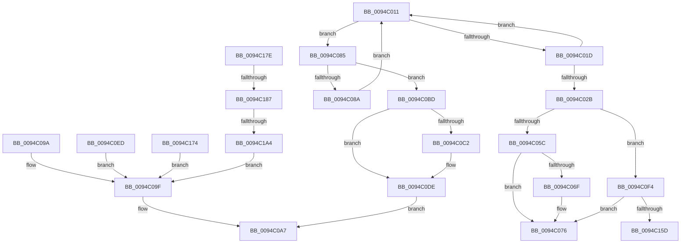

# sub_0094C011

- RVA: `0x0094C011`–`0x0094C1AE` (길이 `413` bytes)
- VA: `0x000000014094C011`
- 실행 섹션: `PAGE`
- PDB 이름 있음: `아니요`; PDB Function 태그: `아니요`
- unwind 정보 RVA: `0x00091480`
- 디코드: `103`개 명령, `413/413` bytes 표시
- 미해석 바이트: `0` (있으면 어셈블리에 `.byte`로 보존)

> 이 문서는 커널 이미지의 기계어와 PDB 기호를 분석해 생성했습니다. 4번과 5번은 함수 원형과 자료형을 바이너리 사용 방식에서 추정한 C 해석이며 원본 소스 복구 결과는 아닙니다.

## 1. Dependencies

- 직접 호출 지점: **12**; 고유 호출 대상: **11**
- 직접 호출자로 확인된 함수: **0**
- RIP 상대 이미지 참조: **0**

### Outgoing calls
- `0x0094C02E` → [ExGetHandlePointer](../../text/43/ExGetHandlePointer_function_00430C90.md) (function, `0x00430C90`)
- `0x0094C041` → [ExSlowReplenishHandleTableEntry](../../text/44/ExSlowReplenishHandleTableEntry_function_0044BEF0.md) (function, `0x0044BEF0`)
- `0x0094C071` → [ExfUnblockPushLock](../../text/2A/ExfUnblockPushLock_function_002A3FE0.md) (function, `0x002A3FE0`)
- `0x0094C090` → [ExpBlockOnLockedHandleEntry](../86/ExpBlockOnLockedHandleEntry_function_00868838.md) (function, `0x00868838`)
- `0x0094C0A2` → [HalPutDmaAdapter](../../text/48/HalPutDmaAdapter_function_0048E530.md) (function, `0x0048E530`)
- `0x0094C0D9` → [ExHandleLogBadReference](../../text/44/ExHandleLogBadReference_function_00440580.md) (function, `0x00440580`)
- `0x0094C0E1` → [KeLeaveCriticalRegionThread](../../text/25/KeLeaveCriticalRegionThread_function_0025EFF0.md) (function, `0x0025EFF0`)
- `0x0094C109` → [KeBugCheckEx](../../text/4F/KeBugCheckEx_function_004FD660.md) (function, `0x004FD660`)
- `0x0094C12D` → [ExGetHandlePointer](../../text/43/ExGetHandlePointer_function_00430C90.md) (function, `0x00430C90`)
- `0x0094C13D` → [ObpIncrPointerCountEx](../../text/41/ObpIncrPointerCountEx_function_00419CB0.md) (function, `0x00419CB0`)
- `0x0094C150` → [ExFastReplenishHandleTableEntry](../../text/47/ExFastReplenishHandleTableEntry_function_0047E210.md) (function, `0x0047E210`)
- `0x0094C197` → [ObpAuditObjectAccess](ObpAuditObjectAccess_function_0094C270.md) (function, `0x0094C270`)

### Direct callers
- 이 함수 시작 RVA로 연결되는 직접 call은 확인되지 않았습니다. 간접 호출은 완전히 역산할 수 없습니다.

### Static image references
- 디코드된 RIP-relative 메모리 참조가 없습니다.

## 2. Other-region calls and transfers

- 다른 실행 섹션으로 향하는 call: **10**
  - `0x0094C02E` → [ExGetHandlePointer](../../text/43/ExGetHandlePointer_function_00430C90.md) (`PAGE` → `.text`)
  - `0x0094C041` → [ExSlowReplenishHandleTableEntry](../../text/44/ExSlowReplenishHandleTableEntry_function_0044BEF0.md) (`PAGE` → `.text`)
  - `0x0094C071` → [ExfUnblockPushLock](../../text/2A/ExfUnblockPushLock_function_002A3FE0.md) (`PAGE` → `.text`)
  - `0x0094C0A2` → [HalPutDmaAdapter](../../text/48/HalPutDmaAdapter_function_0048E530.md) (`PAGE` → `.text`)
  - `0x0094C0D9` → [ExHandleLogBadReference](../../text/44/ExHandleLogBadReference_function_00440580.md) (`PAGE` → `.text`)
  - `0x0094C0E1` → [KeLeaveCriticalRegionThread](../../text/25/KeLeaveCriticalRegionThread_function_0025EFF0.md) (`PAGE` → `.text`)
  - `0x0094C109` → [KeBugCheckEx](../../text/4F/KeBugCheckEx_function_004FD660.md) (`PAGE` → `.text`)
  - `0x0094C12D` → [ExGetHandlePointer](../../text/43/ExGetHandlePointer_function_00430C90.md) (`PAGE` → `.text`)
  - `0x0094C13D` → [ObpIncrPointerCountEx](../../text/41/ObpIncrPointerCountEx_function_00419CB0.md) (`PAGE` → `.text`)
  - `0x0094C150` → [ExFastReplenishHandleTableEntry](../../text/47/ExFastReplenishHandleTableEntry_function_0047E210.md) (`PAGE` → `.text`)
- call이 아닌 외부 분기/꼬리 이동: **5**
  - `0x0094C080` → [sub_0094BE3F + 0xC2](Unknown_function_0094BE3F.md) (`tail-transfer`)
  - `0x0094C0B8` → [sub_0094BE3F + 0x1B2](Unknown_function_0094BE3F.md) (`tail-transfer`)
  - `0x0094C16F` → [sub_0094BE3F + 0xC2](Unknown_function_0094BE3F.md) (`tail-transfer`)
  - `0x0094C181` → [sub_0094BE3F + 0x1A5](Unknown_function_0094BE3F.md) (`tail-transfer`)
  - `0x0094C19E` → [sub_0094BE3F + 0x1A5](Unknown_function_0094BE3F.md) (`tail-transfer`)

## 3. Assembly (complete function range)

```asm
0094C011  0F 0D 0F                        prefetchw byte ptr [rdi]
0094C014  4C 8B 07                        mov r8, qword ptr [rdi]
0094C017  41 F6 C0 01                     test r8b, 1
0094C01B  74 68                           je 0x14094c085
0094C01D  49 8D 48 FF                     lea rcx, [r8 - 1]
0094C021  49 8B C0                        mov rax, r8
0094C024  F0 48 0F B1 0F                  lock cmpxchg qword ptr [rdi], rcx
0094C029  75 E6                           jne 0x14094c011
0094C02B  48 8B CF                        mov rcx, rdi
0094C02E  E8 5D 4C AE FF                  call 0x140430c90
0094C033  0F 10 07                        movups xmm0, xmmword ptr [rdi]
0094C036  48 8B CF                        mov rcx, rdi
0094C039  48 8B D8                        mov rbx, rax
0094C03C  0F 11 44 24 30                  movups xmmword ptr [rsp + 0x30], xmm0
0094C041  E8 AA FE AF FF                  call 0x14044bef0
0094C046  FF C0                           inc eax
0094C048  48 63 C8                        movsxd rcx, eax
0094C04B  48 8B C1                        mov rax, rcx
0094C04E  F0 48 0F C1 03                  lock xadd qword ptr [rbx], rax
0094C053  48 85 C0                        test rax, rax
0094C056  0F 8E 98 00 00 00               jle 0x14094c0f4
0094C05C  F0 48 FF 07                     lock inc qword ptr [rdi]
0094C060  49 8D 4D 30                     lea rcx, [r13 + 0x30]
0094C064  F0 83 0C 24 00                  lock or dword ptr [rsp], 0
0094C069  48 83 39 00                     cmp qword ptr [rcx], 0
0094C06D  74 07                           je 0x14094c076
0094C06F  33 D2                           xor edx, edx
0094C071  E8 6A 7F 95 FF                  call 0x1402a3fe0
0094C076  4C 8B 74 24 38                  mov r14, qword ptr [rsp + 0x38]
0094C07B  48 8B 74 24 30                  mov rsi, qword ptr [rsp + 0x30]
0094C080  E9 7C FE FF FF                  jmp 0x14094bf01
0094C085  4D 85 C0                        test r8, r8
0094C088  74 33                           je 0x14094c0bd
0094C08A  48 8B D7                        mov rdx, rdi
0094C08D  49 8B CD                        mov rcx, r13
0094C090  E8 A3 C7 F1 FF                  call 0x140868838
0094C095  E9 77 FF FF FF                  jmp 0x14094c011
0094C09A  BB 22 00 00 C0                  mov ebx, 0xc0000022
0094C09F  49 8B CF                        mov rcx, r15
0094C0A2  E8 89 24 B4 FF                  call 0x14048e530
0094C0A7  48 8B 84 24 90 00 00 00         mov rax, qword ptr [rsp + 0x90]
0094C0AF  48 C7 00 00 00 00 00            mov qword ptr [rax], 0
0094C0B6  8B C3                           mov eax, ebx
0094C0B8  E9 34 FF FF FF                  jmp 0x14094bff1
0094C0BD  48 85 ED                        test rbp, rbp
0094C0C0  74 1C                           je 0x14094c0de
0094C0C2  65 4C 8B 04 25 88 01 00 00      mov r8, qword ptr gs:[0x188]
0094C0CB  48 8B D5                        mov rdx, rbp
0094C0CE  49 8B CD                        mov rcx, r13
0094C0D1  45 0F B6 80 32 02 00 00         movzx r8d, byte ptr [r8 + 0x232]
0094C0D9  E8 A2 44 AF FF                  call 0x140440580
0094C0DE  49 8B CF                        mov rcx, r15
0094C0E1  E8 0A 2F 91 FF                  call 0x14025eff0
0094C0E6  BB 08 00 00 C0                  mov ebx, 0xc0000008
0094C0EB  EB BA                           jmp 0x14094c0a7
0094C0ED  BB 24 00 00 C0                  mov ebx, 0xc0000024
0094C0F2  EB AB                           jmp 0x14094c09f
0094C0F4  33 D2                           xor edx, edx
0094C0F6  4C 8D 43 30                     lea r8, [rbx + 0x30]
0094C0FA  48 03 C1                        add rax, rcx
0094C0FD  48 89 44 24 20                  mov qword ptr [rsp + 0x20], rax
0094C102  8D 4A 18                        lea ecx, [rdx + 0x18]
0094C105  44 8D 4A 10                     lea r9d, [rdx + 0x10]
0094C109  E8 52 15 BB FF                  call 0x1404fd660
0094C10E  CC                              int3
0094C10F  48 8D 41 FF                     lea rax, [rcx - 1]
0094C113  48 81 E6 01 00 FE FF            and rsi, 0xfffffffffffe0001
0094C11A  0F B7 C8                        movzx ecx, ax
0094C11D  48 03 C9                        add rcx, rcx
0094C120  48 0B CE                        or rcx, rsi
0094C123  48 89 4C 24 30                  mov qword ptr [rsp + 0x30], rcx
0094C128  48 8D 4C 24 30                  lea rcx, [rsp + 0x30]
0094C12D  E8 5E 4B AE FF                  call 0x140430c90
0094C132  BA F0 7F 00 00                  mov edx, 0x7ff0
0094C137  48 8B C8                        mov rcx, rax
0094C13A  48 8B D8                        mov rbx, rax
0094C13D  E8 6E DB AC FF                  call 0x140419cb0
0094C142  41 B8 F0 7F 00 00               mov r8d, 0x7ff0
0094C148  48 8D 54 24 30                  lea rdx, [rsp + 0x30]
0094C14D  48 8B CF                        mov rcx, rdi
0094C150  E8 BB 20 B3 FF                  call 0x14047e210
0094C155  85 C0                           test eax, eax
0094C157  0F 84 19 FF FF FF               je 0x14094c076
0094C15D  F7 D8                           neg eax
0094C15F  48 98                           cdqe
0094C161  F0 48 01 03                     lock add qword ptr [rbx], rax
0094C165  4C 8B 74 24 38                  mov r14, qword ptr [rsp + 0x38]
0094C16A  48 8B 74 24 30                  mov rsi, qword ptr [rsp + 0x30]
0094C16F  E9 8D FD FF FF                  jmp 0x14094bf01
0094C174  BB 06 A0 00 C0                  mov ebx, 0xc000a006
0094C179  E9 21 FF FF FF                  jmp 0x14094c09f
0094C17E  45 84 E4                        test r12b, r12b
0094C181  0F 84 5D FE FF FF               je 0x14094bfe4
0094C187  89 54 24 20                     mov dword ptr [rsp + 0x20], edx
0094C18B  4C 8B CB                        mov r9, rbx
0094C18E  48 8B D5                        mov rdx, rbp
0094C191  4C 8B C7                        mov r8, rdi
0094C194  49 8B CD                        mov rcx, r13
0094C197  E8 D4 00 00 00                  call 0x14094c270
0094C19C  84 C0                           test al, al
0094C19E  0F 85 40 FE FF FF               jne 0x14094bfe4
0094C1A4  BB 08 00 00 C0                  mov ebx, 0xc0000008
0094C1A9  E9 F1 FE FF FF                  jmp 0x14094c09f
```

## 4. C-style interpretation (structured pseudocode)

```c
__int64 __fastcall sub_0094C011(__int64 a1, int a2, __int64 a3, __int64 a4, __int64 a5, __int64 a6, __int64 a7, __int64 a8, __int64 a9, __int64 a10, __int64 a11, __int64 a12, __int64 a13, __int64 a14, __int64 a15, __int64 a16, __int64 a17, __int64 a18)
{
    __int64 result;
    __int64 v_rsi;
    unsigned int v_stack_p0;
    unsigned __int64 v_stack_p20;
    unsigned __int64 v_stack_p30;

    if ((((unsigned __int8)(*(unsigned __int64 *)(v_rdi))) & (1)) == 0) goto loc_0094C085;
    if ((((unsigned __int8)(*(unsigned __int64 *)(v_rdi))) & (1)) != 0) goto loc_0094C011;
    result = ExGetHandlePointer(v_rdi, a2, *(unsigned __int64 *)(v_rdi), a4);
    a6 = v_xmm0;
    result = ExSlowReplenishHandleTableEntry(v_rdi, a2, *(unsigned __int64 *)(v_rdi), a4);
    result = (unsigned int)((result) + 1);
    if (condition_is_less_or_equal) goto loc_0094C0F4;
    result = (int)((unsigned int)(result));
    if ((*(unsigned __int64 *)(v_r13 + 48)) != 0) {
        a2 = 0;
        result = ExfUnblockPushLock(v_r13 + 48, a2, *(unsigned __int64 *)(v_rdi), a4);
    }
loc_0094C085:
    if (*(unsigned __int64 *)(v_rdi) == 0) goto loc_0094C0BD;
    result = ExpBlockOnLockedHandleEntry(v_r13, v_rdi, *(unsigned __int64 *)(v_rdi), a4);
    goto loc_0094C011;
loc_0094C0A7:
    *(unsigned __int64 *)(a18) = 0;
loc_0094C0BD:
    result = (unsigned int)((unsigned int)(result));
    if (v_rbp != 0) {
        a3 = *(unsigned __int64 *)(gs_base + (0 + 392));
        a2 = v_rbp;
        a1 = v_r13;
        a3 = *(unsigned __int8 *)(a3 + 562);
        result = ExHandleLogBadReference(a1, a2, a3, a4);
    }
    result = KeLeaveCriticalRegionThread(v_r15, a2, a3, a4);
    goto loc_0094C0A7;
loc_0094C0F4:
    a2 = 0;
    result = (result) + (v_r15);
    v_stack_p20 = result;
    result = KeBugCheckEx(a2 + 24, a2, (unsigned int)(0xC0000008ULL) + 48, a2 + 16);
    v_rsi = (a6) & (0xFFFFFFFFFFFE0001ULL);
    a1 = ((unsigned __int16)(a2 + 24 - 1)) + ((unsigned __int16)(a2 + 24 - 1));
    a1 = (a1) | (v_rsi);
    v_stack_p30 = a1;
    result = ExGetHandlePointer(a6, a2, (unsigned int)(0xC0000008ULL) + 48, a2 + 16);
    result = ObpIncrPointerCountEx(result, (unsigned int)(0x7FF0ULL), (unsigned int)(0xC0000008ULL) + 48, a2 + 16);
    result = ExFastReplenishHandleTableEntry(v_rdi, a6, (unsigned int)(0x7FF0ULL), a2 + 16);
    if ((unsigned int)(result) == 0) goto loc_0094C076;
    result = (unsigned int)(-(result));
}
```

## 5. (Beta) C Style

```c
int64_t sub_0094C011(int64_t Arg1, int32_t Arg2, int64_t Arg3, int64_t Arg4, uint64_t Arg5, int64_t Arg6, int64_t Arg7, uint64_t Arg8, uint64_t Arg9, uint64_t Arg10, uint64_t Arg11, uint64_t Arg12, uint64_t Arg13, uint64_t Arg14, uint64_t Arg15, uint64_t Arg16, uint64_t Arg17, void *Arg18)
{
    uint8_t *arg18 = (uint8_t *)Arg18;

    int64_t result;
    int64_t local_rsi;
    uint32_t v_stack_p0;
    uint64_t v_stack_p20;
    uint64_t v_stack_p30;

    if ((((uint8_t)(*(uint64_t *)(local_rdi))) & (1)) == 0) goto loc_0094C085;
    if ((((uint8_t)(*(uint64_t *)(local_rdi))) & (1)) != 0) goto loc_0094C011;
    result = ExGetHandlePointer(local_rdi, Arg2, *(uint64_t *)(local_rdi), Arg4);
    Arg6 = v_xmm0;
    result = ExSlowReplenishHandleTableEntry(local_rdi, Arg2, *(uint64_t *)(local_rdi), Arg4);
    result = (uint32_t)((result) + 1);
    if (condition_is_less_or_equal) goto loc_0094C0F4;
    result = (int32_t)((uint32_t)(result));
    if ((*(uint64_t *)(local_r13 + 0x30)) != 0) {
        Arg2 = 0;
        result = ExfUnblockPushLock(local_r13 + 48, Arg2, *(uint64_t *)(local_rdi), Arg4);
    }
loc_0094C085:
    if (*(uint64_t *)(local_rdi) == 0) goto loc_0094C0BD;
    result = ExpBlockOnLockedHandleEntry(local_r13, local_rdi, *(uint64_t *)(local_rdi), Arg4);
    goto loc_0094C011;
loc_0094C0A7:
    *(uint64_t *)(arg18) = 0;
loc_0094C0BD:
    result = (uint32_t)((uint32_t)(result));
    if (local_rbp != 0) {
        Arg3 = *(uint64_t *)(gs_base + (0 + 0x188));
        Arg2 = local_rbp;
        Arg1 = local_r13;
        Arg3 = *(uint8_t *)(Arg3 + 0x232);
        result = ExHandleLogBadReference(Arg1, Arg2, Arg3, Arg4);
    }
    result = KeLeaveCriticalRegionThread(local_r15, Arg2, Arg3, Arg4);
    goto loc_0094C0A7;
loc_0094C0F4:
    Arg2 = 0;
    result = (result) + (local_r15);
    v_stack_p20 = result;
    result = KeBugCheckEx(Arg2 + 24, Arg2, (uint32_t)(0xC0000008ULL) + 48, Arg2 + 16);
    local_rsi = (Arg6) & (0xFFFFFFFFFFFE0001ULL);
    Arg1 = ((uint16_t)(Arg2 + 24 - 1)) + ((uint16_t)(Arg2 + 24 - 1));
    Arg1 = (Arg1) | (local_rsi);
    v_stack_p30 = Arg1;
    result = ExGetHandlePointer(Arg6, Arg2, (uint32_t)(0xC0000008ULL) + 48, Arg2 + 16);
    result = ObpIncrPointerCountEx(result, (uint32_t)(0x7FF0ULL), (uint32_t)(0xC0000008ULL) + 48, Arg2 + 16);
    result = ExFastReplenishHandleTableEntry(local_rdi, Arg6, (uint32_t)(0x7FF0ULL), Arg2 + 16);
    if ((uint32_t)(result) == 0) goto loc_0094C076;
    result = (uint32_t)(-(result));
}
```

### 관측된 메모리 오프셋

구조체 형식이 확인되지 않은 접근은 인자 기준의 오프셋으로만 기록했습니다.

| 기준 인자 | 오프셋 표현 | 폭 (bit) | 접근 |
|---|---:|---:|---|
| `Arg18` | `+ 0x0` | `64` | `W` |

## 6. Execution-region graph

[열기: 2D/3D 그래프와 함수 탐색 컨트롤 패널](../../../control-panel.html?section=page&rva=0x0094C011&view=graph)

- 2D 그래프는 위에서 아래로 흐르고, 3D 그래프는 빈 공간을 드래그해 회전합니다. Shift+드래그는 이동, 휠은 확대·축소, 함수 노드 선택은 대상 보고서 이동입니다.

### Static fallback


