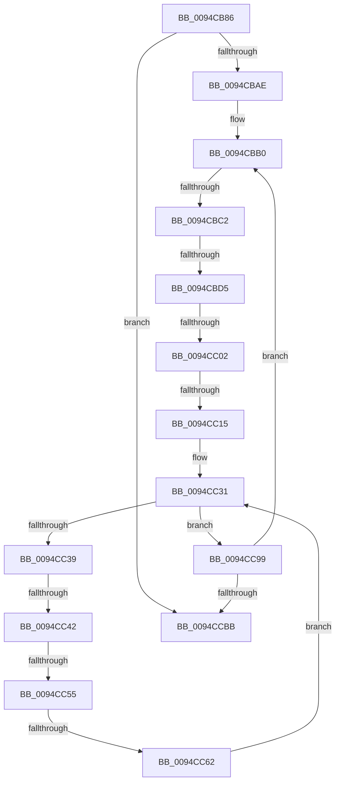

# sub_0094CB86

- RVA: `0x0094CB86`–`0x0094CCD5` (길이 `335` bytes)
- VA: `0x000000014094CB86`
- 실행 섹션: `PAGE`
- PDB 이름 있음: `아니요`; PDB Function 태그: `아니요`
- unwind 정보 RVA: `0x000915A0`
- 디코드: `76`개 명령, `335/335` bytes 표시
- 미해석 바이트: `0` (있으면 어셈블리에 `.byte`로 보존)

> 이 문서는 커널 이미지의 기계어와 PDB 기호를 분석해 생성했습니다. 4번과 5번은 함수 원형과 자료형을 바이너리 사용 방식에서 추정한 C 해석이며 원본 소스 복구 결과는 아닙니다.

## 1. Dependencies

- 직접 호출 지점: **0**; 고유 호출 대상: **0**
- 직접 호출자로 확인된 함수: **0**
- RIP 상대 이미지 참조: **0**

### Outgoing calls
- 직접 디코드된 call 명령이 없습니다.

### Direct callers
- 이 함수 시작 RVA로 연결되는 직접 call은 확인되지 않았습니다. 간접 호출은 완전히 역산할 수 없습니다.

### Static image references
- 디코드된 RIP-relative 메모리 참조가 없습니다.

## 2. Other-region calls and transfers

- 다른 실행 섹션으로 향하는 call: **0**
- call이 아닌 외부 분기/꼬리 이동: **8**
  - `0x0094CBBC` → [sub_0094CD40 + 0x4C](Unknown_function_0094CD40.md) (`tail-transfer`)
  - `0x0094CBCF` → [sub_0094CD40 + 0x32](Unknown_function_0094CD40.md) (`tail-transfer`)
  - `0x0094CBFC` → [sub_0094CD40 + 0x54](Unknown_function_0094CD40.md) (`tail-transfer`)
  - `0x0094CC0F` → [sub_0094CD40 + 0x3F](Unknown_function_0094CD40.md) (`tail-transfer`)
  - `0x0094CC3C` → [sub_0094D08D + 0x2C](Unknown_function_0094D08D.md) (`tail-transfer`)
  - `0x0094CC4F` → [sub_0094CD40](Unknown_function_0094CD40.md) (`tail-transfer`)
  - `0x0094CC5C` → [sub_0094CD40](Unknown_function_0094CD40.md) (`tail-transfer`)
  - `0x0094CCCF` → [sub_0094D04A + 0x11](Unknown_function_0094D04A.md) (`tail-transfer`)

## 3. Assembly (complete function range)

```asm
0094CB86  4C 89 6C 24 78                  mov qword ptr [rsp + 0x78], r13
0094CB8B  66 FF 88 E4 01 00 00            dec word ptr [rax + 0x1e4]
0094CB92  90                              nop
0094CB93  48 8B 45 00                     mov rax, qword ptr [rbp]
0094CB97  48 89 44 24 58                  mov qword ptr [rsp + 0x58], rax
0094CB9C  44 89 5C 24 40                  mov dword ptr [rsp + 0x40], r11d
0094CBA1  4C 8D 68 48                     lea r13, [rax + 0x48]
0094CBA5  48 85 DB                        test rbx, rbx
0094CBA8  0F 84 0D 01 00 00               je 0x14094ccbb
0094CBAE  66 90                           nop
0094CBB0  8B 06                           mov eax, dword ptr [rsi]
0094CBB2  4C 8B C7                        mov r8, rdi
0094CBB5  49 83 E0 FC                     and r8, 0xfffffffffffffffc
0094CBB9  4C 3B C0                        cmp r8, rax
0094CBBC  0F 83 CA 01 00 00               jae 0x14094cd8c
0094CBC2  4C 8B 4E 08                     mov r9, qword ptr [rsi + 8]
0094CBC6  41 8B C1                        mov eax, r9d
0094CBC9  83 E0 03                        and eax, 3
0094CBCC  83 F8 01                        cmp eax, 1
0094CBCF  0F 85 9D 01 00 00               jne 0x14094cd72
0094CBD5  49 8B C0                        mov rax, r8
0094CBD8  48 C1 E8 0A                     shr rax, 0xa
0094CBDC  49 8B 44 C1 FF                  mov rax, qword ptr [r9 + rax*8 - 1]
0094CBE1  49 8B C8                        mov rcx, r8
0094CBE4  81 E1 FF 03 00 00               and ecx, 0x3ff
0094CBEA  4C 8D 14 88                     lea r10, [rax + rcx*4]
0094CBEE  48 8B 55 00                     mov rdx, qword ptr [rbp]
0094CBF2  4C 89 54 24 48                  mov qword ptr [rsp + 0x48], r10
0094CBF7  8B 02                           mov eax, dword ptr [rdx]
0094CBF9  4C 3B C0                        cmp r8, rax
0094CBFC  0F 83 92 01 00 00               jae 0x14094cd94
0094CC02  4C 8B 4A 08                     mov r9, qword ptr [rdx + 8]
0094CC06  41 8B C1                        mov eax, r9d
0094CC09  83 E0 03                        and eax, 3
0094CC0C  83 F8 01                        cmp eax, 1
0094CC0F  0F 85 6A 01 00 00               jne 0x14094cd7f
0094CC15  49 8B C0                        mov rax, r8
0094CC18  48 C1 E8 0A                     shr rax, 0xa
0094CC1C  49 8B 44 C1 FF                  mov rax, qword ptr [r9 + rax*8 - 1]
0094CC21  41 81 E0 FF 03 00 00            and r8d, 0x3ff
0094CC28  4A 8D 2C 80                     lea rbp, [rax + r8*4]
0094CC2C  BE 01 00 00 00                  mov esi, 1
0094CC31  81 FE 00 01 00 00               cmp esi, 0x100
0094CC37  73 60                           jae 0x14094cc99
0094CC39  45 85 E4                        test r12d, r12d
0094CC3C  0F 88 77 04 00 00               js 0x14094d0b9
0094CC42  8D 1C B5 00 00 00 00            lea ebx, [rsi*4]
0094CC49  48 03 DF                        add rbx, rdi
0094CC4C  45 85 F6                        test r14d, r14d
0094CC4F  0F 84 EB 00 00 00               je 0x14094cd40
0094CC55  41 8B C3                        mov eax, r11d
0094CC58  49 39 1C C7                     cmp qword ptr [r15 + rax*8], rbx
0094CC5C  0F 84 DE 00 00 00               je 0x14094cd40
0094CC62  48 8B 44 24 58                  mov rax, qword ptr [rsp + 0x58]
0094CC67  8B CE                           mov ecx, esi
0094CC69  48 C1 E1 04                     shl rcx, 4
0094CC6D  48 03 CD                        add rcx, rbp
0094CC70  49 89 4D 00                     mov qword ptr [r13], rcx
0094CC74  48 89 48 50                     mov qword ptr [rax + 0x50], rcx
0094CC78  4C 8D 69 08                     lea r13, [rcx + 8]
0094CC7C  48 C7 01 00 00 00 00            mov qword ptr [rcx], 0
0094CC83  4C 8B 54 24 48                  mov r10, qword ptr [rsp + 0x48]
0094CC88  FF C6                           inc esi
0094CC8A  44 8B 5C 24 40                  mov r11d, dword ptr [rsp + 0x40]
0094CC8F  4C 8B BC 24 D8 00 00 00         mov r15, qword ptr [rsp + 0xd8]
0094CC97  EB 98                           jmp 0x14094cc31
0094CC99  48 8B B4 24 C8 00 00 00         mov rsi, qword ptr [rsp + 0xc8]
0094CCA1  48 81 C7 00 04 00 00            add rdi, 0x400
0094CCA8  48 8B AC 24 E0 00 00 00         mov rbp, qword ptr [rsp + 0xe0]
0094CCB0  48 3B 7C 24 50                  cmp rdi, qword ptr [rsp + 0x50]
0094CCB5  0F 82 F5 FE FF FF               jb 0x14094cbb0
0094CCBB  48 8B 4D 00                     mov rcx, qword ptr [rbp]
0094CCBF  49 C7 45 00 00 00 00 00         mov qword ptr [r13], 0
0094CCC7  4C 8B 6C 24 78                  mov r13, qword ptr [rsp + 0x78]
0094CCCC  45 85 E4                        test r12d, r12d
0094CCCF  0F 88 86 03 00 00               js 0x14094d05b
```

## 4. C-style interpretation (structured pseudocode)

```c
__int64 __fastcall sub_0094CB86(__int64 a1, __int64 a2, __int64 a3, __int64 a4, __int64 a5, __int64 a6, __int64 a7, unsigned int a8, __int64 a9, __int64 a10, __int64 a11, __int64 a12, __int64 a13, __int64 a14, __int64 a15, __int64 a16, __int64 a17, __int64 a18, __int64 a19, __int64 a20, __int64 a21, __int64 a22, __int64 a23, __int64 a24, __int64 a25, __int64 a26, __int64 a27, __int64 a28)
{
    __int64 result;
    __int64 v_rbx;
    __int64 v_rdi;
    __int64 v_rsi;
    unsigned int v_stack_p40;
    unsigned __int64 v_stack_p48;
    unsigned __int64 v_stack_p58;
    unsigned __int64 v_stack_p78;

    v_stack_p78 = v_r13;
    v_stack_p58 = *(unsigned __int64 *)(v_rbp);
    v_stack_p40 = (unsigned int)(v_r11);
    if (v_rbx == 0) goto loc_0094CCBB;
loc_0094CBB0:
    a3 = (v_rdi) & (-4);
    result = (unsigned int)(((unsigned int)((unsigned int)(*(unsigned __int64 *)(v_rsi + 8)))) & (3));
    result = (a3) >> (10);
    a1 = (unsigned int)((a3) & (0x3FFULL));
    v_stack_p48 = *(unsigned __int64 *)(*(unsigned __int64 *)(v_rsi + 8) + result * 8 - 1) + a1 * 4;
    result = (unsigned int)(((unsigned int)((unsigned int)(*(unsigned __int64 *)(*(unsigned __int64 *)(v_rbp) + 8)))) & (3));
    result = (a3) >> (10);
    a3 = (unsigned int)((a3) & (0x3FFULL));
loc_0094CC31:
    if (1 >= 256) goto loc_0094CC99;
    v_rbx = (1 * 4) + (v_rdi);
    a1 = (1) << (4);
    a1 = (a1) + (*(unsigned __int64 *)(*(unsigned __int64 *)(*(unsigned __int64 *)(v_rbp) + 8) + result * 8 - 1) + a3 * 4);
    *(unsigned __int64 *)(*(unsigned __int64 *)(v_rbp) + 72) = a1;
    *(unsigned __int64 *)(a11 + 80) = a1;
    *(unsigned __int64 *)(a1) = 0;
    v_rsi = (unsigned int)((1) + 1);
    goto loc_0094CC31;
loc_0094CC99:
    v_rdi = (v_rdi) + (0x400ULL);
    if (v_rdi < a10) goto loc_0094CBB0;
loc_0094CCBB:
    *(unsigned __int64 *)(a1 + 8) = 0;
}
```

## 5. (Beta) C Style

```c
int64_t sub_0094CB86(int64_t Arg1, int64_t Arg2, int64_t Arg3, int64_t Arg4, uint64_t Arg5, uint64_t Arg6, uint64_t Arg7, uint32_t Arg8, int64_t Arg9, int64_t Arg10, void *Arg11, uint64_t Arg12, uint64_t Arg13, uint64_t Arg14, int64_t Arg15, uint64_t Arg16, uint64_t Arg17, uint64_t Arg18, uint64_t Arg19, uint64_t Arg20, uint64_t Arg21, uint64_t Arg22, uint64_t Arg23, uint64_t Arg24, int64_t Arg25, uint64_t Arg26, int64_t Arg27, int64_t Arg28)
{
    uint8_t *arg11 = (uint8_t *)Arg11;

    int64_t result;
    int64_t local_rbx;
    int64_t local_rdi;
    int64_t local_rsi;
    uint32_t v_stack_p40;
    uint64_t v_stack_p48;
    uint64_t v_stack_p58;
    uint64_t v_stack_p78;

    v_stack_p78 = local_r13;
    v_stack_p58 = *(uint64_t *)(local_rbp);
    v_stack_p40 = (uint32_t)(local_r11);
    if (local_rbx == 0) goto loc_0094CCBB;
loc_0094CBB0:
    Arg3 = (local_rdi) & (-4);
    result = (uint32_t)(((uint32_t)((uint32_t)(*(uint64_t *)(local_rsi + 0x8)))) & (3));
    result = (Arg3) >> (10);
    Arg1 = (uint32_t)((Arg3) & (0x3FFULL));
    v_stack_p48 = *(uint64_t *)(*(uint64_t *)(local_rsi + 0x8) + result * 8 - 0x1) + Arg1 * 4;
    result = (uint32_t)(((uint32_t)((uint32_t)(*(uint64_t *)(*(uint64_t *)(local_rbp) + 0x8)))) & (3));
    result = (Arg3) >> (10);
    Arg3 = (uint32_t)((Arg3) & (0x3FFULL));
loc_0094CC31:
    if (1 >= 256) goto loc_0094CC99;
    local_rbx = (1 * 4) + (local_rdi);
    Arg1 = (1) << (4);
    Arg1 = (Arg1) + (*(uint64_t *)(*(uint64_t *)(*(uint64_t *)(local_rbp) + 0x8) + result * 8 - 0x1) + Arg3 * 4);
    *(uint64_t *)(*(uint64_t *)(local_rbp) + 0x48) = Arg1;
    *(uint64_t *)(arg11 + 0x50) = Arg1;
    *(uint64_t *)(Arg1) = 0;
    local_rsi = (uint32_t)((1) + 1);
    goto loc_0094CC31;
loc_0094CC99:
    local_rdi = (local_rdi) + (0x400ULL);
    if (local_rdi < Arg10) goto loc_0094CBB0;
loc_0094CCBB:
    *(uint64_t *)(Arg1 + 0x8) = 0;
}
```

### 관측된 메모리 오프셋

구조체 형식이 확인되지 않은 접근은 인자 기준의 오프셋으로만 기록했습니다.

| 기준 인자 | 오프셋 표현 | 폭 (bit) | 접근 |
|---|---:|---:|---|
| `Arg11` | `+ 0x50` | `64` | `W` |

## 6. Execution-region graph

[열기: 2D/3D 그래프와 함수 탐색 컨트롤 패널](../../../control-panel.html?section=page&rva=0x0094CB86&view=graph)

- 2D 그래프는 위에서 아래로 흐르고, 3D 그래프는 빈 공간을 드래그해 회전합니다. Shift+드래그는 이동, 휠은 확대·축소, 함수 노드 선택은 대상 보고서 이동입니다.

### Static fallback


